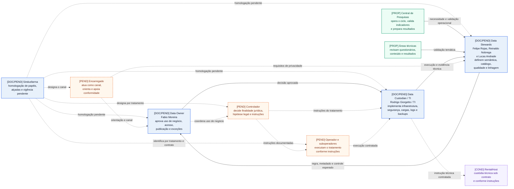

<Table>
  <tr>
    <td><a href= "link"></td>
    <td>
      <a href= "https://www.inteli.edu.br/"></a>
    </td>
  </tr>
</table>

# Governança de Dados do Projeto — Central de Pesquisas do Sindusfarma

## Nome do Grupo: Synapse

## Integrantes:

- <a href="https://www.linkedin.com/in/anna-riciopo/">Anna Riciopo</a>
- <a href="https://www.linkedin.com/in/karine-paixao/">Karine Paixão</a>
- <a href="https://www.linkedin.com/in/lucas-nunes-matheus/">Lucas Nunes Matheus</a>
- <a href="https://www.linkedin.com/in/marlos-do-carmo-guedes-366987250/">Marlos Guedes</a>
- <a href="https://www.linkedin.com/in/milena-castro-vieira/">Milena Castro Vieira</a>
- <a href="https://www.linkedin.com/in/otavio-vasc/">Otávio Vasconcelos</a>
- <a href="https://www.linkedin.com/in/vitor-balbo/">Vitor Balbo</a>

# Sumário

- [1. Estrutura Organizacional da Governança](#1-estrutura-organizacional-da-governança)
  - [1.1 Estado das atribuições](#11-estado-das-atribuições)
  - [1.2 Papéis fundamentais](#12-papéis-fundamentais)
  - [1.3 Encadeamento das decisões](#13-encadeamento-das-decisões)
  - [1.4 Homologações pendentes](#14-homologações-pendentes)
  - [1.5 Mapa funcional da governança de dados](#15-mapa-funcional-da-governança-de-dados)
  - [1.6 Matriz de responsabilidades por domínio](#16-matriz-de-responsabilidades-por-domínio)
  - [1.7 Regras de aplicação da matriz](#17-regras-de-aplicação-da-matriz)
  - [1.8 Atribuições internas, externas e cadeia de custódia](#18-atribuições-internas-externas-e-cadeia-de-custódia)
    - [1.8.1 Interfaces de responsabilidade na custódia](#181-interfaces-de-responsabilidade-na-custódia)
    - [1.8.2 Confirmações externas pendentes](#182-confirmações-externas-pendentes)
- [2. Política de Qualidade de Dados](#2-política-de-qualidade-de-dados)
  - [2.1 Atributos de qualidade](#21-atributos-de-qualidade)
  - [2.2 Métricas e procedimentos de mensuração](#22-métricas-e-procedimentos-de-mensuração)
  - [2.3 Metas mínimas e limiares de tolerância](#23-metas-mínimas-e-limiares-de-tolerância)
  - [2.4 Indicadores (KPIs) de qualidade](#24-indicadores-kpis-de-qualidade)
  - [2.5 Fluxo de ações corretivas](#25-fluxo-de-ações-corretivas)
  - [2.6 Regras de validação na ingestão](#26-regras-de-validação-na-ingestão)
  - [2.7 Auditoria e monitoramento contínuo](#27-auditoria-e-monitoramento-contínuo)
  - [2.8 Tratamento de inconformidades e registros duplicados](#28-tratamento-de-inconformidades-e-registros-duplicados)
- [3. Gestão de Metadados e Catálogo](#3-gestão-de-metadados-e-catálogo)
  - [3.1 Estado e objetivo do catálogo](#31-estado-e-objetivo-do-catálogo)
  - [3.2 Estratégia e fontes de verdade](#32-estratégia-e-fontes-de-verdade)
  - [3.3 Busca, reutilização, descoberta e rastreabilidade](#33-busca-reutilização-descoberta-e-rastreabilidade)
  - [3.4 Metadados obrigatórios](#34-metadados-obrigatórios)
  - [3.5 Atualização e versionamento](#35-atualização-e-versionamento)
  - [3.6 Exemplo de catálogo: FATO_CICLO_PESQUISA](#36-exemplo-de-catálogo-fato_ciclo_pesquisa)
  - [3.7 Escopo dos cubos e limitações do catálogo](#37-escopo-dos-cubos-e-limitações-do-catálogo)
  - [3.8 Integração com qualidade, proteção e acesso](#38-integração-com-qualidade-proteção-e-acesso)
- [4. Classificação e Proteção de Dados](#4-classificação-e-proteção-de-dados)
- [5. Segurança e Acesso](#5-segurança-e-acesso)
- [6. Ciclo de Vida dos Dados](#6-ciclo-de-vida-dos-dados)
- [7. Avaliação de Maturidade](#7-avaliação-de-maturidade)

# 1. Estrutura Organizacional da Governança

Esta seção define os papéis que decidem, especificam e executam a governança de
dados da Central de Pesquisas. Ela usa como baseline a
[Arquitetura de Negócio](arquitetura-de-negocio.md#8-pilar-4--estrutura-organizacional),
o [Data Model Canvas](dmc.json) e a
[estrutura registrada na documentação geral](projeto.md#662-estrutura-de-governança-de-dados-da-central-de-pesquisas).
Essas fontes confirmam documentalmente os nomes abaixo, mas não comprovam que o
Sindusfarma já formalizou as designações ou implantou as responsabilidades.

## 1.1 Estado das atribuições

O documento distingue três estados para não transformar uma referência do
projeto em política vigente:

- **confirmado documentalmente:** nome ou papel registrado na Arquitetura de
  Negócio e no baseline do Data Model Canvas;
- **responsabilidade proposta:** atribuição definida pelo grupo para o desenho
  de governança da solução;
- **pendente de homologação:** designação, autoridade ou procedimento que o
  parceiro ainda precisa aprovar antes da operação.

Data Owner, Data Steward e Data Custodian são papéis organizacionais de
governança. Eles não equivalem automaticamente a controlador, operador,
suboperador ou encarregado da LGPD. O Sindusfarma deve identificar esses agentes
legais de acordo com cada tratamento, contrato e fluxo de dados.

## 1.2 Papéis fundamentais

| Papel | Referência documental | Autoridade e responsabilidade propostas | Limites do papel |
| :--- | :--- | :--- | :--- |
| **Data Owner** | Fabio Moreira | Responder pelo domínio de negócio; aprovar finalidade de negócio, uso pretendido, prioridade, indicadores, classificação, perfis de acesso, publicação, exceções e risco residual. | Não recebe acesso administrativo por ocupar o papel e não substitui automaticamente o controlador ou o encarregado da LGPD. |
| **Data Steward** | Felipe Rojas, Reinaldo Nobrega e Lucas Andrade | Definir significado, catálogo, dicionário, regras de qualidade, completude, reconciliação e linhagem; acompanhar inconformidades e propor correções. | Não aprova sozinho novo uso de negócio, finalidade jurídica, exposição externa ou aceitação de risco estratégico; ele prepara a decisão organizacional e a evidência para o papel legal aplicável. |
| **Data Custodian / TI** | Rodrigo Giorgetto / TI | Administrar infraestrutura, ingestão, armazenamento, credenciais, backups, logs, disponibilidade e controles técnicos conforme as decisões aprovadas. | Não define uso de negócio, finalidade jurídica, regra de negócio ou publicação e só acessa conteúdo protegido quando a atividade técnica exigir, com autorização e auditoria. |

A RentalHost aparece no baseline como custodiante externo quando operar o
sistema interno ou o repositório público. Essa participação depende do contrato
e das instruções aprovadas. A empresa executa a custódia contratada, mas não
decide por conta própria a finalidade do tratamento, a regra de qualidade ou a
publicação de resultados.

## 1.3 Encadeamento das decisões

Os papéis se complementam sem concentrar decisão de negócio e execução técnica
na mesma função. O fluxo proposto é:

```text
Central de Pesquisas ou área técnica identifica a necessidade
    ↓
Data Steward define significado, regra de qualidade e impacto nos dados
    ↓
Data Owner aprova uso de negócio, acesso, exceção ou publicação
    ↓
Data Custodian / TI implementa o controle e registra a execução
    ↓
Data Steward ou Data Owner verifica o resultado conforme a regra aplicável
```

O Data Custodian pode bloquear tecnicamente uma operação insegura ou fora da
política, mas não pode autorizar um novo uso de negócio ou tratamento. O Data Steward pode
reprovar um dado que não atende à regra registrada, mas uma exceção com impacto
de negócio ou publicação retorna ao Data Owner. A separação preserva a
segregação de funções adotada nas políticas de qualidade, classificação e
acesso das Seções 2, 4 e 5. No encerramento de uma ação corretiva, o validador
segue a severidade definida na Seção 2.5. Na validação do encerramento ou em
exceções, casos críticos e baixos envolvem o Data Owner; a execução permanece
com Steward, Custodian ou responsável pela origem conforme a matriz daquele
fluxo.

## 1.4 Homologações pendentes

| Decisão a confirmar | Evidência atual | Condição para tratar como vigente |
| :--- | :--- | :--- |
| Designação nominal de Owner, Stewards e Custodian | Nomes registrados na Arquitetura de Negócio e no baseline do DMC | Aprovação formal do Sindusfarma com escopo, autoridade, substitutos e data de vigência. |
| Controlador, operador, suboperadores e encarregado | Não definidos pelos papéis organizacionais | Inventário de cada tratamento e validação jurídica ou organizacional pelo parceiro. |
| Participação da RentalHost | Custódia externa indicada no baseline | Contrato e inventário que identifiquem dados, ambiente, instruções, acesso, retenção, auditoria e descarte. |
| Concessão de acesso excepcional aos dados protegidos | Matrizes propostas nas Seções 4 e 5 | Procedimento aprovado com solicitante, aprovador, finalidade, prazo, log e revisão posterior. |

Até essas confirmações, a estrutura desta seção é o desenho de governança do
projeto. Ela não comprova a implantação dos papéis ou dos controles no ambiente
produtivo do Sindusfarma.

## 1.5 Mapa funcional da governança de dados

O diagrama representa **relações funcionais de decisão e execução; não
representa organograma empregatício** nem designação jurídica. Os nomes nos
nós azuis vêm do baseline documental; as atribuições e relações são propostas
do projeto. A matriz RACI da Seção 1.6 detalha a distribuição proposta de
responsabilidades quando uma relação resumida no desenho envolver mais de um
papel.



| Elemento visual | Leitura |
| :--- | :--- |
| `[DOC]`, nó azul | Nome ou papel presente no baseline documental. |
| `[DOC/PEND]`, nó azul | Nome presente no baseline, com designação e autoridade ainda sujeitas à homologação. |
| `[PROP]`, nó verde | Função operacional proposta para a Central ou para as áreas técnicas. |
| `[PEND]`, nó laranja tracejado | Papel jurídico pendente; controlador, operador/suboperador e encarregado preservam funções distintas. |
| `[COND]`, nó roxo tracejado | Participação externa condicionada a contrato e instruções. |
| Seta contínua | Interface funcional proposta de definição, aprovação, execução ou verificação. |
| Seta tracejada | Relação pendente ou condicional; não comprova subordinação ou vínculo jurídico. |

## 1.6 Matriz de responsabilidades por domínio

A matriz usa a notação RACI: **A** responde pela decisão final, **R** executa,
**C** é consultado antes da decisão e **I** recebe a informação. A coluna LGPD
nomeia o papel aplicável para não reunir responsabilidades jurídicas distintas.
Essas responsabilidades só passam a valer depois da designação pelo
Sindusfarma para cada tratamento.

| Atividade | Data Owner | Data Steward | Central de Pesquisas | Áreas técnicas | Data Custodian / TI | Papéis LGPD a designar, conforme o tratamento | Custódia externa |
| :--- | :---: | :---: | :---: | :---: | :---: | :---: | :---: |
| Definir significado, criticidade e uso de negócio dos metadados | A | R | C | C | C | Encarregado: C quando houver risco jurídico | I |
| Definir finalidade jurídica e hipótese legal do tratamento pessoal | C quanto ao uso de negócio | R na documentação e evidência | C | C | I | Controlador: A/R na decisão; operador/suboperador: R conforme instrução; encarregado: C/I | I |
| Manter catálogo semântico, dicionário, regras e linhagem | A | R | C | C | C | Encarregado: I | I |
| Manter metadados técnicos de origem, carga, versão e armazenamento | I | A quanto à coerência com o catálogo | I | I | R | Operador/suboperador: R técnico conforme instrução | R técnico sob contrato |
| Definir e acompanhar regras de qualidade | A | R | C | C | C | Controlador ou encarregado: C quando o desvio afetar o tratamento | C na fonte sob contrato |
| Corrigir origem, validar, colocar em quarentena e reingerir | A somente para exceção ou impacto relevante | A pela regra e pelo encerramento aplicável | R quando controlar a fonte | R quando controlar a fonte | R na execução técnica | Operador/suboperador: R conforme instrução; encarregado: C | R técnico sob contrato |
| Classificar dados e revisar risco de reidentificação | A quanto ao uso de negócio e à exposição | R | C | C | R na aplicação técnica | Controlador: A quanto ao tratamento; encarregado: C; operador/suboperador: R técnico | C |
| Administrar perfis, autenticação, camadas, logs e backups | A quanto à política e às exceções | C | I | I | R | Controlador: A quanto ao tratamento; operador/suboperador: R; encarregado: C | R na infraestrutura contratada |
| Tratar desvios, exceções e risco residual | A quanto ao negócio | R | C | C | R técnico | Controlador: A na decisão legal; operador/suboperador: R conforme instrução; encarregado: C | R técnico se a causa estiver no serviço contratado |
| Aprovar e disponibilizar resultados | A quanto ao uso de negócio e à publicação | R na classificação, linhagem e proteção | C sobre o sentido do resultado | C na validação temática | R na disponibilização | Controlador: A quando houver decisão legal; encarregado: C; operador/suboperador: R técnico | R técnico somente na publicação sob contrato |
| Auditar conformidade e atender direitos dos titulares | C | R na evidência, inventário e rastreabilidade | C | C | R na propagação, nos logs e na retenção técnica | Controlador: A; encarregado: R como canal; operador/suboperador: R conforme instrução | R técnico conforme instrução e contrato |

## 1.7 Regras de aplicação da matriz

- **Metadados semânticos e técnicos:** o Data Steward mantém significado,
  domínio, criticidade, regra de qualidade e linhagem. O Data Custodian mantém
  origem técnica, execução da carga, armazenamento, versão e logs. Mudança que
  altere uso de negócio ou indicador retorna ao Data Owner; mudança no
  tratamento pessoal também exige a decisão do controlador designado.
- **Qualidade:** detecção, correção, validação e escalonamento seguem a matriz de
  severidade da Seção 2.5. A marca `A` desta matriz não transforma o Data Owner
  em executor das correções rotineiras.
- **Segurança:** o Data Owner aprova política, perfis e exceções; o Data Steward
  classifica o dado; o Data Custodian implementa acesso, autenticação, camadas,
  backup e auditoria. Acesso emergencial exige prazo, justificativa, log e
  revisão posterior.
- **Compliance e LGPD:** controlador, operador, suboperador e encarregado
  continuam pendentes de designação. O controlador decide a finalidade
  jurídica e emite instruções; operador e suboperador executam o tratamento
  dentro dessas instruções; o encarregado atua como canal, orienta e apoia a
  conformidade. Até essa definição, nenhum nome desta seção recebe
  responsabilidade jurídica por inferência.
- **Custódia externa:** fornecedor executa somente o que contrato e instruções
  autorizarem. Escopo de acesso, retenção, auditoria, devolução e descarte devem
  constar do inventário antes da operação. O fornecedor não aprova finalidade,
  hipótese legal, classificação, exceção, publicação ou resposta ao titular.
- **Proteção do catálogo:** metadados não são públicos por definição. Objetivos,
  enunciados, contatos, chaves de relacionamento e informações de origem herdam
  a classificação e a restrição do dado que descrevem.

As atribuições da matriz são responsabilidades propostas pelo grupo. Os nomes
da Seção 1.2 permanecem como baseline documental, e a vigência operacional
depende das homologações listadas na Seção 1.4.

## 1.8 Atribuições internas, externas e cadeia de custódia

A tabela a seguir liga cada participante ao trecho do ciclo em que atua. Ela
não converte presença em uma ferramenta ou contrato em responsabilidade
jurídica: a atribuição legal depende do tratamento realizado e das designações
pendentes da Seção 1.4.

| Ator ou grupo | Dados, sistemas ou etapa | Responsabilidade no desenho | Limite e estado da evidência |
| :--- | :--- | :--- | :--- |
| **Central de Pesquisas** | Solicitações, pesquisas, questionários, indicadores e resultados | Operar o ciclo, registrar necessidades, validar indicadores, solicitar correções e preparar resultados para aprovação. | Atuação confirmada no TAPI e na Arquitetura de Negócio; não aprova sozinha exposição externa, exceção de acesso ou risco residual. |
| **Fabio Moreira / Data Owner** | Uso de negócio, prioridades, perfis, indicadores e publicação | Aprovar o uso de negócio, os perfis, a publicação e as exceções sob sua alçada. | Nome no baseline documental; autoridade formal ainda depende de homologação. Não administra infraestrutura nem recebe papel LGPD por inferência. |
| **Felipe Rojas, Reinaldo Nobrega e Lucas Andrade / Data Stewards** | Catálogo, dicionário, qualidade, linhagem e significado | Definir regras, documentar metadados, acompanhar inconformidades e validar a coerência do dado. | Papéis derivados do DMC e da Arquitetura; não autorizam sozinhos novo uso de negócio, finalidade jurídica ou exposição externa. O TAPI registra o nome completo **Felipe Fernandes Rojas**; a equivalência com “Felipe Rojas” deve ser confirmada. |
| **Rodrigo Giorgetto / TI / Data Custodian** | Banco, integrações, credenciais, camadas, backups e logs | Executar ingestões e controles técnicos; manter disponibilidade, trilha de execução, recuperação e descarte autorizado. | Nome presente no DMC e na Arquitetura, não localizado no TAPI; escopo por ambiente e suplência precisam ser homologados. Não decide finalidade ou publicação. |
| **Áreas técnicas** | Questionários, conteúdo temático e resultados agregados | Revisar conteúdo, regras temáticas e interpretação dos resultados quando consultadas. | Participação documentada; não implica custódia técnica nem acesso a identidade sem necessidade e autorização. |
| **Empresas e respondentes** | Dados cadastrais, participação e respostas | Fornecer dados e receber resultados compatíveis com autorização e perfil. | Respondentes podem ser titulares de dados pessoais; empresas são fontes ou consumidoras conforme o fluxo. Nenhum deles se torna custodiante ou responsável técnico por participar da pesquisa. |
| **RentalHost** | Sistema interno ou repositório hospedado, se contratados | Executar custódia técnica, disponibilidade, logs, backup, devolução e descarte conforme instruções documentadas. | Participação condicional, citada no DMC e na Arquitetura; contrato e escopo não foram localizados. Não decide finalidade, hipótese legal, classificação ou publicação. |
| **SurveyMonkey, Trello, Outlook, n8n e provedor de nuvem** | Coleta, tarefas, comunicação, automação e hospedagem, conforme o serviço | Executar somente a função configurada e contratada; fornecer evidência técnica e apoiar exportação, correção ou eliminação quando aplicável. | Ferramentas confirmadas no TAPI, mas dados efetivamente tratados, região, retenção, subcontratação e papéis LGPD ainda dependem de inventário e contrato. O provedor de nuvem ainda não foi escolhido. |
| **Provedor de LLM a definir** | Otimização ou análise futura que venha a usar modelo externo | Processar apenas o conteúdo mínimo autorizado, com registro de finalidade, versão do serviço e evidência de envio. | O TAPI prevê uso de LLM, mas não identifica provedor, conteúdo enviado, região, retenção ou contrato; nenhum envio de dado pessoal é pressuposto. |
| **Controlador, operadores, suboperadores e encarregado** | Cada tratamento que envolva dados pessoais | Controlador decide finalidade jurídica, hipótese legal e instruções; operadores e suboperadores executam o tratamento conforme instruções; encarregado atua como canal e apoia orientação, direitos dos titulares e incidentes. | Papéis pendentes de designação pelo Sindusfarma; não equivalem automaticamente a Owner, Steward, Custodian ou fornecedor. |

### 1.8.1 Interfaces de responsabilidade na custódia

| Interface | Quem entrega ou solicita | Quem executa | Quem aprova ou valida | Evidência mínima exigida |
| :--- | :--- | :--- | :--- | :--- |
| Fonte operacional → `staging` | Central, área técnica ou integração autorizada | Data Custodian/TI; fornecedor somente sob contrato | Data Steward valida estrutura e classificação | Fonte, arquivo ou evento, data, responsável, hash ou identificador da carga, classificação e resultado da validação. |
| `staging` → `trusted` | Data Steward fornece regras e pendências | Data Custodian/TI executa padronização, quarentena e reprocessamento | Data Steward valida qualidade; Data Owner decide exceção relevante | Versão da regra, contagens de entrada/saída, rejeições, reconciliações, execução e aprovador da exceção. |
| `trusted` → `analytics` | Central define a necessidade analítica; Steward mantém semântica | Data Custodian/TI materializa fatos, dimensões e agregações | Data Steward valida cálculo e linhagem; Data Owner aprova o uso de negócio; controlador decide a compatibilidade jurídica quando houver dado pessoal; encarregado orienta | Versão do modelo, grão, fontes, fórmula, teste de qualidade, classificação e data da atualização. |
| `analytics` → publicação | Central ou área técnica prepara resultado | Data Custodian/TI ou custodiante externo disponibiliza; operador/suboperador atua somente conforme instrução | Data Owner aprova a publicação de negócio; controlador decide as condições jurídicas quando houver dado pessoal; encarregado orienta | Versão, recorte, teste de agregação ou anonimização, aprovadores, destino, data e procedimento de retirada. |
| Correção, incidente ou direito do titular | Central, titular, auditoria ou monitoramento registra a demanda | Custodian, operador, suboperador e fornecedores propagam a ação nos ambientes sob sua custódia e conforme instruções | Steward comprova linhagem; controlador decide o aspecto legal; encarregado atua como canal e acompanha o atendimento | Protocolo, escopo, sistemas afetados, logs, prazo, resultado, exceções e encerramento aprovado. |

### 1.8.2 Confirmações externas pendentes

Antes de considerar a cadeia implantada, o inventário de fornecedores deve
confirmar para cada serviço: entidade contratada, dados e ambientes abrangidos,
papel LGPD, região de processamento, subcontratados, perfis administrativos,
criptografia, logs, resposta a incidentes, retenção, backup, devolução,
portabilidade e descarte. Também permanecem pendentes a confirmação nominal dos
papéis internos, o alcance da responsabilidade de TI por ambiente e o destino
do repositório público. Ausência dessas respostas é registrada como lacuna de
governança, não preenchida por suposição do grupo.

# 2. Política de Qualidade de Dados

A Política de Qualidade de Dados define quais atributos de qualidade são monitorados no acervo de pesquisas e no banco de dados relacional, como cada um é medido, quais metas e indicadores (KPIs) acompanham a saúde do dado, e como a equipe reage quando a qualidade sai do aceitável. As definições partem do diagnóstico realizado na Sprint 1 sobre as bases disponibilizadas (completude e duplicidade medidas por base e variável) e seguem as dimensões de qualidade consagradas no DAMA-DMBOK 2.0.

A seção está organizada da definição à operação: primeiro **o que** se monitora (2.1 atributos), depois **como** se mede (2.2 métricas), **até onde** se aceita (2.3 metas e limiares), **o que se acompanha** no dashboard (2.4 KPIs), e por fim **como se reage e se previne** o desvio (2.5 ações corretivas, 2.6 validação na ingestão, 2.7 auditoria contínua e 2.8 tratamento de inconformidades).

## 2.1 Atributos de qualidade

Atributo de qualidade é a dimensão sob a qual a confiabilidade de um dado é avaliada. O projeto adota cinco atributos, selecionados a partir das dimensões do DAMA-DMBOK 2.0 e priorizados pelo que o diagnóstico da Sprint 1 mostrou ser crítico para o acervo de pesquisas: cada um responde por um tipo distinto de risco sobre os indicadores que a solução vai calcular (adesão, tempos de ciclo, representatividade). Um mesmo registro pode estar completo mas impreciso, ou único mas desatualizado — por isso os atributos são monitorados de forma independente.

<div align="center">
<sub>Tabela X - Atributos de qualidade monitorados no projeto</sub><br>

| Atributo | Definição | Relevância para o acervo de pesquisas | Bases/variáveis mais sensíveis |
| :--- | :--- | :--- | :--- |
| **Acurácia** | O valor registrado corresponde ao fato real que ele representa. | Garante que os indicadores (adesão, tempos, participação) reflitam a realidade das pesquisas, e não erros de digitação ou de conversão de tipo. | Medidas de mercado (`part_mercado`) armazenadas como texto; datas do ciclo em `pesquisas.csv`. |
| **Completude** | Proporção de campos preenchidos onde o preenchimento é exigido. | Campos obrigatórios vazios inviabilizam KPIs; distingue-se ausência **condicional** (estrutural e esperada) de ausência **problemática**. | `data_aprov` (94,5% nula) em `pesquisas.csv`; campos de contato em `clientes.csv`. |
| **Atualidade** | O dado reflete o estado mais recente do processo (defasagem temporal baixa). | Status e datas do ciclo precisam estar atualizados para o acompanhamento operacional em tempo quase real. | Campo de status e marcos de data das pesquisas em andamento. |
| **Consistência** | O mesmo dado é coerente entre as diferentes bases e ao longo do tempo. | Identificadores e domínios precisam bater entre as fontes, senão o cruzamento (drill-across) produz dupla contagem ou órfãos. | `id_cliente` (texto em `clientes.csv`, inteiro em `respondentes.csv`); domínio de país. |
| **Unicidade** | Ausência de duplicidades indevidas de um mesmo registro. | Contagens de empresas, respondentes e respostas só são confiáveis sem duplicatas — base para adesão e representatividade. | Chaves naturais de `empresas.csv`, `clientes.csv` e `respondentes.csv`. |

<sup>Material produzido pelos autores (2026)</sup>

</div><br>

**Ausência condicional × problemática.** No atributo de completude, nem todo campo vazio é defeito: há ausências **estruturais** — por exemplo, atributos de matriz que só existem para questões do tipo matriz — que são esperadas e não contam como erro. A política só trata como problemática a ausência em campo obrigatório para o tipo de registro em questão. Essa distinção, levantada no diagnóstico da Sprint 1, evita metas de completude artificialmente pessimistas e é a base para as métricas da seção 2.2.

## 2.2 Métricas e procedimentos de mensuração

Cada atributo definido em 2.1 é traduzido em uma métrica calculável sobre as bases de pesquisas, clientes, empresas, respondentes, questões e respostas. Uma métrica só é útil se tiver **fórmula, unidade e granularidade** explícitas — por isso cada uma é especificada com o denominador de referência (o universo esperado) e o nível em que é apurada (por campo, por base ou por relacionamento entre bases).

<div align="center">
<sub>Tabela X - Métricas de mensuração da qualidade por atributo</sub><br>

| Atributo | Métrica | Fórmula | Unidade | Granularidade |
| :--- | :--- | :--- | :--- | :--- |
| **Completude** | Percentual de completude | `(registros preenchidos ÷ registros esperados) × 100` | % | Por campo obrigatório de cada base |
| **Unicidade** | Taxa de duplicidade | `(registros duplicados ÷ total de registros) × 100` | % | Por base, sobre a chave natural/composta |
| **Consistência** | Taxa de conformidade referencial | `(chaves com correspondência na base de origem ÷ total de chaves) × 100` | % | Por relacionamento (ex.: `respostas`→`empresas`) |
| **Acurácia** | Percentual de valores válidos por regra | `(valores que passam nas regras de negócio ÷ total avaliado) × 100` | % | Por campo com regra definida |
| **Atualidade** | Defasagem temporal | `data de referência − data do último evento registrado` | dias úteis | Por registro em aberto (mediana no dashboard) |

<sup>Material produzido pelos autores (2026)</sup>

</div><br>

**Convenção do denominador (registros esperados).** Para a completude, o denominador não é o total de linhas da base, e sim o total de linhas em que o campo é **obrigatório para aquele tipo de registro** — coerente com a distinção condicional × problemática da seção 2.1. Assim, um atributo que só se aplica a questões do tipo matriz não penaliza a métrica das demais.

**Rotina de extração.** As métricas são apuradas sobre a **camada tratada** do pipeline (dados já tipados e padronizados), nunca sobre a camada bruta — que contém chaves órfãs, nulos e tipos inconsistentes que distorceriam a medição. A rotina roda a cada carga (ingestão incremental) e, adicionalmente, em varredura completa programada (ver periodicidade em 2.7), gravando o resultado num histórico de qualidade que alimenta os KPIs da seção 2.4 e serve de trilha de auditoria.

**Exemplo aplicado (linha de base da Sprint 1).** A completude de `data_aprov` em `pesquisas.csv` mediu ~5,5% (94,5% nula); a taxa de duplicidade das seis bases mediu 0%. Esses dois números são a linha de base concreta que calibra as metas da seção 2.3.

## 2.3 Metas mínimas e limiares de tolerância

Uma métrica sem meta não governa nada: é preciso dizer **a partir de qual valor o dado é aceitável** e **em que ponto a equipe é acionada ou a ingestão é barrada**. Esta seção fixa, para cada métrica da 2.2, três referências — a meta mínima (nível desejado), o limiar de alerta (dispara a ação corretiva da seção 2.5) e o limiar de bloqueio (barra a gravação na ingestão, seção 2.6). As metas são **provisórias**: foram calibradas pela linha de base medida na Sprint 1 e serão renegociadas com o parceiro à medida que o histórico de qualidade amadurecer.

<div align="center">
<sub>Tabela X - Metas mínimas e limiares de tolerância por métrica</sub><br>

| Métrica | Meta mínima | Limiar de alerta | Limiar de bloqueio | Justificativa da calibragem |
| :--- | :--- | :--- | :--- | :--- |
| Completude de campo obrigatório | ≥ 95% | < 95% | < 80% em campo crítico | Linha de base heterogênea; campos como `data_aprov` exigem exceção documentada (ver nota). |
| Taxa de duplicidade | 0% | > 0% | > 0% em chave natural | Diagnóstico da Sprint 1 mediu 0% nas seis bases; qualquer duplicata é regressão. |
| Conformidade referencial | ≥ 98% | < 98% | chave órfã em campo obrigatório | Existem chaves órfãs conhecidas (pesquisa_id 424, 1116, 1139, 1147) a reconciliar. |
| Conformidade de domínio | ≥ 98% | < 98% | valor fora de domínio fechado | Categóricos (país, status) devem cair em domínio canônico. |
| Defasagem (atualidade) | dentro do ciclo da pesquisa | acima do ciclo previsto | — | Atualidade gera alerta, não bloqueio: é sinal de processo, não de dado inválido. |

<sup>Material produzido pelos autores (2026)</sup>

</div><br>

**Alerta × bloqueio.** O limiar de **alerta** sinaliza degradação e aciona o fluxo de ações corretivas (2.5) sem interromper o pipeline; o limiar de **bloqueio** impede que o registro seja gravado no banco central até correção (2.6). Nem toda métrica tem bloqueio: a atualidade, por exemplo, só gera alerta, porque um dado atrasado ainda é um dado válido — o problema está no processo, não na integridade.

**Exceção documentada (`data_aprov`).** Como a base histórica traz `data_aprov` ~94,5% nula, aplicar a meta de 95% de completude reprovaria praticamente todo o acervo legado. A política adota, para esse campo, uma **meta segmentada**: 95% para pesquisas novas (a partir da adoção do pipeline) e cobertura reportada (não meta) para o legado — todo indicador de tempo de validação derivado dele é publicado **com o número de casos**, para não sugerir precisão inexistente. Toda exceção de meta é registrada no catálogo de metadados (Seção 3).

## 2.4 Indicadores (KPIs) de qualidade

Os KPIs consolidam as métricas (2.2) e suas metas (2.3) em indicadores acompanhados nos dashboards analíticos. Separam-se em **operacionais** — acompanhados a cada carga pela equipe de dados, orientados à ação imediata — e **estratégicos** — agregados por período, voltados à leitura de tendência pela gestão. Cada KPI declara fórmula, meta de referência, forma de apresentação e o público que o consome.

<div align="center">
<sub>Tabela X - KPIs de qualidade de dados</sub><br>

| KPI | Tipo | Fórmula | Meta (ref. 2.3) | Apresentação no dashboard |
| :--- | :--- | :--- | :--- | :--- |
| Taxa de dados ausentes | Operacional | ausentes em campos obrigatórios ÷ total esperado | ≤ 5% | Cartão + série temporal por base |
| Taxa de duplicidade | Operacional | registros duplicados ÷ total | 0% | Cartão com semáforo (verde/vermelho) |
| Índice de consistência entre fontes | Operacional | chaves com correspondência ÷ total de chaves | ≥ 98% | Barra por relacionamento (ex.: `respostas`→`empresas`) |
| Índice de conformidade de domínio | Operacional | valores em domínio válido ÷ total | ≥ 98% | Barra por variável categórica |
| Tempo de defasagem (atualidade) | Operacional | mediana da defasagem dos registros abertos | dentro do ciclo | Cartão + distribuição |
| Índice geral de qualidade (IGQ) | Estratégico | média ponderada dos KPIs operacionais por base | ≥ 95% | Gauge + evolução mensal |
| Cobertura de campos críticos | Estratégico | campos críticos acima da meta ÷ total de campos críticos | ≥ 90% | Heatmap base × atributo |

<sup>Material produzido pelos autores (2026)</sup>

</div><br>

**Índice geral de qualidade (IGQ).** É o indicador estratégico de topo: uma média ponderada dos KPIs operacionais, com peso maior para os atributos que travam decisão (consistência e unicidade, que sustentam contagens de adesão e representatividade). Serve para a gestão ler a saúde do acervo num único número, sem precisar interpretar cada métrica isolada — e para comparar a evolução entre sprints e cargas.

**Semântica das cores.** A apresentação segue o código de limiares da 2.3: **verde** acima da meta mínima, **amarelo** entre a meta e o limiar de alerta, **vermelho** abaixo do limiar de alerta (ou em qualquer bloqueio ativo). Assim o dashboard comunica não só o valor, mas se ele já exige ação corretiva (2.5).

**Nota de rastreabilidade.** Cada KPI aqui referenciado é rastreável até uma pergunta de negócio e uma métrica da 2.2; a validação da aplicabilidade desses KPIs contra amostras reais das bases é objeto de verificação específica no plano de testes do projeto.

## 2.5 Fluxo de ações corretivas

Quando um KPI (2.4) cruza um limiar da seção 2.3, dispara-se um **procedimento operacional padrão (POP)** de correção. O fluxo é o mesmo independentemente do atributo violado; o que muda é a **severidade**, que determina prazo e nível de intervenção. O procedimento tem sete passos encadeados, do disparo à reavaliação:

1. **Detecção** — a rotina de mensuração (2.2) identifica a métrica fora do limiar e registra o evento no histórico de qualidade.
2. **Classificação** — o desvio recebe uma severidade (crítica / alta / média / baixa) conforme a tabela abaixo.
3. **Contenção** — nos casos de limiar de bloqueio, o lote é retido e isolado antes de qualquer gravação no banco central.
4. **Correção** — o dado é saneado na origem ou por regra de padronização documentada; nunca por edição manual não rastreada.
5. **Re-ingestão** — o registro corrigido retorna ao início do pipeline e passa novamente pelas regras de validação (2.6).
6. **Reavaliação** — o KPI é recalculado; se voltou à meta, o caso é encerrado no histórico.
7. **Escalonamento** — se o desvio persistir após a correção, **ou** se o prazo máximo da severidade estourar sem resolução, o caso sobe ao Data Owner para decisão (aceitar exceção documentada ou acionar a fonte). Um caso crítico cuja correção **depende do parceiro** (ex.: reconciliação de chave órfã) não permanece bloqueando a ingestão: os registros afetados vão para **quarentena** (retidos e isolados, sem entrar no banco central) e a decisão é escalada, evitando que uma dependência externa trave o pipeline por tempo indeterminado.

<div align="center">
<sub>Tabela X - Fluxo de ações corretivas por severidade</sub><br>

| Severidade | Gatilho (limiar da 2.3) | Ação | Prazo | Responsável (ver Seção 1) |
| :--- | :--- | :--- | :--- | :--- |
| **Crítica** | Duplicidade > 0% ou chave órfã em campo obrigatório | Bloquear ingestão do lote, isolar registros e corrigir na origem | 1 dia útil | Data Steward + Data Custodian |
| **Alta** | Completude de campo obrigatório abaixo do limiar de alerta | Sinalizar, completar na origem e reprocessar | 3 dias úteis | Data Steward |
| **Média** | Conformidade de domínio/referencial abaixo do limiar | Padronizar valores e registrar regra de saneamento | 5 dias úteis | Data Steward |
| **Baixa** | Defasagem de atualidade fora do esperado | Revisar rotina de atualização da fonte | Próximo ciclo | Data Owner |

<sup>Material produzido pelos autores (2026)</sup>

</div><br>

**Encerramento e trilha.** Toda ação corretiva — gatilho, severidade, responsável, data e resultado da reavaliação — é gravada no histórico de qualidade, compondo a trilha de auditoria consolidada na seção 2.7.

**Matriz de responsáveis pelo disparo e execução.** Para que o fluxo não fique sem dono, cada severidade tem responsáveis explícitos em três momentos — **disparo** (quem detecta e classifica), **execução** (quem corrige e reingere) e **validação do encerramento** (quem confirma que o KPI voltou à meta) — com um prazo máximo de resposta. As funções remetem aos papéis da Seção 1 (Estrutura Organizacional).

<div align="center">
<sub>Tabela X - Responsáveis pelo disparo e execução das ações corretivas</sub><br>

| Severidade | Disparo (detecção/classificação) | Execução (correção/re-ingestão) | Validação do encerramento | Prazo máximo |
| :--- | :--- | :--- | :--- | :--- |
| **Crítica** | Rotina automática de monitoramento (2.7) + Data Steward | Data Custodian, sob condução do Data Steward | Data Owner | 1 dia útil |
| **Alta** | Rotina automática + Data Steward | Data Steward | Data Steward (par distinto) | 3 dias úteis |
| **Média** | Data Steward | Data Steward | Data Steward | 5 dias úteis |
| **Baixa** | Data Steward | Data Owner (revisão de processo/fonte) | Data Owner | Próximo ciclo |

<sup>Material produzido pelos autores (2026)</sup>

</div><br>

O **disparo** dos casos críticos e altos é preferencialmente automático — a rotina de monitoramento contínuo (2.7) abre a ocorrência assim que o limiar é cruzado, sem depender de inspeção manual. A **segregação de funções** (quem executa a correção não é quem valida o encerramento) é aplicada nas severidades crítica e alta, para que nenhuma correção seja dada como concluída por seu próprio autor. A aderência desses prazos à cadência operacional da Central de Pesquisas é revisada periodicamente para garantir que o fluxo seja executável, e não apenas formal.

## 2.6 Regras de validação na ingestão

As regras de validação são a primeira linha de defesa da qualidade: rodam nos **conectores de ingestão** (SurveyMonkey, planilhas Excel, repositório do site) **antes** da gravação no banco central, filtrando ou sinalizando campos inconsistentes na entrada, e não depois. Elas materializam os limiares de bloqueio da seção 2.3 e separam-se em dois tipos aplicados em ordem:

- **Validação sintática** — verifica *forma*: tipo, formato e presença do valor, sem consultar outras bases. É barata e roda primeiro, descartando o grosso dos erros de origem.
- **Validação semântica** — verifica *significado*: domínio válido, integridade referencial entre fontes e regras de negócio. Só roda sobre registros que passaram na sintática, pois depende de valores já bem formados.

<div align="center">
<sub>Tabela X - Regras de validação aplicadas na ingestão</sub><br>

| Regra | Tipo | Aplicação | Ação em caso de falha |
| :--- | :--- | :--- | :--- |
| Formato de data válido | Sintática | Campos de data do ciclo (`data_solicitacao`, `data_entrega`, ...) | Rejeitar registro e sinalizar |
| Tipo numérico onde esperado | Sintática | Medidas (participantes, market share, tempos) armazenadas como texto | Converter quando seguro; senão sinalizar |
| Preenchimento de campo obrigatório | Sintática | Campos obrigatórios por tipo de registro | Bloquear gravação até preenchimento |
| Padronização de domínio | Semântica | Categóricos (país, status, nacionalidade) | Normalizar para o valor canônico |
| Integridade referencial | Semântica | `id_empresa`, `id_cliente`, `id_pergunta` devem existir na base de origem | Sinalizar chave órfã e reter para conciliação |
| Não duplicidade | Semântica | Chave natural/composta por base | Descartar duplicata conforme regra de mesclagem (ver 2.8) |
| Coerência entre marcos temporais | Semântica | Ordem dos marcos do ciclo (solicitação ≤ aprovação ≤ entrega) | Sinalizar inconsistência de negócio |

<sup>Material produzido pelos autores (2026)</sup>

</div><br>

**Rejeitar × sinalizar × normalizar.** A ação em falha é graduada: **rejeitar** (registro não entra, típico de erro sintático grave), **sinalizar** (registro entra marcado como suspeito, para tratamento na seção 2.5 sem travar o lote inteiro) ou **normalizar** (o conector corrige automaticamente para o valor canônico, registrando a transformação). A escolha segue o limiar da 2.3: violações do limiar de bloqueio rejeitam; violações do limiar de alerta sinalizam.

**Casos herdados do diagnóstico.** As regras acima já nascem calibradas para problemas reais mapeados na Sprint 1: medidas de mercado gravadas como texto (regra de tipo numérico), `id_cliente` texto×inteiro entre `clientes.csv` e `respondentes.csv` (integridade referencial) e as chaves órfãs de pesquisa (retenção para conciliação, sem descarte). O tratamento aprofundado de duplicidade e mesclagem é detalhado na seção 2.8.

## 2.7 Auditoria e monitoramento contínuo

Qualidade não é um estado que se atinge uma vez: é uma condição que se mantém por vigilância. Esta seção define **com que frequência** as checagens rodam, **o que é registrado** para auditoria posterior e **como a equipe é avisada** antes que um desvio vire um problema de negócio. Distinguem-se dois regimes complementares: o **monitoramento contínuo** (automático, orientado a alerta imediato) e a **auditoria periódica** (programada, orientada a evidência e conformidade).

<div align="center">
<sub>Tabela X - Checagens de qualidade por periodicidade</sub><br>

| Checagem | Periodicidade | Escopo | Saída | Destinatário |
| :--- | :--- | :--- | :--- | :--- |
| Validação na ingestão (2.6) | A cada carga | Lote em ingestão | Registros aceitos/sinalizados/rejeitados | Data Custodian |
| Recálculo de KPIs (2.4) | A cada carga | Bases afetadas pela carga | Atualização do painel + alertas de limiar | Data Steward |
| Varredura completa de qualidade | Diária (programada) | Todas as bases do DW | Relatório de qualidade + histórico | Data Steward |
| Auditoria de conformidade | Mensal | Trilha de ações corretivas e exceções | Relatório de auditoria | Data Owner |

<sup>Material produzido pelos autores (2026)</sup>

</div><br>

**Monitoramento contínuo.** A cada carga, o recálculo dos KPIs (2.4) confronta cada métrica com os limiares da 2.3 e, ao cruzar um limiar de alerta, dispara automaticamente a notificação que abre o fluxo de ações corretivas (2.5) — sem esperar a varredura programada. É o que garante que um desvio seja tratado no ciclo em que aparece, não no relatório do mês seguinte.

**Histórico de qualidade (trilha de auditoria).** Toda medição e toda ação corretiva são gravadas num histórico **append-only** (somente inserção, sem sobrescrita), com data, base, métrica, valor apurado, limiar de referência e — quando houver — a ação corretiva vinculada e seu responsável. A imutabilidade é o que torna o histórico auditável: permite reconstruir o estado da qualidade em qualquer data passada e comprovar que um desvio foi tratado. Os logs seguem a política de retenção definida na Seção 6 (Ciclo de Vida dos Dados).

**Relatórios automáticos.** A varredura diária emite um relatório de qualidade (evolução dos KPIs, itens fora de meta, exceções ativas) para o Data Steward; a auditoria mensal consolida a trilha de ações corretivas e as exceções documentadas (como a de `data_aprov`, 2.3) num relatório de conformidade para o Data Owner, fechando o ciclo de accountability da política.

## 2.8 Tratamento de inconformidades e registros duplicados

O diagnóstico da Sprint 1 mediu **0% de duplicidade** nas seis bases isoladas — mas o projeto integra fontes (SurveyMonkey, Excel, repositório do site), e é na **integração** que a duplicidade nasce: a mesma empresa cadastrada em duas planilhas, o mesmo respondente com grafias diferentes. Esta seção define, de forma preventiva, como reconhecer, mesclar ou descartar duplicatas e como tratar as inconformidades já conhecidas (chaves órfãs e identidade inconsistente). O tratamento tem três etapas: **identificação** (matching), **mesclagem** (survivorship) e **descarte com registro**.

**Identificação (matching).** A detecção de duplicatas usa a chave natural de cada base; quando a chave não é confiável, aplica-se correspondência aproximada (*fuzzy*) sobre atributos identificadores, sempre com revisão antes da mesclagem definitiva.

<div align="center">
<sub>Tabela X - Política de deduplicação por base</sub><br>

| Base | Chave de deduplicação | Critério de match | Regra de mesclagem (survivorship) |
| :--- | :--- | :--- | :--- |
| `empresas.csv` | CNPJ / razão social normalizada | Exato na chave; *fuzzy* na razão social | Sobrevive o registro mais completo; consolida % de mercado e porte mais recentes |
| `clientes.csv` / `respondentes.csv` | `id_cliente` + e-mail normalizado | Exato no par; *fuzzy* em nome+empresa | Sobrevive o mais recente; preserva vínculo empresa×pessoa |
| `respostas.csv` | pesquisa + respondente + questão | Exato na tripla | Mantém a resposta mais recente; descarta reenvio |

<sup>Material produzido pelos autores (2026)</sup>

</div><br>

**Mesclagem (survivorship).** Quando dois registros representam a mesma entidade, um sobrevive e os demais são consolidados nele segundo uma regra explícita — em geral, **o mais completo** (menos campos nulos) e, em empate, **o mais recente**. Atributos ausentes no sobrevivente são preenchidos a partir dos registros mesclados; a operação é registrada no histórico de qualidade (2.7) para rastreabilidade.

**Descarte com registro.** Nenhuma duplicata é apagada silenciosamente: o registro descartado é marcado e mantido na camada bruta com referência ao registro que o absorveu, permitindo auditoria e reversão.

**Inconformidades conhecidas (não são duplicidade).** Dois casos mapeados na Sprint 1 exigem tratamento distinto, pois são falhas de integridade, não duplicatas:

- **Chaves órfãs** — `pesquisa_id` 424, 1116, 1139 e 1147 aparecem em `questoes`/`respostas` mas não em `pesquisas.csv`. Política: **preservar a chave de origem** e apontá-la para um registro **"Não mapeado"**, adiando a chave canônica até a reconciliação com o parceiro — nunca descartar o dado.
- **Identidade inconsistente** — `id_cliente` é texto em `clientes.csv` e inteiro em `respondentes.csv`. Política: normalizar o tipo na camada tratada e conciliar por chave composta (id + e-mail) antes de qualquer contagem de respondentes únicos.

Esses tratamentos alimentam a regra de não duplicidade e de integridade referencial da seção 2.6 e, quando o desvio é bloqueante, o fluxo de ação corretiva crítica da seção 2.5.

# 3. Gestão de Metadados e Catálogo

O catálogo conecta os termos usados pelo negócio às fontes, estruturas do DW,
medidas, regras de qualidade, classificação e responsáveis. Seu objetivo é
permitir que uma pessoa encontre um ativo, entenda se ele serve à decisão,
verifique sua origem e reutilize a mesma definição sem reconstruí-la por conta
própria. Metadados herdam a proteção do dado descrito; registrar uma coluna no
catálogo não a torna pública.

## 3.1 Estado e objetivo do catálogo

| Componente | Estado em 27/08/2026 | Uso nesta Sprint | Limite |
| :--- | :--- | :--- | :--- |
| Dicionário recebido | **Observado, parcial** | Documenta nove campos de `respostas.csv`. | Não cobre todas as fontes nem os objetos do DW. |
| [`dmc.json`](dmc.json) | **Confirmado documentalmente e versionado no Git** | Registra quatro cubos, grãos, fatos, medidas, dimensões, fontes, qualidade e governança. | É desenho conceitual; não comprova tabelas físicas ou pipeline implantados. |
| [`manifest.json`](../scripts/data_quality/manifest.json) | **Confirmado documentalmente e versionado no Git** | Registra contratos das fontes, chaves, domínios, relações, formatos, sentinelas e nulos condicionais. | Não é catálogo produtivo nem substitui a semântica de negócio. |
| Este documento e documentação relacionada | **Confirmado como artefato do projeto** | Mantém definições legíveis, responsabilidades, classificação, acesso e referências de linhagem. | A vigência operacional depende de homologação e implantação. |
| Git e Merge Requests | **Estratégia transitória adotada pelo grupo** | Preservam autoria, revisão, diff, versão e histórico auditável dos metadados. | Não oferecem, sozinhos, busca federada, coleta automática de schema, classificação automática ou portal de descoberta. |
| Catálogo dedicado, banco, orquestrador e SLA | **Pendentes de decisão do parceiro** | Possível evolução para coleta e descoberta automatizadas. | Nenhuma ferramenta específica é declarada como escolhida ou operante. |

O catálogo desta Sprint é, portanto, **documental e versionado**, não um serviço
produtivo. A adoção futura de DataHub, OpenMetadata ou solução equivalente só
deve ocorrer após prova de conceito e decisão do Sindusfarma. A avaliação deve
considerar integração com o banco e o orquestrador escolhidos, importação dos
metadados existentes, busca, glossário, linhagem, controle de acesso, API,
versionamento, custo, operação, portabilidade e hospedagem compatível com a
classificação das Seções 4 e 5.

## 3.2 Estratégia e fontes de verdade

Cada tipo de metadado possui um artefato canônico. Como evolução proposta,
referências cruzadas deverão usar um `asset_id` estável, legível e independente
do nome de exibição, no formato `<camada>.<tipo>.<nome>`, por exemplo
`source.file.pesquisas`, `dw.fact.fato_ciclo_pesquisa` e
`metric.ciclo.dias_uteis_validacao`. Esses identificadores ainda não foram
incorporados ao DMC e ao manifesto; sua implantação começa quando o inventário
da Seção 3 for materializado. Depois disso, renomear o ativo não permitirá
reutilizar seu identificador para outro significado.

| Metadado | Fonte canônica nesta Sprint | Regra de precedência e reconciliação |
| :--- | :--- | :--- |
| Termo de negócio, definição, grão, fatos, dimensões e medidas | Seção 3 e DMC versionado como baseline, com homologação pendente | Divergência bloqueia a publicação; o Steward abre uma mudança e mantém o ativo como `em_revisao` até haver uma versão homologada. |
| Contrato da fonte, formato, chave, domínio, sentinela e nulabilidade | Manifesto de qualidade, perfil observado e dicionário recebido | A estrutura observada sustenta o diagnóstico; mudança proposta só vira contrato após teste e revisão. Não se altera a definição de negócio para esconder erro da fonte. |
| Responsável e alçada | Seção 1 | Nomes permanecem baseline documental até homologação; o catálogo referencia o papel mesmo quando a pessoa ainda está pendente. |
| Regra e resultado de qualidade | Seção 2 e relatórios versionados | Regra deve indicar fórmula, limiar e aplicabilidade; medição não sobrescreve a regra que a produziu. |
| Classificação, marcador LGPD e perfil de acesso | Seções 4 e 5 | Em conflito ou ausência, vale a proteção mais restritiva até decisão registrada. |
| Linhagem dimensional e execução da carga | DMC, `DIM_FONTE_DADO` e `DIM_EXECUCAO_CARGA` propostas | Linhagem operacional só será confirmada quando o pipeline registrar origem, versão e execução; até lá permanece documental. |

O Git guarda cada revisão aceita pelo grupo e distingue essa revisão da
homologação pelo parceiro; não é usado como repositório de dados brutos,
respostas, contatos, credenciais ou amostras pessoais. O catálogo registra
schema, regra e evidência agregada suficiente para auditoria, nunca valores
individuais apenas para ilustrar um campo.

O catálogo mantém dois eixos de estado para não confundir evidência com
vigência. O `estado_evidencia` usa `observado` para estrutura medida nos dados,
`documentado` para afirmação sustentada por artefato, `proposto` para decisão do
grupo e `pendente_confirmacao` para informação ainda não comprovada. O
`estado_ciclo` usa `rascunho`, `em_revisao`, `vigente`, `depreciado` e
`indisponivel`. Um item só se torna `vigente` após aprovação registrada; estar
`documentado` não significa que já esteja homologado ou implantado.

## 3.3 Busca, reutilização, descoberta e rastreabilidade

Para que o catálogo seja útil antes de uma ferramenta dedicada, cada ativo deve
ser localizável pelo `asset_id`, nome técnico, nome de negócio, sinônimos,
domínio, fonte, Owner, Steward, classe, cubo, pergunta de negócio, requisito e
indicador relacionado. Os links devem permitir percorrer a cadeia nos dois
sentidos:

```text
fonte e campo de origem
    → transformação e regra de qualidade
    → fato, dimensão ou medida
    → cubo e visualização
    → indicador, pergunta de negócio e requisito
```

- **Busca e descoberta:** o índice planejado do catálogo deverá apresentar
  filtros pelos campos acima e pelos dois eixos de estado. Nesta Sprint, a
  busca é manual nos arquivos versionados e não há interface de filtros
  implantada.
- **Reutilização:** um novo painel ou cubo referencia o `asset_id` existente. Se
  precisar mudar fórmula, grão, aditividade, finalidade ou classificação, abre
  nova versão em vez de criar um homônimo incompatível.
- **Rastreabilidade:** o inventário planejado deverá fazer cada ativo apontar
  para fonte, coluna, transformação, regra de qualidade, execução de carga
  quando disponível e consumidores. Enquanto `asset_id` e linhagem operacional
  não estiverem implantados, os links documentais cumprem apenas a
  rastreabilidade de projeto. Um campo sem origem ou uma medida sem fórmula não
  pode ser promovido para uso analítico.
- **Responsabilidade:** o Data Steward mantém semântica e relações; o Data
  Custodian/TI mantém schema técnico e execução; o Data Owner aprova uso de
  negócio e exceções. Papéis LGPD atuam conforme a designação da Seção 1.
- **Acesso:** a busca mostra apenas metadados permitidos ao perfil. Enunciados,
  nomes, contatos, chaves e detalhes de origem recebem a mesma restrição do dado
  que descrevem.

Até existir portal de catálogo, a descoberta ocorre pelos arquivos versionados
e pelo sumário da documentação. A coleta automática de schema, a busca
federada, a linhagem de execução e alertas de impacto são capacidades futuras,
não resultados já entregues.

## 3.4 Metadados obrigatórios

Um campo obrigatório não precisa fingir que a informação já existe. Quando o
projeto ainda não conhece periodicidade, tipo físico, responsável homologado ou
regra de retenção, o catálogo deve registrar `indisponivel` ou
`pendente_confirmacao`, a fonte consultada e a condição que permitirá completar
o campo. Valor vazio, “a definir” sem responsável ou inferência silenciosa não
atendem ao contrato.

### 3.4.1 Campos comuns a todo ativo

| Metadado | Conteúdo obrigatório | Aplicação e regra |
| :--- | :--- | :--- |
| `asset_id` | Identificador estável no padrão da Seção 3.2 | Obrigatório quando o inventário for materializado. Enquanto não implantado, usar o caminho e a âncora do artefato como referência documental e marcar `asset_id_status: planejado`. |
| `nome_negocio` e `nome_tecnico` | Termo legível e nome usado no schema ou artefato | Nome físico proposto deve trazer essa condição; sinônimos não criam novo ativo. |
| `tipo_ativo` | `fonte`, `campo`, `fato`, `dimensao`, `medida`, `regra` ou `relatorio` | Um ativo não acumula tipos incompatíveis para contornar requisitos específicos. |
| `definicao` | Significado, evento ou conceito representado | Deve permitir distinguir o ativo de termos próximos e citar a decisão que sustenta seu uso. |
| `dominio_negocio` e `finalidade_uso` | Domínio, pergunta, requisito, indicador ou processo atendido | Finalidade de negócio não substitui finalidade jurídica quando houver tratamento pessoal. |
| `pergunta_ids`, `requisito_ids`, `indicador_ids`, `visualizacao_ids` e `consumidor_ids` | Identificadores explícitos dos contratos e consumidores ligados ao ativo | Obrigatórios quando existirem; permitem análise de impacto bidirecional. A ausência deve ser `indisponivel`, não substituída por descrição genérica. |
| `unidade_analise` e `grao` | O que uma linha ou valor representa | Obrigatório para fonte, fato, dimensão e medida; deve ser uma frase verificável, como “uma linha por pesquisa” ou “uma linha por versão vigente da empresa”. |
| `fonte_origem` e `campos_origem` | Sistema, arquivo/tabela e colunas usadas | Origem desconhecida bloqueia promoção para uso analítico. Chaves recebidas são preservadas. |
| `transformacao` e `linhagem` | Padronização, junção, derivação e ativos de entrada/saída | Informar método de costura e estado da reconciliação; fallback por título não vira chave canônica por inferência. |
| `tipo_fisico` e `tipo_semantico` | Tipo no armazenamento e interpretação de negócio | Divergência, como identificador texto versus inteiro, deve ser registrada e tratada. |
| `dominio_valores` | Valores válidos, referência, faixa e sentinelas | `7`, `s/i`, `NA` e `-` não são nulos automaticamente; sua semântica depende do campo e do manifesto. |
| `nulabilidade` | Se aceita nulo e em qual condição | Distinguir ausência estrutural, indisponibilidade histórica e defeito de qualidade. |
| `periodicidade_esperada` e `frescor_observado` | Frequência aprovada e último marco verificável | Não usar a data do documento como timestamp de carga. Sem pipeline ou SLA, registrar `indisponivel`. |
| `owner`, `steward` e `custodian` | Papéis responsáveis e, quando homologados, pessoas | Nomes do baseline mantêm `estado_evidencia: documentado` e `estado_ciclo: em_revisao` até homologação. |
| `classificacao`, `marcador_lgpd` e `acesso` | Classe, presença de dado pessoal/sensível e perfis autorizados | Aplicar as Seções 4 e 5 e herdar a proteção mais restritiva dos dados descritos. |
| `regra_qualidade` e `limiar` | Validação, fórmula, aplicabilidade, meta e tratamento do desvio | Regra sem limiar precisa justificar controle qualitativo; resultado medido referencia a versão da regra. |
| `retencao` e `descarte` | Regra aprovada ou estado pendente | Até a Seção 6 ser homologada, registrar dependência; não inventar prazo. |
| `estado_evidencia` e `estado_ciclo` | Dois eixos definidos na Seção 3.2 | `documentado` não significa `vigente`; promoção exige aprovação registrada. |
| `versao`, `vigencia_inicio`, `vigencia_fim` e `change_id` | Versão do contrato, período de validade e mudança de origem | A versão do catálogo não é a versão da carga ou dos dados. O histórico substituído permanece consultável. |
| `atualizado_em`, `atualizado_por` e `aprovado_por` | Data, autor e aprovador da revisão | Aprovação do grupo e homologação do parceiro devem aparecer como eventos distintos. |

### 3.4.2 Requisitos específicos por tipo de ativo

| Tipo | Metadados adicionais obrigatórios | Regra de completude |
| :--- | :--- | :--- |
| **Fato** | `tipo_fato` (transação, snapshot periódico, snapshot acumulado ou associação), evento, grão, chaves estrangeiras, dimensões conformadas, medidas, fonte, transformação e execução de carga | Exatamente um grão declarado. Mudança de grão cria nova versão e exige análise de impacto nos indicadores. |
| **Dimensão** | Grão da entidade ou versão, chave substituta proposta, chave de negócio ou origem, atributos, domínios, membro “Não mapeado”, estratégia SCD, início/fim de vigência e indicador de registro atual | A chave deve ser compatível com o grão. SCD Tipo 2 só é marcado como `vigente` depois de regra aprovada e implementação comprovada; até lá permanece proposta. |
| **Medida** | Fórmula, unidade, numerador, denominador, aditividade, janela temporal, timezone, cobertura, comportamento com nulos/sentinelas, filtros válidos, regra de validação e estado de disponibilidade | Medida sem denominador conhecido não pode ser apresentada como taxa; medida sem marco temporal não recebe duração imputada. |
| **Fonte ou campo de origem** | Formato, codificação, chave, nulabilidade, sentinelas, domínio observado, volume/perfil, hash ou versão recebida, responsável pelo fornecimento e, quando houver extração ou costura, `confianca_extracao`, `origem_evidencia` e `status_mapeamento` | Estrutura observada não é alterada para caber no DW; incompatibilidades geram transformação explícita ou quarentena. A confiança deve preservar o valor e o domínio observados; quando ausente, registrar `indisponivel` ou `pendente_confirmacao`, sem classificar por inferência. |

Para os cubos atuais, o catálogo deve preservar: C01 como uma linha por
pesquisa e snapshot acumulado; C02 como uma linha por participação e fato
transacional; C03 como combinação mês, status, área, tipo e perfil, sem
reconstrução histórica anterior ao início dos snapshots; e C04 como uma linha
por pergunta em pesquisa, com cobertura parcial. Linhas de `respostas.csv` não
equivalem a respondentes, repetição de participação não equivale
automaticamente a duplicidade técnica e nenhuma taxa de adesão existe sem
denominador documentado.

## 3.5 Atualização e versionamento

Alteração de fonte, schema, chave, grão, fórmula, domínio, qualidade,
classificação, acesso, finalidade, responsável ou consumidor abre uma mudança
de metadados. Inclusão de fonte ou ativo, correção de definição e depreciação
seguem o mesmo fluxo; edição direta sem histórico não é permitida no desenho de
governança.

### 3.5.1 Fluxo de mudança

1. **Registrar:** o solicitante cria um `change_id` com motivo, evidência,
   ativos afetados, urgência e resultado esperado. Mudança originada por erro
   de dado referencia a ação corretiva da Seção 2.
2. **Analisar impacto:** o Data Steward percorre fonte → transformação → modelo
   → medida → cubo → visualização → PB/RF e registra compatibilidade, mudança de
   significado, classificação, consumidores e necessidade de migração.
3. **Propor:** o Steward atualiza definição, regra, linhagem,
   `estado_evidencia`, `estado_ciclo`, vigência e versão candidata. Informação
   ainda desconhecida permanece explícita.
4. **Validar:** Data Custodian/TI executa validações de schema, tipo, domínio,
   chave, grão, nulabilidade, segurança e reprocessamento; o Steward valida
   fórmula, aditividade, qualidade, reconciliação e impacto analítico.
5. **Decidir:** Data Owner aprova uso de negócio, publicação e exceções;
   controlador e demais papéis LGPD atuam conforme designação quando a mudança
   alterar tratamento pessoal. Custodian confirma viabilidade técnica, sem
   substituir as aprovações de negócio ou jurídicas.
6. **Revisar por MR:** a mudança é submetida a Merge Request com diff,
   `change_id`, testes, impacto, plano de migração e rollback. A revisão por
   pessoa diferente do autor aceita a versão do grupo, mas não equivale à
   homologação do Sindusfarma.
7. **Publicar:** após as aprovações exigidas, atualizar versão, vigência, autor,
   aprovadores, artefatos relacionados e consumidores. Automação futura deve
   publicar de forma idempotente e registrar a execução.
8. **Monitorar:** a primeira carga ou uso da nova versão verifica contagens,
   rejeições, KPIs, compatibilidade e acesso. Desvio reabre a mudança ou aciona
   rollback.
9. **Encerrar sem apagar:** registrar resultado, evidências e versão
   substituída. Histórico anterior permanece imutável e consultável.

O registro da mudança exige `change_id`, `change_owner`, status, solicitante,
datas, motivo, escopo, ativos e consumidores afetados, evidência, impacto,
versão anterior/candidata, testes, plano de migração/rollback e gates
aplicáveis. Cada decisão registra papel, pessoa ou agente designado, resultado
(`aprovado`, `rejeitado` ou `pendente`), escopo, data e evidência. A homologação
do parceiro é um gate separado da revisão do grupo. Se uma decisão obrigatória
estiver ausente ou pendente, o ativo continua `em_revisao` e a publicação é
bloqueada.

Na automação futura, a publicação usa a chave idempotente
`change_id + ambiente_alvo`. Repetir a mesma chave com o mesmo hash de conteúdo
retorna a publicação já aplicada, sem criar nova versão; a mesma chave com hash
diferente gera conflito e não publica. Cada tentativa recebe `attempt_id`, mas
somente uma execução pode ser marcada como publicação efetiva. Para cargas de
dados, a chave deve combinar fonte, versão ou hash recebido, destino e
`schema_version`, mantendo tentativa separada de lote efetivamente aplicado.

### 3.5.2 Política de versões

| Identificador | O que versiona | Regra proposta |
| :--- | :--- | :--- |
| `catalog_version` | Contrato semântico e técnico do catálogo | SemVer: **major** para quebra de grão, chave, fórmula, significado, classificação ou consumidor; **minor** para ativo/campo compatível novo; **patch** para correção editorial sem mudança semântica. |
| `schema_version` | Estrutura física ou contrato de uma fonte/tabela | Incremento próprio ligado ao `change_id`; inclui compatibilidade, migração e versão anterior suportada. Não herda automaticamente a versão do catálogo. |
| `load_id` | Uma execução de ingestão ou transformação | Identificador imutável com fonte, hash/versão recebida, início/fim, código/schema usado, contagens e resultado. Está planejado em `DIM_EXECUCAO_CARGA`, ainda não implantado. |
| `data_version` | Snapshot ou lote de dados | Hash, versão da fonte ou marco temporal verificável. Data do documento não substitui data da carga. |
| `scd_version` | Versão histórica de uma linha dimensional | Chave durável, início/fim de vigência e indicador atual. Só se aplica após estratégia SCD homologada e implementada. |

Mudança incompatível não sobrescreve consumidores existentes: cria versão
maior, identifica painéis e indicadores afetados, define janela de migração e
mantém a versão anterior até o critério de retirada. Mudança de classificação
para nível menos restritivo sempre exige reavaliação e aprovação, ainda que não
altere o schema.

### 3.5.3 Revisão, depreciação e rollback

Como periodicidade **proposta e pendente de homologação**, o catálogo é revisto
em cada mudança/MR, antes de cada release que altere dados e trimestralmente
para conferir responsáveis, fontes, consumidores, classificação, acessos,
qualidade e ativos sem uso. Incidente, nova fonte, mudança regulatória,
alteração contratual, quebra de qualidade ou divergência de indicador dispara
revisão extraordinária.

Depreciação registra motivo, substituto, consumidores, data do aviso, fim de
suporte e responsável pela retirada. O ativo fica `depreciado`, não é apagado,
e seus links continuam resolvendo para o histórico.

Rollback de metadado cria nova revisão que restaura a definição anterior e
referencia a mudança falha; não reescreve o histórico do Git. Rollback técnico
só ocorre com versão compatível de schema/código, backup ou lote preservado,
teste de reconciliação e autorização aplicável. Se a reversão puder perder dado
ou reabrir acesso indevido, a carga é bloqueada ou isolada e a decisão é
escalada antes da execução.

## 3.6 Exemplo de catálogo: `FATO_CICLO_PESQUISA`

O exemplo aplica o contrato das Seções 3.4 e 3.5 ao C01 — Portfólio e
Ciclo. `FATO_CICLO_PESQUISA` é um **nome físico proposto**; o snapshot recebido
e o DMC sustentam o desenho, mas não comprovam DW, tabela ou pipeline
implantados.

| Metadado | Valor catalogado |
| :--- | :--- |
| `asset_id` | `dw.fact.fato_ciclo_pesquisa` — identificador planejado, ainda não incorporado ao inventário executável. |
| Nome de negócio | Ciclo de vida das pesquisas. |
| Nome técnico | `FATO_CICLO_PESQUISA` — nome físico proposto para o C01. |
| Tipo de ativo | `fato`; snapshot acumulado proposto. |
| Definição | Fato acumulador que representa os marcos de cada pesquisa, da solicitação à entrega, conforme disponibilidade dos campos de origem. |
| Domínio e finalidade de uso | Central de Pesquisas; acompanhar portfólio, duração das etapas, prorrogações e gargalos das pesquisas. Novo tratamento pessoal exige decisão jurídica separada. |
| Perguntas e requisitos | `PB01`, `PB02`, `PB03`; `RF01`, `RF02`, `RF03`. |
| Indicadores | `I01`, `I02`, `I03`, `I04`, `I05`, `I06`, respeitando o estado de disponibilidade de cada contrato. |
| Visualizações e consumidores | `D01 — Operação`; documentação analítica e matriz de rastreabilidade do projeto. Consumidor técnico executável ainda `indisponivel`. |
| Estado | `estado_evidencia: documentado`; `estado_ciclo: em_revisao`; implantação e homologação pendentes. |
| Tipo e grão | Snapshot acumulado; uma linha por pesquisa, aproximadamente 366 linhas no snapshot documentado. |
| Fonte principal | `pesquisas.csv`; chaves e valores da origem devem ser preservados. |
| Dimensões relacionadas | `DIM_PESQUISA`, papéis da `DIM_TEMPO`, `DIM_AREA`, `DIM_STATUS_PESQUISA`, `DIM_TIPO_PESQUISA`, `DIM_PERFIL_PESQUISA`, `DIM_FAMILIA_PESQUISA`, `DIM_FONTE_DADO` e `DIM_EXECUCAO_CARGA`. |
| Periodicidade esperada | `pendente_confirmacao`: não há pipeline, frequência ou SLA aprovado. |
| Frescor observado | `indisponivel`: a data do DMC identifica o artefato documental, não a última carga da tabela. |
| Classificação e sensibilidade | Interno por padrão; sem dado pessoal direto no fato. Saída pública somente agregada e autorizada. Textos em dimensões relacionadas exigem reavaliação se identificarem pessoa. |
| Domínios, nulabilidade e sentinelas | Definidos por campo no dicionário abaixo e no manifesto da fonte. Marcos opcionais aceitam `NULL`; nenhum sentinela é convertido em nulo sem regra específica. |
| Responsáveis | Steward semântico: Felipe Rojas, Reinaldo Nobrega e Lucas Andrade; aprovação de negócio: Fabio Moreira; custódia técnica: Rodrigo Giorgetto/TI. Nomes são baseline documental, com homologação pendente. |
| Qualidade e limiares | Preservar chave de origem; não imputar marcos; validar ordem e domínios. Como gates propostos: 100% das linhas com chave de origem, fonte e carga quando houver pipeline; 0% de duração publicada a partir de data inválida. Metas dependem de homologação e as coberturas são reportadas separadamente. |
| Retenção e descarte | Fonte: princípio de auditoria do DMC e Seção 1.8. Condição de conclusão: política da Seção 6 e contratos homologados definirem prazo, arquivo e descarte. Até lá: `pendente_confirmacao`, sem prazo inventado. |
| Versão e vigência | DMC `schemaVersion: 1`, versão documental `1.0`; `schema_version`, `load_id` e versão física não se aplicam enquanto a tabela não estiver implantada. `vigencia_inicio: pendente_homologacao`; `vigencia_fim: nao_aplicavel`. |
| Mudança e auditoria | `change_id: issue-95`; atualizado em 27/08/2026 pelo Grupo Synapse no branch da tarefa; revisão por pessoa diferente do autor e homologação do parceiro permanecem pendentes. |

### 3.6.1 Dicionário de campos propostos

Todos os campos abaixo herdam classificação **Interno** e não carregam dado
pessoal direto no fato. “Tipo” indica papel e tipo lógico; o tipo físico final
permanece `pendente_confirmacao` até a escolha do banco e do schema.

| Campo técnico | Tipo e papel | Definição e origem | Qualidade, aditividade ou uso |
| :--- | :--- | :--- | :--- |
| `sk_pesquisa` | FK para dimensão | Chave da `DIM_PESQUISA`, derivada de `pesquisas.id`. | Preservar a chave de origem; órfãos apontam para “Não mapeado” até reconciliação, sem chave canônica inventada. |
| `sk_data_solicitacao` | FK temporal | Papel da `DIM_TEMPO` para `pesquisas.data_solicitacao`. | `NULL` se o marco não estiver registrado ou não for válido. |
| `sk_data_aprovacao` | FK temporal | Papel da `DIM_TEMPO` para `pesquisas.data_aprov`. | Ausência é frequente no histórico; não imputar. |
| `sk_data_divulgacao` | FK temporal | Papel da `DIM_TEMPO` para `pesquisas.data_divulgacao`. | Não confundir divulgação operacional com autorização de publicação. |
| `sk_data_limite_coleta` | FK temporal | Papel da `DIM_TEMPO` para `pesquisas.data_limite`. | Necessária para duração da coleta quando não houver prorrogação. |
| `sk_data_prorrogacao` | FK temporal | Papel da `DIM_TEMPO` para `pesquisas.prorrogada_ate`. | `NULL` quando não houver prorrogação observada. |
| `sk_data_entrega` | FK temporal | Papel da `DIM_TEMPO` para `pesquisas.data_entrega`. | Necessária para tabulação e ciclo total; validar ordem dos marcos. |
| `sk_area` | FK para dimensão | Área de `pesquisas.area`. | Normalizar domínio sem perder o valor recebido. |
| `sk_status` | FK para dimensão | Status atual de `pesquisas.status`. | Não representa histórico anterior; histórico depende de snapshots ou SCD implantado. |
| `sk_tipo` | FK para dimensão | Tipo de `pesquisas.tipo`. | Preservar categoria da origem e registrar mapeamento. |
| `sk_perfil` | FK para dimensão | Complexidade e tipo de resposta da pesquisa. | Ausência aparece como “Não informado”, sem inferência. |
| `sk_familia` | FK para dimensão | Família derivada da normalização do título. | Derivação proposta, sujeita à validação do Sindusfarma. |
| `sk_fonte` | FK de linhagem | Sistema ou arquivo que originou o registro. | Obrigatória para rastreabilidade quando a dimensão estiver implantada. |
| `sk_carga` | FK de governança | Execução responsável pela materialização. | Obrigatória com pipeline; antes disso permanece `indisponivel`. |
| `dias_uteis_validacao` | Medida inteira proposta | Diferença entre aprovação e solicitação em calendário útil aprovado. | `NULL` sem datas válidas. O DMC registra aditividade, mas a classificação e a cobertura precisam de validação; não reutilizar a cobertura de divulgação como cobertura de aprovação. |
| `dias_uteis_coleta` | Medida inteira proposta | Diferença entre limite, ou prorrogação quando existir, e divulgação. | `NULL` sem datas válidas. Aditividade documentada no DMC, pendente de validação analítica. |
| `dias_uteis_tabulacao` | Medida inteira proposta | Diferença entre entrega e fim efetivo da coleta. | `NULL` sem datas válidas. Aditividade documentada no DMC, pendente de validação analítica. |
| `dias_uteis_ciclo_total` | Medida inteira proposta | Diferença entre entrega e solicitação. | Não aditiva; não somar com as fases. |
| `qtd_empresas_na_pesquisa` | Medida inteira proposta | Valor de `pesquisas.participantes`. | Não aditiva; leitura somente no grão da pesquisa e sem tratar como respondentes únicos. |
| `flag_prorrogada` | Indicador booleano proposto | `1` quando `prorrogada_ate` estiver preenchida; `0` caso contrário. | Usado como filtro ou contagem de pesquisas, não como medida somável fora do grão declarado. |

### 3.6.2 Catálogo das dimensões relacionadas

As chaves substitutas e políticas SCD abaixo pertencem ao desenho conceitual;
seus tipos físicos, vigência operacional e implementação permanecem pendentes.

| Dimensão | Grão e chaves | Atributos e domínio | Histórico, membro desconhecido e estado |
| :--- | :--- | :--- | :--- |
| `DIM_PESQUISA` | Uma linha por pesquisa; uma por versão se SCD for implantado. `sk_pesquisa` proposta; chave de origem `pesquisas.id`. | Título, objetivos e edição; fonte `pesquisas.csv`. Interno; textos podem elevar o risco se identificarem pessoa. | SCD proposto; membro “Não mapeado” preserva chaves órfãs. `em_revisao`. |
| `DIM_TEMPO` | Uma linha por data do calendário; `sk_data` proposta e chave de negócio `data`. | Data, dia, mês, trimestre, ano e indicador de dia útil. Calendário e feriados ainda precisam de regra aprovada. | Dimensão estática, SCD não aplicável. Uso de membro “Data desconhecida” versus FK `NULL` está `pendente_confirmacao`; data inválida não recebe chave inventada. `em_revisao`. |
| `DIM_AREA` | Uma linha por área normalizada; uma por versão se a regra histórica for aprovada. `sk_area` proposta; chave de origem `pesquisas.area`. | Nome recebido, nome padronizado e status do mapeamento. | SCD proposto; membro “Não informado/Não mapeado” conforme causa; vigência pendente. `em_revisao`. |
| `DIM_STATUS_PESQUISA` | Uma linha por status normalizado. `sk_status` proposta; chave de origem `pesquisas.status`. | Código, rótulo e categoria do ciclo. | Membro “Não mapeado”; SCD e vigência propostos. O snapshot só comprova status atual; histórico depende de captura futura. `em_revisao`. |
| `DIM_TIPO_PESQUISA` | Uma linha por tipo normalizado. `sk_tipo` proposta; chave de origem `pesquisas.tipo`. | Tipo recebido, rótulo padronizado e mapeamento. | SCD e vigência propostos; preservar valor de origem e membro “Não mapeado”. `em_revisao`. |
| `DIM_PERFIL_PESQUISA` | Uma linha por combinação homologada de complexidade e tipo de resposta. `sk_perfil` proposta; chave de negócio composta ainda `pendente_confirmacao`. | Complexidade, tipo de resposta e estado de completude. | Membro “Não informado”; SCD e vigência pendentes. `em_revisao`. |
| `DIM_FAMILIA_PESQUISA` | Uma linha por família derivada. `sk_familia` proposta; chave de negócio ainda `pendente_confirmacao`. | Título normalizado e família de edições recorrentes. | SCD e vigência propostos; derivação e domínio dependem de validação; membro “Não mapeado”. `em_revisao`. |
| `DIM_FONTE_DADO` | Uma linha por sistema, arquivo ou fonte versionada. `sk_fonte` proposta; chave de negócio fonte + versão/hash, pendente de regra final. | Nome, tipo, versão/hash, origem, classificação e responsável. | SCD Tipo 2 e vigência propostos para mudança de atributos; membro “Fonte desconhecida” não autoriza publicação e exige reconciliação. `rascunho`. |
| `DIM_EXECUCAO_CARGA` | Uma linha por execução efetivamente aplicada. `sk_carga` e chave durável `load_id` planejadas. | Fonte, hash, schema/código, início/fim, contagens, resultado e chave de idempotência. | Registros são imutáveis; SCD não aplicável. Tratamento de carga legada sem `load_id` e eventual membro “Carga desconhecida” estão `pendente_confirmacao`. `rascunho`. |

### 3.6.3 Contrato das medidas

| Medida | Fórmula, unidade e janela | Aditividade e filtros válidos | Nulos, cobertura, validação e disponibilidade |
| :--- | :--- | :--- | :--- |
| `dias_uteis_validacao` | Aprovação menos solicitação; dias úteis; janela da pesquisa. Datas não possuem timezone; calendário útil está pendente. | Aditiva no DMC, classificação pendente de validação; agrupar somente por dimensões compatíveis. | `NULL` sem marcos válidos; não interpretar sentinela como data. Cobertura conflitante e `pendente_confirmacao`; validar ordem e não usar 97,8% até corrigir a fonte da afirmação. |
| `dias_uteis_coleta` | Fim efetivo da coleta menos divulgação; dias úteis; usa prorrogação quando existir. | Aditiva no DMC, pendente de validação; filtrar pesquisa e período sem somar com ciclo total. | `NULL` sem marcos válidos; cobertura `indisponivel` até medição reproduzível; validar fim maior ou igual ao início. Estado `proposto`. |
| `dias_uteis_tabulacao` | Entrega menos fim efetivo da coleta; dias úteis; janela da pesquisa. | Aditiva no DMC, pendente de validação; não somar com ciclo total. | `NULL` sem marcos válidos; cobertura `indisponivel`; validar ordem temporal. Estado `proposto`. |
| `dias_uteis_ciclo_total` | Entrega menos solicitação; dias úteis; janela completa da pesquisa. | Não aditiva; usar distribuição, média, mediana ou percentil aprovados, sem somar pesquisas ou fases. | `NULL` sem marcos válidos; cobertura `indisponivel`; validar ordem e coerência com fases disponíveis. Estado `proposto`. |
| `qtd_empresas_na_pesquisa` | Valor de `pesquisas.participantes`; unidade empresa declarada; grão da pesquisa. | Não aditiva; consultar no nível da pesquisa. Não usar como respondentes únicos nem denominador sem validação. | Nulo/sentinela permanecem indisponíveis; cobertura e domínio devem ser perfilados. Validar inteiro não negativo. Estado `proposto`. |
| `flag_prorrogada` | `1` se `prorrogada_ate` válida; caso contrário `0`; unidade booleana. | Indicador/filtro; soma só representa contagem de pesquisas no mesmo grão e após regra aprovada. | Data inválida não vira `1`; cobertura deriva do campo de prorrogação. Validar domínio `{0,1}`. Estado `proposto`. |

### 3.6.4 Limitações do exemplo

- O calendário de dias úteis, os tipos físicos, a periodicidade, o SLA, a
  primeira carga e o frescor continuam pendentes.
- A documentação apresenta números conflitantes para a cobertura de
  `data_aprov`; como a fonte tem baixa completude observada, a cobertura de
  `dias_uteis_validacao` fica `pendente_confirmacao` até correção do contrato.
- `DIM_FAMILIA_PESQUISA`, SCD e dimensões de fonte/carga são propostas, não
  componentes comprovadamente implantados.
- O exemplo não contém amostras de respostas, contatos ou valores pessoais; a
  classificação pode subir se o schema físico futuro incorporar texto ou
  ligação identificável.

## 3.7 Escopo dos cubos e limitações do catálogo

| Cubo | Grão e fontes | Medidas principais | Limitação que o catálogo deve exibir |
| :--- | :--- | :--- | :--- |
| **C01 — Portfólio e Ciclo** | Uma linha por pesquisa; `pesquisas.csv`. | Durações das etapas e do ciclo, empresas declaradas e flag de prorrogação. | `data_aprov` tem baixa completude observada e documentação conflitante de cobertura; calendários, aditividade e periodicidade ainda exigem validação. |
| **C02 — Participação e Representatividade** | Uma linha por participação; `respondentes.csv`, com atributos conciliados de pesquisas, clientes e empresas. | Quantidade de participação, sequência de ocorrência, minutos de preenchimento e participação de mercado. | Repetições da mesma pessoa/pesquisa não são automaticamente duplicidade técnica; `seq_ocorrencia` permite recortes. Ponte pessoa–resposta, denominadores e identidade canônica não estão comprovados; tempo de preenchimento tem baixa cobertura. |
| **C03 — Pipeline Mensal** | Mês × status × área × tipo × perfil. O C01 fornece apenas o estado inicial; entradas e saídas exigem snapshots mensais persistidos ou log de mudança de status após o go-live. | Estoque, entradas, saídas e transições mensais propostas. | A fonte atual não permite calcular movimentos históricos. Não reconstrói período anterior ao primeiro snapshot/evento; timestamp de carga, periodicidade e SLA ainda não existem. |
| **C04 — Questionários e Cobertura** | Uma pergunta por pesquisa; `questoes.csv`, com ligação a pesquisa quando comprovada. | Quantidade de pergunta e alternativas; características de tipo/matriz. | Cobre 10 de aproximadamente 366 pesquisas e não contém respostas individuais. Não suporta distribuição de respostas antes de futuro `FATO_RESPOSTA`. |

Para ligações de pesquisa, o catálogo registra `metodo_costura` e
`status_mapeamento`. Valores previstos incluem `direto`, `fallback_por_titulo`,
`nao_mapeado` e `pendente_validacao`, além da `confianca_extracao` observada.
Quando a correspondência exata por título é encontrada, a linha recebe
`metodo_costura: fallback_por_titulo` e permanece com chave canônica
`pendente_validacao`; ela não é contabilizada como “Não mapeado”. Somente a
linha sem correspondência recebe `status_mapeamento: nao_mapeado`. Em ambos os
casos, a chave de origem e a evidência são preservadas, e o fallback não se
torna chave canônica homologada por inferência.

A ausência de duplicidade de chave ou linha nas fontes não elimina repetições
de evento no modelo analítico. Em C02, múltiplas participações podem representar
reenvio, correção ou evento legítimo e só recebem tratamento após regra de
negócio. Em C04, linha de pergunta não representa resposta, e linha de
`respostas.csv` não representa automaticamente pessoa única.

## 3.8 Integração com qualidade, proteção e acesso

- **Responsabilidade:** Owner, Steward, Custodian, Central, áreas técnicas e
  papéis jurídicos seguem as alçadas e pendências da Seção 1.
- **Qualidade:** fórmula, limiar, aplicabilidade, cobertura, exceção e ação
  corretiva referenciam a Seção 2. Um conflito documental mantém o ativo
  `em_revisao`; o catálogo não escolhe o número mais conveniente.
- **Classificação e LGPD:** metadados recebem classe e marcador da Seção 4. O
  catálogo não expõe amostras, contatos, enunciados restritos ou chaves de
  reidentificação para facilitar descoberta.
- **Acesso:** visibilidade e edição seguem perfis e camadas da Seção 5. Busca
  por metadado não concede leitura do dado, e toda exportação ou publicação
  continua sujeita à autorização aplicável.
- **Ciclo de vida:** retenção, arquivo e descarte apontam para a Seção 6. Como
  ela ainda depende de consolidação e homologação, o catálogo registra a
  pendência e não cria prazos substitutos.

Com essas dependências, a Seção 3 constitui o contrato documental do catálogo
na Sprint 2. Inventário com `asset_id`, coleta automática de schema, portal de
busca, linhagem de execução e atualização por pipeline permanecem capacidades
planejadas, não implantadas.

# 4. Classificação e Proteção de Dados

Esta seção transforma as restrições do TAPI e o mapa de dados do projeto em
uma regra única de classificação. O TAPI exige controle de acesso por perfil,
tratamento de dados sensíveis em conformidade com a LGPD e proíbe a publicação
aberta de bases reais, respostas individuais identificáveis e dados de contato.
A fonte foi conferida pelo projeto sob o SHA-256
`16ec3cb7efefa8a371aa4ad03ff47a0388b24c24f1e22545994d38ffaed0ba3c`. [TAPI e
fontes primárias](projeto.md#ref-1)

As regras abaixo são diretrizes do projeto. Elas não comprovam que os controles
já estejam implantados pelo Sindusfarma. A classificação final, as hipóteses
legais e as exceções de acesso ainda dependem da aprovação do Data Owner, do
controlador e do encarregado aplicáveis a cada tratamento.

## 4.1 Plano de classificação

Todo ativo recebe uma classe de informação e, separadamente, um marcador de
proteção de dados. Essa separação evita tratar informação comercial restrita
como dado pessoal sensível ou concluir que um dado deixou de ser pessoal apenas
porque foi pseudonimizado.

| Classe de informação | Critério | Uso permitido | Regra de divulgação |
| :--- | :--- | :--- | :--- |
| **Público** | Conteúdo aprovado para divulgação, sem segredo de negócio e sem risco razoável de identificar pessoa ou participação. | Acervo público, comunicação externa e entrega acadêmica. | Publicação somente após autorização, agregação ou anonimização e revisão de reidentificação. |
| **Interno** | Informação operacional necessária ao trabalho da Central e das áreas técnicas, sem conteúdo individual de alta criticidade. | Operação, qualidade, acompanhamento e análise interna conforme o perfil. | Não publicar por padrão; uma versão pode se tornar pública após revisão e aprovação. |
| **Confidencial** | Dado pessoal, contato, vínculo profissional, informação comercial ou resultado cuja exposição possa afetar titular, empresa ou pesquisa. | Somente pessoas autorizadas, pela finalidade registrada e com trilha de acesso. | Proibida divulgação aberta; usar recorte minimizado, mascarado ou agregado quando necessário. |
| **Sensível** | Resposta identificável, vínculo pessoa–empresa–pesquisa, credencial, segredo, dado pessoal sensível nos termos da LGPD ou combinação com alto risco de reidentificação. | Acesso excepcional, mínimo, justificado e auditado. | Nunca publicar na forma identificável; a liberação exige anonimização efetiva ou agregação suficiente e aprovação expressa. |

Neste documento, **Sensível** é a classe organizacional mais restritiva. Ela
inclui, mas não se limita, ao conceito jurídico de dado pessoal sensível do art.
5º, II, da LGPD. O enquadramento jurídico deve ser registrado no marcador
próprio, sem ser inferido apenas pelo nome de uma coluna ou tabela.

## 4.2 Marcadores de proteção de dados

| Marcador | Significado para o projeto |
| :--- | :--- |
| **Não pessoal** | Não se refere a pessoa natural identificada ou identificável; ainda pode ser Confidencial por motivo comercial. |
| **Pessoal** | Relaciona-se direta ou indiretamente a uma pessoa natural. |
| **Pessoal sensível** | Enquadra-se nas categorias do art. 5º, II, da LGPD; exige hipótese e salvaguardas compatíveis. |
| **Pseudonimizado** | O vínculo foi separado, mas pode ser recomposto com informação adicional; continua sujeito à LGPD. |
| **Anonimizado ou agregado** | A identificação não é razoavelmente possível no contexto e os filtros não desfazem a proteção; o risco deve ser reavaliado a cada publicação. |

Uma classificação pode aumentar quando a finalidade, o conteúdo ou a combinação
de campos elevar o risco. A redução de classe só ocorre com evidência da
transformação aplicada e aprovação registrada; remover nome ou e-mail, sozinho,
não basta para declarar anonimização.

## 4.3 Matriz de classificação dos ativos

A matriz parte das entidades canônicas da Arquitetura de Negócio: Pesquisa,
Empresa, Pessoa/Cliente, Participação em Pesquisa, Questão, Resposta e
Resultado/Publicação. `respondentes.csv` representa a participação de uma
pessoa em uma pesquisa; não é sinônimo do cadastro de Pessoa/Cliente mantido em
`clientes.csv`.

| Ativo | Dados e campos observados ou previstos | Classe padrão | Marcador de proteção | Regra de tratamento e divulgação |
| :--- | :--- | :--- | :--- | :--- |
| **Pesquisa** (`pesquisas.csv`) | Identificador, título, status, tipo, área, datas, prazos, complexidade, objetivo e responsáveis | Interno | Não pessoal por padrão; Pessoal quando texto ou relacionamento identificar alguém | Central e áreas relacionadas podem acompanhar o fluxo. Remover contatos, observações pessoais e chaves internas antes de divulgar metadados. |
| **Empresa** (`empresas.csv`) | Identificador, nome, associação, nacionalidade, localização, tipo e participação de mercado | Confidencial | Não pessoal em regra; pode permitir identificação indireta em organização unipessoal | Não publicar recorte por empresa, market share ou vínculo com pesquisa sem autorização. Resultado agregado pode ser Público após revisão. |
| **Pessoa/Cliente** (`clientes.csv`) | `id_cliente`, `id_empresa`, e-mail, cargo e departamento | Confidencial | Pessoal | Manter separado da camada analítica, mascarar contato nas interfaces e proibir exportação ou publicação aberta. |
| **Participação em Pesquisa** (`respondentes.csv`) | `id_pesq`, `id_empresa`, `id_cliente`, horários de início e término e atributos de participação | Sensível | Pessoal ou Pseudonimizado | Restringir o vínculo pessoa–empresa–pesquisa. Dashboards usam contagens e taxas agregadas, nunca a linha individual. |
| **Questão** (`questoes.csv`) | Enunciado, tipo, alternativas, matriz, observações, formato e confiança da extração | Interno | Não pessoal por padrão | Elevar para Confidencial ou Sensível quando o tema, a observação ou as alternativas revelarem estratégia, pessoa ou categoria do art. 5º, II, da LGPD. |
| **Resposta** (`respostas.csv`, recebido originalmente como `teste.csv`) | `id_resposta`, `pesquisa_id`, `id_pergunta`, `respondent_id`, `id_empresa`, alternativa, coordenadas de matriz e valor | Sensível | Pessoal, Pessoal sensível quando o conteúdo assim se enquadrar, ou Pseudonimizado | Classificar pergunta e resposta na ingestão. Bloquear detalhe identificável em dashboard, GitLab, acervo e entrega acadêmica. |
| **Resultado analítico** | Indicadores, tabelas, relatórios, cortes, filtros, exports e versões de dashboard | Confidencial até aprovação | Pseudonimizado ou Anonimizado/agregado, conforme a construção | Testar células pequenas, filtros e dedução por diferença. Somente a versão aprovada e protegida pode mudar para Público. |
| **Publicação autorizada** | Resultado final, versão, data, origem, responsável e decisão de publicação | Público | Anonimizado ou agregado | Preservar a versão aprovada e sua linhagem; retirar ou corrigir quando a autorização ou a proteção deixar de ser válida. |
| **Consentimento e atendimento do titular** | Titular pseudonimizado, finalidade, aviso, hipótese legal, manifestação, revogação, protocolo e decisão | Sensível | Pessoal ou Pseudonimizado | Acesso restrito ao atendimento e à prestação de contas; não reutilizar o registro como fonte analítica. |
| **Credenciais, segredos e chaves de reidentificação** | Senhas, tokens, chaves criptográficas, secrets de integração e mapa de identidade | Sensível | Pessoal quando associado a usuário | Armazenar fora de código, planilhas e logs comuns; acesso técnico temporário, individual e auditado. |
| **Logs de acesso e auditoria** | Usuário, data/hora, ação, recurso, origem, resultado, exportação e publicação | Confidencial | Pessoal quando identificar o usuário | Proteger contra alteração e limitar a investigação autorizada; nunca registrar senha, token ou resposta bruta. |

Campos de texto livre, filtros de baixa frequência e combinações entre empresa,
cargo, departamento, período, questão e resposta recebem a maior classe
aplicável ao conjunto. A matriz descreve a classificação padrão; o catálogo
deve registrar as exceções por campo, finalidade e ambiente.

## 4.4 Controles por classe

| Classe | Controles mínimos antes do uso | Aprovação e evidência |
| :--- | :--- | :--- |
| **Público** | Inventário da versão publicada, teste de reidentificação, remoção de metadados internos e validação dos filtros disponíveis. | Decisão de publicação, Data Owner, responsável pela revisão, data, versão, origem e regra de proteção aplicada. |
| **Interno** | Autenticação individual, autorização por perfil, registro de alteração e exportação, ambiente separado do público e revisão periódica da necessidade. | Perfil aprovado e trilha que associe usuário, finalidade, recurso e ação. |
| **Confidencial** | Menor privilégio, mascaramento em tela, exportação restrita, criptografia, retenção definida e compartilhamento mínimo. | Justificativa de acesso, aprovação do responsável, destinatário, prazo e revisão de exceções. |
| **Sensível** | Separação entre identidade e conteúdo, pseudonimização quando o vínculo ainda for necessário, bloqueio de download por padrão, acesso excepcional e monitorado e anonimização ou agregação antes de qualquer divulgação. | Hipótese legal e finalidade registradas, risco avaliado, aprovação expressa, teste da proteção e trilha de todos os acessos administrativos. |

A classe mais alta de qualquer elemento prevalece durante transporte,
armazenamento, processamento, exportação e backup. Uma cópia não perde a classe
da origem. Logs, caches, arquivos temporários e amostras de teste seguem a mesma
regra do dado que reproduzem.

## 4.5 Técnicas de proteção e limites

| Técnica | Aplicação no projeto | Limite que precisa ser observado |
| :--- | :--- | :--- |
| **Minimização** | Coletar, integrar e disponibilizar somente campos necessários à finalidade documentada. | Conveniência futura não é finalidade; novo uso exige nova avaliação. |
| **Mascaramento** | Ocultar e-mail, identificadores e trechos de valores em telas, suporte e evidências. | Protege a visualização, mas não transforma o dado de origem em anônimo. |
| **Pseudonimização** | Substituir chaves de pessoa/empresa e guardar a informação de associação separadamente. | Como a associação pode ser refeita, o resultado continua sendo dado pessoal. |
| **Anonimização** | Remover ou generalizar identificadores e combinações quando a identificação deixar de ser razoavelmente possível no contexto. | Hash simples, retirada do nome ou exclusão de uma coluna não comprovam anonimização. |
| **Agregação** | Publicar contagens, taxas e estatísticas por pesquisa, período ou grupo autorizado. | Filtros, drill-downs e dedução por diferença podem reidentificar células pequenas. |
| **Supressão** | Ocultar célula, corte ou resultado com frequência insuficiente ou conteúdo de alto risco. | O limiar inicial `k < 5` é proposta da equipe, não controle confirmado; deve ser testado e aprovado para cada publicação. |

Antes de liberar um resultado, o Data Steward propõe a classificação e testa a
proteção; a Central confirma o sentido do resultado; o Data Owner decide a
publicação; e o Data Custodian executa a disponibilização aprovada. Esses papéis
são organizacionais. Controlador, operador e encarregado são papéis jurídicos
que ainda precisam ser definidos pelo Sindusfarma para cada fluxo.

## 4.6 Controles organizacionais e LGPD

O projeto adota privacidade desde a concepção, necessidade, finalidade,
transparência, prevenção, segurança e prestação de contas como critérios de
revisão. Para cada tratamento com dado pessoal, o inventário deve registrar:

0. finalidade específica e resultado esperado;
0. categorias de titulares, dados e destinatários;
0. origem, sistemas envolvidos e localização de armazenamento;
0. hipótese legal proposta e decisão do controlador;
0. responsável de negócio, custódia, operadores e suboperadores;
0. retenção, descarte, compartilhamento e eventual transferência internacional;
0. controles aplicados, risco residual e condição de revisão.

O Data Owner, os Data Stewards e o Data Custodian não substituem a definição
formal de controlador, operador ou encarregado. Também não se presume que a
RentalHost ou outro fornecedor ocupe determinado papel jurídico sem contrato,
instrução documentada e análise do tratamento efetivamente realizado.

## 4.7 Finalidade, hipótese legal e consentimento

Consentimento não é uma autorização genérica nem a hipótese automática para
toda pesquisa. O controlador deve decidir, para cada finalidade e categoria de
dado, a hipótese prevista nos arts. 7º ou 11 da
[LGPD](https://www.planalto.gov.br/ccivil_03/_ato2015-2018/2018/lei/l13709compilado.htm).
O encarregado orienta e atua como canal de comunicação, sem assumir
automaticamente a decisão do controlador.
A decisão precisa existir antes da coleta ou do novo uso e permanecer ligada à
versão do aviso apresentado ao titular.

| Finalidade do projeto | Dados minimizados | Decisão que precisa ser registrada |
| :--- | :--- | :--- |
| Operar convite, participação e acompanhamento da pesquisa | Contato, vínculo com empresa, pesquisa e estado da participação | Hipótese legal, canal de informação, prazo e responsáveis pelo atendimento. |
| Produzir indicadores e resultados | Respostas e participação pseudonimizadas, dimensões necessárias e métricas agregadas | Compatibilidade com a finalidade original, necessidade do detalhe e proteção contra reidentificação. |
| Publicar resultado no acervo | Versão aprovada, agregada ou efetivamente anonimizada | Autorização, teste de reidentificação, público, filtros permitidos e mecanismo de retirada/correção. |
| Manter segurança e prestação de contas | Logs minimizados, decisões, incidentes e evidências de atendimento | Prazo, acesso, integridade e justificativa de conservação. |

Quando o consentimento for a hipótese escolhida, a captura deve ser livre,
informada, inequívoca e vinculada a finalidade determinada. O registro mínimo
proposto contém:

- identificador do registro e do titular em forma pseudonimizada;
- finalidade e hipótese legal associada;
- versão do aviso e texto consentido;
- data/hora, canal e evidência da manifestação;
- estado (`vigente`, `revogado` ou `substituído`) e data da mudança;
- destinatários ou compartilhamentos informados;
- responsável pela captura e trilha das alterações.

O fluxo proposto é: apresentar aviso → permitir escolha específica → registrar
a evidência → confirmar ao titular → aplicar a decisão nas fontes e acessos →
facilitar revogação gratuita → interromper novos tratamentos baseados naquele
consentimento → avaliar eliminação ou conservação permitida → propagar a decisão
a operadores e registrar o encerramento. A revogação não apaga automaticamente
tratamentos anteriores válidos nem evidências cuja conservação tenha outra
justificativa documentada.

## 4.8 Atendimento dos direitos dos titulares

O canal, o encarregado e a implementação ainda precisam ser confirmados pelo
Sindusfarma. O fluxo documental proposto segue os [direitos dos titulares
descritos pela ANPD](https://www.gov.br/anpd/pt-br/assuntos/titular-de-dados-1/direito-dos-titulares):

0. receber o pedido e registrar protocolo, data, pedido e canal;
0. autenticar o solicitante de forma proporcional, sem coletar dados excessivos;
0. localizar a pessoa no mapa de identidade e levantar fontes, participações, respostas, exports, publicações, backups e operadores relacionados;
0. classificar o pedido e verificar hipótese legal, direitos de terceiros, segredo comercial e necessidade de conservação;
0. executar acesso, correção, anonimização, bloqueio, eliminação, portabilidade, informação ou revogação, ou registrar a justificativa da negativa;
0. propagar a decisão às fontes, camadas, caches, destinatários e operadores aplicáveis;
0. responder em linguagem clara e manter evidência da decisão, revisão e encerramento.

Confirmação e acesso devem ser disponibilizados em formato simplificado
imediatamente ou por declaração completa, clara e segura em até 15 dias, nos
termos do art. 19 da LGPD. Os demais pedidos seguem o prazo legal ou regulatório
aplicável, sem criar um prazo interno não confirmado.

## 4.9 Lacunas de rastreabilidade identificadas

O modelo atual não comprova estruturas próprias para consentimento, pedidos de
titular e decisão de publicação. Para evitar que a documentação simule uma
capacidade inexistente, ficam registradas como **propostas pendentes**:

| Estrutura proposta | Finalidade | Estado |
| :--- | :--- | :--- |
| `registro_consentimento` | Versionar manifestação, finalidade, aviso, estado e revogação quando consentimento for aplicável. | Pendente de validação jurídica e modelagem. |
| `solicitacao_titular` | Rastrear protocolo, autenticação, escopo, decisão, propagação e encerramento. | Pendente de definição do canal e responsável. |
| `decisao_publicacao` | Ligar resultado, versão, proteção aplicada, aprovação, publicação, retirada e correção. | Pendente de integração com o acervo público. |

Essas estruturas não devem ser adicionadas ao banco apenas para preencher o
documento. Sua implementação depende de validação com o parceiro e de uma task
de modelagem própria.

## 4.10 Estado das afirmações e decisões

| Item | Estado | Fonte ou condição |
| :--- | :--- | :--- |
| Controle de acesso por perfil no MVP | Confirmado pelo parceiro | TAPI, linhas de escopo e MVP; fonte externa identificada pelo hash desta seção. |
| Proibição de publicar bases reais, contatos e respostas identificáveis | Confirmado pelo parceiro | TAPI, restrições e conteúdo restrito. |
| Entidades, campos e riscos de combinação | Observado nos artefatos e dados | Arquitetura de Negócio, documentação quantitativa e mapa de fontes do projeto. |
| Dados recebidos já são fictícios ou anonimizados | **Não confirmado** | O DMC contém essa afirmação, mas o TAPI não a comprova. As fontes brutas permanecem Confidenciais ou Sensíveis por padrão. |
| Quatro classes, técnicas, matriz e limiar `k < 5` | Proposta da equipe | Precisa de teste, catálogo, aprovação e evidência de implementação. |
| Controlador, operador, encarregado, hipóteses legais e retenções | Pendente de validação | Decisão jurídica e organizacional do Sindusfarma para cada fluxo. |

As referências normativas usadas são a [Lei nº 13.709/2018 —
LGPD](https://www.planalto.gov.br/ccivil_03/_ato2015-2018/2018/lei/l13709compilado.htm),
as orientações da ANPD sobre [direitos dos
titulares](https://www.gov.br/anpd/pt-br/assuntos/titular-de-dados-1/direito-dos-titulares)
e o [Guia de Segurança da Informação para Agentes de Tratamento de Pequeno
Porte](https://www.gov.br/anpd/pt-br/centrais-de-conteudo/materiais-educativos-e-publicacoes/guia-vf.pdf).
Essas fontes sustentam os critérios legais e de segurança; não comprovam a
implantação dos controles no parceiro.

## 4.11 Critério de liberação de dados

Uma entrega externa só é liberada quando possui finalidade e público definidos,
versão inventariada, origem e transformações rastreáveis, classificação
revisada, autorização registrada e teste de reidentificação considerando
filtros, exports e dedução por diferença. Qualquer ausência bloqueia a
publicação. GitLab, GitHub ou outro repositório público e as entregas acadêmicas
recebem apenas documentação, código e dados sintéticos, anonimizados ou
agregados aprovados.

# 5. Segurança e Acesso

Esta seção define o desenho de referência para autorização e segurança do Data
App e do Data Warehouse. O TAPI confirma a necessidade de controle por perfil e
os públicos principais, mas não confirma que os perfis, protocolos ou controles
abaixo já estejam implantados. Até a homologação, eles são requisitos e
propostas da equipe.

## 5.1 Modelo de autorização

O acesso é negado por padrão. Uma decisão de autorização precisa combinar:

`perfil × ação × recurso × classe × pesquisa × empresa × área × finalidade`.

O perfil sozinho não concede acesso ao domínio inteiro. A aplicação e os
serviços devem validar a política no servidor para cada leitura, gravação,
exportação, alteração de permissão e publicação. Filtros de interface não são
controle de segurança.

Legenda usada nas matrizes:

- **L** — leitura autorizada no escopo indicado;
- **G** — gravação ou correção controlada;
- **A** — administração de regra ou infraestrutura, sem implicar leitura do conteúdo;
- **—** — negado por padrão.

## 5.2 Perfis de acesso

| Perfil | Necessidade de acesso | Limite obrigatório |
| :--- | :--- | :--- |
| **Equipe da Central** | Operar pesquisas, acompanhar fluxo, corrigir metadados autorizados e consultar indicadores internos. | Sem administração técnica, exportação bruta ou acesso automático a resposta sensível. |
| **Áreas técnicas** | Validar questionário e interpretar indicadores das pesquisas da própria área. | Escopo por área e `id_pesq`; sem identidade, participação individual ou staging. |
| **Data Owner** | Aprovar uso de negócio, acesso, exceção, indicador e publicação. | Administração de negócio não concede administração técnica nem acesso pessoal automático. |
| **Data Steward** | Manter classificação, catálogo, qualidade, linhagem e correções governadas. | Detalhe pessoal somente quando indispensável, temporário e registrado. |
| **Data Custodian / TI** | Administrar banco, integrações, credenciais, cópias, logs e disponibilidade. | Sem permissão permanente para usar o conteúdo; leitura excepcional por break-glass. |
| **Solicitantes/participantes** | Consultar o resultado aprovado para a pesquisa e finalidade autorizadas. | Sem acesso às camadas internas, a terceiros ou a filtros que desfaçam a agregação. |
| **Público externo** | Consultar o acervo expressamente publicado. | Somente visão Pública; sem login interno, export bruto, drill-down individual ou escrita. |
| **Equipe acadêmica** | Trabalhar com código, documentação e evidências aprovadas. | Nenhum acesso produtivo; somente dado sintético, anonimizado ou agregado aprovado. |

## 5.3 Matriz de permissões por objeto

| Perfil | Pesquisa e metadados | Questionário | Pessoa/identidade | Participação e resposta | Resultado analítico | Publicação | Permissões e infraestrutura |
| :--- | :---: | :---: | :---: | :---: | :---: | :---: | :---: |
| Equipe da Central | L/G | L/G | L no job autorizado | L restrita; G de correção registrada | L | G de preparação | — |
| Áreas técnicas | L no escopo | L/G de validação | — | — | L no escopo | — | — |
| Data Owner | L | L | — | — | L | A de aprovação | A de regra de negócio |
| Data Steward | L/G | L/G de regra | L excepcional | L/G excepcional | L/G de qualidade | L de evidência | A de classificação e catálogo |
| Data Custodian / TI | — por padrão | — por padrão | — por padrão | — por padrão | — por padrão | G da versão aprovada | A técnica |
| Solicitantes/participantes | — | — | — | — | — | L da entrega autorizada | — |
| Público externo | — | — | — | — | — | L da visão pública | — |
| Equipe acadêmica | — | — | — | — | L somente de agregado aprovado | L da versão pública | — |

Toda permissão é limitada à finalidade e ao menor escopo de pesquisa, empresa e
área necessário. E-mail, `id_cliente`, `respondent_id`, mapa de identidade,
horários, vínculo de participação, `market_share`, resposta individual e texto
livre ainda não classificado exigem política por campo e mascaramento.

Exports, APIs, caches, índices de busca, logs e backups herdam a classificação e
o escopo da fonte. Se classe, finalidade, política ou escopo estiverem ausentes,
a decisão é negar e registrar; dado novo permanece em quarentena como Sensível
até classificação.

## 5.4 Segregação de funções e acesso emergencial

Uma mesma pessoa não prepara, revisa e publica sozinha um resultado. A Central
prepara; o Data Steward revisa classificação, linhagem e reidentificação; o Data
Owner aprova; e o Data Custodian disponibiliza a versão aprovada.

O acesso emergencial do Data Custodian ao conteúdo exige motivo, prazo curto,
segunda aprovação e revisão posterior. Ao término, a permissão temporária e as
sessões associadas devem ser revogadas, preservando a trilha da ação.

## 5.5 Segregação por camadas

| Camada | Conteúdo | Escrita permitida | Leitura permitida | Regra de saída |
| :--- | :--- | :--- | :--- | :--- |
| **staging** | Cópia recebida da fonte, schema original, identificadores e metadados da entrega. Tratar como Sensível até classificação. | Somente serviço de ingestão com credencial própria; Data Custodian em operação técnica controlada. | Data Steward apenas em quarentena ou investigação escopada; Data Custodian somente por necessidade técnica ou break-glass. | Promover lote completo e validado para trusted; nunca alimentar dashboard ou publicação diretamente. |
| **trusted** | Dado tipado, validado, deduplicado, classificado, com identidade separada e regra de qualidade registrada. | Pipeline validado; Data Steward em correção governada; Central somente pela aplicação e no fluxo autorizado. | Central e Data Steward no escopo; áreas técnicas apenas para validação de questionário e metadados relacionados. | Promover para analytics com checkpoint de qualidade, linhagem e finalidade. |
| **analytics** | Fatos, dimensões, métricas e agregações com grão e origem documentados. | Pipeline analítico; correção somente pela origem/trusted e reprocessamento. | Central, Data Owner, Data Steward e áreas técnicas nos recortes autorizados. | Gerar uma versão publicável separada; o cubo inteiro não se torna Público porque um agregado foi aprovado. |
| **publicação** | Resultado imutável, versionado, aprovado, anonimizado ou agregado, acompanhado da decisão de publicação. | Data Custodian publica somente a versão aprovada; retirada/correção segue nova decisão. | Solicitantes/participantes conforme finalidade e público externo quando expressamente liberado. | Não permite retorno para camadas internas nem drill-down que revele dado protegido. |

## 5.6 Matriz de acesso por camada

| Perfil ou serviço | staging | trusted | analytics | publicação |
| :--- | :---: | :---: | :---: | :---: |
| Serviço de ingestão | G | G de promoção | — | — |
| Equipe da Central | — | L/G via aplicação | L | G de preparação |
| Áreas técnicas | — | L/G no questionário e escopo | L no escopo | L quando autorizada |
| Data Owner | — | — | L | A de aprovação |
| Data Steward | L de quarentena | L/G de qualidade | L/G de regra | L de evidência |
| Data Custodian / TI | A técnica; L excepcional | A técnica; L excepcional | A técnica; L excepcional | G da versão aprovada |
| Solicitantes/participantes | — | — | — | L da entrega autorizada |
| Público externo | — | — | — | L da visão pública |
| Equipe acadêmica | — | — | — | L da versão pública ou agregado acadêmico aprovado |

As permissões de `staging`, `trusted` e `analytics` são sempre internas. Um
usuário externo não recebe acesso direto a essas camadas, mesmo que um campo ou
indicador isolado tenha classificação Pública.

## 5.7 Promoção, falha segura e reprocessamento

Cada promoção registra origem, hash ou versão da entrada, execução, schema,
regras aplicadas, contagens, rejeições, responsável e destino. A mudança deve
ser atômica: lote incompleto ou inválido permanece em quarentena e a versão
anterior continua servindo o consumo autorizado.

Falha de autenticação, política, classificação, qualidade, anonimização,
assinatura da fonte ou decisão de publicação bloqueia a ação. O sistema não
retorna parte do dado nem usa `staging` como fallback. Reprocessamento parte da
entrada inventariada, produz nova execução e não sobrescreve a trilha anterior.

Restauração de backup ocorre em ambiente isolado. Antes de voltar ao serviço,
deve reaplicar bloqueios, revogações e eliminações registradas após o ponto da
cópia e nunca republicar automaticamente uma versão antiga.

## 5.8 Práticas de segurança da informação

Os controles desta subseção são o baseline técnico **proposto** para a solução.
Eles ainda dependem da plataforma escolhida, da política do Sindusfarma e de
evidência de configuração e teste antes da produção.

| Controle | Baseline proposto | Evidência para homologação |
| :--- | :--- | :--- |
| Criptografia em trânsito | TLS 1.2 ou superior em Data App, APIs, banco, integrações, cópias e administração; rejeitar conexão insegura. | Configuração efetiva, teste de protocolo e inventário de certificados. |
| Criptografia em repouso | Banco, volumes, objetos, filas, logs e backups criptografados com chaves gerenciadas e acesso separado. | Configuração do provedor, responsáveis pela chave, rotação e teste de recuperação. |
| Segredos | Credencial individual por serviço e ambiente, mínimo escopo, rotação e armazenamento em cofre de segredos. | Nenhuma senha, chave ou token no Git, imagem, planilha, payload ou log; trilha de uso e rotação. |
| Aplicação | Validação de entrada e saída, consultas parametrizadas, proteção CSRF, cookies seguros, política de conteúdo e codificação de texto não confiável. | Testes negativos e revisão que impeçam transformar questão, resposta ou nome externo em HTML executável. |
| Auditoria | Eventos estruturados, minimizados, protegidos contra alteração e ligados à versão da política aplicada. | Consulta por incidente e prova de que o log não contém token, senha, e-mail, resposta bruta ou texto livre. |
| Monitoramento | Alertar falha de autorização, comportamento incomum, exportação sensível, erro de integração, replay, mudança de permissão e publicação. | Regra, destinatário, severidade, teste do alerta e registro do tratamento. |
| Backup e recuperação | Meta inicial: backup diário criptografado, janela operacional de 30 dias, RPO de 24 horas, RTO de 8 horas e teste mensal de restauração. | Aprovação do Data Owner e Data Custodian, cópia isolada/imutável, resultado do teste e expiração verificada. |
| Incidentes | Registro único da detecção ao encerramento, com contenção, preservação de evidência, análise de risco, decisão e comunicação aplicável. | Responsáveis, playbook testado, tempos medidos e vínculo com o RIPD quando cabível. |

Os números de backup, RPO e RTO são metas provisórias, não compromissos
confirmados pelo parceiro. Retenção do dado e rotação da cópia são decisões
diferentes: uma restauração não pode reintroduzir de forma ativa um registro
eliminado, bloqueado ou cuja autorização tenha sido revogada.

## 5.9 Contrato da trilha de auditoria

Devem gerar evento: login, MFA, logout e revogação; concessão ou retirada de
permissão; decisão de permitir ou negar; leitura Sensível; exportação;
alteração ou eliminação; aprovação, publicação, retirada e correção; acesso
emergencial; rotação de segredo; rejeição ou replay de integração; backup,
restauração, incidente e pedido de titular.

Cada evento registra somente:

- `event_id` e timestamp UTC;
- ator pseudonimizado e snapshot de perfil/escopo;
- ação, tipo do recurso e identificador não sensível;
- versão da política, decisão e motivo codificado;
- correlação, execução ou sessão necessária à investigação;
- resultado e referência ao registro operacional relacionado.

O log não replica conteúdo de negócio. Senha, token, chave, e-mail, resposta,
enunciado, texto livre e corpo integral de payload são proibidos.

## 5.10 Segurança das integrações

Cada fonte usa credencial dedicada e escopo mínimo. Eventos recebidos por n8n,
SurveyMonkey ou outro provedor só produzem efeito depois de TLS, autenticação ou
assinatura, validação de timestamp e identificador de entrega, schema permitido,
proteção contra replay e verificação de idempotência.

Evento inválido vai para quarentena sem conteúdo sensível no alerta. Quando o
provedor não oferecer assinatura confiável, a preferência é coleta autenticada
ou entrada isolada com credencial própria e reconciliação posterior. O papel
futuro do n8n e os provedores finais continuam como decisões pendentes.

## 5.11 Autenticação e federação

A tecnologia não foi confirmada pelo parceiro. Como baseline **proposto**, o
Data App integra-se ao provedor corporativo de identidade por OpenID Connect
(OIDC), usando OAuth 2.0 Authorization Code com PKCE. MFA é obrigatório para
perfis internos e privilegiados. Exportação Sensível, publicação, alteração de
permissão e acesso emergencial exigem reautenticação ou MFA adicional.

JWT é formato de token, não protocolo de login. Se adotado, o serviço valida
assinatura, emissor, audiência, expiração e identificador; usa validade curta e
não aceita algoritmo ou chave informados pelo cliente. Tokens e refresh tokens
não ficam em `localStorage`. Para a aplicação web, a preferência é sessão
servidor-side ou cookie `Secure`, `HttpOnly` e `SameSite`, acompanhado de
proteção CSRF.

Contas são individuais. Conta compartilhada, credencial padrão e autenticação
local paralela ao IdP ficam proibidas, salvo conta de emergência formalmente
controlada. Serviços usam identidades não interativas, separadas por integração
e ambiente, sem reaproveitar credencial humana.

## 5.12 Política de sessões

| Contexto | Inatividade proposta | Duração absoluta proposta | Reautenticação |
| :--- | :---: | :---: | :--- |
| Administração, permissão e break-glass | 15 minutos | 8 horas | Antes de ação crítica e ao elevar privilégio. |
| Equipe interna e áreas técnicas | 30 minutos | 8 horas | Antes de exportar dado protegido ou aprovar publicação. |
| Solicitante/participante autenticado | 30 minutos | 8 horas | Antes de novo download protegido ou mudança de finalidade. |
| Público externo | Sem sessão interna | Não aplicável | Acesso somente à visão Pública. |

Os tempos são parâmetros iniciais sujeitos à validação de risco e à capacidade
do IdP. Renovar atividade não ultrapassa a duração absoluta. Refresh token, se
existir, tem rotação, detecção de reutilização e revogação no logout.

Desligamento, mudança de função, retirada de escopo, revogação de consentimento
aplicável ou incidente invalidam imediatamente sessão, refresh token, grants e
caches de autorização. A alteração não espera a expiração natural.

Como processo **proposto**, toda concessão deve ter solicitante, aprovador,
perfil, escopo, finalidade e expiração registrados. Mudança de função exige
nova análise, não a soma automática de permissões antigas; desligamento aciona
revogação imediata. O Data Owner e o Data Steward recertificam periodicamente
os acessos de negócio, enquanto o Data Custodian recertifica contas técnicas e
privilégios administrativos. A periodicidade e os responsáveis nominais ainda
dependem de aprovação do Sindusfarma.

## 5.13 Falhas, recuperação de conta e credenciais

Falha do IdP, do mecanismo de MFA ou da política de autorização bloqueia o
acesso protegido. A aplicação não mantém um modo degradado com dados internos.

Recuperação de conta usa canal corporativo verificado, autenticação proporcional
e registro do evento. Suporte não solicita nem recebe senha, token ou código de
MFA. Após recuperação ou suspeita de comprometimento, sessões e credenciais
anteriores são revogadas e as ações recentes ficam disponíveis para auditoria.

A aprovação destas propostas cabe ao Data Owner e à TI/Data Custodian, com
validação do encarregado quando o controle afetar tratamento de dado pessoal.
Até essa decisão, OIDC, MFA, protocolo, tempos e formato de sessão não devem ser
descritos como mecanismos já existentes no Sindusfarma.

## 5.14 Estado das decisões de segurança

| Item | Estado | Condição de fechamento |
| :--- | :--- | :--- |
| Controle de acesso por perfil | Requisito confirmado no TAPI | Aprovar matriz, escopos por pesquisa/empresa/área e testes de permitido/negado. |
| Banco relacional em nuvem | Escopo confirmado; provedor pendente | Registrar região, criptografia, administradores, logs, backup e contratos. |
| staging, trusted, analytics e publicação | Proposta da equipe | Validar arquitetura, contas técnicas, gates e isolamento em ambiente de homologação. |
| OIDC, OAuth2/PKCE, MFA e sessões | Proposta da equipe | Validar IdP, políticas corporativas, tempos e fluxos de revogação com TI. |
| TLS, cofre de segredos, monitoramento e auditoria | Requisitos técnicos propostos | Comprovar configuração, alertas, rotação, proteção do log e testes negativos. |
| Backup diário, 30 dias, RPO 24h e RTO 8h | Metas provisórias | Aprovar impacto de negócio e demonstrar restauração completa dentro das metas. |
| Papel futuro do n8n e provedores | Pendente | Definir autenticação, segredos, idempotência, replay, responsabilidades e contratos. |

## 5.15 Critérios de homologação

A segurança só pode ser descrita como implantada quando houver, no ambiente
correspondente:

0. matriz aprovada e teste negativo para cada perfil, camada e ação crítica;
0. isolamento comprovado entre ambientes, contas, bancos, secrets e backups;
0. autenticação individual, MFA privilegiado, revogação e expiração testados;
0. logs minimizados e pesquisáveis para acesso, exportação, permissão e publicação;
0. restauração executada sem republicar dado bloqueado ou versão antiga;
0. integração testada contra evento inválido, duplicado, fora de prazo e replay;
0. varredura do repositório e da entrega sem credencial ou dado identificável;
0. evidência, responsável, data e resultado anexados à decisão de homologação.

Até esses critérios serem atendidos, a documentação representa o desenho de
governança da solução, não uma declaração de conformidade produtiva.

# 6. Ciclo de Vida dos Dados

Esta seção define o desenho de referência para o ciclo de vida dos dados das
pesquisas, da ingestão ao descarte, e para a linhagem que liga cada resultado
publicado à sua origem. O TAPI confirma rastreabilidade e auditabilidade ponta a
ponta como benefício esperado, mas não confirma que prazos de retenção, rotinas
de expurgo, camadas de arquivamento ou registro de execução já existam. Até a
homologação, o conteúdo abaixo é requisito e proposta da equipe.

Quatro pontos do documento dependem desta seção e permanecem abertos até que ela
seja homologada: a retenção do histórico de qualidade (Seção 2.7), o
preenchimento dos metadados `retencao` e `descarte` (Seção 3.4), o contrato de
retenção do exemplo `FATO_CICLO_PESQUISA` (Seção 3.6) e a integração do catálogo
com o ciclo de vida (Seção 3.8). Esta seção fornece o critério que cada um deles
referencia. Onde o prazo depender de decisão do parceiro, o valor registrado
continua `pendente_confirmacao`, sem prazo substituto.

## 6.1 Fases do ciclo e camadas correspondentes

O ciclo de vida do dado não coincide com o ciclo de vida da pesquisa. A pesquisa
percorre as dez etapas de solicitação a publicação descritas na documentação
geral; o dado percorre seis fases que atravessam essas etapas e se apoiam nas
quatro camadas da Seção 5.5.

| Fase do ciclo do dado | Etapas da pesquisa que a alimentam | Camada | Evidência mínima da transição | Limite |
| :--- | :--- | :--- | :--- | :--- |
| **Ingestão** | Solicitação, triagem, divulgação, coleta e registro de respostas | `staging` | Fonte, arquivo ou evento, data, responsável, hash ou identificador da carga, classificação e resultado da validação. | A cópia recebida permanece Sensível até a classificação e nunca alimenta painel diretamente. |
| **Processamento** | Encerramento da coleta, tabulação e análise | `trusted` e `analytics` | Origem, hash ou versão da entrada, execução, schema, regras aplicadas, contagens, rejeições, responsável e destino. | Lote inválido vai para quarentena; o reprocessamento gera nova execução e não sobrescreve a trilha anterior. |
| **Armazenamento** | Todas | Todas as camadas | Inventário da cópia, classe herdada da origem, criptografia, controle de acesso e responsável técnico. | Uma cópia não perde a classe da origem; logs, caches, arquivos temporários e amostras seguem a regra do dado que reproduzem. |
| **Uso** | Análise, entrega, consulta autorizada e publicação | `analytics` e publicação | Finalidade, perfil, decisão de acesso, versão consultada e evento na trilha da Seção 5.9. | Busca por metadado não concede leitura do dado, e navegação por agregado não autoriza consulta individual. |
| **Arquivamento** | Encerramento da pesquisa e fim do uso corrente | Camada de arquivo proposta na Seção 6.5 | Inventário do lote arquivado, classe e linhagem preservadas, motivo, responsável e data da próxima revisão. | Arquivar não é descartar: o dado arquivado continua sujeito a acesso autorizado, auditoria e direitos do titular. |
| **Descarte** | Vencimento do critério de retenção, revogação de autorização ou pedido de titular deferido | Todas, inclusive cópias e backups | Registro de expurgo com escopo, critério aplicado, responsável, data, resultado e confirmação nas cópias alcançadas. | A eliminação lógica na base primária não basta enquanto a cópia continuar acessível. |

As fases não formam um percurso de mão única. Correção, reprocessamento e
atendimento a direitos do titular retornam do uso para o processamento, e a
restauração de uma cópia retorna do arquivamento para o armazenamento. A Seção
5.7 permanece a referência do percurso técnico de promoção entre camadas; a
Seção 6.2 acrescenta as transições de ciclo de vida que a promoção não cobre.

## 6.2 Transições e gates do ciclo

Cada transição exige um gate: uma condição verificável sem a qual o dado não
avança. O desenho apresenta a sequência proposta e marca o estado de cada
elemento com a mesma convenção da Seção 1.5.

```mermaid
flowchart LR
    FONTE["[DOC] Fontes operacionais<br/>SurveyMonkey, Excel, Trello,<br/>repositório do site e n8n"]:::baseline
    ING["[PROP] Ingestão<br/>camada staging"]:::proposal
    QUAR["[PROP] Quarentena<br/>lote ou registro retido<br/>com chave de origem"]:::proposal
    PROC["[PROP] Processamento<br/>camadas trusted e analytics"]:::proposal
    ARM["[PROP] Armazenamento<br/>ativo, classificado<br/>e inventariado"]:::proposal
    USO["[PROP] Uso autorizado<br/>análise, entrega<br/>e publicação"]:::proposal
    BKP["[PEND] Backup<br/>cópia criptografada,<br/>rotação e restauração"]:::pending
    ARQ["[PEND] Arquivamento<br/>custo menor, acesso raro,<br/>classe preservada"]:::pending
    DESC["[PEND] Descarte<br/>expurgo registrado<br/>na base e nas cópias"]:::pending

    FONTE -->|G1 admissão| ING
    ING -->|G2 tipificação| PROC
    ING -.->|lote inválido| QUAR
    QUAR -.->|correção aprovada, nova execução| PROC
    PROC -->|G3 materialização| ARM
    ARM -->|G4 liberação de uso| USO
    USO -.->|correção ou direito do titular| PROC
    ARM -.->|cópia inventariada| BKP
    BKP -.->|G5 restauração| ARM
    ARM -->|G6 arquivamento| ARQ
    ARQ -->|G7 descarte| DESC
    ARM -->|G7 descarte| DESC
    DESC -.->|confirmação do expurgo| BKP

    classDef baseline fill:#E8F1FB,stroke:#2563EB,color:#0F172A,stroke-width:1.5px
    classDef proposal fill:#ECFDF5,stroke:#059669,color:#064E3B,stroke-width:1.5px
    classDef pending fill:#FFF7ED,stroke:#EA580C,color:#7C2D12,stroke-width:1.5px,stroke-dasharray:5 3
```



| Elemento visual | Leitura |
| :--- | :--- |
| `[DOC]`, nó azul | Fonte confirmada no TAPI como existente na operação atual. |
| `[PROP]`, nó verde | Fase desenhada pelo grupo sobre as camadas propostas na Seção 5.5. |
| `[PEND]`, nó laranja tracejado | Fase dependente de decisão do parceiro sobre plataforma, contrato ou prazo. |
| Seta contínua | Transição do percurso principal, condicionada ao gate indicado. |
| Seta tracejada | Retorno, exceção ou operação sobre cópia; não integra o percurso principal. |

| Gate | Condição de passagem | Efeito quando a condição falha |
| :--- | :--- | :--- |
| **G1 — Admissão** | Schema, encoding e domínios conferem com o manifesto da fonte, e a carga possui hash ou identificador próprio. | Lote rejeitado ou sinalizado conforme a Seção 2.6; nenhum registro alcança `trusted`. |
| **G2 — Tipificação** | Tipos, chaves e integridade referencial validados; duplicatas tratadas pela Seção 2.8 e chaves órfãs preservadas como “Não mapeado”. | Registro segue para quarentena com a chave de origem preservada; nada é apagado silenciosamente. |
| **G3 — Materialização** | Grão, fonte e execução registrados em `sk_fonte` e `sk_carga`, com contagens conciliadas contra a entrada. | Promoção bloqueada e a execução anterior permanece vigente. |
| **G4 — Liberação de uso** | Finalidade, perfil, decisão de acesso e classificação conferidos conforme as Seções 4 e 5. | Acesso negado e evento registrado na trilha, sem expor o conteúdo protegido na negativa. |
| **G5 — Restauração** | Bloqueios, revogações e eliminações posteriores ao ponto da cópia reaplicados em ambiente isolado. | Retorno ao serviço bloqueado; nenhuma versão antiga é republicada automaticamente. |
| **G6 — Arquivamento** | Uso corrente encerrado, classe e linhagem preservadas e data de revisão definida. | O dado permanece em armazenamento ativo; arquivamento sem inventário não é executado. |
| **G7 — Descarte** | Critério de retenção da Seção 6.3 vencido, ausência de obrigação legal concorrente e autorização registrada. | Expurgo suspenso e o item permanece retido com a justificativa e o novo prazo registrados. |

Os gates G1 a G4 apoiam-se em controles já descritos nas Seções 2, 4 e 5 e
herdam o estado dessas seções. Os gates G5 a G7 dependem de decisões que ainda
não foram tomadas — plataforma de nuvem, contratos de custódia e prazos de
retenção —, e por isso backup, arquivamento e descarte aparecem como pendentes
no desenho. Nenhum gate deve ser descrito como operante antes das evidências
listadas na Seção 6.11.

## 6.3 Tabela de temporalidade

Não se propõe um prazo único para todos os dados. O critério é manter o mínimo
necessário enquanto durar a finalidade, a obrigação legal, o exercício regular
de direitos ou a prestação de contas, conforme o art. 16 da LGPD. A tabela
registra, para cada classe de dado, o critério proposto, o prazo quando ele tem
âncora normativa e a condição que precisa ser atendida para o prazo deixar de
ser `pendente_confirmacao`.

| Classe de dado | Critério de retenção proposto | Prazo | Condição para tratar como vigente |
| :--- | :--- | :--- | :--- |
| **Contatos e mapa de identidade** | Manter enquanto a pessoa for elegível a participar de pesquisas e enquanto a identidade for necessária para reconciliar participações. | `pendente_confirmacao` | Definir com o Sindusfarma o critério de elegibilidade, a base legal e o gatilho de remoção do contato. |
| **Respostas brutas e participação identificável** | Manter enquanto a pesquisa estiver em execução, conciliação ou contestação de resultado. | `pendente_confirmacao` | Aprovar o marco que encerra a contestação e o prazo de guarda posterior à publicação. |
| **Dados pseudonimizados para indicadores** | Manter enquanto o indicador for comparável e a série histórica for necessária à análise setorial. | `pendente_confirmacao` | Definir a janela de série histórica exigida pela Central e o momento de remoção da chave de reidentificação. |
| **Resultado agregado publicado** | Manter enquanto a autorização de publicação permanecer válida, preservando a versão aprovada e sua linhagem. | `pendente_confirmacao` | Definir política de acervo, critério de retirada e responsável pela revogação da autorização. |
| **Histórico de qualidade e ações corretivas** | Manter enquanto for necessário reconstruir o estado da qualidade em data passada e comprovar o tratamento de um desvio. | `pendente_confirmacao` | Aprovar a janela de reconstrução exigida pela auditoria mensal da Seção 2.7. |
| **Logs de acesso e auditoria** | Manter pelo período necessário à responsabilização, à investigação e às obrigações aplicáveis, protegidos contra alteração. | `pendente_confirmacao` | Aprovar prazo de expiração formal com o Data Owner e a TI, considerando investigação de incidente. |
| **Registro de incidente com dados pessoais** | Manter para prestação de contas perante a ANPD, inclusive quando o incidente não for comunicado. | **No mínimo cinco anos** contados da data do registro | Prazo com âncora normativa; resta comprovar o armazenamento protegido e o inventário dos registros. |
| **Trilha de atendimento a direitos do titular** | Manter como comprovação do atendimento, sem constituir novo repositório de respostas. | `pendente_confirmacao` | Definir canal, responsável e prazo de guarda da evidência do atendimento. |
| **Artefatos acadêmicos e documentação do projeto** | Manter conforme a exigência do curso, sem dado pessoal, base bruta ou credencial. | `pendente_confirmacao` | Confirmar a exigência institucional de guarda e a data de encerramento do projeto. |

**Prazos com âncora normativa.** Três prazos desta seção não dependem de decisão
do parceiro porque decorrem de norma: a guarda mínima de cinco anos do registro
de incidente, prevista na Resolução CD/ANPD nº 15/2024; a resposta ao titular em
até quinze dias na hipótese do art. 19 da LGPD; e a comunicação de incidente à
ANPD e aos titulares em três dias úteis quando presentes cumulativamente os
critérios do art. 5º da mesma resolução. Os dois últimos são prazos de
atendimento, não de retenção, e não devem ser convertidos em prazo de guarda.

**Por que as demais linhas não recebem número.** As Seções 3.4, 3.6 e 3.8 já
determinam que o catálogo registre dependência e não invente prazo enquanto esta
seção não estiver homologada, e a Seção 4.10 mantém as retenções como pendentes
de validação jurídica. Atribuir aqui um número sem decisão do parceiro
transformaria uma lacuna conhecida em obrigação aparente e faria o catálogo
herdar um prazo sem lastro. O critério de cada linha é suficiente para orientar
a modelagem e para instruir a conversa com o Sindusfarma; o número entra quando
a condição da última coluna for cumprida.

## 6.4 Descarte seguro e expurgo

O descarte é um procedimento com evidência, não a ausência do dado. Cada
execução registra escopo, critério aplicado, responsável, data, resultado e
confirmação nas cópias alcançadas, e gera evento na trilha da Seção 5.9.

| Procedimento | Aplicação proposta | Evidência exigida |
| :--- | :--- | :--- |
| **Eliminação lógica** | Bloqueio imediato de leitura, exportação e publicação no banco primário, quando o expurgo físico depender de janela técnica. | Registro do bloqueio, alcance verificado e data prevista da eliminação física. |
| **Eliminação física** | Remoção definitiva do registro e de suas derivações no banco, índices, caches e exports. | Contagem antes e depois, inventário das derivações alcançadas e responsável pela execução. |
| **Anonimização** | Alternativa ao descarte quando a série histórica precisa ser preservada e a identificação não é mais necessária. | Teste de reidentificação considerando filtros, exports e dedução por diferença, com o limiar da Seção 4.5. |
| **Expurgo em cópias e backups** | Propagação do descarte às cópias que ainda contenham o registro eliminado. | Lista das cópias alcançadas, confirmação de expiração ou sobrescrita e bloqueio de restauração indevida. |
| **Retirada de publicação** | Remoção do acervo quando a autorização deixar de ser válida ou a proteção for comprometida. | Decisão registrada, versão retirada, responsável e comunicação ao público quando aplicável. |
| **Suspensão de descarte** | Retenção prolongada por obrigação legal, investigação de incidente ou exercício regular de direitos. | Justificativa, responsável, prazo revisado e data de reavaliação da suspensão. |

**Pseudonimização não é descarte.** Remover a chave de reidentificação reduz o
risco, mas o registro continua existindo e continua sujeito às regras desta
seção. Da mesma forma, hash simples, retirada do nome ou exclusão de uma coluna
não comprovam anonimização, conforme a Seção 4.5.

**Retenção do dado e rotação da cópia são decisões diferentes.** A janela
operacional de trinta dias de backup proposta na Seção 5.8 é rotação de cópia,
não prazo de retenção do dado, e não substitui as linhas da Seção 6.3. Uma
restauração não pode reintroduzir de forma ativa um registro eliminado,
bloqueado ou cuja autorização tenha sido revogada: o gate G5 exige reaplicar,
em ambiente isolado, todos os bloqueios, revogações e eliminações posteriores ao
ponto da cópia antes do retorno ao serviço.

**Nenhum descarte silencioso.** Duplicata absorvida por mesclagem é marcada e
mantida na camada bruta com referência ao registro que a absorveu, conforme a
Seção 2.8, e chave órfã é preservada como “Não mapeado” até a reconciliação. O
expurgo previsto nesta seção se aplica ao vencimento do critério de retenção e
ao pedido de titular deferido, não ao tratamento de inconformidade de qualidade.

## 6.5 Arquivamento em camadas de menor custo

Arquivar é mover para armazenamento mais barato o dado que não tem uso corrente,
preservando classe, linhagem e capacidade de recuperação. Arquivar não reduz a
proteção, não encerra a retenção e não substitui backup: a cópia de segurança
existe para recuperar uma falha, o arquivo existe para guardar o que ainda deve
ser mantido mas não precisa estar disponível de imediato.

| Camada de guarda | Conteúdo proposto | Tempo de recuperação aceito | Controles herdados |
| :--- | :--- | :--- | :--- |
| **Ativa** | Pesquisas em execução, conciliação ou contestação, e séries usadas nos painéis correntes. | Imediato | Classe, perfis e trilha das Seções 4 e 5, sem exceção. |
| **Arquivo** | Pesquisas encerradas e publicadas cujo uso analítico se tornou eventual, com o critério de retenção ainda vigente. | Diferido, mediante solicitação registrada | Mesma classe da origem; leitura exige autorização e gera evento de auditoria. |
| **Retenção obrigatória** | Registros mantidos por obrigação legal, investigação ou exercício regular de direitos, inclusive sob suspensão de descarte. | Diferido, restrito ao propósito da obrigação | Acesso restrito ao propósito declarado; expurgo bloqueado até a reavaliação. |

O tempo de recuperação de cada camada, o custo por volume e o mecanismo de
transição permanecem `pendente_confirmacao`. Esta subseção não nomeia serviço,
classe de armazenamento ou provedor porque a plataforma de nuvem ainda não foi
escolhida, conforme a Seção 5.14; qualquer nome citado antes dessa decisão seria
proposta apresentada como configuração existente.

Três regras se aplicam a qualquer implementação escolhida. O dado arquivado
continua sujeito a pedido de titular, e o atendimento não pode ser recusado por
estar em camada fria. A recuperação de um lote arquivado é um acesso: exige
perfil autorizado, finalidade registrada e evento na trilha. E o arquivamento
preserva a linhagem: um lote sem `sk_fonte` e `sk_carga` conhecidos não é
arquivado, porque deixaria de ser auditável exatamente quando o custo de
reconstituí-lo é maior.

## 6.6 Versionamento histórico

O versionamento do ciclo de vida reutiliza os cinco identificadores já definidos
na Seção 3.5.2, sem criar vocabulário paralelo. A tabela registra o que cada um
versiona quando o eixo é o dado, e não o metadado.

| Identificador | O que versiona | Aplicação no ciclo de vida do dado |
| :--- | :--- | :--- |
| `catalog_version` | Contrato documental do ativo | Muda quando grão, chave, fórmula, significado ou classificação do ativo mudam; não muda a cada carga. |
| `schema_version` | Estrutura física da tabela | Condiciona a promoção entre camadas e o rollback: reverter exige versão compatível. |
| `load_id` | Uma execução de ingestão ou transformação | Identifica a execução que materializou cada linha; base da conciliação e do reprocessamento idempotente. |
| `data_version` | Snapshot ou lote recebido | Identifica a fotografia da fonte por hash, versão ou marco temporal verificável; a data do documento não substitui a data da carga. |
| `scd_version` | Versão histórica de uma linha dimensional | Preserva o valor vigente em cada período; aplicável somente após regra de SCD aprovada e implementada. |

**O histórico substituído permanece consultável.** Correção, reprocessamento e
mudança de regra produzem uma nova versão e uma nova execução; nenhuma delas
sobrescreve a anterior. Um resultado publicado referencia a versão que o
produziu, e a regra de qualidade aplicada referencia sua própria versão, de modo
que uma medição antiga continua explicável mesmo depois de a regra mudar.

**Retenção da versão e retenção do dado são decisões distintas.** Manter todas as
versões indefinidamente recria, no histórico, o volume que a Seção 6.3 procura
limitar. A política de guarda de versões antigas segue os mesmos critérios da
tabela de temporalidade e permanece `pendente_confirmacao` até a homologação;
até lá, nenhuma versão é eliminada.

Enquanto `DIM_FONTE_DADO` e `DIM_EXECUCAO_CARGA` permanecerem em `rascunho` e o
pipeline não registrar origem, versão e execução, `load_id` e `data_version`
continuam sendo capacidades planejadas. O que existe hoje são os hashes dos
arquivos recebidos, que cumprem a função de identidade reproduzível do snapshot
sem constituir registro de carga.

## 6.7 Auditoria do ciclo de vida

Esta subseção não redefine a trilha de auditoria nem a auditoria de qualidade. O
contrato de eventos, campos obrigatórios e conteúdo proibido permanece na Seção
5.9, e a vigilância sobre métricas e ações corretivas permanece na Seção 2.7. O
que se acrescenta aqui é a comprovação de que as rotinas de ciclo de vida foram
efetivamente executadas — e não apenas descritas.

Os eventos de ciclo de vida ampliam a lista da Seção 5.9 com a execução de
expurgo, o arquivamento e a recuperação de lote arquivado, a suspensão de
descarte, a alteração de prazo de retenção e a retirada de publicação. Cada um
segue o mesmo contrato: identificador do evento, timestamp UTC, ator
pseudonimizado, ação, recurso, versão da política aplicada, resultado e
correlação com a execução relacionada. O log não replica o conteúdo eliminado;
registra que a eliminação ocorreu, em que escopo e sob qual critério.

| Rotina | Periodicidade proposta | Saída | Destinatário |
| :--- | :--- | :--- | :--- |
| Revisão da tabela de temporalidade | A cada mudança de finalidade e, na ausência dela, anual | Tabela revisada, com prazos homologados e pendências atualizadas | Data Owner |
| Execução do expurgo dos itens vencidos | A cada ciclo aprovado, após o gate G7 | Registro de expurgo com escopo, critério, contagens e confirmação nas cópias | Data Custodian |
| Conferência do inventário de arquivo | Semestral | Lotes arquivados com classe, critério de retenção e data da próxima revisão | Data Steward |
| Teste de restauração com reaplicação de bloqueios | Mensal, junto ao teste de restauração da Seção 5.8 | Evidência de que nenhum registro eliminado, bloqueado ou revogado retornou ativo | Data Custodian e Data Owner |
| Auditoria de linhagem | Mensal, junto à auditoria de conformidade da Seção 2.7 | Cobertura da linhagem por caminho e relação dos elos em reconciliação | Data Steward |

As periodicidades acima são propostas do grupo e permanecem pendentes de
homologação, como as da Seção 3.5.3. Uma rotina sem execução registrada não
comprova a política: para efeito desta seção, a ausência de evidência de expurgo
equivale à ausência de expurgo.

## 6.8 Linhagem da fonte ao data warehouse

A linhagem responde a uma pergunta operacional: dado um resultado agregado, quais
arquivos, registros, regras e execuções o produziram. O caminho proposto é
fonte → pesquisa → participação → questão → elemento de resposta, e cada elo é
apresentado separadamente, com sua própria chave e seu próprio estado. Nenhum
elo é inferido a partir de outro.

| Elo da linhagem | Chave disponível | Estado | Limite |
| :--- | :--- | :--- | :--- |
| Arquivo → registro | Nome do arquivo recebido e hash do snapshot | Observado | O sistema de origem não está registrado; usa-se o arquivo recebido como origem disponível e declara-se o sistema como indisponível. |
| Pesquisa → participação | `respondentes.id_pesq` → `pesquisas.id` | Observado, com exceções | As 55 participações com `id_pesq=304` sem pesquisa correspondente permanecem em reconciliação. |
| Pesquisa → questão | `questoes.pesquisa_id` → `pesquisas.id` | Observado, com exceções | 43 das 231 questões apontam para pesquisa ausente e permanecem em reconciliação. |
| Pesquisa → elemento de resposta | `respostas.pesquisa_id` → `pesquisas.id` | Observado, com exceções | 3.592 dos 20.607 elementos de resposta apontam para pesquisa ausente; os `pesquisa_id` 424, 1116, 1139 e 1147 concentram os casos conhecidos. |
| Questão → elemento de resposta | `respostas.(pesquisa_id, id_pergunta)` → `questoes` | Observado | Sem violação de integridade referencial medida nas fontes recebidas. |
| Participação → elemento de resposta | Nenhuma chave disponível | Em reconciliação | Não há ponte explícita entre `respostas.respondent_id` e `respondentes.id_cliente`; este elo nunca compõe um caminho observado nesta versão. |
| Registro → execução de carga | `sk_carga`, previsto em `DIM_EXECUCAO_CARGA` | Proposto | Depende de pipeline implantado; até lá o valor permanece `indisponivel`. |
| Registro → sistema de origem | `sk_fonte`, previsto em `DIM_FONTE_DADO` | Proposto | O catálogo de sistemas de origem não existe; a ausência é declarada, não substituída por inferência. |

**Medição da cobertura.** A cobertura da linhagem é a razão entre os elos
observados com chave correspondente e os elos elegíveis do caminho selecionado,
expressa em elos e em percentual. Chave nula ou órfã conta como elo em
reconciliação, nunca como elo ausente do denominador; aresta repetida conta uma
vez e é sinalizada. Como o caminho completo inclui um elo sem chave, a cobertura
de um caminho que atravesse participação e resposta nunca atinge 100% nesta
versão, e esse limite deve aparecer no resultado em vez de ser arredondado.

**Costura e confiança.** Quando o vínculo não vem de chave direta, o metadado
`metodo_costura` registra como ele foi obtido, com os valores `direto`,
`fallback_por_titulo`, `nao_mapeado` ou `pendente_validacao`, acompanhado de
`confianca_extracao` quando a origem for texto. Um `fallback_por_titulo` não se
converte em chave canônica por repetição de uso: a promoção exige regra aprovada
e registrada. Dos 188 títulos comparados, 41 divergem entre fontes, o que torna
o título uma pista de reconciliação e não um identificador.

**O que a linhagem não autoriza.** Percorrer a linhagem é navegar por evidência
agregada. O percurso não concede leitura do dado subjacente, não reconstrói o
vínculo entre uma pessoa e sua resposta e não é caminho alternativo de acesso: a
autorização continua sendo decidida pelas Seções 4 e 5. Um agregado sem elo
disponível, uma falha de consulta e um perfil sem permissão produzem respostas
distintas, e nenhuma delas fabrica elo.

## 6.9 Reuso seguro em novas pesquisas

Reuso é usar em uma nova pesquisa dado coletado para outra. Ele é desejável —
evita recoletar, preserva série histórica e reduz a carga sobre as associadas —
mas não é automático: a finalidade original não se estende por conveniência.

| Tipo de reuso | Condição proposta | Limite |
| :--- | :--- | :--- |
| **Série histórica agregada** | Compatibilidade de grão, período e definição do indicador, com a versão da regra que produziu cada ponto registrada. | Mudança de definição quebra a série; o ponto anterior não é recalculado retroativamente sem registro da mudança. |
| **Cadastro de empresas e áreas** | Reuso direto, por ser dado organizacional e não pessoal. | Campo textual livre do cadastro é reavaliado antes do reuso, porque pode identificar pessoa. |
| **Contatos e mapa de identidade** | Verificação da base legal e da elegibilidade da pessoa para a nova pesquisa, antes do convite. | Participação anterior não é consentimento para nova coleta; revogação registrada bloqueia o convite. |
| **Instrumento e questionário** | Reuso da versão identificada, mantendo a referência à versão anterior e ao parecer de validação quando existir. | Reaproveitar enunciado sem a versão correspondente impede comparar respostas entre pesquisas. |
| **Respostas brutas identificáveis** | Finalidade compatível com a original, autorização registrada e minimização aplicada ao mínimo necessário. | Na ausência de compatibilidade demonstrada, o reuso ocorre apenas sobre a camada pseudonimizada ou agregada. |
| **Entrega a terceiro ou publicação externa** | Critério de liberação da Seção 4.11 integralmente atendido, incluindo teste de reidentificação. | Qualquer ausência bloqueia a entrega; o acervo público recebe apenas agregado autorizado. |

Três diretrizes valem para todos os casos. O reuso herda a classificação mais
restritiva entre a origem e o destino, nunca a mais permissiva. O dado reusado
carrega sua linhagem: um indicador recomposto a partir de pesquisas diferentes
precisa exibir de quais pesquisas veio e qual elo sustenta cada parte. E o
resultado de um reuso é publicável apenas sob as mesmas regras de agregação e de
limiar aplicáveis à coleta original — combinar duas pesquisas pequenas não torna
público um recorte que nenhuma delas poderia publicar isoladamente.

## 6.10 Estado das decisões do ciclo de vida

| Item | Estado | Condição de fechamento |
| :--- | :--- | :--- |
| Fases, camadas e gates do ciclo | Proposta da equipe | Validar as transições contra o pipeline implantado e testar cada gate com caso permitido e caso negado. |
| Critérios de retenção por classe de dado | Proposta da equipe | Aprovar com o Data Owner e a assessoria jurídica a base legal e o critério de cada classe. |
| Guarda mínima de cinco anos do registro de incidente | Requisito normativo | Comprovar armazenamento protegido, inventário dos registros e acesso restrito ao propósito. |
| Prazos das demais classes | Pendente de decisão do parceiro | Substituir `pendente_confirmacao` por prazo aprovado, com responsável e data de vigência. |
| Camadas de arquivamento e tempo de recuperação | Pendente | Escolher a plataforma, registrar custo, tempo de recuperação e mecanismo de transição entre camadas. |
| Propagação do expurgo a cópias e backups | Proposta da equipe | Demonstrar expurgo propagado, expiração verificada e bloqueio de restauração indevida. |
| `load_id`, `data_version` e versionamento SCD | Capacidades planejadas | Implantar pipeline que registre origem, versão e execução e promover `DIM_FONTE_DADO` e `DIM_EXECUCAO_CARGA`. |
| Elo participação ↔ elemento de resposta | Em reconciliação | Obter do parceiro o metadado ou a chave de ligação; não inferir vínculo a partir das fontes atuais. |
| Periodicidades de revisão, expurgo e conferência | Propostas do grupo | Homologar a cadência com Data Owner, Data Steward e Data Custodian. |
| Retenção do histórico de qualidade | Pendente de decisão do parceiro | Aprovar a janela exigida pela auditoria mensal e fechar a dependência registrada na Seção 2.7. |

## 6.11 Critérios de homologação

O ciclo de vida só pode ser descrito como implantado quando houver, no ambiente
correspondente:

0. inventário de ativos com classe, critério e prazo de retenção aprovados;
0. tabela de temporalidade sem `pendente_confirmacao` nas classes que contenham dado pessoal;
0. rotina de expurgo executada, com escopo, critério, contagens e responsável registrados;
0. propagação do descarte comprovada em cópias, backups, índices, caches e exports;
0. restauração testada sem reintroduzir registro eliminado, bloqueado ou revogado;
0. lote arquivado recuperado dentro do tempo acordado e com evento de auditoria correspondente;
0. execução de carga registrando origem, versão, regras aplicadas, contagens e resultado;
0. linhagem exibindo cada elo com seu estado, sem fabricar vínculo ausente;
0. evidência, responsável, data e resultado anexados à decisão de homologação.

Até esses critérios serem atendidos, esta seção permanece como desenho do ciclo
de vida da solução, não como comprovação de que prazos, expurgos, arquivamentos
e registros de linhagem já operam. As dependências declaradas nas Seções 2.7,
3.4, 3.6 e 3.8 continuam abertas e devem seguir registrando
`pendente_confirmacao` em vez de adotar prazo substituto.

# 7. Avaliação de Maturidade

Esta seção avalia a maturidade da governança de dados da Central de Pesquisas do
Sindusfarma, identifica as lacunas que separam o estado atual do estado desejado
e propõe um plano de evolução. A avaliação é uma autoavaliação do grupo,
construída a partir dos artefatos recebidos, dos dados perfilados na Sprint 1 e
das próprias Seções 1 a 6. Ela não é auditoria, não foi validada pelo parceiro e
não atribui conformidade: cada nível vem acompanhado da evidência que o sustenta
e do limite dessa evidência.

## 7.1 Modelo de referência adotado

O projeto adota o **DAMA-DMBOK 2.0** como modelo de referência das dimensões de
governança e uma **escala de cinco níveis no formato CMMI** para graduar cada
dimensão.

A escolha do DMBOK não começa aqui. A Seção 2 já declara que os cinco atributos
de qualidade do projeto foram selecionados a partir das dimensões consagradas no
DAMA-DMBOK 2.0. Adotá-lo também na avaliação mantém um vocabulário único entre a
política de qualidade e o diagnóstico de maturidade, e permite avaliar
exatamente aquilo que o documento já descreve: as áreas de conhecimento do DMBOK
correspondem quase diretamente às Seções 1 a 6, o que torna cada nível atribuído
verificável contra um texto existente em vez de contra uma impressão.

O DCAM foi considerado e não adotado. Ele é mais orientado à pontuação formal de
maturidade, o que seria uma vantagem, mas seus componentes não correspondem à
estrutura já documentada; usá-lo exigiria reorganizar as Seções 1 a 6 para
produzir a mesma conclusão, sem ganho de precisão no estágio em que o projeto
está. A escala CMMI entra apenas como régua de níveis, porque o DMBOK descreve
áreas de conhecimento e não fixa uma escala única de maturidade.

## 7.2 Dimensões avaliadas

| Área de conhecimento do DMBOK | Escopo avaliado neste projeto | Onde o documento a trata |
| :--- | :--- | :--- |
| **Governança de Dados** | Papéis, alçadas, matriz de responsabilidades e cadeia de custódia. | Seção 1 |
| **Qualidade de Dados** | Atributos, métricas, limiares, ações corretivas e monitoramento. | Seção 2 |
| **Metadados** | Catálogo, dicionário, metadados obrigatórios e versionamento. | Seção 3 |
| **Segurança de Dados** | Perfis, matriz de acesso, camadas, autenticação e trilha de auditoria. | Seções 4 e 5 |
| **Armazenamento e Operação** | Banco, camadas, backup, restauração e ambientes. | Seções 5.5 a 5.8 e 6.5 |
| **Integração e Interoperabilidade** | Ingestão, conectores, idempotência e segurança das integrações. | Seções 2.6 e 5.10 |
| **Arquitetura de Dados** | Fluxo de valor, camadas e visão alvo da solução analítica. | Documentação geral do projeto |
| **Modelagem e Desenho de Dados** | Grão, fatos, dimensões e vocabulário canônico. | Documentação geral e Seção 3.6 |
| **Data Warehousing e BI** | Cubos, indicadores e dashboards propostos. | Documentação geral |
| **Dados Mestres e de Referência** | Identidade de empresa, cliente e pesquisa entre fontes. | Seções 2.8 e 6.8 |

A área **Gestão de Documentos e Conteúdo** não é avaliada: o projeto não trata
acervo documental não estruturado, e incluí-la produziria um nível sem objeto. A
conformidade com a LGPD não aparece como área isolada porque o DMBOK a distribui
entre Governança e Segurança; neste documento ela está concentrada na Seção 4 e
é avaliada dentro dessas duas dimensões.

## 7.3 Escala de níveis

| Nível | Nome | Critério de atribuição | Equivalência no vocabulário do documento |
| :--- | :--- | :--- | :--- |
| **0** | Inexistente | Não há prática nem registro documental da dimensão. | Ausência de item no documento e nos artefatos. |
| **1** | Inicial | A prática existe na operação, mas é informal, dependente de pessoas e não documentada. | `pendente_confirmacao`; prática observada nos dados sem contrato correspondente. |
| **2** | Repetível | A prática está documentada e proposta, com responsável indicado, porém sem homologação do parceiro. | `estado_evidencia: documentado` ou `proposto`; `estado_ciclo: em_revisao`. |
| **3** | Definido | A prática está homologada, com responsável designado, vigência registrada e evidência de aplicação. | `estado_ciclo: vigente`; homologação registrada. |
| **4** | Gerenciado | A prática é medida por indicador com limiar aprovado, e o desvio dispara ação corretiva rastreável. | KPI com meta homologada e histórico de qualidade em operação. |
| **5** | Otimizado | A medição alimenta um ciclo de melhoria que revisa a própria política com periodicidade definida. | Revisão programada com evidência de mudança decorrente da medição. |

A escala converge com as taxonomias que o documento já usa. A distinção entre
`documentado` e `vigente` da Seção 3.2 é exatamente a fronteira entre os níveis
2 e 3; a distinção entre responsabilidade proposta e homologada da Seção 1.1 é a
mesma fronteira aplicada aos papéis.

Disso decorre uma consequência que condiciona todo o diagnóstico seguinte:
**nenhuma dimensão pode ultrapassar o nível 2 nesta avaliação**. A passagem para
o nível 3 exige homologação, e a Seção 1.4 registra que a designação dos papéis,
a definição dos agentes de tratamento, o contrato de custódia externa e o
procedimento de acesso excepcional continuam pendentes. Não se trata de uma
avaliação severa por opção metodológica: é o limite que as próprias evidências
impõem. Um nível 3 atribuído aqui seria uma afirmação que nenhuma fonte do
projeto sustenta.

## 7.4 Diagnóstico técnico

O diagnóstico técnico parte do que foi medido na Sprint 1 sobre as seis bases
recebidas, não de impressão sobre a operação.

| Achado | Evidência | Efeito sobre a maturidade |
| :--- | :--- | :--- |
| Não existe data warehouse, orquestração nem ambiente produtivo | O repositório contém contratos, scripts e agregados; as bases permanecem em armazenamento externo | Impede qualquer dimensão operacional de passar do desenho à prática. |
| O snapshot não informa data de carga | Nenhum timestamp de extração, execução ou frescor foi recebido | Bloqueia os indicadores de frescor, cobertura de processamento e conformidade de acesso. |
| Integridade referencial parcial | 55 participações com `id_pesq=304`, 43 de 231 questões e 3.592 de 20.607 elementos de resposta apontam para pesquisa ausente | Impede tratar a linhagem como observada de ponta a ponta. |
| Identidade não canônica entre fontes | `id_cliente` é texto em `clientes.csv` e inteiro em `respondentes.csv`; 41 de 188 títulos divergem entre fontes | Mantém os dados mestres em estágio inicial, dependentes de reconciliação manual. |
| Ausência de ponte entre participação e resposta | Não há chave ligando `respostas.respondent_id` a `respondentes.id_cliente` | Torna estruturalmente impossível fechar o caminho completo da linhagem nesta versão. |
| Completude desigual em campos operacionais | `complexidade` com 24,6% de completude, `part_mercado` com 88% de ausência e `data_aprov` majoritariamente nula | Obriga segmentar metas de qualidade e impede automatizar parte dos indicadores. |
| Resíduo de exportação | 11 das 33 colunas de `pesquisas.csv` estão vazias | Indica que a extração não passa por contrato de saída definido. |
| As bases recebidas são acervo, não pipeline | 90,7% das pesquisas estão finalizadas; apenas 34 permanecem em andamento | O histórico sustenta análise retrospectiva, mas não demonstra operação corrente sobre dados vivos. |
| Não há duplicidade nas bases isoladas | 0% de duplicidade de linha e de chave declarada nas seis fontes | Ponto positivo real; o risco de duplicidade se desloca para a integração futura. |
| Existe instrumentação reprodutível versionada | Manifesto, perfilador, validadores de DMC, governança e rastreabilidade, com testes automatizados e hashes das fontes | É a evidência mais forte de maturidade técnica do projeto e sustenta o nível 2 em várias dimensões. |

A leitura conjunta é direta: o projeto tem **contratos e instrumentação acima da
sua infraestrutura**. Existem validadores executáveis e identidade reproduzível
do snapshot antes de existir banco, pipeline ou ambiente. Isso é incomum e é uma
vantagem, mas significa que a maturidade medida aqui é de desenho e verificação
documental, não de operação de dados.

## 7.5 Diagnóstico organizacional

| Achado | Evidência | Efeito sobre a maturidade |
| :--- | :--- | :--- |
| Papéis nomeados, designação não formalizada | Data Owner, Data Stewards e Data Custodian constam do baseline documental; a Seção 1.4 registra a homologação como pendente | Trava todas as dimensões no nível 2, porque a homologação é a fronteira para o nível 3. |
| Agentes de tratamento não definidos | Controlador, operador, suboperadores e encarregado não estão designados para cada fluxo | Impede afirmar conformidade e mantém as bases legais como roteiro de análise. |
| Custódia externa sem contrato localizado | A participação da RentalHost aparece no baseline sem contrato, inventário ou instruções documentadas | Deixa a cadeia de custódia aberta em seu ponto mais externo. |
| Decisões de plataforma em aberto | Provedor de nuvem não escolhido, papel futuro do n8n indefinido e alimentação do repositório público sem regra | Bloqueia armazenamento, integração e publicação no nível 1. |
| Política de acesso não homologada | O TAPI confirma a necessidade de controle por perfil; a matriz da Seção 5.3 permanece proposta | Mantém segurança como desenho, sem teste de permitido e negado. |
| Divergências no próprio baseline | Um nome aparece com grafia diferente entre TAPI e DMC, outro consta do DMC e da Arquitetura mas não do TAPI, e a afirmação de que os dados são fictícios não é comprovada pelo TAPI | Mostra que a camada documental ainda não passou por conciliação formal. |
| Gestão de configuração em prática | Branches por tarefa, merge requests com revisor distinto do autor, commits padronizados e validadores executados antes da entrega | É a única prática do projeto que opera de fato, com evidência no histórico do repositório. |

O padrão organizacional é consistente: **a estrutura de governança está desenhada
e nominalmente atribuída, mas não investida**. Nenhum papel tem alçada formal,
nenhuma decisão de plataforma foi tomada e nenhum contrato externo foi
localizado. A exceção é a gestão de configuração do próprio grupo, que funciona
com controle e revisão reais.

## 7.6 Diagnóstico cultural

Este é o eixo com a evidência mais fraca, e a fragilidade precisa ser declarada
antes das conclusões. **Não houve entrevista, questionário de cultura nem
observação direta da equipe da Central.** O que existe são preocupações
levantadas na análise de stakeholders e divergências de expectativa mapeadas no
fluxo — ambas produzidas pelo próprio grupo a partir dos documentos, e portanto
inferências, não diagnóstico validado.

Com esse limite explícito, três sinais são recorrentes nos artefatos:

- **Receio de exposição.** A análise de stakeholders registra, para a equipe
  interna, o receio de aumento de etapas de registro e de exposição de falhas
  antes tratadas manualmente; para as áreas técnicas, resistência a indicadores
  que revelem baixa adesão ou atraso. Uma governança que torna o desvio visível
  encontra resistência previsível quando o desvio já existia e era absorvido.
- **Desalinhamento conceitual sobre o dado.** O mapeamento do fluxo registra
  expectativas como tratar cada linha de resposta como uma pessoa, considerar o
  resultado pronto ao encerrar a coleta e considerar publicado o que foi
  aprovado tecnicamente. São modelos mentais incompatíveis com o grão real dos
  dados e com o ciclo descrito na Seção 6.
- **Conhecimento concentrado.** O diagnóstico do problema aponta que a baixa
  escalabilidade concentra conhecimento operacional em poucas pessoas, o que é
  simultaneamente um risco de continuidade e um obstáculo à adoção de papéis
  distribuídos.

Nenhum desses sinais foi confirmado pelo parceiro. Eles indicam onde a conversa
de adoção precisa acontecer, não o estágio cultural da organização.

## 7.7 Nível atribuído por dimensão

| Dimensão | Nível | Evidência que sustenta o nível | O que falta para o nível seguinte |
| :--- | :---: | :--- | :--- |
| Governança de Dados | 2 | Papéis, alçadas, matriz de responsabilidades e cadeia de custódia documentados na Seção 1. | Designação formal com escopo, autoridade, substitutos e data de vigência. |
| Qualidade de Dados | 2 | Atributos, métricas, limiares, ações corretivas e linha de base medida nas Seções 2.1 a 2.8. | Homologação das metas provisórias e histórico de qualidade em operação. |
| Metadados | 2 | Dicionário recebido, DMC e manifesto versionados, contrato de metadados obrigatórios na Seção 3.4. | Inventário com `asset_id`, coleta de schema e catálogo operante, não apenas documental. |
| Segurança de Dados | 2 | Perfis, matriz de acesso, camadas, autenticação e trilha de auditoria desenhados nas Seções 4 e 5. | Ambiente onde a matriz possa ser aplicada e testada com caso permitido e negado. |
| Arquitetura de Dados | 2 | Fluxo de valor AS-IS e TO-BE confirmado na Arquitetura de Negócio e camadas definidas. | Decisão de plataforma e implantação das zonas propostas. |
| Modelagem e Desenho de Dados | 2 | Quatro cubos no DMC, grão canônico declarado e vocabulário validado por script. | Implantação física com tipos, chaves substitutas e SCD homologados. |
| Armazenamento e Operação | 1 | Operação real em planilhas, formulários e repositório do site; arquitetura alvo apenas documentada. | Escolha da plataforma, criação das camadas e política de backup aprovada. |
| Integração e Interoperabilidade | 1 | Um workflow pontual em n8n replica solicitações, sem integração estruturada ao longo do ciclo. | Definição do papel do n8n e conectores com validação, idempotência e log. |
| Data Warehousing e BI | 1 | Protótipos de dashboard versionados; os painéis atuais dependem de atualização manual. | Banco central alimentando os painéis e indicadores com denominador aprovado. |
| Dados Mestres e de Referência | 1 | Identidade divergente entre fontes, chaves órfãs e ausência de ponte participação–resposta. | Identidade canônica aprovada preservando o identificador de cada sistema de origem. |

O perfil resultante é **1,6 em média**, com seis dimensões no nível 2 e quatro no
nível 1. A média é apresentada como leitura de conjunto, não como índice
homologado: somar níveis de dimensões com pesos diferentes produz um número
conveniente, e nenhuma decisão deve depender apenas dele.

A forma do perfil importa mais que a média. As dimensões documentais — governança,
qualidade, metadados, segurança, arquitetura e modelagem — estão no nível 2,
enquanto as dimensões operacionais — armazenamento, integração, BI e dados
mestres — estão no nível 1. Isso confirma, com evidência por dimensão, a
avaliação já registrada na entrada do Entregável A: a maturidade da Central é
operacionalmente funcional, porém fragmentada do ponto de vista de dados. O
projeto elevou a camada documental antes da camada operacional, o que é
coerente com o escopo da Sprint 2, mas significa que a diferença entre o nível 2
e o nível 3 não será vencida por mais documentação.

## 7.8 Lacunas, riscos e oportunidades

As lacunas abaixo são as que separam o nível atribuído do nível seguinte. Cada
uma é relacionada à dor correspondente do TAPI, para que a evolução da
maturidade permaneça ligada ao problema que originou o projeto, e não a um
ideal genérico de governança.

**Lacunas estruturais** — dependem de construir algo que não existe.

| Lacuna | Dor do TAPI a que se relaciona | Risco se não tratada |
| :--- | :--- | :--- |
| Ausência de banco central, pipeline e ambiente produtivo | Fragmentação das fontes; dependência de planilhas e cruzamentos manuais | A solução permanece um desenho, e o esforço de consolidação manual continua integral. |
| Ausência de identidade canônica entre fontes | Fragmentação das fontes; baixa rastreabilidade ponta a ponta | Indicadores divergentes para a mesma pesquisa, sem critério para decidir qual valor prevalece. |
| Ausência de ponte entre participação e elemento de resposta | Baixa rastreabilidade ponta a ponta | A rastreabilidade individual permanece estruturalmente impossível; prometê-la seria fabricar vínculo. |
| Ausência de metadados de execução: timestamp de carga, `load_id` e versão da fonte | Baixa rastreabilidade; qualidade inconsistente | Frescor, cobertura de processamento e conformidade de acesso não podem ser medidos nem auditados. |
| Ausência de metadados de validação e de publicação | Baixa rastreabilidade ponta a ponta | A publicação continua manual e sem vínculo entre resultado, versão, autorização e responsável. |
| Ausência do universo convidado por pesquisa | Qualidade inconsistente dos dados | A adesão fica sem denominador válido e admite leituras muito distintas do mesmo fato. |

**Lacunas operacionais** — dependem de decidir e formalizar o que já foi
desenhado.

| Lacuna | Dor do TAPI a que se relaciona | Risco se não tratada |
| :--- | :--- | :--- |
| Designação formal de Data Owner, Stewards e Custodian | Baixa escalabilidade operacional | Decisões de acesso, qualidade e publicação seguem sem alçada, concentradas em quem tem o conhecimento. |
| Definição dos agentes de tratamento e das hipóteses legais | Necessidade de tratar dados pessoais conforme a LGPD | Nenhuma afirmação de conformidade é sustentável, e a responsabilidade permanece indefinida. |
| Contrato e inventário da custódia externa | Fragmentação das fontes | A cadeia de custódia fica aberta no ponto menos controlado pela Central. |
| Escolha da plataforma de nuvem e do papel do n8n | Dependência de planilhas e ausência de pipeline | Credenciais, logs, reprocessamento, idempotência e linhagem das integrações continuam sem dono técnico. |
| Homologação da política de acesso por perfil | Necessidade de controle por perfil, confirmada no TAPI | O único requisito de segurança confirmado pelo parceiro permanece sem teste de permitido e negado. |
| Aprovação dos prazos de retenção e do procedimento de expurgo | Necessidade de tratar dados pessoais conforme a LGPD | Dado pessoal guardado por prazo indeterminado, sem critério de eliminação nem evidência de expurgo. |

**Inconsistências que o próprio TAPI deixa em aberto.** Quatro pontos merecem
tratamento explícito porque o TAPI é a fonte confirmada pelo parceiro e, ainda
assim, não sustenta afirmações que circulam nos demais artefatos. O TAPI
registra atualização em tempo real como benefício esperado, mas o snapshot
recebido não possui timestamp de carga que comprove integração contínua. O DMC
afirma que os dados recebidos são fictícios ou anonimizados, e o TAPI não
comprova essa afirmação, razão pela qual as fontes permanecem Confidenciais ou
Sensíveis por padrão. O TAPI prevê o uso de um modelo de linguagem sem
identificar provedor, conteúdo enviado, região, retenção ou contrato. E o TAPI
descreve quatro bases principais, enquanto o conjunto efetivamente recebido é
maior. Nenhuma dessas divergências é erro de leitura: são lacunas de
alinhamento entre documentos que precisam ser fechadas com o parceiro antes de
qualquer afirmação de conformidade.

**Oportunidades** — o que já existe e pode ser aproveitado.

| Oportunidade | Base já disponível | Ganho esperado |
| :--- | :--- | :--- |
| Transformar a instrumentação em gate de operação | Manifesto, perfilador e validadores de DMC, governança e rastreabilidade, com testes automatizados | A verificação que hoje protege a documentação passa a proteger a carga, sem reconstruir método. |
| Promover o dicionário a catálogo integrado | Dicionário recebido, `dmc.json` e manifesto versionados | O catálogo deixa de descrever uma fonte e passa a cobrir o conjunto, tornando-se ativo formal de governança. |
| Aproveitar a série histórica já recebida | Cobertura temporal de 2022 a 2027, com anos completos em 2023, 2024 e 2025 | Análise de tendência e sazonalidade viável antes mesmo do pipeline, com as ressalvas de denominador. |
| Partir de um MVP estreito | Escopo do TAPI: banco central, um pipeline e um dashboard | Sobe o nível das dimensões operacionais com um recorte verificável, em vez de esperar a integração completa. |
| Usar a gestão de configuração como modelo | Branches por tarefa, revisor distinto do autor e validação antes da entrega, já em prática | A prática madura do grupo serve de referência para a rotina de mudança da própria governança. |

## 7.9 Plano de ação e roadmap

O plano é organizado em três ondas encadeadas por dependência, não por
calendário. A escolha é deliberada: o projeto não recebeu linha de base de
capacidade operacional, tamanho de equipe, custo ou esforço em fonte auditável,
e atribuir datas sem esses insumos produziria um cronograma de aparência
precisa e sem lastro. A ordem das ondas, essa sim, é determinada pelas
evidências: a homologação é a fronteira do nível 3, e a escolha da plataforma
bloqueia todas as dimensões operacionais.

**Onda 1 — Formalização.** Não depende de infraestrutura e pode começar
imediatamente.

| Iniciativa | Dimensão afetada | Meta | Evidência de conclusão |
| :--- | :--- | :---: | :--- |
| Homologar a designação de Data Owner, Stewards e Custodian | Governança de Dados | 2 → 3 | Ato formal com escopo, autoridade, substitutos e data de vigência. |
| Designar controlador, operador, suboperadores e encarregado por fluxo | Governança e Segurança | 2 → 3 | Inventário de tratamento com agente identificado e hipótese legal por finalidade. |
| Escolher a plataforma de nuvem e definir o papel do n8n | Armazenamento e Integração | desbloqueio | Registro de região, criptografia, administradores, logs, backup, retenção e contrato. |
| Aprovar a política de acesso por perfil | Segurança de Dados | 2 → 3 | Matriz aprovada e teste negativo executado para cada perfil e ação crítica. |
| Aprovar os critérios e prazos de retenção da Seção 6.3 | Ciclo de vida | 2 → 3 | Tabela sem `pendente_confirmacao` nas classes com dado pessoal; fecha as dependências das Seções 2.7, 3.4, 3.6 e 3.8. |
| Contratar e inventariar a custódia externa | Governança de Dados | 2 → 3 | Contrato identificando dados, ambiente, instruções, acesso, retenção, auditoria e descarte. |
| Conciliar as divergências do baseline e as afirmações do TAPI | Governança de Dados | 2 → 3 | Registro da grafia correta dos nomes, do papel não localizado e da natureza real das bases recebidas. |

**Onda 2 — MVP operacional.** Depende da plataforma escolhida na Onda 1 e
implementa o recorte já previsto no TAPI: banco central, um pipeline e um
dashboard.

| Iniciativa | Dimensão afetada | Meta | Evidência de conclusão |
| :--- | :--- | :---: | :--- |
| Implantar as camadas `staging`, `trusted` e `analytics` para uma fonte | Armazenamento e Operação | 1 → 2 | Isolamento comprovado entre camadas e contas, com gates de promoção operando. |
| Implantar um pipeline com registro de execução | Integração e Interoperabilidade | 1 → 2 | `load_id`, hash da entrada, contagens e resultado gravados a cada carga; reprocessamento idempotente testado. |
| Aprovar a identidade canônica preservando o identificador de origem | Dados Mestres e de Referência | 1 → 2 | Regra de reconciliação aprovada; chaves órfãs conhecidas resolvidas ou mantidas como não mapeadas. |
| Aplicar as regras de validação da Seção 2.6 como gate de ingestão | Qualidade de Dados | 2 → 3 | Lote inválido efetivamente rejeitado ou sinalizado, com registro do resultado. |
| Migrar um dashboard para o banco central | Data Warehousing e BI | 1 → 2 | Painel alimentado pela carga, sem atualização manual, com indicador de frescor exibido. |

**Onda 3 — Medição e melhoria.** Depende do MVP em operação e é o que leva as
dimensões documentais acima do nível 3.

| Iniciativa | Dimensão afetada | Meta | Evidência de conclusão |
| :--- | :--- | :---: | :--- |
| Instrumentar os KPIs de qualidade com limiar homologado | Qualidade de Dados | 3 → 4 | Histórico append-only em operação, com desvio disparando ação corretiva rastreável. |
| Implantar o catálogo com `asset_id` e linhagem de execução | Metadados | 2 → 4 | Inventário navegável, coleta de schema automatizada e cobertura de linhagem medida. |
| Executar o primeiro ciclo de expurgo e o teste de restauração | Ciclo de vida | 3 → 4 | Expurgo propagado às cópias e restauração sem reintroduzir registro eliminado. |
| Obter o universo convidado por pesquisa | Data Warehousing e BI | 2 → 3 | Denominador aprovado, encerrando a ambiguidade atual do cálculo de adesão. |
| Estabelecer a revisão periódica da política de governança | Todas | 4 → 5 | Evidência de mudança de política decorrente de uma medição, e não de uma opinião. |

**Sequenciamento e primeira medida.** As três iniciativas de maior efeito estão
na Onda 1 e não custam infraestrutura: homologar os papéis, escolher a
plataforma e aprovar os prazos de retenção. Juntas, elas destravam seis das dez
dimensões e fecham as quatro dependências que a Seção 6 mantém abertas. Enquanto
a Onda 1 não avançar, qualquer investimento nas ondas seguintes produz
capacidade técnica sem alçada para operá-la — que é exatamente o desequilíbrio
diagnosticado na Seção 7.7.

## 7.10 Estado das decisões da avaliação

| Item | Estado | Condição de fechamento |
| :--- | :--- | :--- |
| Adoção do DAMA-DMBOK 2.0 e da escala em cinco níveis | Proposta da equipe | Validar o modelo com a orientação acadêmica e com o Data Owner. |
| Recorte das dimensões avaliadas | Proposta da equipe | Confirmar com o parceiro que a área excluída não integra o escopo da solução. |
| Níveis atribuídos por dimensão | Autoavaliação documental do grupo | Revisão pelo Data Owner com evidência independente; esta seção não é auditoria. |
| Diagnóstico técnico | Observado nos dados e nos artefatos | Reexecutar o perfilamento sobre a primeira carga real, no ambiente escolhido. |
| Diagnóstico organizacional | Documentado, com pendências | Concluir as homologações registradas na Seção 1.4. |
| Diagnóstico cultural | **Inferência da equipe** | Substituir por entrevista, questionário ou observação junto à equipe da Central. |
| Média de 1,6 entre as dimensões | Leitura de conjunto | Não utilizar como índice isolado de decisão; nenhum peso por dimensão foi acordado. |
| Ondas e sequenciamento do roadmap | Proposta da equipe | Aprovar prioridade, responsável e capacidade com o Sindusfarma. |
| Ausência de datas no roadmap | Limitação declarada | Fornecer linha de base de equipe, capacidade operacional e custo em fonte auditável. |
| Relação entre lacunas e dores do TAPI | Derivada dos artefatos | Confirmar com o parceiro que a leitura das dores permanece atual. |

## 7.11 Critérios de reavaliação

A avaliação descreve o estado em 27/08/2026 e perde validade à medida que as
decisões pendentes forem tomadas. A maturidade deve ser remedida quando:

0. qualquer homologação da Seção 1.4 for concluída;
0. a plataforma de nuvem for escolhida ou o papel do n8n for definido;
0. a primeira carga real for executada no ambiente escolhido;
0. os prazos da Seção 6.3 deixarem de ser `pendente_confirmacao`;
0. um indicador de qualidade passar a operar com limiar homologado;
0. o diagnóstico cultural for substituído por evidência colhida junto à equipe;
0. na ausência desses gatilhos, ao final de cada ciclo de planejamento.

Cada reavaliação registra data, fontes utilizadas, nível anterior e nível novo
por dimensão, de modo que a evolução seja verificável e não dependa da memória
de quem avaliou. Uma dimensão pode regredir: perder o responsável designado ou
descontinuar uma medição reduz o nível, e essa queda deve aparecer com a mesma
clareza que uma subida.

Até que uma reavaliação com evidência do parceiro seja realizada, os níveis desta
seção representam a leitura do grupo sobre os artefatos recebidos, não a
maturidade certificada da Central de Pesquisas do Sindusfarma.
