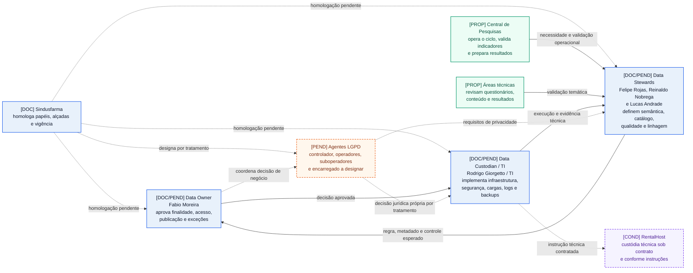

<Table>
  <tr>
    <td><a href= "link"></td>
    <td>
      <a href= "https://www.inteli.edu.br/"></a>
    </td>
  </tr>
</table>

# Governança de Dados do Projeto — Central de Pesquisas do Sindusfarma

## Nome do Grupo: Synapse

## Integrantes:

- <a href="https://www.linkedin.com/in/anna-riciopo/">Anna Riciopo</a>
- <a href="https://www.linkedin.com/in/karine-paixao/">Karine Paixão</a>
- <a href="https://www.linkedin.com/in/lucas-nunes-matheus/">Lucas Nunes Matheus</a>
- <a href="https://www.linkedin.com/in/marlos-do-carmo-guedes-366987250/">Marlos Guedes</a>
- <a href="https://www.linkedin.com/in/milena-castro-vieira/">Milena Castro Vieira</a>
- <a href="https://www.linkedin.com/in/otavio-vasc/">Otávio Vasconcelos</a>
- <a href="https://www.linkedin.com/in/vitor-balbo/">Vitor Balbo</a>

# Sumário

- [1. Estrutura Organizacional da Governança](#1-estrutura-organizacional-da-governança)
- [2. Política de Qualidade de Dados](#2-política-de-qualidade-de-dados)
  - [2.1 Atributos de qualidade](#21-atributos-de-qualidade)
  - [2.2 Métricas e procedimentos de mensuração](#22-métricas-e-procedimentos-de-mensuração)
  - [2.3 Metas mínimas e limiares de tolerância](#23-metas-mínimas-e-limiares-de-tolerância)
  - [2.4 Indicadores (KPIs) de qualidade](#24-indicadores-kpis-de-qualidade)
  - [2.5 Fluxo de ações corretivas](#25-fluxo-de-ações-corretivas)
  - [2.6 Regras de validação na ingestão](#26-regras-de-validação-na-ingestão)
  - [2.7 Auditoria e monitoramento contínuo](#27-auditoria-e-monitoramento-contínuo)
  - [2.8 Tratamento de inconformidades e registros duplicados](#28-tratamento-de-inconformidades-e-registros-duplicados)
- [3. Gestão de Metadados e Catálogo](#3-gestão-de-metadados-e-catálogo)
- [4. Classificação e Proteção de Dados](#4-classificação-e-proteção-de-dados)
- [5. Segurança e Acesso](#5-segurança-e-acesso)
- [6. Ciclo de Vida dos Dados](#6-ciclo-de-vida-dos-dados)
- [7. Avaliação de Maturidade](#7-avaliação-de-maturidade)

# 1. Estrutura Organizacional da Governança

Esta seção define os papéis que decidem, especificam e executam a governança de
dados da Central de Pesquisas. Ela usa como baseline a
[Arquitetura de Negócio](arquitetura-de-negocio.md#8-pilar-4--estrutura-organizacional),
o [Data Model Canvas](dmc.json) e a
[estrutura registrada na documentação geral](projeto.md#662-estrutura-de-governança-de-dados-da-central-de-pesquisas).
Essas fontes confirmam documentalmente os nomes abaixo, mas não comprovam que o
Sindusfarma já formalizou as designações ou implantou as responsabilidades.

## 1.1 Estado das atribuições

O documento distingue três estados para não transformar uma referência do
projeto em política vigente:

- **confirmado documentalmente:** nome ou papel registrado na Arquitetura de
  Negócio e no baseline do Data Model Canvas;
- **responsabilidade proposta:** atribuição definida pelo grupo para o desenho
  de governança da solução;
- **pendente de homologação:** designação, autoridade ou procedimento que o
  parceiro ainda precisa aprovar antes da operação.

Data Owner, Data Steward e Data Custodian são papéis organizacionais de
governança. Eles não equivalem automaticamente a controlador, operador,
suboperador ou encarregado da LGPD. O Sindusfarma deve identificar esses agentes
legais de acordo com cada tratamento, contrato e fluxo de dados.

## 1.2 Papéis fundamentais

| Papel | Referência documental | Autoridade e responsabilidade propostas | Limites do papel |
| :--- | :--- | :--- | :--- |
| **Data Owner** | Fabio Moreira | Responder pelo domínio de negócio; aprovar finalidade, prioridade, indicadores, classificação, perfis de acesso, publicação, exceções e risco residual. | Não recebe acesso administrativo por ocupar o papel e não substitui automaticamente o controlador ou o encarregado da LGPD. |
| **Data Steward** | Felipe Rojas, Reinaldo Nobrega e Lucas Andrade | Definir significado, catálogo, dicionário, regras de qualidade, completude, reconciliação e linhagem; acompanhar inconformidades e propor correções. | Não aprova sozinho nova finalidade, exposição externa ou aceitação de risco estratégico; ele prepara a decisão do Data Owner. |
| **Data Custodian / TI** | Rodrigo Giorgetto / TI | Administrar infraestrutura, ingestão, armazenamento, credenciais, backups, logs, disponibilidade e controles técnicos conforme as decisões aprovadas. | Não define finalidade, regra de negócio ou publicação e só acessa conteúdo protegido quando a atividade técnica exigir, com autorização e auditoria. |

A RentalHost aparece no baseline como custodiante externo quando operar o
sistema interno ou o repositório público. Essa participação depende do contrato
e das instruções aprovadas. A empresa executa a custódia contratada, mas não
decide por conta própria a finalidade do tratamento, a regra de qualidade ou a
publicação de resultados.

## 1.3 Encadeamento das decisões

Os papéis se complementam sem concentrar decisão de negócio e execução técnica
na mesma função. O fluxo proposto é:

```text
Central de Pesquisas ou área técnica identifica a necessidade
    ↓
Data Steward define significado, regra de qualidade e impacto nos dados
    ↓
Data Owner aprova finalidade, acesso, exceção ou publicação
    ↓
Data Custodian / TI implementa o controle e registra a execução
    ↓
Data Steward ou Data Owner verifica o resultado conforme a regra aplicável
```

O Data Custodian pode bloquear tecnicamente uma operação insegura ou fora da
política, mas não pode autorizar uma nova finalidade. O Data Steward pode
reprovar um dado que não atende à regra registrada, mas uma exceção com impacto
de negócio ou publicação retorna ao Data Owner. A separação preserva a
segregação de funções adotada nas políticas de qualidade, classificação e
acesso das Seções 2, 4 e 5. No encerramento de uma ação corretiva, o validador
segue a severidade definida na Seção 2.5; casos críticos e baixos cabem ao Data
Owner, enquanto os demais seguem a matriz específica daquele fluxo.

## 1.4 Homologações pendentes

| Decisão a confirmar | Evidência atual | Condição para tratar como vigente |
| :--- | :--- | :--- |
| Designação nominal de Owner, Stewards e Custodian | Nomes registrados na Arquitetura de Negócio e no baseline do DMC | Aprovação formal do Sindusfarma com escopo, autoridade, substitutos e data de vigência. |
| Controlador, operador, suboperadores e encarregado | Não definidos pelos papéis organizacionais | Inventário de cada tratamento e validação jurídica ou organizacional pelo parceiro. |
| Participação da RentalHost | Custódia externa indicada no baseline | Contrato e inventário que identifiquem dados, ambiente, instruções, acesso, retenção, auditoria e descarte. |
| Concessão de acesso excepcional aos dados protegidos | Matrizes propostas nas Seções 4 e 5 | Procedimento aprovado com solicitante, aprovador, finalidade, prazo, log e revisão posterior. |

Até essas confirmações, a estrutura desta seção é o desenho de governança do
projeto. Ela não comprova a implantação dos papéis ou dos controles no ambiente
produtivo do Sindusfarma.

## 1.5 Mapa funcional da governança de dados

O diagrama representa **relações funcionais de decisão e execução; não
representa organograma empregatício** nem designação jurídica. Os nomes nos
nós azuis vêm do baseline documental; as atribuições e relações são propostas
do projeto. A matriz RACI da Seção 1.6 é a fonte detalhada de autoridade quando
uma relação resumida no desenho envolver mais de um responsável.



| Elemento visual | Leitura |
| :--- | :--- |
| `[DOC]`, nó azul | Nome ou papel presente no baseline documental. |
| `[DOC/PEND]`, nó azul | Nome presente no baseline, com designação e autoridade ainda sujeitas à homologação. |
| `[PROP]`, nó verde | Função operacional proposta para a Central ou para as áreas técnicas. |
| `[PEND]`, nó laranja tracejado | Agente legal pendente de designação por tratamento. |
| `[COND]`, nó roxo tracejado | Participação externa condicionada a contrato e instruções. |
| Seta contínua | Interface funcional proposta de definição, aprovação, execução ou verificação. |
| Seta tracejada | Relação pendente ou condicional; não comprova subordinação ou vínculo jurídico. |

## 1.6 Matriz de responsabilidades por domínio

A matriz usa a notação RACI: **A** responde pela decisão final, **R** executa,
**C** é consultado antes da decisão e **I** recebe a informação. Quando uma
atividade envolve dado pessoal, a responsabilidade jurídica indicada para
controlador ou encarregado só passa a valer após a designação pelo Sindusfarma.

| Atividade | Data Owner | Data Steward | Central / áreas técnicas | Data Custodian / TI | Agentes LGPD a designar | Custódia externa |
| :--- | :---: | :---: | :---: | :---: | :---: | :---: |
| Definir significado, criticidade e uso de negócio dos metadados | A | R | C | C | C quanto ao tratamento pessoal | I |
| Definir finalidade e hipótese legal do tratamento pessoal | C | R na documentação e evidência | C | I | A/R após a designação | I |
| Manter catálogo semântico, dicionário, regras e linhagem | A | R | C | C | I | I |
| Manter metadados técnicos de origem, carga, versão e armazenamento | I | A quanto à coerência com o catálogo | I | R | I | R técnico sob contrato |
| Definir e acompanhar regras de qualidade | A | R | C | C | C | C na fonte sob contrato |
| Corrigir origem, validar, colocar em quarentena e reingerir | A somente para exceção ou impacto relevante | A pela regra e pelo encerramento aplicável | R na correção da origem | R na execução técnica | C | R técnico sob contrato |
| Classificar dados e revisar risco de reidentificação | A quanto ao uso e à exposição | R | C | R na aplicação técnica | A/C conforme a atribuição legal | C |
| Administrar perfis, autenticação, camadas, logs e backups | A quanto à política e às exceções | C | I | R | C | R na infraestrutura contratada |
| Tratar desvios, exceções e risco residual | A | R | C | R técnico | C/A quando houver decisão legal | R técnico se a causa estiver no serviço contratado |
| Aprovar e disponibilizar resultados | A | R na classificação, linhagem e proteção | C sobre o sentido do resultado | R na disponibilização | C/A quando houver decisão legal | R técnico somente na publicação sob contrato |
| Auditar conformidade e atender direitos dos titulares | C | R na evidência, inventário e rastreabilidade | C | R na propagação, nos logs e na retenção técnica | A/R conforme a atribuição legal | R técnico conforme instrução e contrato |

## 1.7 Regras de aplicação da matriz

- **Metadados semânticos e técnicos:** o Data Steward mantém significado,
  domínio, criticidade, regra de qualidade e linhagem. O Data Custodian mantém
  origem técnica, execução da carga, armazenamento, versão e logs. Mudança que
  altere uso, finalidade ou indicador retorna ao Data Owner.
- **Qualidade:** detecção, correção, validação e escalonamento seguem a matriz de
  severidade da Seção 2.5. A marca `A` desta matriz não transforma o Data Owner
  em executor das correções rotineiras.
- **Segurança:** o Data Owner aprova política, perfis e exceções; o Data Steward
  classifica o dado; o Data Custodian implementa acesso, autenticação, camadas,
  backup e auditoria. Acesso emergencial exige prazo, justificativa, log e
  revisão posterior.
- **Compliance e LGPD:** controlador, operador, suboperador e encarregado
  continuam pendentes de designação. Até essa definição, nenhum nome desta
  seção recebe responsabilidade jurídica por inferência.
- **Custódia externa:** fornecedor executa somente o que contrato e instruções
  autorizarem. Escopo de acesso, retenção, auditoria, devolução e descarte devem
  constar do inventário antes da operação. O fornecedor não aprova finalidade,
  hipótese legal, classificação, exceção, publicação ou resposta ao titular.
- **Proteção do catálogo:** metadados não são públicos por definição. Objetivos,
  enunciados, contatos, chaves de relacionamento e informações de origem herdam
  a classificação e a restrição do dado que descrevem.

As atribuições da matriz são responsabilidades propostas pelo grupo. Os nomes
da Seção 1.2 permanecem como baseline documental, e a vigência operacional
depende das homologações listadas na Seção 1.4.

# 2. Política de Qualidade de Dados

A Política de Qualidade de Dados define quais atributos de qualidade são monitorados no acervo de pesquisas e no banco de dados relacional, como cada um é medido, quais metas e indicadores (KPIs) acompanham a saúde do dado, e como a equipe reage quando a qualidade sai do aceitável. As definições partem do diagnóstico realizado na Sprint 1 sobre as bases disponibilizadas (completude e duplicidade medidas por base e variável) e seguem as dimensões de qualidade consagradas no DAMA-DMBOK 2.0.

A seção está organizada da definição à operação: primeiro **o que** se monitora (2.1 atributos), depois **como** se mede (2.2 métricas), **até onde** se aceita (2.3 metas e limiares), **o que se acompanha** no dashboard (2.4 KPIs), e por fim **como se reage e se previne** o desvio (2.5 ações corretivas, 2.6 validação na ingestão, 2.7 auditoria contínua e 2.8 tratamento de inconformidades).

## 2.1 Atributos de qualidade

Atributo de qualidade é a dimensão sob a qual a confiabilidade de um dado é avaliada. O projeto adota cinco atributos, selecionados a partir das dimensões do DAMA-DMBOK 2.0 e priorizados pelo que o diagnóstico da Sprint 1 mostrou ser crítico para o acervo de pesquisas: cada um responde por um tipo distinto de risco sobre os indicadores que a solução vai calcular (adesão, tempos de ciclo, representatividade). Um mesmo registro pode estar completo mas impreciso, ou único mas desatualizado — por isso os atributos são monitorados de forma independente.

<div align="center">
<sub>Tabela X - Atributos de qualidade monitorados no projeto</sub><br>

| Atributo | Definição | Relevância para o acervo de pesquisas | Bases/variáveis mais sensíveis |
| :--- | :--- | :--- | :--- |
| **Acurácia** | O valor registrado corresponde ao fato real que ele representa. | Garante que os indicadores (adesão, tempos, participação) reflitam a realidade das pesquisas, e não erros de digitação ou de conversão de tipo. | Medidas de mercado (`part_mercado`) armazenadas como texto; datas do ciclo em `pesquisas.csv`. |
| **Completude** | Proporção de campos preenchidos onde o preenchimento é exigido. | Campos obrigatórios vazios inviabilizam KPIs; distingue-se ausência **condicional** (estrutural e esperada) de ausência **problemática**. | `data_aprov` (94,5% nula) em `pesquisas.csv`; campos de contato em `clientes.csv`. |
| **Atualidade** | O dado reflete o estado mais recente do processo (defasagem temporal baixa). | Status e datas do ciclo precisam estar atualizados para o acompanhamento operacional em tempo quase real. | Campo de status e marcos de data das pesquisas em andamento. |
| **Consistência** | O mesmo dado é coerente entre as diferentes bases e ao longo do tempo. | Identificadores e domínios precisam bater entre as fontes, senão o cruzamento (drill-across) produz dupla contagem ou órfãos. | `id_cliente` (texto em `clientes.csv`, inteiro em `respondentes.csv`); domínio de país. |
| **Unicidade** | Ausência de duplicidades indevidas de um mesmo registro. | Contagens de empresas, respondentes e respostas só são confiáveis sem duplicatas — base para adesão e representatividade. | Chaves naturais de `empresas.csv`, `clientes.csv` e `respondentes.csv`. |

<sup>Material produzido pelos autores (2026)</sup>

</div><br>

**Ausência condicional × problemática.** No atributo de completude, nem todo campo vazio é defeito: há ausências **estruturais** — por exemplo, atributos de matriz que só existem para questões do tipo matriz — que são esperadas e não contam como erro. A política só trata como problemática a ausência em campo obrigatório para o tipo de registro em questão. Essa distinção, levantada no diagnóstico da Sprint 1, evita metas de completude artificialmente pessimistas e é a base para as métricas da seção 2.2.

## 2.2 Métricas e procedimentos de mensuração

Cada atributo definido em 2.1 é traduzido em uma métrica calculável sobre as bases de pesquisas, clientes, empresas, respondentes, questões e respostas. Uma métrica só é útil se tiver **fórmula, unidade e granularidade** explícitas — por isso cada uma é especificada com o denominador de referência (o universo esperado) e o nível em que é apurada (por campo, por base ou por relacionamento entre bases).

<div align="center">
<sub>Tabela X - Métricas de mensuração da qualidade por atributo</sub><br>

| Atributo | Métrica | Fórmula | Unidade | Granularidade |
| :--- | :--- | :--- | :--- | :--- |
| **Completude** | Percentual de completude | `(registros preenchidos ÷ registros esperados) × 100` | % | Por campo obrigatório de cada base |
| **Unicidade** | Taxa de duplicidade | `(registros duplicados ÷ total de registros) × 100` | % | Por base, sobre a chave natural/composta |
| **Consistência** | Taxa de conformidade referencial | `(chaves com correspondência na base de origem ÷ total de chaves) × 100` | % | Por relacionamento (ex.: `respostas`→`empresas`) |
| **Acurácia** | Percentual de valores válidos por regra | `(valores que passam nas regras de negócio ÷ total avaliado) × 100` | % | Por campo com regra definida |
| **Atualidade** | Defasagem temporal | `data de referência − data do último evento registrado` | dias úteis | Por registro em aberto (mediana no dashboard) |

<sup>Material produzido pelos autores (2026)</sup>

</div><br>

**Convenção do denominador (registros esperados).** Para a completude, o denominador não é o total de linhas da base, e sim o total de linhas em que o campo é **obrigatório para aquele tipo de registro** — coerente com a distinção condicional × problemática da seção 2.1. Assim, um atributo que só se aplica a questões do tipo matriz não penaliza a métrica das demais.

**Rotina de extração.** As métricas são apuradas sobre a **camada tratada** do pipeline (dados já tipados e padronizados), nunca sobre a camada bruta — que contém chaves órfãs, nulos e tipos inconsistentes que distorceriam a medição. A rotina roda a cada carga (ingestão incremental) e, adicionalmente, em varredura completa programada (ver periodicidade em 2.7), gravando o resultado num histórico de qualidade que alimenta os KPIs da seção 2.4 e serve de trilha de auditoria.

**Exemplo aplicado (linha de base da Sprint 1).** A completude de `data_aprov` em `pesquisas.csv` mediu ~5,5% (94,5% nula); a taxa de duplicidade das seis bases mediu 0%. Esses dois números são a linha de base concreta que calibra as metas da seção 2.3.

## 2.3 Metas mínimas e limiares de tolerância

Uma métrica sem meta não governa nada: é preciso dizer **a partir de qual valor o dado é aceitável** e **em que ponto a equipe é acionada ou a ingestão é barrada**. Esta seção fixa, para cada métrica da 2.2, três referências — a meta mínima (nível desejado), o limiar de alerta (dispara a ação corretiva da seção 2.5) e o limiar de bloqueio (barra a gravação na ingestão, seção 2.6). As metas são **provisórias**: foram calibradas pela linha de base medida na Sprint 1 e serão renegociadas com o parceiro à medida que o histórico de qualidade amadurecer.

<div align="center">
<sub>Tabela X - Metas mínimas e limiares de tolerância por métrica</sub><br>

| Métrica | Meta mínima | Limiar de alerta | Limiar de bloqueio | Justificativa da calibragem |
| :--- | :--- | :--- | :--- | :--- |
| Completude de campo obrigatório | ≥ 95% | < 95% | < 80% em campo crítico | Linha de base heterogênea; campos como `data_aprov` exigem exceção documentada (ver nota). |
| Taxa de duplicidade | 0% | > 0% | > 0% em chave natural | Diagnóstico da Sprint 1 mediu 0% nas seis bases; qualquer duplicata é regressão. |
| Conformidade referencial | ≥ 98% | < 98% | chave órfã em campo obrigatório | Existem chaves órfãs conhecidas (pesquisa_id 424, 1116, 1139, 1147) a reconciliar. |
| Conformidade de domínio | ≥ 98% | < 98% | valor fora de domínio fechado | Categóricos (país, status) devem cair em domínio canônico. |
| Defasagem (atualidade) | dentro do ciclo da pesquisa | acima do ciclo previsto | — | Atualidade gera alerta, não bloqueio: é sinal de processo, não de dado inválido. |

<sup>Material produzido pelos autores (2026)</sup>

</div><br>

**Alerta × bloqueio.** O limiar de **alerta** sinaliza degradação e aciona o fluxo de ações corretivas (2.5) sem interromper o pipeline; o limiar de **bloqueio** impede que o registro seja gravado no banco central até correção (2.6). Nem toda métrica tem bloqueio: a atualidade, por exemplo, só gera alerta, porque um dado atrasado ainda é um dado válido — o problema está no processo, não na integridade.

**Exceção documentada (`data_aprov`).** Como a base histórica traz `data_aprov` ~94,5% nula, aplicar a meta de 95% de completude reprovaria praticamente todo o acervo legado. A política adota, para esse campo, uma **meta segmentada**: 95% para pesquisas novas (a partir da adoção do pipeline) e cobertura reportada (não meta) para o legado — todo indicador de tempo de validação derivado dele é publicado **com o número de casos**, para não sugerir precisão inexistente. Toda exceção de meta é registrada no catálogo de metadados (Seção 3).

## 2.4 Indicadores (KPIs) de qualidade

Os KPIs consolidam as métricas (2.2) e suas metas (2.3) em indicadores acompanhados nos dashboards analíticos. Separam-se em **operacionais** — acompanhados a cada carga pela equipe de dados, orientados à ação imediata — e **estratégicos** — agregados por período, voltados à leitura de tendência pela gestão. Cada KPI declara fórmula, meta de referência, forma de apresentação e o público que o consome.

<div align="center">
<sub>Tabela X - KPIs de qualidade de dados</sub><br>

| KPI | Tipo | Fórmula | Meta (ref. 2.3) | Apresentação no dashboard |
| :--- | :--- | :--- | :--- | :--- |
| Taxa de dados ausentes | Operacional | ausentes em campos obrigatórios ÷ total esperado | ≤ 5% | Cartão + série temporal por base |
| Taxa de duplicidade | Operacional | registros duplicados ÷ total | 0% | Cartão com semáforo (verde/vermelho) |
| Índice de consistência entre fontes | Operacional | chaves com correspondência ÷ total de chaves | ≥ 98% | Barra por relacionamento (ex.: `respostas`→`empresas`) |
| Índice de conformidade de domínio | Operacional | valores em domínio válido ÷ total | ≥ 98% | Barra por variável categórica |
| Tempo de defasagem (atualidade) | Operacional | mediana da defasagem dos registros abertos | dentro do ciclo | Cartão + distribuição |
| Índice geral de qualidade (IGQ) | Estratégico | média ponderada dos KPIs operacionais por base | ≥ 95% | Gauge + evolução mensal |
| Cobertura de campos críticos | Estratégico | campos críticos acima da meta ÷ total de campos críticos | ≥ 90% | Heatmap base × atributo |

<sup>Material produzido pelos autores (2026)</sup>

</div><br>

**Índice geral de qualidade (IGQ).** É o indicador estratégico de topo: uma média ponderada dos KPIs operacionais, com peso maior para os atributos que travam decisão (consistência e unicidade, que sustentam contagens de adesão e representatividade). Serve para a gestão ler a saúde do acervo num único número, sem precisar interpretar cada métrica isolada — e para comparar a evolução entre sprints e cargas.

**Semântica das cores.** A apresentação segue o código de limiares da 2.3: **verde** acima da meta mínima, **amarelo** entre a meta e o limiar de alerta, **vermelho** abaixo do limiar de alerta (ou em qualquer bloqueio ativo). Assim o dashboard comunica não só o valor, mas se ele já exige ação corretiva (2.5).

**Nota de rastreabilidade.** Cada KPI aqui referenciado é rastreável até uma pergunta de negócio e uma métrica da 2.2; a validação da aplicabilidade desses KPIs contra amostras reais das bases é objeto de verificação específica no plano de testes do projeto.

## 2.5 Fluxo de ações corretivas

Quando um KPI (2.4) cruza um limiar da seção 2.3, dispara-se um **procedimento operacional padrão (POP)** de correção. O fluxo é o mesmo independentemente do atributo violado; o que muda é a **severidade**, que determina prazo e nível de intervenção. O procedimento tem sete passos encadeados, do disparo à reavaliação:

1. **Detecção** — a rotina de mensuração (2.2) identifica a métrica fora do limiar e registra o evento no histórico de qualidade.
2. **Classificação** — o desvio recebe uma severidade (crítica / alta / média / baixa) conforme a tabela abaixo.
3. **Contenção** — nos casos de limiar de bloqueio, o lote é retido e isolado antes de qualquer gravação no banco central.
4. **Correção** — o dado é saneado na origem ou por regra de padronização documentada; nunca por edição manual não rastreada.
5. **Re-ingestão** — o registro corrigido retorna ao início do pipeline e passa novamente pelas regras de validação (2.6).
6. **Reavaliação** — o KPI é recalculado; se voltou à meta, o caso é encerrado no histórico.
7. **Escalonamento** — se o desvio persistir após a correção, **ou** se o prazo máximo da severidade estourar sem resolução, o caso sobe ao Data Owner para decisão (aceitar exceção documentada ou acionar a fonte). Um caso crítico cuja correção **depende do parceiro** (ex.: reconciliação de chave órfã) não permanece bloqueando a ingestão: os registros afetados vão para **quarentena** (retidos e isolados, sem entrar no banco central) e a decisão é escalada, evitando que uma dependência externa trave o pipeline por tempo indeterminado.

<div align="center">
<sub>Tabela X - Fluxo de ações corretivas por severidade</sub><br>

| Severidade | Gatilho (limiar da 2.3) | Ação | Prazo | Responsável (ver Seção 1) |
| :--- | :--- | :--- | :--- | :--- |
| **Crítica** | Duplicidade > 0% ou chave órfã em campo obrigatório | Bloquear ingestão do lote, isolar registros e corrigir na origem | 1 dia útil | Data Steward + Data Custodian |
| **Alta** | Completude de campo obrigatório abaixo do limiar de alerta | Sinalizar, completar na origem e reprocessar | 3 dias úteis | Data Steward |
| **Média** | Conformidade de domínio/referencial abaixo do limiar | Padronizar valores e registrar regra de saneamento | 5 dias úteis | Data Steward |
| **Baixa** | Defasagem de atualidade fora do esperado | Revisar rotina de atualização da fonte | Próximo ciclo | Data Owner |

<sup>Material produzido pelos autores (2026)</sup>

</div><br>

**Encerramento e trilha.** Toda ação corretiva — gatilho, severidade, responsável, data e resultado da reavaliação — é gravada no histórico de qualidade, compondo a trilha de auditoria consolidada na seção 2.7.

**Matriz de responsáveis pelo disparo e execução.** Para que o fluxo não fique sem dono, cada severidade tem responsáveis explícitos em três momentos — **disparo** (quem detecta e classifica), **execução** (quem corrige e reingere) e **validação do encerramento** (quem confirma que o KPI voltou à meta) — com um prazo máximo de resposta. As funções remetem aos papéis da Seção 1 (Estrutura Organizacional).

<div align="center">
<sub>Tabela X - Responsáveis pelo disparo e execução das ações corretivas</sub><br>

| Severidade | Disparo (detecção/classificação) | Execução (correção/re-ingestão) | Validação do encerramento | Prazo máximo |
| :--- | :--- | :--- | :--- | :--- |
| **Crítica** | Rotina automática de monitoramento (2.7) + Data Steward | Data Custodian, sob condução do Data Steward | Data Owner | 1 dia útil |
| **Alta** | Rotina automática + Data Steward | Data Steward | Data Steward (par distinto) | 3 dias úteis |
| **Média** | Data Steward | Data Steward | Data Steward | 5 dias úteis |
| **Baixa** | Data Steward | Data Owner (revisão de processo/fonte) | Data Owner | Próximo ciclo |

<sup>Material produzido pelos autores (2026)</sup>

</div><br>

O **disparo** dos casos críticos e altos é preferencialmente automático — a rotina de monitoramento contínuo (2.7) abre a ocorrência assim que o limiar é cruzado, sem depender de inspeção manual. A **segregação de funções** (quem executa a correção não é quem valida o encerramento) é aplicada nas severidades crítica e alta, para que nenhuma correção seja dada como concluída por seu próprio autor. A aderência desses prazos à cadência operacional da Central de Pesquisas é revisada periodicamente para garantir que o fluxo seja executável, e não apenas formal.

## 2.6 Regras de validação na ingestão

As regras de validação são a primeira linha de defesa da qualidade: rodam nos **conectores de ingestão** (SurveyMonkey, planilhas Excel, repositório do site) **antes** da gravação no banco central, filtrando ou sinalizando campos inconsistentes na entrada, e não depois. Elas materializam os limiares de bloqueio da seção 2.3 e separam-se em dois tipos aplicados em ordem:

- **Validação sintática** — verifica *forma*: tipo, formato e presença do valor, sem consultar outras bases. É barata e roda primeiro, descartando o grosso dos erros de origem.
- **Validação semântica** — verifica *significado*: domínio válido, integridade referencial entre fontes e regras de negócio. Só roda sobre registros que passaram na sintática, pois depende de valores já bem formados.

<div align="center">
<sub>Tabela X - Regras de validação aplicadas na ingestão</sub><br>

| Regra | Tipo | Aplicação | Ação em caso de falha |
| :--- | :--- | :--- | :--- |
| Formato de data válido | Sintática | Campos de data do ciclo (`data_solicitacao`, `data_entrega`, ...) | Rejeitar registro e sinalizar |
| Tipo numérico onde esperado | Sintática | Medidas (participantes, market share, tempos) armazenadas como texto | Converter quando seguro; senão sinalizar |
| Preenchimento de campo obrigatório | Sintática | Campos obrigatórios por tipo de registro | Bloquear gravação até preenchimento |
| Padronização de domínio | Semântica | Categóricos (país, status, nacionalidade) | Normalizar para o valor canônico |
| Integridade referencial | Semântica | `id_empresa`, `id_cliente`, `id_pergunta` devem existir na base de origem | Sinalizar chave órfã e reter para conciliação |
| Não duplicidade | Semântica | Chave natural/composta por base | Descartar duplicata conforme regra de mesclagem (ver 2.8) |
| Coerência entre marcos temporais | Semântica | Ordem dos marcos do ciclo (solicitação ≤ aprovação ≤ entrega) | Sinalizar inconsistência de negócio |

<sup>Material produzido pelos autores (2026)</sup>

</div><br>

**Rejeitar × sinalizar × normalizar.** A ação em falha é graduada: **rejeitar** (registro não entra, típico de erro sintático grave), **sinalizar** (registro entra marcado como suspeito, para tratamento na seção 2.5 sem travar o lote inteiro) ou **normalizar** (o conector corrige automaticamente para o valor canônico, registrando a transformação). A escolha segue o limiar da 2.3: violações do limiar de bloqueio rejeitam; violações do limiar de alerta sinalizam.

**Casos herdados do diagnóstico.** As regras acima já nascem calibradas para problemas reais mapeados na Sprint 1: medidas de mercado gravadas como texto (regra de tipo numérico), `id_cliente` texto×inteiro entre `clientes.csv` e `respondentes.csv` (integridade referencial) e as chaves órfãs de pesquisa (retenção para conciliação, sem descarte). O tratamento aprofundado de duplicidade e mesclagem é detalhado na seção 2.8.

## 2.7 Auditoria e monitoramento contínuo

Qualidade não é um estado que se atinge uma vez: é uma condição que se mantém por vigilância. Esta seção define **com que frequência** as checagens rodam, **o que é registrado** para auditoria posterior e **como a equipe é avisada** antes que um desvio vire um problema de negócio. Distinguem-se dois regimes complementares: o **monitoramento contínuo** (automático, orientado a alerta imediato) e a **auditoria periódica** (programada, orientada a evidência e conformidade).

<div align="center">
<sub>Tabela X - Checagens de qualidade por periodicidade</sub><br>

| Checagem | Periodicidade | Escopo | Saída | Destinatário |
| :--- | :--- | :--- | :--- | :--- |
| Validação na ingestão (2.6) | A cada carga | Lote em ingestão | Registros aceitos/sinalizados/rejeitados | Data Custodian |
| Recálculo de KPIs (2.4) | A cada carga | Bases afetadas pela carga | Atualização do painel + alertas de limiar | Data Steward |
| Varredura completa de qualidade | Diária (programada) | Todas as bases do DW | Relatório de qualidade + histórico | Data Steward |
| Auditoria de conformidade | Mensal | Trilha de ações corretivas e exceções | Relatório de auditoria | Data Owner |

<sup>Material produzido pelos autores (2026)</sup>

</div><br>

**Monitoramento contínuo.** A cada carga, o recálculo dos KPIs (2.4) confronta cada métrica com os limiares da 2.3 e, ao cruzar um limiar de alerta, dispara automaticamente a notificação que abre o fluxo de ações corretivas (2.5) — sem esperar a varredura programada. É o que garante que um desvio seja tratado no ciclo em que aparece, não no relatório do mês seguinte.

**Histórico de qualidade (trilha de auditoria).** Toda medição e toda ação corretiva são gravadas num histórico **append-only** (somente inserção, sem sobrescrita), com data, base, métrica, valor apurado, limiar de referência e — quando houver — a ação corretiva vinculada e seu responsável. A imutabilidade é o que torna o histórico auditável: permite reconstruir o estado da qualidade em qualquer data passada e comprovar que um desvio foi tratado. Os logs seguem a política de retenção definida na Seção 6 (Ciclo de Vida dos Dados).

**Relatórios automáticos.** A varredura diária emite um relatório de qualidade (evolução dos KPIs, itens fora de meta, exceções ativas) para o Data Steward; a auditoria mensal consolida a trilha de ações corretivas e as exceções documentadas (como a de `data_aprov`, 2.3) num relatório de conformidade para o Data Owner, fechando o ciclo de accountability da política.

## 2.8 Tratamento de inconformidades e registros duplicados

O diagnóstico da Sprint 1 mediu **0% de duplicidade** nas seis bases isoladas — mas o projeto integra fontes (SurveyMonkey, Excel, repositório do site), e é na **integração** que a duplicidade nasce: a mesma empresa cadastrada em duas planilhas, o mesmo respondente com grafias diferentes. Esta seção define, de forma preventiva, como reconhecer, mesclar ou descartar duplicatas e como tratar as inconformidades já conhecidas (chaves órfãs e identidade inconsistente). O tratamento tem três etapas: **identificação** (matching), **mesclagem** (survivorship) e **descarte com registro**.

**Identificação (matching).** A detecção de duplicatas usa a chave natural de cada base; quando a chave não é confiável, aplica-se correspondência aproximada (*fuzzy*) sobre atributos identificadores, sempre com revisão antes da mesclagem definitiva.

<div align="center">
<sub>Tabela X - Política de deduplicação por base</sub><br>

| Base | Chave de deduplicação | Critério de match | Regra de mesclagem (survivorship) |
| :--- | :--- | :--- | :--- |
| `empresas.csv` | CNPJ / razão social normalizada | Exato na chave; *fuzzy* na razão social | Sobrevive o registro mais completo; consolida % de mercado e porte mais recentes |
| `clientes.csv` / `respondentes.csv` | `id_cliente` + e-mail normalizado | Exato no par; *fuzzy* em nome+empresa | Sobrevive o mais recente; preserva vínculo empresa×pessoa |
| `respostas.csv` | pesquisa + respondente + questão | Exato na tripla | Mantém a resposta mais recente; descarta reenvio |

<sup>Material produzido pelos autores (2026)</sup>

</div><br>

**Mesclagem (survivorship).** Quando dois registros representam a mesma entidade, um sobrevive e os demais são consolidados nele segundo uma regra explícita — em geral, **o mais completo** (menos campos nulos) e, em empate, **o mais recente**. Atributos ausentes no sobrevivente são preenchidos a partir dos registros mesclados; a operação é registrada no histórico de qualidade (2.7) para rastreabilidade.

**Descarte com registro.** Nenhuma duplicata é apagada silenciosamente: o registro descartado é marcado e mantido na camada bruta com referência ao registro que o absorveu, permitindo auditoria e reversão.

**Inconformidades conhecidas (não são duplicidade).** Dois casos mapeados na Sprint 1 exigem tratamento distinto, pois são falhas de integridade, não duplicatas:

- **Chaves órfãs** — `pesquisa_id` 424, 1116, 1139 e 1147 aparecem em `questoes`/`respostas` mas não em `pesquisas.csv`. Política: **preservar a chave de origem** e apontá-la para um registro **"Não mapeado"**, adiando a chave canônica até a reconciliação com o parceiro — nunca descartar o dado.
- **Identidade inconsistente** — `id_cliente` é texto em `clientes.csv` e inteiro em `respondentes.csv`. Política: normalizar o tipo na camada tratada e conciliar por chave composta (id + e-mail) antes de qualquer contagem de respondentes únicos.

Esses tratamentos alimentam a regra de não duplicidade e de integridade referencial da seção 2.6 e, quando o desvio é bloqueante, o fluxo de ação corretiva crítica da seção 2.5.

# 3. Gestão de Metadados e Catálogo

_conteúdo_

**Nota:** Estratégia e ferramentas de catalogação, metadados obrigatórios para tabelas de fato, dimensões e medidas (nome, definição, fonte, periodicidade, sensibilidade, grão), versionamento do catálogo e tabela de exemplo de metadados do DW.

# 4. Classificação e Proteção de Dados

Esta seção transforma as restrições do TAPI e o mapa de dados do projeto em
uma regra única de classificação. O TAPI exige controle de acesso por perfil,
tratamento de dados sensíveis em conformidade com a LGPD e proíbe a publicação
aberta de bases reais, respostas individuais identificáveis e dados de contato.
A fonte foi conferida pelo projeto sob o SHA-256
`16ec3cb7efefa8a371aa4ad03ff47a0388b24c24f1e22545994d38ffaed0ba3c`. [TAPI e
fontes primárias](projeto.md#ref-1)

As regras abaixo são diretrizes do projeto. Elas não comprovam que os controles
já estejam implantados pelo Sindusfarma. A classificação final, as hipóteses
legais e as exceções de acesso ainda dependem da aprovação do Data Owner, do
controlador e do encarregado aplicáveis a cada tratamento.

## 4.1 Plano de classificação

Todo ativo recebe uma classe de informação e, separadamente, um marcador de
proteção de dados. Essa separação evita tratar informação comercial restrita
como dado pessoal sensível ou concluir que um dado deixou de ser pessoal apenas
porque foi pseudonimizado.

| Classe de informação | Critério | Uso permitido | Regra de divulgação |
| :--- | :--- | :--- | :--- |
| **Público** | Conteúdo aprovado para divulgação, sem segredo de negócio e sem risco razoável de identificar pessoa ou participação. | Acervo público, comunicação externa e entrega acadêmica. | Publicação somente após autorização, agregação ou anonimização e revisão de reidentificação. |
| **Interno** | Informação operacional necessária ao trabalho da Central e das áreas técnicas, sem conteúdo individual de alta criticidade. | Operação, qualidade, acompanhamento e análise interna conforme o perfil. | Não publicar por padrão; uma versão pode se tornar pública após revisão e aprovação. |
| **Confidencial** | Dado pessoal, contato, vínculo profissional, informação comercial ou resultado cuja exposição possa afetar titular, empresa ou pesquisa. | Somente pessoas autorizadas, pela finalidade registrada e com trilha de acesso. | Proibida divulgação aberta; usar recorte minimizado, mascarado ou agregado quando necessário. |
| **Sensível** | Resposta identificável, vínculo pessoa–empresa–pesquisa, credencial, segredo, dado pessoal sensível nos termos da LGPD ou combinação com alto risco de reidentificação. | Acesso excepcional, mínimo, justificado e auditado. | Nunca publicar na forma identificável; a liberação exige anonimização efetiva ou agregação suficiente e aprovação expressa. |

Neste documento, **Sensível** é a classe organizacional mais restritiva. Ela
inclui, mas não se limita, ao conceito jurídico de dado pessoal sensível do art.
5º, II, da LGPD. O enquadramento jurídico deve ser registrado no marcador
próprio, sem ser inferido apenas pelo nome de uma coluna ou tabela.

## 4.2 Marcadores de proteção de dados

| Marcador | Significado para o projeto |
| :--- | :--- |
| **Não pessoal** | Não se refere a pessoa natural identificada ou identificável; ainda pode ser Confidencial por motivo comercial. |
| **Pessoal** | Relaciona-se direta ou indiretamente a uma pessoa natural. |
| **Pessoal sensível** | Enquadra-se nas categorias do art. 5º, II, da LGPD; exige hipótese e salvaguardas compatíveis. |
| **Pseudonimizado** | O vínculo foi separado, mas pode ser recomposto com informação adicional; continua sujeito à LGPD. |
| **Anonimizado ou agregado** | A identificação não é razoavelmente possível no contexto e os filtros não desfazem a proteção; o risco deve ser reavaliado a cada publicação. |

Uma classificação pode aumentar quando a finalidade, o conteúdo ou a combinação
de campos elevar o risco. A redução de classe só ocorre com evidência da
transformação aplicada e aprovação registrada; remover nome ou e-mail, sozinho,
não basta para declarar anonimização.

## 4.3 Matriz de classificação dos ativos

A matriz parte das entidades canônicas da Arquitetura de Negócio: Pesquisa,
Empresa, Pessoa/Cliente, Participação em Pesquisa, Questão, Resposta e
Resultado/Publicação. `respondentes.csv` representa a participação de uma
pessoa em uma pesquisa; não é sinônimo do cadastro de Pessoa/Cliente mantido em
`clientes.csv`.

| Ativo | Dados e campos observados ou previstos | Classe padrão | Marcador de proteção | Regra de tratamento e divulgação |
| :--- | :--- | :--- | :--- | :--- |
| **Pesquisa** (`pesquisas.csv`) | Identificador, título, status, tipo, área, datas, prazos, complexidade, objetivo e responsáveis | Interno | Não pessoal por padrão; Pessoal quando texto ou relacionamento identificar alguém | Central e áreas relacionadas podem acompanhar o fluxo. Remover contatos, observações pessoais e chaves internas antes de divulgar metadados. |
| **Empresa** (`empresas.csv`) | Identificador, nome, associação, nacionalidade, localização, tipo e participação de mercado | Confidencial | Não pessoal em regra; pode permitir identificação indireta em organização unipessoal | Não publicar recorte por empresa, market share ou vínculo com pesquisa sem autorização. Resultado agregado pode ser Público após revisão. |
| **Pessoa/Cliente** (`clientes.csv`) | `id_cliente`, `id_empresa`, e-mail, cargo e departamento | Confidencial | Pessoal | Manter separado da camada analítica, mascarar contato nas interfaces e proibir exportação ou publicação aberta. |
| **Participação em Pesquisa** (`respondentes.csv`) | `id_pesq`, `id_empresa`, `id_cliente`, horários de início e término e atributos de participação | Sensível | Pessoal ou Pseudonimizado | Restringir o vínculo pessoa–empresa–pesquisa. Dashboards usam contagens e taxas agregadas, nunca a linha individual. |
| **Questão** (`questoes.csv`) | Enunciado, tipo, alternativas, matriz, observações, formato e confiança da extração | Interno | Não pessoal por padrão | Elevar para Confidencial ou Sensível quando o tema, a observação ou as alternativas revelarem estratégia, pessoa ou categoria do art. 5º, II, da LGPD. |
| **Resposta** (`respostas.csv`, recebido originalmente como `teste.csv`) | `id_resposta`, `pesquisa_id`, `id_pergunta`, `respondent_id`, `id_empresa`, alternativa, coordenadas de matriz e valor | Sensível | Pessoal, Pessoal sensível quando o conteúdo assim se enquadrar, ou Pseudonimizado | Classificar pergunta e resposta na ingestão. Bloquear detalhe identificável em dashboard, GitLab, acervo e entrega acadêmica. |
| **Resultado analítico** | Indicadores, tabelas, relatórios, cortes, filtros, exports e versões de dashboard | Confidencial até aprovação | Pseudonimizado ou Anonimizado/agregado, conforme a construção | Testar células pequenas, filtros e dedução por diferença. Somente a versão aprovada e protegida pode mudar para Público. |
| **Publicação autorizada** | Resultado final, versão, data, origem, responsável e decisão de publicação | Público | Anonimizado ou agregado | Preservar a versão aprovada e sua linhagem; retirar ou corrigir quando a autorização ou a proteção deixar de ser válida. |
| **Consentimento e atendimento do titular** | Titular pseudonimizado, finalidade, aviso, hipótese legal, manifestação, revogação, protocolo e decisão | Sensível | Pessoal ou Pseudonimizado | Acesso restrito ao atendimento e à prestação de contas; não reutilizar o registro como fonte analítica. |
| **Credenciais, segredos e chaves de reidentificação** | Senhas, tokens, chaves criptográficas, secrets de integração e mapa de identidade | Sensível | Pessoal quando associado a usuário | Armazenar fora de código, planilhas e logs comuns; acesso técnico temporário, individual e auditado. |
| **Logs de acesso e auditoria** | Usuário, data/hora, ação, recurso, origem, resultado, exportação e publicação | Confidencial | Pessoal quando identificar o usuário | Proteger contra alteração e limitar a investigação autorizada; nunca registrar senha, token ou resposta bruta. |

Campos de texto livre, filtros de baixa frequência e combinações entre empresa,
cargo, departamento, período, questão e resposta recebem a maior classe
aplicável ao conjunto. A matriz descreve a classificação padrão; o catálogo
deve registrar as exceções por campo, finalidade e ambiente.

## 4.4 Controles por classe

| Classe | Controles mínimos antes do uso | Aprovação e evidência |
| :--- | :--- | :--- |
| **Público** | Inventário da versão publicada, teste de reidentificação, remoção de metadados internos e validação dos filtros disponíveis. | Decisão de publicação, Data Owner, responsável pela revisão, data, versão, origem e regra de proteção aplicada. |
| **Interno** | Autenticação individual, autorização por perfil, registro de alteração e exportação, ambiente separado do público e revisão periódica da necessidade. | Perfil aprovado e trilha que associe usuário, finalidade, recurso e ação. |
| **Confidencial** | Menor privilégio, mascaramento em tela, exportação restrita, criptografia, retenção definida e compartilhamento mínimo. | Justificativa de acesso, aprovação do responsável, destinatário, prazo e revisão de exceções. |
| **Sensível** | Separação entre identidade e conteúdo, pseudonimização quando o vínculo ainda for necessário, bloqueio de download por padrão, acesso excepcional e monitorado e anonimização ou agregação antes de qualquer divulgação. | Hipótese legal e finalidade registradas, risco avaliado, aprovação expressa, teste da proteção e trilha de todos os acessos administrativos. |

A classe mais alta de qualquer elemento prevalece durante transporte,
armazenamento, processamento, exportação e backup. Uma cópia não perde a classe
da origem. Logs, caches, arquivos temporários e amostras de teste seguem a mesma
regra do dado que reproduzem.

## 4.5 Técnicas de proteção e limites

| Técnica | Aplicação no projeto | Limite que precisa ser observado |
| :--- | :--- | :--- |
| **Minimização** | Coletar, integrar e disponibilizar somente campos necessários à finalidade documentada. | Conveniência futura não é finalidade; novo uso exige nova avaliação. |
| **Mascaramento** | Ocultar e-mail, identificadores e trechos de valores em telas, suporte e evidências. | Protege a visualização, mas não transforma o dado de origem em anônimo. |
| **Pseudonimização** | Substituir chaves de pessoa/empresa e guardar a informação de associação separadamente. | Como a associação pode ser refeita, o resultado continua sendo dado pessoal. |
| **Anonimização** | Remover ou generalizar identificadores e combinações quando a identificação deixar de ser razoavelmente possível no contexto. | Hash simples, retirada do nome ou exclusão de uma coluna não comprovam anonimização. |
| **Agregação** | Publicar contagens, taxas e estatísticas por pesquisa, período ou grupo autorizado. | Filtros, drill-downs e dedução por diferença podem reidentificar células pequenas. |
| **Supressão** | Ocultar célula, corte ou resultado com frequência insuficiente ou conteúdo de alto risco. | O limiar inicial `k < 5` é proposta da equipe, não controle confirmado; deve ser testado e aprovado para cada publicação. |

Antes de liberar um resultado, o Data Steward propõe a classificação e testa a
proteção; a Central confirma o sentido do resultado; o Data Owner decide a
publicação; e o Data Custodian executa a disponibilização aprovada. Esses papéis
são organizacionais. Controlador, operador e encarregado são papéis jurídicos
que ainda precisam ser definidos pelo Sindusfarma para cada fluxo.

## 4.6 Controles organizacionais e LGPD

O projeto adota privacidade desde a concepção, necessidade, finalidade,
transparência, prevenção, segurança e prestação de contas como critérios de
revisão. Para cada tratamento com dado pessoal, o inventário deve registrar:

0. finalidade específica e resultado esperado;
0. categorias de titulares, dados e destinatários;
0. origem, sistemas envolvidos e localização de armazenamento;
0. hipótese legal proposta e decisão do controlador;
0. responsável de negócio, custódia, operadores e suboperadores;
0. retenção, descarte, compartilhamento e eventual transferência internacional;
0. controles aplicados, risco residual e condição de revisão.

O Data Owner, os Data Stewards e o Data Custodian não substituem a definição
formal de controlador, operador ou encarregado. Também não se presume que a
RentalHost ou outro fornecedor ocupe determinado papel jurídico sem contrato,
instrução documentada e análise do tratamento efetivamente realizado.

## 4.7 Finalidade, hipótese legal e consentimento

Consentimento não é uma autorização genérica nem a hipótese automática para
toda pesquisa. O controlador e o encarregado devem avaliar, para cada finalidade
e categoria de dado, a hipótese prevista nos arts. 7º ou 11 da
[LGPD](https://www.planalto.gov.br/ccivil_03/_ato2015-2018/2018/lei/l13709compilado.htm).
A decisão precisa existir antes da coleta ou do novo uso e permanecer ligada à
versão do aviso apresentado ao titular.

| Finalidade do projeto | Dados minimizados | Decisão que precisa ser registrada |
| :--- | :--- | :--- |
| Operar convite, participação e acompanhamento da pesquisa | Contato, vínculo com empresa, pesquisa e estado da participação | Hipótese legal, canal de informação, prazo e responsáveis pelo atendimento. |
| Produzir indicadores e resultados | Respostas e participação pseudonimizadas, dimensões necessárias e métricas agregadas | Compatibilidade com a finalidade original, necessidade do detalhe e proteção contra reidentificação. |
| Publicar resultado no acervo | Versão aprovada, agregada ou efetivamente anonimizada | Autorização, teste de reidentificação, público, filtros permitidos e mecanismo de retirada/correção. |
| Manter segurança e prestação de contas | Logs minimizados, decisões, incidentes e evidências de atendimento | Prazo, acesso, integridade e justificativa de conservação. |

Quando o consentimento for a hipótese escolhida, a captura deve ser livre,
informada, inequívoca e vinculada a finalidade determinada. O registro mínimo
proposto contém:

- identificador do registro e do titular em forma pseudonimizada;
- finalidade e hipótese legal associada;
- versão do aviso e texto consentido;
- data/hora, canal e evidência da manifestação;
- estado (`vigente`, `revogado` ou `substituído`) e data da mudança;
- destinatários ou compartilhamentos informados;
- responsável pela captura e trilha das alterações.

O fluxo proposto é: apresentar aviso → permitir escolha específica → registrar
a evidência → confirmar ao titular → aplicar a decisão nas fontes e acessos →
facilitar revogação gratuita → interromper novos tratamentos baseados naquele
consentimento → avaliar eliminação ou conservação permitida → propagar a decisão
a operadores e registrar o encerramento. A revogação não apaga automaticamente
tratamentos anteriores válidos nem evidências cuja conservação tenha outra
justificativa documentada.

## 4.8 Atendimento dos direitos dos titulares

O canal, o encarregado e a implementação ainda precisam ser confirmados pelo
Sindusfarma. O fluxo documental proposto segue os [direitos dos titulares
descritos pela ANPD](https://www.gov.br/anpd/pt-br/assuntos/titular-de-dados-1/direito-dos-titulares):

0. receber o pedido e registrar protocolo, data, pedido e canal;
0. autenticar o solicitante de forma proporcional, sem coletar dados excessivos;
0. localizar a pessoa no mapa de identidade e levantar fontes, participações, respostas, exports, publicações, backups e operadores relacionados;
0. classificar o pedido e verificar hipótese legal, direitos de terceiros, segredo comercial e necessidade de conservação;
0. executar acesso, correção, anonimização, bloqueio, eliminação, portabilidade, informação ou revogação, ou registrar a justificativa da negativa;
0. propagar a decisão às fontes, camadas, caches, destinatários e operadores aplicáveis;
0. responder em linguagem clara e manter evidência da decisão, revisão e encerramento.

Confirmação e acesso devem ser disponibilizados em formato simplificado
imediatamente ou por declaração completa, clara e segura em até 15 dias, nos
termos do art. 19 da LGPD. Os demais pedidos seguem o prazo legal ou regulatório
aplicável, sem criar um prazo interno não confirmado.

## 4.9 Lacunas de rastreabilidade identificadas

O modelo atual não comprova estruturas próprias para consentimento, pedidos de
titular e decisão de publicação. Para evitar que a documentação simule uma
capacidade inexistente, ficam registradas como **propostas pendentes**:

| Estrutura proposta | Finalidade | Estado |
| :--- | :--- | :--- |
| `registro_consentimento` | Versionar manifestação, finalidade, aviso, estado e revogação quando consentimento for aplicável. | Pendente de validação jurídica e modelagem. |
| `solicitacao_titular` | Rastrear protocolo, autenticação, escopo, decisão, propagação e encerramento. | Pendente de definição do canal e responsável. |
| `decisao_publicacao` | Ligar resultado, versão, proteção aplicada, aprovação, publicação, retirada e correção. | Pendente de integração com o acervo público. |

Essas estruturas não devem ser adicionadas ao banco apenas para preencher o
documento. Sua implementação depende de validação com o parceiro e de uma task
de modelagem própria.

## 4.10 Estado das afirmações e decisões

| Item | Estado | Fonte ou condição |
| :--- | :--- | :--- |
| Controle de acesso por perfil no MVP | Confirmado pelo parceiro | TAPI, linhas de escopo e MVP; fonte externa identificada pelo hash desta seção. |
| Proibição de publicar bases reais, contatos e respostas identificáveis | Confirmado pelo parceiro | TAPI, restrições e conteúdo restrito. |
| Entidades, campos e riscos de combinação | Observado nos artefatos e dados | Arquitetura de Negócio, documentação quantitativa e mapa de fontes do projeto. |
| Dados recebidos já são fictícios ou anonimizados | **Não confirmado** | O DMC contém essa afirmação, mas o TAPI não a comprova. As fontes brutas permanecem Confidenciais ou Sensíveis por padrão. |
| Quatro classes, técnicas, matriz e limiar `k < 5` | Proposta da equipe | Precisa de teste, catálogo, aprovação e evidência de implementação. |
| Controlador, operador, encarregado, hipóteses legais e retenções | Pendente de validação | Decisão jurídica e organizacional do Sindusfarma para cada fluxo. |

As referências normativas usadas são a [Lei nº 13.709/2018 —
LGPD](https://www.planalto.gov.br/ccivil_03/_ato2015-2018/2018/lei/l13709compilado.htm),
as orientações da ANPD sobre [direitos dos
titulares](https://www.gov.br/anpd/pt-br/assuntos/titular-de-dados-1/direito-dos-titulares)
e o [Guia de Segurança da Informação para Agentes de Tratamento de Pequeno
Porte](https://www.gov.br/anpd/pt-br/centrais-de-conteudo/materiais-educativos-e-publicacoes/guia-vf.pdf).
Essas fontes sustentam os critérios legais e de segurança; não comprovam a
implantação dos controles no parceiro.

## 4.11 Critério de liberação de dados

Uma entrega externa só é liberada quando possui finalidade e público definidos,
versão inventariada, origem e transformações rastreáveis, classificação
revisada, autorização registrada e teste de reidentificação considerando
filtros, exports e dedução por diferença. Qualquer ausência bloqueia a
publicação. GitLab, GitHub ou outro repositório público e as entregas acadêmicas
recebem apenas documentação, código e dados sintéticos, anonimizados ou
agregados aprovados.

# 5. Segurança e Acesso

Esta seção define o desenho de referência para autorização e segurança do Data
App e do Data Warehouse. O TAPI confirma a necessidade de controle por perfil e
os públicos principais, mas não confirma que os perfis, protocolos ou controles
abaixo já estejam implantados. Até a homologação, eles são requisitos e
propostas da equipe.

## 5.1 Modelo de autorização

O acesso é negado por padrão. Uma decisão de autorização precisa combinar:

`perfil × ação × recurso × classe × pesquisa × empresa × área × finalidade`.

O perfil sozinho não concede acesso ao domínio inteiro. A aplicação e os
serviços devem validar a política no servidor para cada leitura, gravação,
exportação, alteração de permissão e publicação. Filtros de interface não são
controle de segurança.

Legenda usada nas matrizes:

- **L** — leitura autorizada no escopo indicado;
- **G** — gravação ou correção controlada;
- **A** — administração de regra ou infraestrutura, sem implicar leitura do conteúdo;
- **—** — negado por padrão.

## 5.2 Perfis de acesso

| Perfil | Necessidade de acesso | Limite obrigatório |
| :--- | :--- | :--- |
| **Equipe da Central** | Operar pesquisas, acompanhar fluxo, corrigir metadados autorizados e consultar indicadores internos. | Sem administração técnica, exportação bruta ou acesso automático a resposta sensível. |
| **Áreas técnicas** | Validar questionário e interpretar indicadores das pesquisas da própria área. | Escopo por área e `id_pesq`; sem identidade, participação individual ou staging. |
| **Data Owner** | Aprovar finalidade, acesso, exceção, indicador e publicação. | Administração de negócio não concede administração técnica nem acesso pessoal automático. |
| **Data Steward** | Manter classificação, catálogo, qualidade, linhagem e correções governadas. | Detalhe pessoal somente quando indispensável, temporário e registrado. |
| **Data Custodian / TI** | Administrar banco, integrações, credenciais, cópias, logs e disponibilidade. | Sem permissão permanente para usar o conteúdo; leitura excepcional por break-glass. |
| **Solicitantes/participantes** | Consultar o resultado aprovado para a pesquisa e finalidade autorizadas. | Sem acesso às camadas internas, a terceiros ou a filtros que desfaçam a agregação. |
| **Público externo** | Consultar o acervo expressamente publicado. | Somente visão Pública; sem login interno, export bruto, drill-down individual ou escrita. |
| **Equipe acadêmica** | Trabalhar com código, documentação e evidências aprovadas. | Nenhum acesso produtivo; somente dado sintético, anonimizado ou agregado aprovado. |

## 5.3 Matriz de permissões por objeto

| Perfil | Pesquisa e metadados | Questionário | Pessoa/identidade | Participação e resposta | Resultado analítico | Publicação | Permissões e infraestrutura |
| :--- | :---: | :---: | :---: | :---: | :---: | :---: | :---: |
| Equipe da Central | L/G | L/G | L no job autorizado | L restrita; G de correção registrada | L | G de preparação | — |
| Áreas técnicas | L no escopo | L/G de validação | — | — | L no escopo | — | — |
| Data Owner | L | L | — | — | L | A de aprovação | A de regra de negócio |
| Data Steward | L/G | L/G de regra | L excepcional | L/G excepcional | L/G de qualidade | L de evidência | A de classificação e catálogo |
| Data Custodian / TI | — por padrão | — por padrão | — por padrão | — por padrão | — por padrão | G da versão aprovada | A técnica |
| Solicitantes/participantes | — | — | — | — | — | L da entrega autorizada | — |
| Público externo | — | — | — | — | — | L da visão pública | — |
| Equipe acadêmica | — | — | — | — | L somente de agregado aprovado | L da versão pública | — |

Toda permissão é limitada à finalidade e ao menor escopo de pesquisa, empresa e
área necessário. E-mail, `id_cliente`, `respondent_id`, mapa de identidade,
horários, vínculo de participação, `market_share`, resposta individual e texto
livre ainda não classificado exigem política por campo e mascaramento.

Exports, APIs, caches, índices de busca, logs e backups herdam a classificação e
o escopo da fonte. Se classe, finalidade, política ou escopo estiverem ausentes,
a decisão é negar e registrar; dado novo permanece em quarentena como Sensível
até classificação.

## 5.4 Segregação de funções e acesso emergencial

Uma mesma pessoa não prepara, revisa e publica sozinha um resultado. A Central
prepara; o Data Steward revisa classificação, linhagem e reidentificação; o Data
Owner aprova; e o Data Custodian disponibiliza a versão aprovada.

O acesso emergencial do Data Custodian ao conteúdo exige motivo, prazo curto,
segunda aprovação e revisão posterior. Ao término, a permissão temporária e as
sessões associadas devem ser revogadas, preservando a trilha da ação.

## 5.5 Segregação por camadas

| Camada | Conteúdo | Escrita permitida | Leitura permitida | Regra de saída |
| :--- | :--- | :--- | :--- | :--- |
| **staging** | Cópia recebida da fonte, schema original, identificadores e metadados da entrega. Tratar como Sensível até classificação. | Somente serviço de ingestão com credencial própria; Data Custodian em operação técnica controlada. | Data Steward apenas em quarentena ou investigação escopada; Data Custodian somente por necessidade técnica ou break-glass. | Promover lote completo e validado para trusted; nunca alimentar dashboard ou publicação diretamente. |
| **trusted** | Dado tipado, validado, deduplicado, classificado, com identidade separada e regra de qualidade registrada. | Pipeline validado; Data Steward em correção governada; Central somente pela aplicação e no fluxo autorizado. | Central e Data Steward no escopo; áreas técnicas apenas para validação de questionário e metadados relacionados. | Promover para analytics com checkpoint de qualidade, linhagem e finalidade. |
| **analytics** | Fatos, dimensões, métricas e agregações com grão e origem documentados. | Pipeline analítico; correção somente pela origem/trusted e reprocessamento. | Central, Data Owner, Data Steward e áreas técnicas nos recortes autorizados. | Gerar uma versão publicável separada; o cubo inteiro não se torna Público porque um agregado foi aprovado. |
| **publicação** | Resultado imutável, versionado, aprovado, anonimizado ou agregado, acompanhado da decisão de publicação. | Data Custodian publica somente a versão aprovada; retirada/correção segue nova decisão. | Solicitantes/participantes conforme finalidade e público externo quando expressamente liberado. | Não permite retorno para camadas internas nem drill-down que revele dado protegido. |

## 5.6 Matriz de acesso por camada

| Perfil ou serviço | staging | trusted | analytics | publicação |
| :--- | :---: | :---: | :---: | :---: |
| Serviço de ingestão | G | G de promoção | — | — |
| Equipe da Central | — | L/G via aplicação | L | G de preparação |
| Áreas técnicas | — | L/G no questionário e escopo | L no escopo | L quando autorizada |
| Data Owner | — | — | L | A de aprovação |
| Data Steward | L de quarentena | L/G de qualidade | L/G de regra | L de evidência |
| Data Custodian / TI | A técnica; L excepcional | A técnica; L excepcional | A técnica; L excepcional | G da versão aprovada |
| Solicitantes/participantes | — | — | — | L da entrega autorizada |
| Público externo | — | — | — | L da visão pública |
| Equipe acadêmica | — | — | — | L da versão pública ou agregado acadêmico aprovado |

As permissões de `staging`, `trusted` e `analytics` são sempre internas. Um
usuário externo não recebe acesso direto a essas camadas, mesmo que um campo ou
indicador isolado tenha classificação Pública.

## 5.7 Promoção, falha segura e reprocessamento

Cada promoção registra origem, hash ou versão da entrada, execução, schema,
regras aplicadas, contagens, rejeições, responsável e destino. A mudança deve
ser atômica: lote incompleto ou inválido permanece em quarentena e a versão
anterior continua servindo o consumo autorizado.

Falha de autenticação, política, classificação, qualidade, anonimização,
assinatura da fonte ou decisão de publicação bloqueia a ação. O sistema não
retorna parte do dado nem usa `staging` como fallback. Reprocessamento parte da
entrada inventariada, produz nova execução e não sobrescreve a trilha anterior.

Restauração de backup ocorre em ambiente isolado. Antes de voltar ao serviço,
deve reaplicar bloqueios, revogações e eliminações registradas após o ponto da
cópia e nunca republicar automaticamente uma versão antiga.

## 5.8 Práticas de segurança da informação

Os controles desta subseção são o baseline técnico **proposto** para a solução.
Eles ainda dependem da plataforma escolhida, da política do Sindusfarma e de
evidência de configuração e teste antes da produção.

| Controle | Baseline proposto | Evidência para homologação |
| :--- | :--- | :--- |
| Criptografia em trânsito | TLS 1.2 ou superior em Data App, APIs, banco, integrações, cópias e administração; rejeitar conexão insegura. | Configuração efetiva, teste de protocolo e inventário de certificados. |
| Criptografia em repouso | Banco, volumes, objetos, filas, logs e backups criptografados com chaves gerenciadas e acesso separado. | Configuração do provedor, responsáveis pela chave, rotação e teste de recuperação. |
| Segredos | Credencial individual por serviço e ambiente, mínimo escopo, rotação e armazenamento em cofre de segredos. | Nenhuma senha, chave ou token no Git, imagem, planilha, payload ou log; trilha de uso e rotação. |
| Aplicação | Validação de entrada e saída, consultas parametrizadas, proteção CSRF, cookies seguros, política de conteúdo e codificação de texto não confiável. | Testes negativos e revisão que impeçam transformar questão, resposta ou nome externo em HTML executável. |
| Auditoria | Eventos estruturados, minimizados, protegidos contra alteração e ligados à versão da política aplicada. | Consulta por incidente e prova de que o log não contém token, senha, e-mail, resposta bruta ou texto livre. |
| Monitoramento | Alertar falha de autorização, comportamento incomum, exportação sensível, erro de integração, replay, mudança de permissão e publicação. | Regra, destinatário, severidade, teste do alerta e registro do tratamento. |
| Backup e recuperação | Meta inicial: backup diário criptografado, janela operacional de 30 dias, RPO de 24 horas, RTO de 8 horas e teste mensal de restauração. | Aprovação do Data Owner e Data Custodian, cópia isolada/imutável, resultado do teste e expiração verificada. |
| Incidentes | Registro único da detecção ao encerramento, com contenção, preservação de evidência, análise de risco, decisão e comunicação aplicável. | Responsáveis, playbook testado, tempos medidos e vínculo com o RIPD quando cabível. |

Os números de backup, RPO e RTO são metas provisórias, não compromissos
confirmados pelo parceiro. Retenção do dado e rotação da cópia são decisões
diferentes: uma restauração não pode reintroduzir de forma ativa um registro
eliminado, bloqueado ou cuja autorização tenha sido revogada.

## 5.9 Contrato da trilha de auditoria

Devem gerar evento: login, MFA, logout e revogação; concessão ou retirada de
permissão; decisão de permitir ou negar; leitura Sensível; exportação;
alteração ou eliminação; aprovação, publicação, retirada e correção; acesso
emergencial; rotação de segredo; rejeição ou replay de integração; backup,
restauração, incidente e pedido de titular.

Cada evento registra somente:

- `event_id` e timestamp UTC;
- ator pseudonimizado e snapshot de perfil/escopo;
- ação, tipo do recurso e identificador não sensível;
- versão da política, decisão e motivo codificado;
- correlação, execução ou sessão necessária à investigação;
- resultado e referência ao registro operacional relacionado.

O log não replica conteúdo de negócio. Senha, token, chave, e-mail, resposta,
enunciado, texto livre e corpo integral de payload são proibidos.

## 5.10 Segurança das integrações

Cada fonte usa credencial dedicada e escopo mínimo. Eventos recebidos por n8n,
SurveyMonkey ou outro provedor só produzem efeito depois de TLS, autenticação ou
assinatura, validação de timestamp e identificador de entrega, schema permitido,
proteção contra replay e verificação de idempotência.

Evento inválido vai para quarentena sem conteúdo sensível no alerta. Quando o
provedor não oferecer assinatura confiável, a preferência é coleta autenticada
ou entrada isolada com credencial própria e reconciliação posterior. O papel
futuro do n8n e os provedores finais continuam como decisões pendentes.

## 5.11 Autenticação e federação

A tecnologia não foi confirmada pelo parceiro. Como baseline **proposto**, o
Data App integra-se ao provedor corporativo de identidade por OpenID Connect
(OIDC), usando OAuth 2.0 Authorization Code com PKCE. MFA é obrigatório para
perfis internos e privilegiados. Exportação Sensível, publicação, alteração de
permissão e acesso emergencial exigem reautenticação ou MFA adicional.

JWT é formato de token, não protocolo de login. Se adotado, o serviço valida
assinatura, emissor, audiência, expiração e identificador; usa validade curta e
não aceita algoritmo ou chave informados pelo cliente. Tokens e refresh tokens
não ficam em `localStorage`. Para a aplicação web, a preferência é sessão
servidor-side ou cookie `Secure`, `HttpOnly` e `SameSite`, acompanhado de
proteção CSRF.

Contas são individuais. Conta compartilhada, credencial padrão e autenticação
local paralela ao IdP ficam proibidas, salvo conta de emergência formalmente
controlada. Serviços usam identidades não interativas, separadas por integração
e ambiente, sem reaproveitar credencial humana.

## 5.12 Política de sessões

| Contexto | Inatividade proposta | Duração absoluta proposta | Reautenticação |
| :--- | :---: | :---: | :--- |
| Administração, permissão e break-glass | 15 minutos | 8 horas | Antes de ação crítica e ao elevar privilégio. |
| Equipe interna e áreas técnicas | 30 minutos | 8 horas | Antes de exportar dado protegido ou aprovar publicação. |
| Solicitante/participante autenticado | 30 minutos | 8 horas | Antes de novo download protegido ou mudança de finalidade. |
| Público externo | Sem sessão interna | Não aplicável | Acesso somente à visão Pública. |

Os tempos são parâmetros iniciais sujeitos à validação de risco e à capacidade
do IdP. Renovar atividade não ultrapassa a duração absoluta. Refresh token, se
existir, tem rotação, detecção de reutilização e revogação no logout.

Desligamento, mudança de função, retirada de escopo, revogação de consentimento
aplicável ou incidente invalidam imediatamente sessão, refresh token, grants e
caches de autorização. A alteração não espera a expiração natural.

Como processo **proposto**, toda concessão deve ter solicitante, aprovador,
perfil, escopo, finalidade e expiração registrados. Mudança de função exige
nova análise, não a soma automática de permissões antigas; desligamento aciona
revogação imediata. O Data Owner e o Data Steward recertificam periodicamente
os acessos de negócio, enquanto o Data Custodian recertifica contas técnicas e
privilégios administrativos. A periodicidade e os responsáveis nominais ainda
dependem de aprovação do Sindusfarma.

## 5.13 Falhas, recuperação de conta e credenciais

Falha do IdP, do mecanismo de MFA ou da política de autorização bloqueia o
acesso protegido. A aplicação não mantém um modo degradado com dados internos.

Recuperação de conta usa canal corporativo verificado, autenticação proporcional
e registro do evento. Suporte não solicita nem recebe senha, token ou código de
MFA. Após recuperação ou suspeita de comprometimento, sessões e credenciais
anteriores são revogadas e as ações recentes ficam disponíveis para auditoria.

A aprovação destas propostas cabe ao Data Owner e à TI/Data Custodian, com
validação do encarregado quando o controle afetar tratamento de dado pessoal.
Até essa decisão, OIDC, MFA, protocolo, tempos e formato de sessão não devem ser
descritos como mecanismos já existentes no Sindusfarma.

## 5.14 Estado das decisões de segurança

| Item | Estado | Condição de fechamento |
| :--- | :--- | :--- |
| Controle de acesso por perfil | Requisito confirmado no TAPI | Aprovar matriz, escopos por pesquisa/empresa/área e testes de permitido/negado. |
| Banco relacional em nuvem | Escopo confirmado; provedor pendente | Registrar região, criptografia, administradores, logs, backup e contratos. |
| staging, trusted, analytics e publicação | Proposta da equipe | Validar arquitetura, contas técnicas, gates e isolamento em ambiente de homologação. |
| OIDC, OAuth2/PKCE, MFA e sessões | Proposta da equipe | Validar IdP, políticas corporativas, tempos e fluxos de revogação com TI. |
| TLS, cofre de segredos, monitoramento e auditoria | Requisitos técnicos propostos | Comprovar configuração, alertas, rotação, proteção do log e testes negativos. |
| Backup diário, 30 dias, RPO 24h e RTO 8h | Metas provisórias | Aprovar impacto de negócio e demonstrar restauração completa dentro das metas. |
| Papel futuro do n8n e provedores | Pendente | Definir autenticação, segredos, idempotência, replay, responsabilidades e contratos. |

## 5.15 Critérios de homologação

A segurança só pode ser descrita como implantada quando houver, no ambiente
correspondente:

0. matriz aprovada e teste negativo para cada perfil, camada e ação crítica;
0. isolamento comprovado entre ambientes, contas, bancos, secrets e backups;
0. autenticação individual, MFA privilegiado, revogação e expiração testados;
0. logs minimizados e pesquisáveis para acesso, exportação, permissão e publicação;
0. restauração executada sem republicar dado bloqueado ou versão antiga;
0. integração testada contra evento inválido, duplicado, fora de prazo e replay;
0. varredura do repositório e da entrega sem credencial ou dado identificável;
0. evidência, responsável, data e resultado anexados à decisão de homologação.

Até esses critérios serem atendidos, a documentação representa o desenho de
governança da solução, não uma declaração de conformidade produtiva.

# 6. Ciclo de Vida dos Dados

_conteúdo_

**Nota:** Retenção, arquivamento, descarte e linhagem dos dados ao longo do ciclo de vida das pesquisas.

# 7. Avaliação de Maturidade

_conteúdo_

**Nota:** Diagnóstico do estágio atual de governança, lacunas identificadas e plano de evolução da maturidade.
