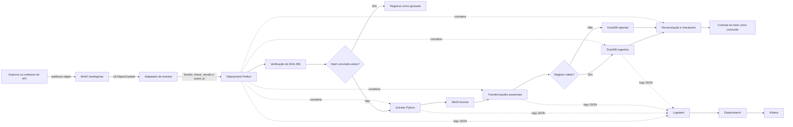

# ADR 0001 — Arquitetura do ETL com Python, Prefect, MinIO e DuckDB

- **Status:** Proposto
- **Data:** 09/09/2026
- **Responsáveis pela decisão:** equipe do projeto

## Contexto

A Sprint 3 exige um pipeline funcional de extração, transformação e carga,
com tratamento de dados antes da persistência, orquestração, observabilidade,
testes automatizados e execução reproduzível no ambiente local e no CI.

As orientações apresentadas em sala determinam o uso do MinIO como bucket de
entrada, a leitura a partir de eventos do bucket, a comparação do hash de cada
objeto antes do processamento, a centralização da
observabilidade na Elastic Stack e produzir uma estimativa de custos da solução.
O resultado deve alimentar a tabela de ingestão do banco definido pela equipe.

As fontes disponíveis neste momento são seis arquivos CSV entregues como
snapshots. Ainda não há atualização automática nem frequência de publicação
confirmada pelo parceiro. Os arquivos serão publicados primeiro em uma área de
entrada imutável no MinIO. Uma futura integração com API deverá preservar a
resposta ou o arquivo recebido nessa mesma área antes de iniciar o processamento,
sem exigir a reescrita das etapas de transformação e carga.

O repositório já possui um contrato comum de extração e configuração segura em
Python. Foi considerada a adoção do Apache NiFi tanto para coordenar o fluxo
quanto para executar a leitura e a movimentação dos dados. Essa alternativa
oferece visualização operacional, filas e proveniência, mas introduz outro
ambiente de execução e divide entre NiFi e Python responsabilidades que precisam
ser versionadas, testadas e observadas em conjunto.

O enunciado e a orientação em sala citam ClickHouse como destino. A equipe
informou que o uso do DuckDB foi autorizado para esta entrega. Essa autorização
deve ser registrada como evidência do projeto e refletida na matriz de
rastreabilidade, nos diagramas e nos critérios de aceite antes de este ADR ser
marcado como aceito.

## Decisão proposta

Adotar Python como plano de dados do ETL, Prefect como plano de controle, MinIO
como porta de entrada e armazenamento de objetos, DuckDB como banco de ingestão
tratada e Elastic Stack como plataforma de observabilidade.

- **Python** implementa extração, validação, transformação e carga.
- **Prefect** recebe o evento normalizado, declara dependências, agenda execuções,
  recebe parâmetros, controla estados, retries e backfills e mantém o histórico
  operacional.
- **MinIO** recebe os objetos de origem, publica eventos de criação e preserva os
  arquivos e artefatos intermediários de cada lote.
- **DuckDB** mantém os dados tratados, os registros rejeitados e as tabelas de
  controle e reconciliação.
- **Elastic Stack** centraliza logs, consultas operacionais e painéis da execução.

No ambiente local, um adaptador HTTP pequeno e sem regra de negócio receberá as
notificações `s3:ObjectCreated:*` do MinIO e solicitará a execução de um
deployment no Prefect. O evento informará apenas dados técnicos, como bucket,
chave, versão e identificador do evento. O conteúdo será lido pelo extrator
diretamente do MinIO.

O NiFi não fará parte da arquitetura principal. Ele poderá ser reavaliado se o
projeto passar a receber muitas fontes heterogêneas, dados contínuos ou precisar
de operação visual por usuários que não trabalham diretamente com código.

## Responsabilidades dos componentes

| Componente | Responsabilidade | Não é responsabilidade |
| :--- | :--- | :--- |
| Publicador da fonte | Depositar o objeto recebido na área de entrada do MinIO | Transformar o conteúdo ou confirmar seu processamento |
| MinIO | Preservar objetos de entrada e intermediários e publicar eventos de criação | Decidir se o objeto deve ser processado |
| Adaptador de eventos | Validar a notificação e disparar o deployment com bucket, chave, versão e ID do evento | Ler ou transformar o conteúdo do objeto |
| Extratores Python | Ler do MinIO o objeto indicado pelo evento sem alterá-lo e emitir lotes no contrato comum | Transformar segundo regras de negócio ou gravar diretamente no banco |
| Transformadores Python | Validar, tipar, normalizar, deduplicar e separar rejeições | Ler credenciais ou controlar agendamento |
| Repositório de carga Python | Validar o schema de destino, carregar lotes e reconciliar contagens | Decidir quando o pipeline deve executar |
| Prefect | Coordenar tarefas, parâmetros, retries, backfills e estados | Conter regras de transformação dos dados |
| DuckDB | Persistir dados conformes, rejeições e controles técnicos | Substituir a cópia imutável da origem |
| Logstash | Receber, normalizar e encaminhar logs técnicos | Controlar o estado do pipeline |
| Elasticsearch | Indexar logs e eventos operacionais | Armazenar os dados de negócio da ingestão |
| Kibana | Consultar logs e apresentar painéis operacionais | Orquestrar ou reprocessar lotes |

## Fluxo de execução

Uma execução seguirá esta sequência:

1. Um arquivo ou coletor publica o objeto na área `landing/raw` do MinIO.
2. O MinIO emite um evento de criação para o adaptador HTTP.
3. O adaptador valida a notificação e inicia o deployment com `bucket`, `key`,
   `version_id` e `event_id`.
4. O pipeline lê o objeto do MinIO, calcula seu SHA-256 e consulta a tabela de
   controle.
5. Um hash já concluído é registrado como ignorado, sem nova carga.
6. Para uma entrada nova, o extrator emite lotes no contrato comum e preserva a
   representação intermediária na área bronze do MinIO.
7. As transformações aplicam o schema canônico e encaminham registros inválidos
   para a área de rejeição com o motivo correspondente.
8. O repositório carrega no DuckDB somente os registros tecnicamente conformes.
9. O pipeline reconcilia extraídos, carregados, rejeitados e duplicados.
10. O checkpoint e o sucesso do hash são confirmados apenas depois da
    persistência e da reconciliação do lote.
11. Todas as etapas emitem logs estruturados para a Elastic Stack.

## Disparo por eventos

O evento do MinIO é um aviso de que existe um objeto disponível; ele não será
tratado como confirmação de processamento. O evento pode ser entregue novamente
ou chegar fora de ordem. Por isso, a idempotência será garantida pela tabela de
controle e pelo hash do conteúdo, e não apenas pelo `event_id` ou pelo nome do
arquivo.

O adaptador responderá rapidamente ao MinIO depois de validar e registrar o
pedido de execução. A leitura e o processamento ocorrerão no worker do Prefect.
O MinIO deverá manter uma fila persistente para notificações que não puderem ser
entregues ao webhook. No CI, o mesmo payload de evento será enviado como fixture,
sem depender de dados reais do parceiro.

## Contratos e extensibilidade

Todos os extratores devem implementar a mesma interface e produzir o mesmo
contrato de lote, independentemente da tecnologia que publicou a entrada. Assim,
uma futura integração com API acrescentará um coletor próprio de autenticação,
paginação e limites de requisição, preservará o retorno no MinIO e reutilizará
as transformações e a carga.

Os checkpoints são opacos para os consumidores. Eles podem representar número
de linha, página, cursor, data de atualização ou outro marcador compreendido
pelo extrator. Para os snapshots CSV atuais, a identidade da entrada será
composta por bucket, chave, versão da fonte e SHA-256 do conteúdo.

O código de domínio continuará sem dependência direta do Prefect, MinIO ou
DuckDB. Essas tecnologias serão acessadas por adaptadores, permitindo testes
unitários sem serviços externos e testes de integração com os serviços reais.

## Idempotência e recuperação

- Cada execução e lote possuirá identificadores estáveis e metadados de origem.
- A combinação de fonte, checksum e lote impedirá a carga lógica duplicada.
- O checkpoint será confirmado somente após a conclusão do lote.
- Falhas transitórias poderão receber retry com limite e espera progressiva.
- Falhas permanentes, como credencial inválida ou schema incompatível, não serão
  repetidas automaticamente.
- Backfills serão parametrizados por fonte e janela, sem alteração do código.
- A mesma entrada e os mesmos parâmetros deverão produzir o mesmo resultado.

## Segurança e observabilidade

Credenciais e endpoints sensíveis serão fornecidos por variáveis de ambiente ou
blocos secretos do orquestrador. Segredos, respostas individuais e outros dados
pessoais não poderão aparecer em logs, mensagens de erro ou artefatos do CI.

Os logs serão estruturados em JSON e correlacionados por `run_id`, `task_id`,
`event_id`, fonte, objeto e lote. O conteúdo do arquivo e dados pessoais não
serão enviados à plataforma de observabilidade. O Logstash receberá e
normalizará os eventos, o Elasticsearch fará a indexação e o Kibana apresentará
consultas e painéis operacionais.

Cada etapa publicará, quando aplicável, duração, registros recebidos, carregados
e rejeitados, bytes processados, tentativas, latência entre publicação e início
e estado final. O histórico de execução do Prefect e os logs da Elastic Stack
serão correlacionados pelo mesmo `run_id`. A falha do mecanismo de telemetria não
poderá corromper nem confirmar uma carga incompleta.

## Estimativa de custos

A decisão deverá ser acompanhada por um documento versionado de custos com dois
cenários: execução local acadêmica e implantação em infraestrutura hospedada. A
estimativa deverá declarar premissas de volume, frequência e retenção e separar,
no mínimo, processamento, armazenamento do MinIO, banco de ingestão, execução do
Prefect, Elastic Stack, transferência de dados e crescimento esperado. Software
sem custo de licença não será apresentado como infraestrutura sem custo.

## Alternativas consideradas

| Alternativa | Avaliação |
| :--- | :--- |
| MinIO orientado a eventos + NiFi + Python + DuckDB | NiFi pode receber o webhook, buscar o objeto e oferecer filas, backpressure e proveniência. Não foi selecionada porque ainda seria necessário integrar e testar as etapas Python, manter dois ambientes de execução e redefinir os extratores já planejados. Deve ser reavaliada se o volume ou a diversidade das fontes justificar uma camada dedicada de dataflow. |
| Python sem orquestrador | Simplifica a infraestrutura, mas não atende adequadamente a dependências declaradas, histórico, execução manual, agendamento, retry e backfill. |
| MinIO orientado a eventos + Python + Prefect + ClickHouse | Atende ao destino originalmente indicado e permite maior concorrência, mas exige um serviço adicional. Pode substituir somente o adaptador de carga se a autorização do DuckDB não for formalizada. |
| MinIO orientado a eventos + Python + Prefect + DuckDB | Selecionada por manter a lógica em código testável, separar execução de coordenação e oferecer ambiente local reproduzível com menor custo operacional. |

## Consequências

### Positivas

- A lógica do pipeline pode ser revisada, testada e versionada junto ao restante
  do código Python.
- Novas fontes são incluídas por adaptadores que preservam o contrato comum.
- O fluxo completo fica visível no Prefect, sem duplicar a extração em outra
  ferramenta.
- A criação do objeto no MinIO inicia o processamento sem depender de varredura
  periódica do bucket.
- Testes unitários podem usar fixtures sintéticas e o CI não depende dos dados
  reais do parceiro.
- MinIO preserva a entrada para auditoria e reprocessamento.
- DuckDB reduz o custo de execução local e mantém consultas SQL sobre os dados
  tratados.
- Elastic Stack centraliza o diagnóstico e os painéis operacionais.

### Negativas e riscos

- A equipe precisa implementar e manter os conectores e as regras de extração
  em Python.
- O Prefect adiciona um serviço e exige configuração de ambiente e persistência
  do histórico.
- O ambiente local precisa manter um adaptador de eventos entre MinIO e Prefect,
  além de tratar notificações duplicadas ou temporariamente indisponíveis.
- O DuckDB não é indicado para muitas escritas concorrentes ou para servir como
  banco analítico distribuído. O acesso de escrita deverá ser controlado pelo
  pipeline.
- A substituição do ClickHouse depende da evidência da autorização e da revisão
  de documentos, tarefas e diagramas que ainda o citam.
- A observabilidade das filas e do transporte não será fornecida pelo NiFi e
  deverá ser coberta pelos eventos do MinIO, estados do Prefect e dados da
  Elastic Stack.
- Elasticsearch, Logstash e Kibana aumentam o consumo de memória e armazenamento
  e exigem uma política explícita de retenção.

## Impacto no que já foi desenvolvido

- O inventário das fontes permanece válido.
- O contrato comum de extração permanece independente do banco e do
  orquestrador.
- A configuração de extração deve ser dividida por componente, deixar de exigir
  parâmetros do NiFi e receber bucket, endpoint e credenciais do MinIO.
- Os extratores Python permanecem como implementação principal das fontes.
- A leitura de diretório local deixa de ser a entrada operacional principal e
  permanece apenas como adaptador de desenvolvimento e teste.
- Configurações, scripts e documentação específicos do NiFi não serão usados na
  execução principal.

## Critérios para aceitar a decisão

Este ADR poderá mudar de **Proposto** para **Aceito** quando:

- a equipe aprovar a divisão de responsabilidades;
- a autorização para uso do DuckDB estiver registrada;
- tarefas e critérios que citam ClickHouse ou NiFi forem atualizados;
- o fluxo mínimo subir localmente por comando documentado;
- a publicação de uma fixture no MinIO disparar automaticamente uma execução;
- uma execução com fixtures das seis fontes concluir extração, transformação,
  carga, reconciliação e registro de estado no Prefect e na Elastic Stack;
- a repetição do mesmo conteúdo produzir estado de ignorado sem duplicar dados;
- retry, rejeição, idempotência e retomada tiverem evidências automatizadas;
- o documento de estimativa de custos declarar premissas e cenários comparáveis.

## Referências

- [Prefect — Flows](https://docs.prefect.io/v3/concepts/flows)
- [Prefect — Retries](https://docs.prefect.io/v3/how-to-guides/workflows/retries)
- [Prefect — Blocks](https://docs.prefect.io/v3/concepts/blocks)
- [Prefect — Deployment triggers](https://docs.prefect.io/v3/how-to-guides/automations/creating-deployment-triggers)
- [MinIO — eventos de bucket e objetos](https://min.io/docs/minio/container/administration/monitoring.html)
- [MinIO — publicação de eventos em webhook](https://min.io/docs/minio/macos/administration/monitoring/publish-events-to-webhook.html)
- [Elastic — Observability](https://www.elastic.co/guide/en/observability/current/index.html)
- [DuckDB — documentação](https://duckdb.org/docs/stable/)
- [MinIO — documentação](https://min.io/docs/minio/container/index.html)
