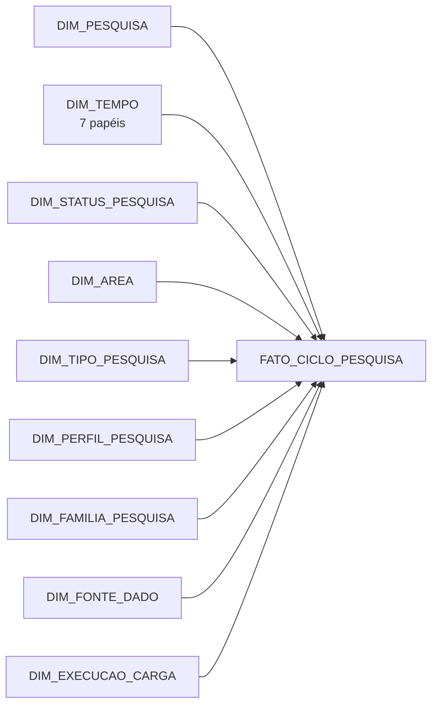
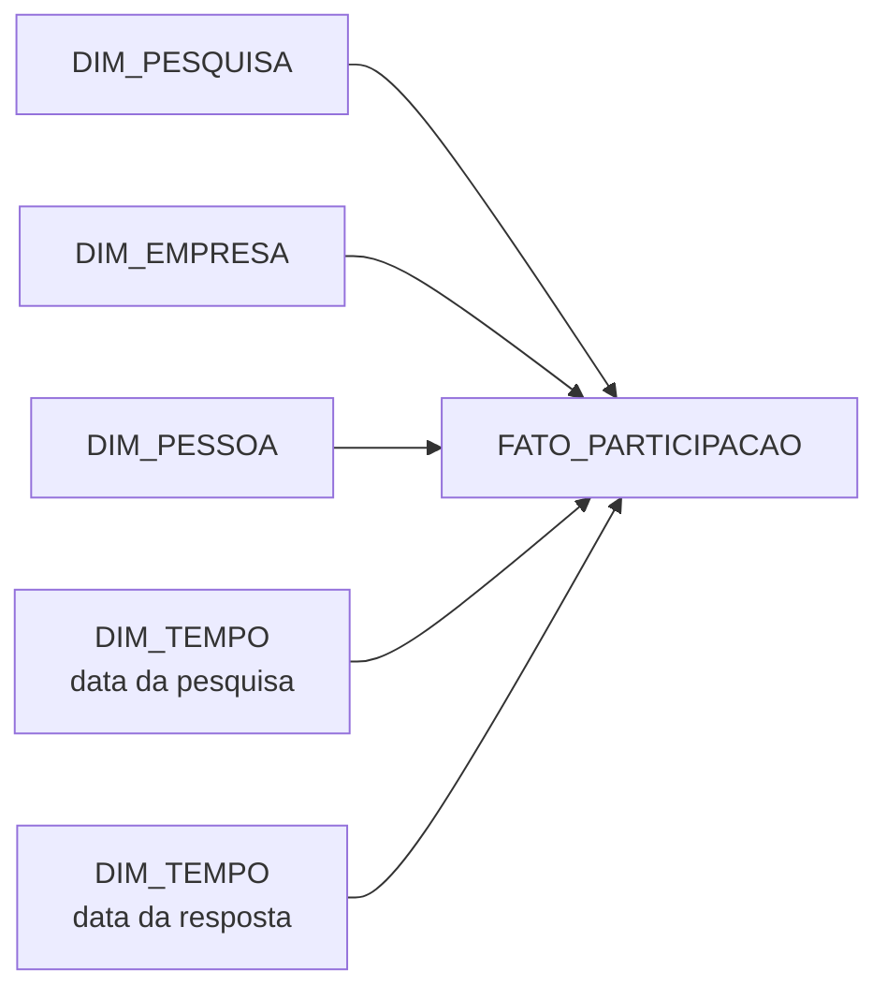
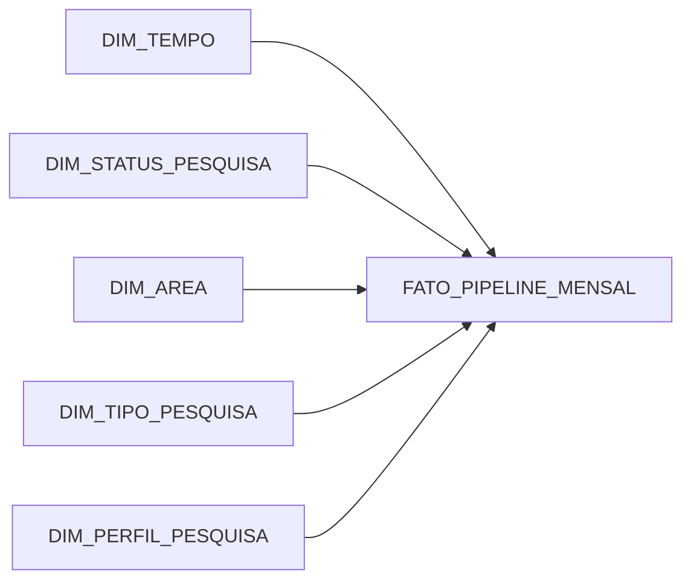
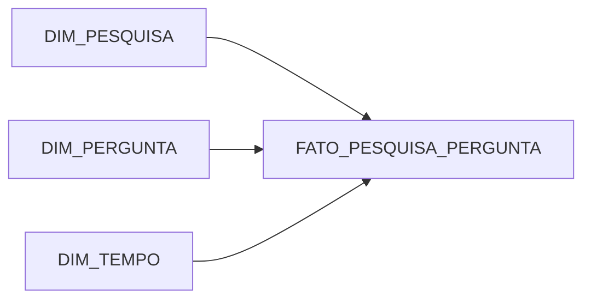
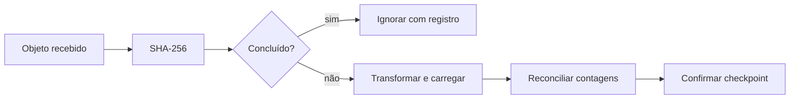
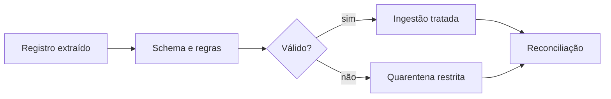
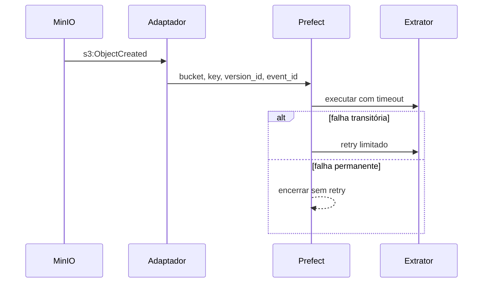
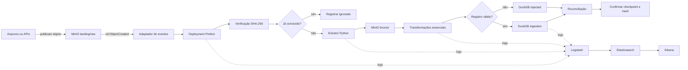

# Data Model Canvas — Sindusfarma

| Metadado | Valor |
| :--- | :--- |
| Parceiro | Sindusfarma |
| Grupo | Grupo 05 |
| Versão | 1.1 |
| Data | 10 de setembro de 2026 |
| Schema do arquivo-fonte | 1 |

Este documento isola e consolida o conteúdo de Data Model Canvas desenvolvido
no [`projeto.md`](projeto.md) e o reconcilia com a fonte principal exigida pelo
barema, o
[`contexto_organizacional_+_requisitos_da_solução_analítica.md`](contexto_organizacional_+_requisitos_da_solução_analítica.md),
mantendo o [`dmc.json`](dmc.json) como fonte canônica para importação na
ferramenta oficial. O canvas cobre o recorte de
Modelo Dimensional da Sprint 3 e as seções corporativas de Negócio, Consumo
Analítico e Governança. Os quatro cubos são contratos técnicos propostos; não
afirmam a existência de um data warehouse implantado. Estados pendentes,
indisponíveis ou propostos representam dependências reais e não devem ser
interpretados como campos esquecidos.

Os campos de Modelo Dimensional, Dados e Governança dos quatro cubos, as Táticas
Arquiteturais e a Arquitetura do ETL estão completos tanto no JSON quanto neste
Markdown. As chaves seguem o esquema serializado pela ferramenta oficial.

## 1. Negócio e consumo analítico

### 1.1 Objetivos de negócio

1. Construir a espinha dorsal de dados da Central de Pesquisas, cobrindo integração, centralização, governança, qualidade e visualização.
2. Integrar as fontes hoje dispersas em um repositório central único.
3. Garantir rastreabilidade ponta a ponta, da solicitação à publicação.
4. Reduzir esforço manual e tempo de entrega das pesquisas.
5. Ampliar adesão e engajamento das indústrias participantes.
6. Sustentar decisões estratégicas com painéis derivados do banco central.
7. Assegurar governança, segurança da informação e conformidade com a LGPD.

Todos os itens acima são resultados pretendidos, não capacidades já comprovadas
em produção.

### 1.2 Perguntas de negócio

| ID | Pergunta |
| :--- | :--- |
| PB01 | Quais pesquisas compõem o portfólio e como se distribuem por período, tipo, área, complexidade e status? |
| PB02 | Em que etapa está cada pesquisa, quais marcos foram observados ou derivados e quais informações do seu detalhe estão disponíveis? |
| PB03 | Quais pesquisas estão atrasadas, foram prorrogadas ou demandam prioridade, qual denominador sustenta cada comparação e como os tempos do ciclo se comparam? |
| PB04 | A participação alcançada é suficiente e representa as empresas ou parcelas de mercado relevantes, e qual denominador sustenta essa leitura? |
| PB05 | Quais áreas, departamentos e cargos participam mais ou menos, e qual é o denominador disponível para o engajamento? |
| PB06 | Quais dados estão completos e válidos, quais lacunas permanecem e qual é o estado de atualização de cada fonte? |
| PB07 | Qual sistema ou arquivo sustenta cada elo do agregado, qual é o estado observado, em reconciliação ou proposto, e como tratar os quatro `pesquisa_id` sem correspondência e as 55 participações com `id_pesq` 304 ausente? |
| PB08 | Que dados cada perfil pode consultar, detalhar ou publicar sem expor informações não autorizadas? |
| PB09 | O resultado foi autorizado e publicado, quais metadados sustentam essa decisão e ele está consistente com a pesquisa interna correspondente? |
| PB10 | Qual foi a distribuição das respostas para cada questão, qual denominador está disponível e como ela varia entre pesquisas ou segmentos permitidos? |
| PB11 | Qual evidência agregada sustenta este resultado, que contexto está disponível e a consulta individual é autorizada e suportada pelos dados? |
| PB12 | Quais fontes foram recebidas, atualizadas e padronizadas, quais registros foram deduplicados e qual origem sustenta cada dado? |
| PB13 | Qual versão do questionário foi revisada por qual área técnica, em que estado de validação e antes de qual marco do ciclo? |

### 1.3 Processos de negócio atuais

1. Solicitação, triagem e aprovação da demanda de pesquisa.
2. Planejamento do cronograma e validação técnica do questionário.
3. Divulgação, coleta e acompanhamento de empresas e respondentes.
4. Encerramento, validação e tabulação das respostas.
5. Entrega dos resultados e publicação autorizada no acervo.

### 1.4 Indicadores de consumo

| ID | Indicador e condição de cálculo |
| :--- | :--- |
| I01 | **Pesquisas no portfólio:** contagem distinta de pesquisas; calculável agora. |
| I02 | **Distribuição do portfólio:** pesquisas da categoria sobre pesquisas do mesmo recorte; calculável agora. |
| I03 | **Cobertura dos marcos:** pesquisas com data válida sobre pesquisas elegíveis; calculável agora. |
| I04 | **Tempo entre marcos:** diferença apenas entre datas válidas, mantendo dias corridos separados de dias úteis; calculável agora. |
| I05 | **Taxa observada de prorrogação:** pesquisas com prorrogação sobre pesquisas com data limite; calculável agora. |
| I06 | **Pesquisas atrasadas ou prioritárias:** indisponível sem data de referência e regra aprovadas. |
| I07 | **Empresas participantes distintas por pesquisa:** calculável agora. |
| I08 | **Taxa de adesão:** participantes elegíveis sobre empresas convidadas; indisponível sem universo de convites. |
| I09 | **Participação de mercado observada:** bloqueada até normalizar os valores e homologar a fonte autoritativa. |
| I10 | **Engajamento por público:** participações e clientes conciliados são contagens separadas; exige reconciliação. |
| I11 | **Taxa de engajamento:** participantes elegíveis sobre convidados do mesmo público; indisponível sem denominador. |
| I12 | **Distribuição agregada de respostas:** elementos válidos da categoria sobre elementos válidos da questão; calculável na fonte de respostas. |
| I13 | **Respondentes distintos na fonte de respostas:** contagem distinta de `respondent_id`, sem união presumida com clientes. |
| I14 | **Questões por tipo:** contagem distinta de perguntas; calculável agora. |
| I15 | **Estado de validação e versão:** indisponível sem versão, área revisora, decisão e timestamp. |
| I16 | **Completude aplicável:** células preenchidas sobre células aplicáveis; calculável agora. |
| I17 | **Taxa de duplicidade:** linhas além da primeira no grão sobre linhas avaliadas; calculável agora. |
| I18 | **Integridade referencial:** chaves correspondentes sobre chaves informadas, calculada por relação. |
| I19 | **Parseabilidade:** valores convertíveis sobre valores informados avaliados; calculável agora. |
| I20 | **Divergência de título:** linhas divergentes sobre linhas comparáveis; calculável agora. |
| I21 | **Frescor da fonte:** indisponível sem timestamp de carga e regra aprovada. |
| I22 | **Cobertura da linhagem:** elos correspondentes sobre elos elegíveis; exige mapeamento. |
| I23 | **Estado de publicação autorizada:** indisponível sem decisão, estado e data de publicação. |
| I24 | **Cobertura do processamento:** fontes concluídas e válidas sobre fontes esperadas; indisponível sem catálogo e execuções. |
| I25 | **Conformidade de acesso:** decisões aderentes à política sobre tentativas avaliadas; indisponível sem política e logs. |

#### Síntese do consumo analítico

“Calculável agora” descreve o que os campos do snapshot permitem calcular, não
uma entrega produtiva. “Exige normalização ou mapeamento” identifica regra ou
reconciliação pendente. “Depende de integração futura” indica ausência de fonte
ou metadado.

| Eixo de consumo | Indicadores | Usuário e forma de consumo propostos | Decisões apoiadas |
| :--- | :--- | :--- | :--- |
| Portfólio e ciclo | I01–I05 calculáveis; I06 aguarda regra de atraso, prioridade e data de referência | Central de Pesquisas e gestores; D01, filtros, detalhe condicionado à autorização e relatório | Priorizar pesquisas, localizar marcos ausentes, comparar durações e avaliar prorrogação sem misturar dias corridos e úteis |
| Adesão e participação | I07 calculável; I09–I10 exigem reconciliação; I08 e I11 aguardam universo elegível | Central, áreas técnicas e gestores; D02 e tabelas com numerador, denominador e indisponibilidade | Identificar empresas participantes e públicos com menor participação; calcular adesão ou engajamento somente quando o denominador existir |
| Resultados e questionários | I12–I14 calculáveis; I15 aguarda versão e decisão de validação | Áreas técnicas, Central e gestores; D03, filtros por questão e resultados agregados | Interpretar distribuições, avaliar o instrumento e verificar validação sem tratar elemento de resposta como pessoa |
| Qualidade, rastreabilidade e publicação | I16–I20 calculáveis; I22 exige mapeamento; I21 e I23–I25 aguardam integração | Central e papéis de governança; D04, relatórios de exceção, drill-down agregado e trilha futura | Priorizar correções e avaliar frescor, acesso e publicação somente quando metadados e decisões estiverem disponíveis |

### 1.5 Usuários e canais

| ID | Usuário, canal e restrição |
| :--- | :--- |
| UC01 | **Central de Pesquisas:** dashboards operacionais D01–D04, relatórios e tabelas; detalhe somente quando o perfil e a finalidade estiverem autorizados. |
| UC02 | **Áreas técnicas do Sindusfarma:** dashboards e relatórios das pesquisas sob sua atuação; resultados agregados e sem acesso individual presumido. |
| UC03 | **Gestores:** painéis consolidados de portfólio, adesão, qualidade e capacidade; drill-down pessoal bloqueado sem autorização específica. |
| UC04 | **Solicitantes, participantes e público externo:** acervo ou download apenas de resultados aprovados para publicação; sem acesso aos dashboards internos. |

### 1.6 Decisões e riscos

| ID | Decisão ou risco | Impacto | Estado |
| :--- | :--- | :--- | :--- |
| DR01 | Universo elegível de empresas e pessoas | I08 e I11 permanecem indisponíveis sem denominador. | Pendente de fonte e regra do parceiro. |
| DR02 | Fonte autoritativa de participação de mercado | Divergências bloqueiam a homologação de I09. | Pendente de decisão do parceiro. |
| DR03 | Ponte entre participação, pessoa e elemento de resposta | Impede afirmar respondentes únicos entre fontes. | Pendente de reconciliação. |
| DR04 | Metadados de carga, catálogo, versão, autorização e logs | Limita I15 e I21–I25. | Depende de integração futura. |
| DR05 | Plataforma de dados, papel do n8n, perfis de acesso e alimentação do acervo | Define a implementação e os controles operacionais. | Proposta da equipe a validar. |
| DR06 | Campos incompletos, inválidos ou identificáveis | Exigem tratamento, minimização e controle antes de detalhar ou exportar. | Risco observado, condicionado à governança. |

## 2. Governança corporativa

### 2.1 Data Owner

Baseline documental: Fabio Moreira como Data Owner para decisões de negócio,
acesso, indicadores, publicação, exceções e risco residual. A autoridade formal
está sujeita à homologação e não implica papel jurídico na LGPD.

### 2.2 Data Stewards

Baseline documental: Felipe Rojas, Reinaldo Nobrega e Lucas Andrade como Data
Stewards de semântica, catálogo, qualidade e linhagem. A atribuição e a grafia
final estão sujeitas à homologação.

### 2.3 Data Custodian

Baseline documental: Rodrigo Giorgetto e TI como Data Custodian de
infraestrutura e controles técnicos. A participação da RentalHost é condicional
ao ambiente e ao contrato, ambos sujeitos à homologação.

### 2.4 Responsáveis técnicos

Baseline documental: Felipe Rojas, Reinaldo Nobrega e Lucas Andrade como
responsáveis técnicos pelo conteúdo e pelas regras. O escopo operacional está
sujeito à homologação.

### 2.5 LGPD

Diretriz proposta, sujeita à validação do controlador e do encarregado:

- limitar cada tratamento à finalidade documentada e ao mínimo necessário;
- separar identidade da camada analítica;
- não publicar e-mail, chaves estáveis, respostas individuais ou combinações reidentificáveis;
- usar somente dados sintéticos, agregados ou com anonimização testada no ambiente acadêmico;
- não apresentar pseudonimização como anonimização.

### 2.6 Segurança

Desenho proposto, ainda não homologado: acesso individual por menor privilégio,
necessidade de conhecer, recurso, ação e finalidade; segregação entre ambientes
acadêmico, desenvolvimento, homologação e produção; dados reais apenas em
ambiente autorizado; leituras, exportações, alterações, publicações, falhas e
acessos administrativos com trilha auditável e revisão periódica.

### 2.7 Conformidade e retenção

Dados reais ficam restritos ao ambiente autorizado. GitLab e a entrega
acadêmica recebem somente código, documentação e dados sintéticos, agregados ou
anonimizados. A retenção não usa prazo único: mantém-se o mínimo necessário à
finalidade, à obrigação aplicável e à prestação de contas. Ao término, o dado
deve ser eliminado, anonimizado ou bloqueado, incluindo expiração controlada de
backups.

### 2.8 Uso ético

Uso restrito às finalidades documentadas das pesquisas setoriais. Registros
inválidos, órfãos ou suspeitos devem ser classificados e colocados em quarentena
para auditoria e reconciliação, nunca apagados ou corrigidos silenciosamente.
Somente dados aprovados seguem para consumo ou publicação, preservando a
confidencialidade de empresas e respondentes.

### 2.9 Catálogo

Catálogo proposto e versionado para pesquisas, empresas, clientes,
respondentes, questões e respostas. Cada fonte e campo deve registrar:

- descrição e tipo esperado;
- nulabilidade ou aplicabilidade;
- domínio, chave e origem;
- destino analítico e classificação;
- responsável e regra de qualidade;
- versão e estado observado, em reconciliação ou proposto.

A implantação do catálogo e seus registros de execução dependem da integração
futura.

### 2.10 KPIs de governança e qualidade

São calculáveis pelo perfilamento atual: completude por campo e aplicabilidade,
unicidade ou duplicidade por chave, integridade referencial, parseabilidade por
tipo e divergência de título. Todo KPI deve registrar numerador, denominador,
unidade, grão, fonte e regra.

Dependem do pipeline: frescor por timestamp de carga, cobertura de linhagem,
publicação autorizada, cobertura de processamento das fontes e conformidade de
acesso. Enquanto faltarem catálogo, execução, política, decisão ou log, o
resultado deve ser indisponível, nunca zero estimado.

### 2.11 Maturidade

**Estado observado:** fontes fragmentadas, cruzamentos e atualizações manuais,
linhagem parcial e ausência de catálogo operacional, timestamps de carga,
política homologada e logs de acesso.

**Estado-alvo proposto:** fonte integrada e governada, com contratos
versionados, execução rastreável, qualidade mensurada e decisões de acesso e
publicação auditáveis. Não há evidência de que esse estado-alvo já opere em
produção.

### 2.12 Evolução

1. Versionar catálogo, regras e baseline de qualidade.
2. Implantar o MVP com banco central e ao menos um pipeline que registre fonte, versão, execução, resultado e timestamp.
3. Ampliar ingestão e linhagem para as fontes aprovadas.
4. Habilitar dashboards e publicação somente após validar perfis, logs, agregação, autorização e controles de retirada ou correção.

Automação completa e integração do acervo permanecem metas futuras, não
capacidades atuais.

### 2.13 Evidência e proposta

| Elemento do canvas | Evidência disponível | Proposta ainda a validar ou implementar |
| :--- | :--- | :--- |
| Negócio | TAPI, Arquitetura de Negócio, JTBD e Problem Canvas registram fragmentação das fontes, públicos, necessidades de decisão e ciclo atual. O snapshot confirma campos e limitações. | Os objetivos são resultados pretendidos. PB01–PB13 são contratos de decisão e representar todo o ciclo de forma integrada no DW é TO-BE. |
| Consumo analítico | O JSON registra I01–I25 e preserva usuários, canais, decisões e riscos. | Dashboards automáticos, taxas sem denominador, atualização em tempo real e integração automática permanecem condicionados às fontes e regras faltantes; indicador indisponível não recebe zero. |
| Governança corporativa | O JSON preserva os nomes e textos do baseline documental. | A formalização jurídica e operacional dos papéis e as políticas de acesso, retenção, auditoria e publicação ainda dependem de validação do parceiro. |
| Cubos | O JSON define portfólio e ciclo, participação e representatividade, pipeline mensal e resultados/questionários. | Os modelos são contratos propostos; grãos, fatos e dimensões exigem homologação antes da implantação produtiva. |

Trechos interrompidos no material de origem não devem ser reconstruídos por
inferência. Essa regra separa o que o artefato efetivamente evidencia do que os
demais documentos apenas permitem propor.

## 3. Cubos dimensionais

Os cubos usam estrutura em estrela, preservam chaves recebidas como chaves de
origem e só admitem uma chave canônica depois da reconciliação. Dimensões
degeneradas mantêm IDs e títulos para auditoria; dimensões de perfil não expõem
e-mail nem resposta individual nos painéis.

| ID / cubo | Grão e estrutura | Tipo de fato | Indicadores ou métricas | Disponibilidade |
| :--- | :--- | :--- | :--- | :--- |
| C01 — Portfólio e Ciclo | Uma linha por pesquisa, acumulando os marcos observados da solicitação à entrega | Snapshot acumulativo | I01–I06 | I01–I05 calculáveis; I06 depende de regra e data de referência aprovadas |
| C02 — Participação e Representatividade | Uma linha por registro de `respondentes.csv`, sem afirmar unicidade de pessoa | Transação | I07–I11 | I07 calculável; I08–I11 dependem de denominador, normalização ou reconciliação |
| C03 — Pipeline Mensal | Uma linha por mês, status, área, tipo e perfil | Snapshot periódico | estoque, entradas e saídas | Calculável após go-live; histórico anterior indisponível |
| C04 — Resultados e Questionários | Uma linha por pergunta associada a uma pesquisa | Fato de associação | perguntas e alternativas | Cobertura de 10 pesquisas, equivalente a 2,7% do acervo |

### 3.1 C01 — Portfólio e Ciclo

| Propriedade | Definição |
| :--- | :--- |
| ID | `cubo-1` |
| Esquema | Estrela |
| Tipo de fato | Snapshot acumulativo |
| Outro esquema | Não aplicável; a documentação descreve estrutura em estrela. |
| Tabelas-ponte | Não previstas. |
| Junk dimensions | Não previstas. |
| Dimensões conformadas | Pesquisa; Tempo; Status da Pesquisa; Área; Tipo; Perfil |


*Fonte: material elaborado pela equipe.*



#### Grão

- Uma linha por pesquisa, totalizando aproximadamente 366 linhas no snapshot atual.
- A linha acumula solicitação, aprovação, divulgação, limite de coleta, prorrogação e entrega.
- O fato é atualizado conforme a pesquisa avança pelos marcos do ciclo.

#### Fatos

- Solicitação registrada.
- Aprovação registrada.
- Divulgação registrada.
- Limite de coleta definido.
- Prorrogação registrada.
- Entrega registrada.

#### Métricas

- `dias_uteis_validacao`: `data_aprov` menos `data_solicitacao`. Até a homologação do calendário, calcular e rotular apenas a diferença em dias corridos, sem apresentá-la como dias úteis. Cobertura de 5,5% (20 de 366), sempre com denominador e excluídos.
- `dias_uteis_coleta`: `data_limite`, ou `prorrogada_ate` quando existir, menos `data_divulgacao`. Até a homologação do calendário, calcular e rotular apenas dias corridos; não misturar as duas convenções.
- `dias_uteis_tabulacao`: `data_entrega` menos `data_limite`, ou `prorrogada_ate` quando existir. Até a homologação do calendário, calcular e rotular apenas dias corridos; pares incompletos produzem `NULL`.
- `dias_uteis_ciclo_total`: `data_entrega` menos `data_solicitacao`; métrica não aditiva, usada sem soma com as fases para evitar dupla contagem.
- `qtd_empresas_na_pesquisa`: contagem declarada na coluna `participantes` do CSV; métrica não aditiva, lida somente no nível da pesquisa e distinta da contagem observada no C02.
- `qtd_respondentes_na_pesquisa`: removida do C01. Contagens de respondentes devem ser calculadas no C02 a partir de `respondentes.csv`, usando participação ou pessoa conciliada conforme o denominador aprovado.
- `flag_prorrogada`: 1 quando `prorrogada_ate` não é nulo e 0 caso contrário; usada como filtro.

#### Dimensões

- `sk_pesquisa`: `DIM_PESQUISA`, com título, objetivos e ano da edição.
- `sk_data_solicitacao`: `DIM_TEMPO` para a data de solicitação.
- `sk_data_aprovacao`: `DIM_TEMPO` para a data de aprovação.
- `sk_data_divulgacao`: `DIM_TEMPO` para a data de divulgação.
- `sk_data_limite_coleta`: `DIM_TEMPO` para a data limite original.
- `sk_data_prorrogacao`: `DIM_TEMPO` para a data limite prorrogada, quando existir.
- `sk_data_entrega`: `DIM_TEMPO` para a data de entrega.
- `sk_area`: `DIM_AREA`, derivada de `pesquisas.area`.
- `sk_status`: `DIM_STATUS_PESQUISA`, derivada de `pesquisas.status`.
- `sk_tipo`: `DIM_TIPO_PESQUISA`, derivada de `pesquisas.tipo`.
- `sk_perfil`: `DIM_PERFIL_PESQUISA`, com atributos imutáveis como complexidade e tipo de resposta.
- `sk_familia`: `DIM_FAMILIA_PESQUISA`, derivada do título para agrupar edições recorrentes.
- `sk_fonte`: `DIM_FONTE_DADO`, dimensão de linhagem do sistema de origem.
- `sk_carga`: `DIM_EXECUCAO_CARGA`, dimensão de governança da execução de ETL.

#### Observações do C01

- Os `pesquisa_id` 424, 1116, 1139 e 1147 não existem em `pesquisas.csv`. Eles devem permanecer como chaves órfãs em reconciliação e apontar para “Não mapeado”, sem criação silenciosa de entidades.
- `data_aprov` cobre somente 20 das 366 pesquisas (5,5%). Métricas dependentes recebem `NULL` quando o par de datas não existe e o painel deve declarar o denominador válido.
- `DIM_FAMILIA_PESQUISA` é derivada por normalização de títulos e precisa de validação do Sindusfarma antes de ser tratada como classificação oficial.
- O cubo não armazena dados individuais de respondentes. Publicações externas exigem agregação e os controles de anonimização aprovados.

#### Dados do C01

**Fontes:** `pesquisas.csv`.

**Transformações:** validar e converter datas; calcular diferenças em dias
corridos entre pares válidos; usar calendário útil somente após homologação;
usar `prorrogada_ate` como fim efetivo quando existir; derivar
`flag_prorrogada` e `DIM_FAMILIA_PESQUISA`; preservar chaves de origem.

**Qualidade:** quatro IDs de outras fontes permanecem em reconciliação;
`data_aprov` tem baixa cobertura; famílias derivadas exigem homologação; o cubo
não recebe detalhe individual de respondentes.

**Histórico/SCD:** usar SCD2 somente após aprovação das regras; manter chave
durável, chave de origem, início/fim de vigência, versão e linhagem de carga.

#### Otimização e governança do C01

| Campo | Definição |
| :--- | :--- |
| Particionamento | Data de solicitação ou divulgação, conforme a consulta. |
| Materializações | Período, área, tipo, status, complexidade, família e prorrogação. |
| Ordenação | Pesquisa, papéis de tempo, status, área, tipo e família. |
| Queries críticas | Duração por etapa, entregas, prorrogações e gargalos. |
| Classificação | Interno; sem dado pessoal ou sensível; dado crítico. Uma saída agregada só se torna pública após autorização. |
| Acesso | Agregação externa autorizada; detalhe interno por menor privilégio. |
| Auditoria | Fonte, versão, execução, resultado e timestamp do ETL. |
| Ciclo de vida | Retenção por finalidade; arquivo versionado; expurgo aprovado e quarentena de órfãos. |
| Metadados | Pesquisa, título, marcos, área, status, tipo, perfil, fonte, versão e execução. |
| KPI de qualidade | Pesquisas com data válida / pesquisas elegíveis, por marco. |
| KPI de governança | Pesquisas com fonte, versão e execução / pesquisas carregadas. |

### 3.2 C02 — Participação e Representatividade

| Propriedade | Definição |
| :--- | :--- |
| ID | `cubo-2` |
| Esquema | Estrela |
| Tipo de fato | Transação |
| Outro esquema | Não aplicável; a documentação descreve estrutura em estrela. |
| Tabelas-ponte | Não previstas. |
| Junk dimensions | Não previstas. |
| Dimensões conformadas | Pesquisa; Tempo |


*Fonte: material elaborado pela equipe.*



#### Grão

- Uma linha por participação, totalizando aproximadamente 18.735 linhas no snapshot atual.
- Cada linha representa um registro de `respondentes.csv`, não uma resposta individual a uma questão, e não acumula estados.
- O cubo suporta contagem bruta de participações e contagem distinta quando filtrado por `seq_ocorrencia`.

#### Fatos

- Participação registrada.
- Início de participação registrado.
- Término de participação registrado.
- Registro de participação recebido de `respondentes.csv`.

#### Métricas

- `qtd_participacao`: sempre 1, pois cada linha é uma participação; métrica aditiva que não representa quantidade de respostas a questões.
- `seq_ocorrencia`: número sequencial para duplicatas de pesquisa e pessoa; métrica não aditiva usada como filtro para deduplicação.
- `minutos_preenchimento`: diferença entre `hora_termino` e `hora_inicio` em minutos; aditiva onde existir, com cobertura aproximada de 4,3%.
- `pct_mercado_na_participacao`: `market_share` de `respondentes.csv` no nível da participação; não aditiva e não homologada enquanto houver conflito com `empresas.csv`. Após decidir a fonte autoritativa, I09 soma uma vez por pesquisa o valor normalizado de cada empresa participante distinta.

#### Dimensões

- `sk_pesquisa`: `DIM_PESQUISA`, a pesquisa respondida.
- `sk_empresa`: `DIM_EMPRESA`, com nome, nacionalidade, cidade, tipo de associado e share de mercado atual.
- `sk_pessoa`: `DIM_PESSOA`, com cargo, departamento, nível hierárquico e agrupamento de departamento para anonimização; sem e-mail.
- `sk_data_pesquisa`: `DIM_TEMPO` herdada de `pesquisas.data_divulgacao`, chave temporal primária.
- `sk_data_resposta`: `DIM_TEMPO` extraída de `respondentes.hora_inicio`, chave opcional para sazonalidade e tempo de preenchimento.

#### Observações do C02

- Há 838 ocorrências em que a mesma pessoa aparece na mesma pesquisa mais de uma vez. `seq_ocorrencia = 1` permite a leitura deduplicada sem eliminar os registros de origem.
- `hora_inicio` e `hora_termino` cobrem aproximadamente 4,3% das linhas. Duração média ou mediana deve filtrar somente pares completos e informar a cobertura.
- `respondentes.market_share` e `empresas.% de mercado` divergem. Nenhuma fonte recebe precedência antes da homologação; I09 fica bloqueado em caso de conflito.
- Cargo e departamento são restritos. A camada externa deve usar agrupamentos aprovados e não pode expor e-mail ou combinações reidentificáveis.
- Contagens distintas devem usar chaves duráveis de empresa ou pessoa, e não chaves substitutas sujeitas a versionamento SCD2.

#### Dados do C02

**Fontes:** `respondentes.csv`, `pesquisas.csv`, `clientes.csv` e
`empresas.csv`.

**Transformações:** criar `qtd_participacao`; numerar `seq_ocorrencia`;
calcular duração somente com horários válidos; usar `data_divulgacao` como data
primária enquanto `hora_inicio` tiver baixa cobertura; não escolher uma fonte
de market share antes da homologação.

**Qualidade:** 838 ocorrências adicionais devem ser preservadas e numeradas;
horários têm cobertura aproximada de 4,3%; market share é divergente; cargo e
departamento são restritos; 55 participações apontam para `id_pesq=304` ausente.

**Histórico/SCD:** usar chaves duráveis nas contagens; versionar atributos
históricos somente com vigência e fonte aprovadas; separar identidade canônica
das versões dimensionais.

#### Otimização e governança do C02

| Campo | Definição |
| :--- | :--- |
| Particionamento | Data da pesquisa e, opcionalmente, data da resposta válida. |
| Materializações | Pesquisa, empresa, pessoa conciliada, público agrupado, período e representatividade homologada. |
| Ordenação | Pesquisa, empresa, pessoa, datas e `seq_ocorrencia`. |
| Queries críticas | Participação por empresa, pessoas distintas, engajamento e cobertura de mercado. |
| Classificação | Restrito; dado pessoal e crítico; não sensível por definição atual. |
| Acesso | Menor privilégio e finalidade; agrupamento de atributos e bloqueio abaixo do limiar homologado. |
| Auditoria | Origem, execução, conciliação, deduplicação, consultas, exportações e decisões de acesso. |
| Ciclo de vida | Identidade separada; retenção mínima; arquivo restrito; eliminação autorizada sem apagar duplicatas silenciosamente. |
| Metadados | Pesquisa, empresa, pessoa conciliada, horários, origem, versão, execução e estado da conciliação. |
| KPI de qualidade | Cobertura temporal, duplicidade e conciliação com numerador e denominador. |
| KPI de governança | Registros com linhagem, chave durável, decisão de acesso e anonimização / registros elegíveis. |

### 3.3 C03 — Pipeline Mensal

| Propriedade | Definição |
| :--- | :--- |
| ID | `cubo-3` |
| Esquema | Estrela |
| Tipo de fato | Snapshot periódico |
| Outro esquema | Não aplicável; a documentação descreve estrutura em estrela. |
| Tabelas-ponte | Não previstas. |
| Junk dimensions | Não previstas. |
| Dimensões conformadas | Tempo; Status da Pesquisa; Área; Tipo; Perfil |


*Fonte: material elaborado pela equipe.*



#### Grão

- Uma linha por combinação de mês, status, área, tipo e perfil.
- O fato captura o estado do pipeline no fim de cada mês.
- A fonte é derivada do C01, mas sem reconstrução histórica de status anteriores.

#### Fatos

- Estado mensal da pesquisa no status.
- Entrada no status durante o mês.
- Saída do status durante o mês.
- Fechamento mensal do pipeline.

#### Métricas

- `qtd_pesquisas_no_status`: estoque de pesquisas naquele status no último dia do mês; semi-aditiva entre categorias disjuntas do mesmo fechamento e nunca somada entre meses.
- `qtd_entradas_no_mes`: fluxo de pesquisas que chegaram ao status durante o mês; aditiva no tempo somente quando houver histórico de transições, pois diferenças de snapshots mostram apenas mudança líquida.
- `qtd_saidas_no_mes`: fluxo de pesquisas que saíram do status durante o mês; aditiva no tempo e indisponível enquanto não houver histórico de transições.

#### Dimensões

- `sk_data_fim_mes`: `DIM_TEMPO` para o último dia do mês.
- `sk_status`: `DIM_STATUS_PESQUISA`, com status no snapshot, como Em andamento, Em tabulação e Finalizada.
- `sk_area`: `DIM_AREA`, área responsável pela pesquisa.
- `sk_tipo`: `DIM_TIPO_PESQUISA`, tipo da pesquisa.
- `sk_perfil`: `DIM_PERFIL_PESQUISA`, com atributos imutáveis como complexidade e tipo de resposta.

#### Observações do C03

- Não existe histórico de status anterior. O cubo começa no go-live e não deve fabricar backfill.
- `qtd_a_finalizar` não é armazenada no fato, pois somá-la entre status multiplica o estoque. A camada semântica deve usar `flag_conta_como_a_finalizar` de `DIM_STATUS_PESQUISA`.
- `DIM_STATUS_PESQUISA` deve oferecer `flag_em_aberto`, `flag_conta_como_a_finalizar` e `flag_terminal`, evitando regras de status fixas no código.
- O fechamento recomendado ocorre no primeiro dia útil do mês, referente ao último dia do mês anterior, após aprovação operacional dessa agenda.

#### Dados do C03

**Fontes:** derivado do C01, com `pesquisas.csv` como base inicial.

**Transformações:** fechar o mês em execução identificada; usar papel específico
de `DIM_TEMPO`; calcular entradas e saídas apenas sobre histórico real; derivar
“a finalizar” na camada semântica pelas flags de status.

**Qualidade:** não há histórico anterior ao go-live; backfill inferido é
proibido; estoque não pode ser somado entre meses; toda linha precisa de status
válido e versão da regra.

**Histórico/SCD:** snapshots mensais são imutáveis; mudanças de significado dos
status são versionadas em `DIM_STATUS_PESQUISA`; cada fechamento preserva a
versão aplicada.

#### Otimização e governança do C03

| Campo | Definição |
| :--- | :--- |
| Particionamento | Último dia do mês do snapshot. |
| Materializações | Agregações mensais por status, área, tipo e perfil; estoques separados de fluxos. |
| Ordenação | `sk_data_fim_mes`, status, área, tipo e perfil. |
| Queries críticas | Pipeline por mês, entregas, entradas, saídas e gargalos. |
| Classificação | Interno; sem dado pessoal ou sensível; dado crítico. |
| Acesso | Agregações operacionais autorizadas, sem detalhe pessoal. |
| Auditoria | Competência, fechamento, versão da regra e execução do snapshot. |
| Ciclo de vida | Retenção mensal aprovada, arquivo de cada fotografia e expurgo após o prazo. |
| Metadados | Competência, instante de fechamento, dimensões, flags, versão da regra e execução. |
| KPI de qualidade | Combinações válidas / combinações avaliadas em cada fechamento. |
| KPI de governança | Snapshots com competência, regra e execução completas / snapshots esperados. |

### 3.4 C04 — Resultados e Questionários

| Propriedade | Definição |
| :--- | :--- |
| ID | `cubo-4` |
| Esquema | Estrela |
| Tipo de fato | Fato de associação sem medidas numéricas tradicionais (*factless fact*) |
| Outro esquema | Fato de associação sem medidas numéricas tradicionais. |
| Tabelas-ponte | Não prevista; o vínculo entre pesquisa e pergunta é modelado no próprio fato. |
| Junk dimensions | Não previstas. |
| Dimensões conformadas | Pesquisa; Tempo |


*Fonte: material elaborado pela equipe.*



#### Grão

- Uma linha por pergunta em uma pesquisa, totalizando 231 linhas no snapshot atual.
- A cobertura atual é de 10 das 366 pesquisas, aproximadamente 2,7% do acervo.
- O fato conecta pesquisa e pergunta sem medidas numéricas tradicionais para soma.

#### Fatos

- Associação entre pesquisa e pergunta.
- Presença de pergunta em pesquisa.
- Metadados de pergunta disponíveis para análise futura.

#### Métricas

- `qtd_pergunta`: `COUNT(*)` derivado das associações distintas entre pesquisa e pergunta no grão consultado; não é medida constante armazenada no fato.
- `qtd_alternativas`: atributo de `DIM_PERGUNTA`, não uma medida do fato; totais e médias devem considerar perguntas distintas e declarar o denominador.

#### Dimensões

- `sk_pesquisa`: `DIM_PESQUISA`, pesquisa que contém a pergunta.
- `sk_pergunta`: `DIM_PERGUNTA`, com enunciado, tipo de questão, número de alternativas, formato de arquivo de origem e outras características.
- `sk_data_pesquisa`: `DIM_TEMPO` herdada de `pesquisas.data_divulgacao`.

#### Observações do C04

- Das 231 linhas de `questoes.csv`, 188 (81,4%) ligam diretamente às pesquisas 112, 238, 274, 377, 414 e 415. Os IDs 424, 1116, 1139 e 1147 permanecem em reconciliação; correspondência por título não vira chave canônica sem validação.
- A fonte cobre 10 de 366 pesquisas (2,7%). Para as demais, o consumo deve declarar “Dados não disponíveis”.
- O cubo é ponto de extensão para uma futura `FATO_RESPOSTA`. A ponte entre `respostas.respondent_id` e a identidade de `respondentes.csv` não está comprovada; análise por pessoa ou segmento continua bloqueada.
- `qtd_alternativas` é atributo de `DIM_PERGUNTA`. Agregações devem operar sobre perguntas distintas e declarar o denominador.

#### Dados do C04

**Fontes:** `questoes.csv` e `pesquisas.csv`. `respostas.csv` é somente uma
extensão agregada futura e não integra o cubo atual.

**Transformações:** deduplicar a associação no grão; derivar `qtd_pergunta` por
contagem; manter `qtd_alternativas` como atributo; vincular seis pesquisas por
ID; manter quatro IDs em reconciliação com fallback exato e auditável; não unir
respondentes e clientes sem contrato aprovado.

**Qualidade:** cobertura de 10/366 pesquisas; ligação direta de 188/231 linhas;
quatro IDs órfãos; consulta fora da cobertura retorna indisponível; resposta
agregada não autoriza consulta individual.

**Histórico/SCD:** versionar `DIM_PERGUNTA` e o instrumento vigente; integrar
uma futura `FATO_RESPOSTA` somente depois da reconciliação e autorização.

#### Otimização e governança do C04

| Campo | Definição |
| :--- | :--- |
| Particionamento | Pesquisa e data de divulgação. |
| Materializações | Pesquisa, tipo de questão, pergunta distinta, alternativas e período. |
| Ordenação | `sk_pesquisa`, `sk_pergunta` e `sk_data_pesquisa`. |
| Queries críticas | Perguntas por pesquisa, tipos, instrumentos semelhantes e cobertura. |
| Classificação | Interno; sem dado pessoal ou sensível no modelo atual; dado crítico. |
| Acesso | Indisponibilidade fora da cobertura; nenhum detalhe individual sem autorização. |
| Auditoria | Arquivo, ID original, tipo do vínculo, título comparado, versão e confiança. |
| Ciclo de vida | Retenção pela finalidade; arquivo de versões; expurgo aprovado; órfãos em quarentena. |
| Metadados | Pesquisa, ID original, pergunta, tipo, alternativas, origem, versão, vínculo e confiança. |
| KPI de qualidade | Pesquisas cobertas / acervo e linhas ligadas / linhas avaliadas. |
| KPI de governança | Associações com origem, versão e decisão / associações elegíveis. |

### 3.5 Dimensões conformadas entre os cubos

Uma dimensão só é conformada quando é compartilhada por mais de um cubo com o
mesmo significado e contrato de chave.

| Dimensão conformada | Cubos |
| :--- | :--- |
| `DIM_TEMPO` | C01, C02, C03 e C04 |
| `DIM_PESQUISA` | C01, C02 e C04 |
| `DIM_STATUS_PESQUISA` | C01 e C03 |
| `DIM_AREA` | C01 e C03 |
| `DIM_TIPO_PESQUISA` | C01 e C03 |
| `DIM_PERFIL_PESQUISA` | C01 e C03 |

`DIM_EMPRESA` e `DIM_PESSOA` são próprias do C02; `DIM_PERGUNTA`, do C04;
`DIM_FAMILIA_PESQUISA`, `DIM_FONTE_DADO` e `DIM_EXECUCAO_CARGA`, do C01 no
recorte atual. Uma possível reutilização futura não as torna conformadas hoje.

## 4. Matriz de rastreabilidade

| Pergunta | Requisito | Indicadores | Cubo ou artefato | Dashboard |
| :--- | :--- | :--- | :--- | :--- |
| PB01 | RF01 | I01, I02 | C01 — atributos de tipo, área, complexidade e status | D01 |
| PB02 | RF02 | I03, I04 | C01 — marcos da solicitação à entrega | D01 |
| PB03 | RF03 | I04, I05, I06 | C01 para datas e prorrogações; C03 para pipeline mensal | D01 |
| PB04 | RF04 | I07, I08, I09 | C02 — participação associada a empresa e mercado | D02 |
| PB05 | RF05 | I10, I11 | C02 — participação, pessoa, cargo e departamento | D02 |
| PB06 | RF06 | I16–I21 | Perfilamento de qualidade e governança | D04 |
| PB07 | RF07 | I18, I22 | Perfilamento, órfãos e estado de reconciliação | D04 |
| PB08 | RF08 | I25 | Política de acesso proposta | D04 |
| PB09 | RF09 | I23 | Política de publicação proposta | D04 |
| PB10 | RF10 | I12, I13 | C04 para o instrumento; resposta conciliada é extensão futura | D03 |
| PB11 | RF11 | I12, I13, I18, I22 | C04, perfilamento e governança | D03, D04 |
| PB12 | RF12 | I17, I19, I21, I24 | Perfilamento de qualidade e governança | D04 |
| PB13 | RF13 | I14, I15 | C04; metadados de versão e validação dependem de integração | D03 |

## 5. Táticas arquiteturais

### 5.1 Idempotência por conteúdo e checkpoint tardio

| Campo | Definição |
| :--- | :--- |
| Problema atacado | Eventos do MinIO podem ser repetidos e snapshots podem ser reenviados; confirmar cedo demais duplica ou perde dados. |
| Atributo de qualidade | Confiabilidade e modificabilidade. |
| Tática | Identificar a entrada por fonte, versão e SHA-256; confirmar checkpoint somente depois de transformar, carregar e reconciliar. |
| Implementação | `ExtractedBatch`, `CheckpointStore`, tabela de controle no DuckDB e fluxo Prefect. |
| Alternativas descartadas | Usar somente nome do arquivo ou `event_id`, pois ambos podem repetir ou mudar sem representar o conteúdo. |
| Evidência | Testes de checkpoint, batching, identidade de carga, DDL de controle e reprocessamento seguro. |
| Consequências | Exige tabela de controle e cálculo de hash; permite reexecução convergente. Reversão demanda migrar identidades e checkpoints. |



### 5.2 Validação fail-closed e quarentena auditável

| Campo | Definição |
| :--- | :--- |
| Problema atacado | Tipos inválidos, chaves órfãs e conteúdo identificável podem contaminar o consumo ou vazar em logs. |
| Atributo de qualidade | Segurança e confiabilidade. |
| Tática | Falha de schema interrompe a carga; registros inválidos seguem para quarentena com motivo e referência, sem valor bruto no log. |
| Implementação | `etl.transformation`, `QuarantineStore`, schemas canônicos, regras de consistência e logs sanitizados. |
| Alternativas descartadas | Corrigir ou apagar silenciosamente; registrar payload bruto em logs; aceitar schema incompatível. |
| Evidência | Testes de conversão, consistência, quarentena, ausência de valores brutos e integridade referencial. |
| Consequências | Requer reconciliação operacional dos rejeitados; preserva auditabilidade e impede publicação indevida. |



### 5.3 Evento, timeout e retry limitado

| Campo | Definição |
| :--- | :--- |
| Problema atacado | Varredura periódica aumenta latência; falhas transitórias podem interromper a ingestão; retry oculto pode duplicar trabalho. |
| Atributo de qualidade | Disponibilidade e desempenho. |
| Tática | Evento `s3:ObjectCreated`, timeout explícito e retry limitado somente para falha transitória. |
| Implementação | Adaptador HTTP MinIO → deployment Prefect; `resilience.py` e `failures.py`; parâmetros de timeout. |
| Alternativas descartadas | Polling contínuo; retry infinito; NiFi na arquitetura principal, que duplicaria responsabilidades com Python e Prefect. |
| Evidência | Testes de resiliência, classificação de falhas e contratos de evento; smoke operacional previsto. |
| Consequências | Adiciona Prefect e adaptador de eventos; a fila de notificações precisa ser persistente. A troca do orquestrador fica isolada dos contratos de domínio. |



## 6. Arquitetura do ETL

### 6.1 Fontes e extração

As seis fontes atuais são snapshots CSV. Não existe coluna de atualização ou
frequência confirmada que sustente extração incremental por data. O recorte
incremental técnico é a versão do objeto e seu SHA-256.

| Fonte | Grão | Extração | Critério de recorte |
| :--- | :--- | :--- | :--- |
| `pesquisas.csv` | Pesquisa | CSV do MinIO, em lotes | versão + SHA-256 + posição `row:N` |
| `empresas.csv` | Empresa | CSV do MinIO, em lotes | versão + SHA-256 + posição `row:N` |
| `clientes.csv` | Pessoa cadastrada | CSV do MinIO, em lotes | versão + SHA-256 + posição `row:N` |
| `respondentes.csv` | Participação | CSV do MinIO, em lotes | versão + SHA-256 + posição absoluta |
| `questoes.csv` | Pergunta em pesquisa | CSV do MinIO, em lotes | versão + SHA-256 + posição `row:N` |
| `respostas.csv` | Elemento de resposta | CSV do MinIO, em lotes | versão + SHA-256 + posição `row:N` |

### 6.2 Camadas e zonas

| Camada | Conteúdo | Produzida por |
| :--- | :--- | :--- |
| Landing/raw no MinIO | Objeto recebido, imutável, identificado por versão e hash | Publicador da fonte ou futuro coletor de API |
| Bronze no MinIO | Representação intermediária preservada por execução/lote | Extratores Python |
| Ingestão tratada no DuckDB | Registros tipados e tecnicamente conformes, com metadados | Transformação e repositório de carga |
| Rejeição/quarentena | Referência à origem, regra violada e estado de tratamento; acesso restrito | Transformação |
| Controle e reconciliação | Execuções, hashes, checkpoints, contagens e decisões de carga | Orquestração e carga |
| Dimensional/consumo | Fatos, dimensões e agregações autorizadas dos quatro cubos | Evolução posterior à ingestão homologada |

### 6.3 Orquestração

| Campo | Definição |
| :--- | :--- |
| Orquestrador | Prefect como plano de controle; regras de negócio permanecem em Python. |
| Frequência | Por evento de criação do objeto; schedule adicional somente após definição da janela operacional. |
| Janela de execução | Parametrizada no deployment; não há SLA ou horário homologado pelo parceiro. |
| Dependências | MinIO → verificação do hash → extração → bronze → transformação/quarentena → DuckDB → reconciliação → checkpoint. |

### 6.4 Carga e reprocessamento

| Campo | Definição |
| :--- | :--- |
| Estratégia de carga | Carregar registros conformes no DuckDB e rejeições nas tabelas próprias; serializar decisão por identidade. |
| Idempotência | Fonte + checksum + lote/identidade; hash concluído é ignorado sem duplicação. |
| Reprocessamento | Manual ou backfill parametrizado por fonte, janela e modo; usa somente estado confirmado. |
| Tratamento de falha | Falha permanente interrompe; falha transitória recebe retry limitado; checkpoint não avança antes da reconciliação. |

### 6.5 Verificações de qualidade

- schema, cabeçalhos, encoding, delimitador e contrato do lote;
- conversão de IDs, datas, horários, decimais e percentuais;
- nulabilidade e aplicabilidade por campo;
- unicidade no grão e classificação auditável de duplicatas;
- integridade referencial sem criar vínculo por similaridade;
- reconciliação entre recebidos, aceitos, rejeitados e duplicados;
- ausência de dado pessoal, segredo ou payload bruto em logs;
- bloqueio da confirmação quando carga ou reconciliação falhar.

### 6.6 Telemetria e custo

| Campo | Definição |
| :--- | :--- |
| Métricas coletadas | Duração, recebidos, carregados, rejeitados, duplicados, bytes, tentativas, latência e estado por etapa. |
| Alertas | Falha permanente, retries esgotados, timeout, divergência de reconciliação e indisponibilidade dos serviços essenciais. |
| Linhagem | `run_id`, `task_id`, `event_id`, fonte, bucket, objeto, versão, hash, lote, schema e timestamps. |
| Custo estimado | Deve separar processamento, MinIO, DuckDB, Prefect, Elastic Stack, transferência e retenção. Valor monetário permanece indisponível sem volume futuro, frequência, ambiente e retenção aprovados. |

### 6.7 Fluxo ponta a ponta



## 7. Validação

O JSON canônico e sua rastreabilidade podem ser verificados com:

```bash
python scripts/dmc/run_gates.py
```

O parecer completo da revisão está em
[`revisao-final-dmc.md`](revisao-final-dmc.md).
