# Modelagem Quantitativa de Dados do Parceiro

## 1. Contextualização Quantitativa

### O processo representado nas bases

As bases de dados disponibilizadas pelo Sindusfarma representam o **ciclo de vida completo das pesquisas setoriais** conduzidas pela Central de Pesquisas: desde a solicitação de um novo levantamento por parte de uma área técnica ou de um associado, passando pelo planejamento do questionário, divulgação às indústrias farmacêuticas participantes, coleta e monitoramento das respostas, até a tabulação e entrega dos resultados.

A Central realiza aproximadamente 120 pesquisas por ano, envolvendo cerca de 60 empresas por pesquisa. Cada pesquisa percorre etapas distintas — solicitação, aprovação, divulgação, coleta, encerramento, tabulação e publicação — e envolve múltiplos atores: a equipe interna da Central, as áreas técnicas do Sindusfarma que validam os questionários, e as indústrias associadas que respondem.

### Decisões que podem ser apoiadas por essas informações

Os dados permitem apoiar decisões em três frentes principais:

- **Gestão operacional:** acompanhar o status de cada pesquisa em tempo real, identificar gargalos no fluxo (etapas com maior tempo de espera), antecipar prorrogações e dimensionar a carga de trabalho da equipe.
- **Engajamento e adesão:** identificar quais empresas mais participam, quais nunca participaram, como a taxa de adesão varia entre áreas temáticas e períodos, e quais públicos (cargos, departamentos) são mais ativos nas respostas.
- **Estratégia e governança:** quantificar a representatividade de mercado das respondentes, avaliar tendências de volume ao longo dos anos, medir a qualidade dos dados coletados e sustentar decisões com evidências em vez de estimativas manuais.

### Principal unidade de análise

A **pesquisa** é a unidade de análise central do projeto. É em torno dela que todas as demais entidades se organizam: empresas participam de pesquisas, clientes respondem questionários de pesquisas, perguntas pertencem a pesquisas, e todos os indicadores operacionais e estratégicos se referem, direta ou indiretamente, a uma pesquisa específica. As demais entidades — empresa, cliente, pergunta, resposta — são unidades secundárias que qualificam ou detalham o que acontece em cada pesquisa.

---

## 2. Unidades de Análise e Variáveis

### 2.1 Unidades de Análise

Foram identificadas **seis unidades de análise** nas bases recebidas, cada uma com papel distinto no modelo de dados:

| # | Unidade de análise | Base principal | Registros | Chave primária | O que representa |
|:---:|:---|:---|---:|:---|:---|
| 1 | **Pesquisa** | `pesquisas.csv` | 366 | `id` | Uma pesquisa setorial completa, do pedido à entrega. Eixo central de todos os KPIs. |
| 2 | **Empresa** | `empresas.csv` | 779 | `ID` | Uma indústria farmacêutica cadastrada. Pode participar de muitas pesquisas ao longo do tempo. |
| 3 | **Cliente (contato)** | `clientes.csv` | 5.430 | `id_cliente` | Uma pessoa física vinculada a uma empresa. É quem efetivamente preenche o questionário. |
| 4 | **Participação** | `respondentes.csv` | 18.735 | `(id_pesq, id_empresa, id_cliente)` | O registro de que uma empresa ou pessoa respondeu a uma pesquisa específica. Base dos indicadores de adesão. |
| 5 | **Pergunta** | `questoes.csv` | 231 | `id_pergunta` | Uma questão de um questionário, com tipo, alternativas e metadados de qualidade. |
| 6 | **Elemento de resposta** | `respostas.csv` | 20.607 | `id_resposta` | O grão mais fino: uma alternativa marcada por um respondente. **Não equivale a um respondente** — perguntas do tipo `caixas_de_selecao` geram N linhas por pessoa. |

> **Atenção ao grão de `respostas.csv`:** questões do tipo `caixas_de_selecao` (34,6% das perguntas) e `matriz_avaliacao` (1,3%) geram múltiplas linhas por respondente. Contagens brutas de linhas nessa tabela inflam artificialmente o número de respostas. Qualquer KPI que use esta base deve filtrar pelo tipo de questão ou agregar por respondente antes de contar.

### 2.2 Classificação das Variáveis

Foram selecionadas **15 variáveis** das diferentes bases, priorizando aquelas que alimentam os indicadores estratégicos do projeto. A classificação segue os tipos matemáticos abaixo:

| Tipo | Definição | Operações válidas |
|:---|:---|:---|
| **Identificadora** | Rótulo único de uma entidade; sem sentido aritmético | Igualdade, contagem distinta, joins |
| **Categórica nominal** | Categorias sem ordenação natural | Frequência, moda, contagem por categoria |
| **Categórica ordinal** | Categorias com ordem bem definida | Frequência, mediana de rank, percentis de rank |
| **Numérica discreta** | Inteiros contáveis; zero tem sentido | Soma, média, desvio padrão, contagem |
| **Numérica contínua** | Valores reais em um intervalo | Soma, média, mediana, desvio padrão, percentis |
| **Temporal** | Datas, horas ou durações | Diferença, distribuição por período, tendência |

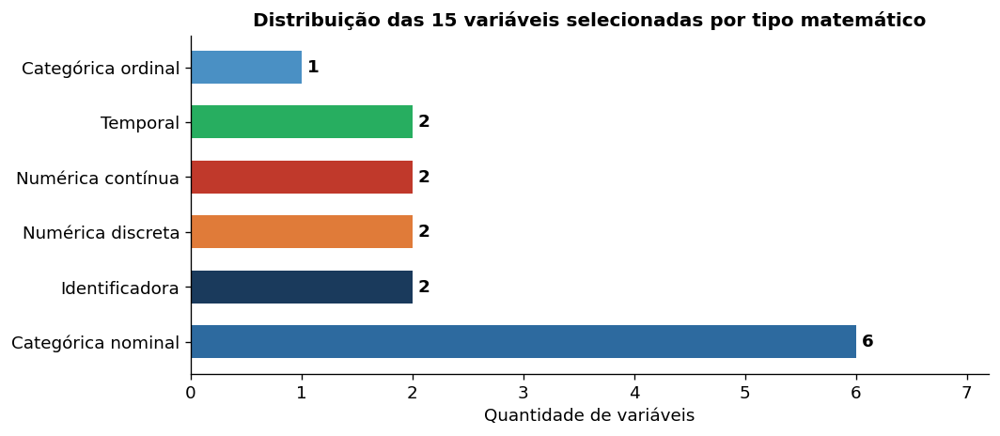

    <small>Distribuição das 15 variáveis selecionadas por tipo matemático</small>

**Tabela de classificação das variáveis:**

| # | Variável | Base | Tipo matemático | Justificativa resumida |
|:---:|:---|:---|:---|:---|
| 1 | `pesquisas.id` | pesquisas.csv | Identificadora | Chave primária da pesquisa; elo central de todas as tabelas. Não tem sentido somar IDs. |
| 2 | `empresas.ID` | empresas.csv | Identificadora | Chave primária da empresa, referenciada como FK em respondentes e respostas. |
| 3 | `pesquisas.status` | pesquisas.csv | Categórica nominal | Etapa atual da pesquisa (Finalizada, Em andamento, etc.). Sem ordem natural inequívoca — uma pesquisa pode voltar a etapas anteriores. |
| 4 | `pesquisas.tipo` | pesquisas.csv | Categórica nominal | Modalidade da pesquisa (Solicitação de associado, Pesquisa fixa anual, etc.). Sem hierarquia entre tipos. |
| 5 | `pesquisas.area` | pesquisas.csv | Categórica nominal | Área temática responsável (RH, Assuntos Regulatórios, etc.). 13 categorias sem ordenação natural. |
| 6 | `pesquisas.tipo de resposta` | pesquisas.csv | Categórica nominal | Define se a resposta é por empresa ou por indivíduo — determina a unidade de contagem nos KPIs de adesão. |
| 7 | `empresas.Nacionalidade` | empresas.csv | Categórica nominal | Nacional ou Multinacional. Binária sem ordenação. 8,9% dos registros ausentes. |
| 8 | `clientes.cargo` | clientes.csv | Categórica nominal | Cargo do contato. Campo de texto livre com dezenas de variações — requer padronização antes de análise ordinal. |
| 9 | `questoes.tipo` | questoes.csv | Categórica nominal | Formato da pergunta (multipla_escolha, caixas_de_selecao, etc.). Define como contar linhas em respostas.csv. |
| 10 | `pesquisas.complexidade` | pesquisas.csv | **Categórica ordinal** | Nível de dificuldade: baixa < média < alta. Única ordinal identificada. **75,4% dos registros sem preenchimento.** |
| 11 | `pesquisas.participantes` | pesquisas.csv | Numérica discreta | Número inteiro de empresas participantes. Admite aritmética. 8,5% ausentes. |
| 12 | `questoes.qtd_alternativas` | questoes.csv | Numérica discreta | Quantidade de opções de uma pergunta. Sempre inteiro não-negativo. |
| 13 | `pesquisas.dias_uteis_para_entrega` | pesquisas.csv | Numérica contínua | Duração total do ciclo em dias úteis. CV de 57,6% — usar mediana em dashboards de SLA. |
| 14 | `empresas.% de mercado` | empresas.csv | Numérica contínua | Market share da empresa. **Armazenado como texto ("8,25%") — requer conversão antes de qualquer cálculo.** |
| 15 | `pesquisas.data_solicitacao` | pesquisas.csv | Temporal | Marco inicial do ciclo. Armazenado como texto dd/mm/aaaa — requer parsing. 4 registros ausentes. |

---

## 3. Qualidade dos Dados

### 3.1 Inventário geral: registros e colunas

| Base | Linhas | Colunas úteis | Células totais | Células nulas | Completude geral | Colunas com nulo |
|:---|---:|---:|---:|---:|---:|---:|
| pesquisas.csv | 366 | 22 | 8.052 | 1.018 | 87,4% | 16 |
| empresas.csv | 779 | 9 | 7.011 | 173 | 97,5% | 6 |
| clientes.csv | 5.430 | 5 | 27.150 | 68 | 99,7% | 4 |
| respondentes.csv | 18.735 | 6 | 112.410 | 18.811 | 83,3% | 4 |
| questoes.csv | 231 | 13 | 3.003 | 1.117 | 62,8% | 5 |
| respostas.csv | 20.607 | 9 | 185.463 | 84.408 | 54,5% | 5 |

> A baixa completude de `respondentes.csv` é dominada por `hora_inicio`/`hora_termino` (95,7% nulos — ausência condicional). A baixa completude de `respostas.csv` é estrutural: `linha_matriz` e `coluna_matriz` só existem para perguntas matriciais (3 de 231 questões).

### 3.2 Dados ausentes — pesquisas.csv

A distinção entre **ausência condicional** (estruturalmente esperada pela lógica do negócio) e **ausência a investigar** (sem justificativa técnica) é fundamental para priorizar o tratamento:

| Campo | Nulos | Completude | Natureza | Observação |
|:---|---:|---:|:---|:---|
| `data_aprov` | 344 | 6,0% | Condicional | Só existe quando há etapa formal de aprovação |
| `prorrogada_ate` | 298 | 18,6% | Condicional | Só preenchida se a pesquisa foi prorrogada |
| `complexidade` | 276 | **24,6%** | **A investigar** | Campo operacional; ausência sem justificativa técnica |
| `tempo_preenchimento` | 135 | 63,1% | **A investigar** | Estimativa de preenchimento; deveria ser sempre declarada |
| `objetivos` | 123 | 66,4% | **A investigar** | Texto descritivo; omissão no cadastro |
| `part_mercado` | 44 | 88,0% | **A investigar** | Representatividade de mercado; dado operacional |
| `participantes` | 31 | 91,5% | **A investigar** | Campo importante para KPIs de adesão |
| `data_divulgacao` | 8 | 97,8% | Condicional | Registrada ao lançar a pesquisa |
| `data_solicitacao` | 4 | 98,9% | **A investigar** | Marco inicial do ciclo; afeta filtros de período |

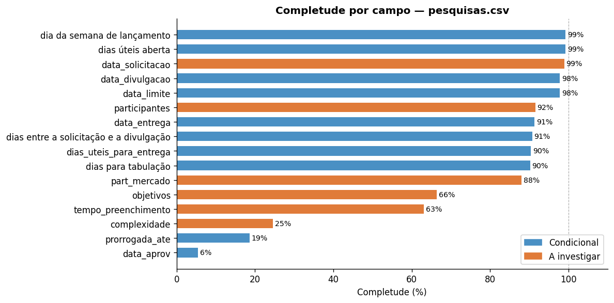

    <small>Completude por campo em pesquisas.csv — laranja = ausência a investigar, azul = condicional</small>

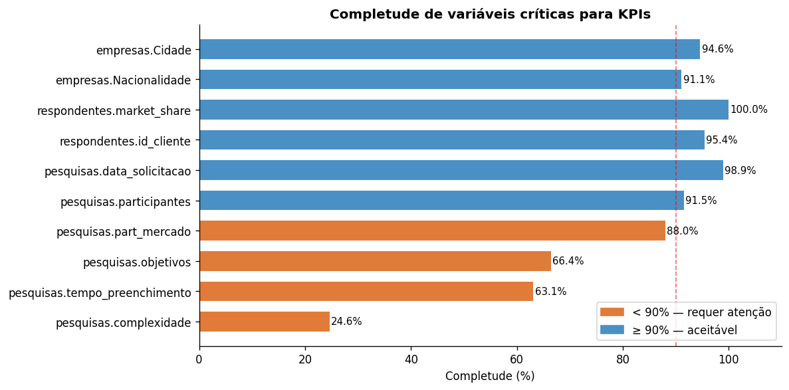

    <small>Completude das variáveis críticas para KPIs — campos abaixo de 90% requerem tratamento prioritário</small>

### 3.3 Registros duplicados

Nenhuma duplicata de chave primária ou de linha completa foi encontrada em nenhuma das seis bases. As repetições de chaves estrangeiras (por exemplo, `id_empresa` aparecendo múltiplas vezes em `respondentes.csv`) são legítimas — representam participações de uma mesma empresa em pesquisas distintas.

### 3.4 Inconsistências de preenchimento

Foram identificadas cinco inconsistências relevantes que requerem tratamento no pipeline de ingestão:

**1. Capitalização divergente em `empresas.País`**
"Brasil", "BRASIL" e "brasil" coexistem como três categorias distintas. Um filtro por "Brasil" sem normalização retorna apenas 669 dos 719 registros brasileiros (erro de ~7%).

**2. Capitalização divergente em `empresas.Associado`**
"Sim" e "sim" aparecem como categorias separadas. A correção é `str.strip().str.capitalize()` na camada de ingestão.

**3. Percentuais armazenados como texto em três bases**
`pesquisas.part_mercado`, `empresas.% de mercado` e `respondentes.market_share` representam a mesma grandeza (market share) e estão todas no formato texto com vírgula decimal e símbolo `%` (ex: "8,25%"). Qualquer operação aritmética direta sobre esses campos retorna erro. A regra de conversão é: `str.replace("%","").replace(",",".").astype(float)`.

**4. Sentinela textual misturada a identificadores numéricos**
`clientes.id_cliente` contém o valor `"s/i"` (sem informação) misturado a IDs numéricos. Deve ser registrado como `NULL` semântico antes de qualquer join ou operação de chave.

**5. Tipo incompatível de `id_cliente` entre tabelas**
Em `clientes.csv` o campo é do tipo `object` (string); em `respondentes.csv` é numérico. Um join direto sem normalização pode retornar zero correspondências.

### 3.5 Impacto nos indicadores e dashboards

| Problema | KPIs afetados | Risco concreto |
|:---|:---|:---|
| `complexidade` ausente em 75,4% | I02, I04 | Segmentação por complexidade não é representativa; análise de tempo por nível é inválida |
| `participantes` ausente em 8,5% | I01, I07 | Denominador de adesão indisponível para 31 pesquisas; média subestimada se nulos = zero |
| Percentuais como texto (3 campos) | I09 | Indicador de representatividade de mercado completamente inoperante sem conversão |
| `id_cliente` com tipo incompatível | I10, I11 | Join entre clientes e respondentes pode falhar; engajamento por cargo/departamento incorreto |
| `data_solicitacao` ausente em 4 pesquisas | I01, I03 | Essas pesquisas ficam invisíveis em filtros de período; volume por ano está subestimado |
| 55 participações com `id_pesq=304` sem match | I07, I08 | Participações órfãs desaparecem de contagens de adesão; D04 deve sinalizá-las |

---

## 4. Estatística Descritiva

### 4.1 Variáveis categóricas

#### `pesquisas.status` — Etapa atual das pesquisas

A grande maioria das pesquisas na base está com status **Finalizada** (90,7%), o que indica que os dados recebidos representam principalmente o acervo histórico, e não o pipeline operacional ativo. Para dashboards de gestão do fluxo, é essencial filtrar pelo status para separar as visões de acervo e de trabalho em andamento.

| Status | Frequência | Percentual |
|:---|---:|---:|
| Finalizada | 332 | 90,7% |
| Aguardando data predefinida | 19 | 5,2% |
| Em andamento | 5 | 1,4% |
| Em tabulação | 3 | 0,8% |
| Em análise da Área Técnica | 3 | 0,8% |
| Em análise da Central de Pesquisas | 3 | 0,8% |
| Em desenvolvimento | 1 | 0,3% |

**Moda:** Finalizada (90,7%). Pipeline ativo (todos os não-Finalizados): **34 pesquisas**.

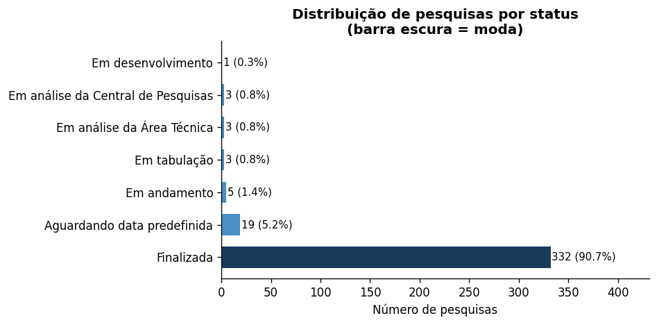

    <small>Distribuição de pesquisas por status — barra escura indica a moda</small>

#### `pesquisas.tipo` — Modalidade das pesquisas

"Solicitação de associado" é o tipo mais frequente (46,4%), seguido de "Pesquisa fixa anual" (23,0%). Isso significa que a maior parte da carga de trabalho da Central vem de demandas pontuais dos associados, e não de levantamentos padronizados — dado importante para dimensionamento de equipe e automação.

| Tipo | Frequência | Percentual |
|:---|---:|---:|
| Solicitação de associado | 170 | 46,4% |
| Pesquisa fixa anual | 84 | 23,0% |
| Solicitação da área técnica | 49 | 13,4% |
| Pública | 25 | 6,8% |
| Uso interno | 24 | 6,6% |
| Solicitação de parceiro | 9 | 2,5% |
| Pesquisa fixa bianual | 4 | 1,1% |
| Errata | 1 | 0,3% |

**Moda:** Solicitação de associado (46,4%).

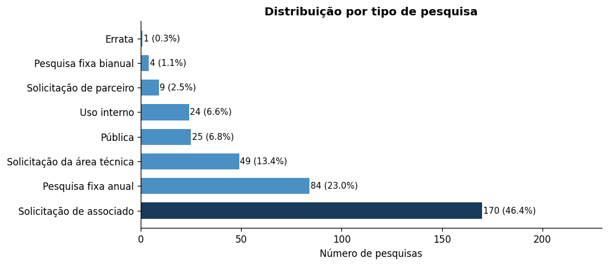

    <small>Distribuição por tipo de pesquisa</small>

#### `pesquisas.area` — Área temática

"Sindical Trabalhista e RH" domina com 41,5% das pesquisas — quase o dobro de "Assuntos Regulatórios" (24,0%), que ocupa o segundo lugar. As últimas seis áreas somadas representam apenas 7,7% do portfólio, caracterizando demanda esporádica. No total, 13 áreas distintas foram identificadas.

| Área | Frequência | Percentual |
|:---|---:|---:|
| Sindical Trabalhista e RH | 152 | 41,5% |
| Assuntos Regulatórios | 88 | 24,0% |
| Business Support | 44 | 12,0% |
| Assuntos Técnicos | 24 | 6,6% |
| Mercado e Assuntos Jurídicos | 21 | 5,7% |
| Presidência | 12 | 3,3% |
| Programa Educacional | 8 | 2,2% |
| Acesso e Precificação | 8 | 2,2% |
| Demais áreas (5) | 9 | 2,5% |

**Moda:** Sindical Trabalhista e RH (41,5%).

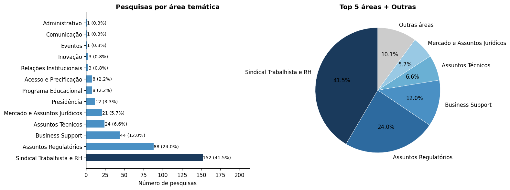

    <small>CDistribuição de pesquisas por área temática (barras e pizza Top 5 + Outras)</small>

#### `pesquisas.complexidade` — Nível de dificuldade (ordinal)

Entre os 90 registros com complexidade preenchida (apenas 24,6% do total), a moda é "alta" (58,9%), seguida de "média" (30,0%) e "baixa" (11,1%). **Os percentuais abaixo se referem exclusivamente à base preenchida** — os resultados não podem ser generalizados para o portfólio completo.

| Complexidade | Frequência (n=90) | Percentual (base preenchida) |
|:---|---:|---:|
| Baixa | 10 | 11,1% |
| Média | 27 | 30,0% |
| Alta | 53 | 58,9% |

**Moda (na base preenchida):** Alta.

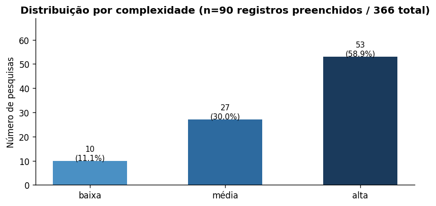

    <small>Distribuição por complexidade — base restrita a 90 registros preenchidos de um total de 366</small>

#### `empresas.Nacionalidade` e `Tipo de Associado`

Do total de 710 empresas com Nacionalidade informada, 65,9% são **Nacionais** e 34,1% são **Multinacionais**. Quanto ao tipo de associado (730 registros válidos), "Fornecedor de Bens e Serviços" é a categoria mais frequente (58,2%), seguida de "Efetivo" (26,0%) e "Cooperador" (15,8%).

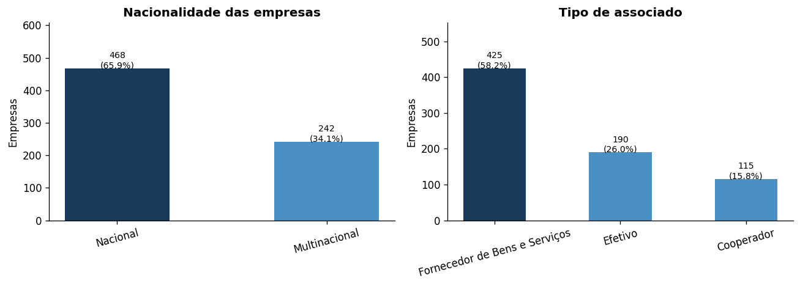

    <small>Nacionalidade das empresas (esquerda) e tipo de associado (direita)</small>

#### `clientes.cargo` e `clientes.departamento`

Os três cargos mais frequentes — Gerente (30,0%), Analista (26,0%) e Coordenador/Supervisor (20,1%) — concentram 76,1% dos contatos cadastrados. No lado dos departamentos, Recursos Humanos (26,3%) e Assuntos Regulatórios (21,0%) lideram, coerentemente com as áreas de maior volume de pesquisas.

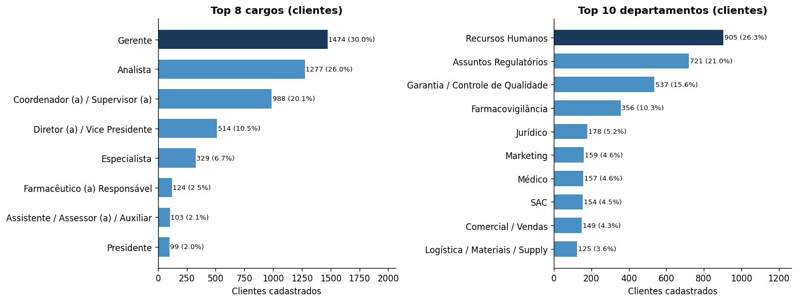

    <small>Top 8 cargos e Top 10 departamentos dos clientes cadastrados</small>

#### `questoes.tipo` — Formato das perguntas

Múltipla escolha (53,2%) e caixas de seleção (34,6%) juntas representam 87,8% das perguntas. Essa distribuição tem implicação direta na interpretação de `respostas.csv`: enquanto múltipla escolha gera exatamente uma linha por respondente, caixas de seleção geram N linhas (uma por alternativa marcada). Os 3 registros de `matriz_avaliacao` chegam a 96 alternativas cada, gerando até 96 linhas por respondente.

| Tipo | Frequência | Percentual |
|:---|---:|---:|
| multipla_escolha | 123 | 53,2% |
| caixas_de_selecao | 80 | 34,6% |
| numerica | 21 | 9,1% |
| aberta | 4 | 1,7% |
| matriz_avaliacao | 3 | 1,3% |

**Moda:** multipla_escolha (53,2%).

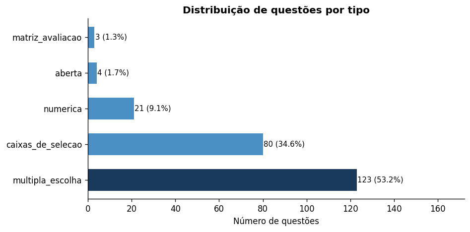

    <small>Distribuição de questões por tipo — multipla_escolha é a moda</small>

---

### 4.2 Variáveis numéricas

Todas as variáveis de tempo apresentam **assimetria positiva** (cauda à direita), indicando que a maioria das pesquisas é resolvida rapidamente, mas um subconjunto pequeno demora muito mais que a mediana. Por isso, a **mediana é a medida de tendência central mais adequada** para comunicar prazos nos dashboards — a média é inflada pelos casos extremos.

#### Variáveis de tempo — pesquisas.csv

| Variável | n | Média | Mediana | Mín | Máx | Amplitude | Desvio Padrão | CV (%) |
|:---|---:|---:|---:|---:|---:|---:|---:|---:|
| Dias úteis para entrega (ciclo total) | 331 | 21,1 | 19,0 | 2 | 89 | 87 | 12,2 | 57,6% |
| Dias solicitação → divulgação | 332 | 8,6 | 6,0 | 0 | 68 | 68 | 10,1 | 117,5% |
| Dias para tabulação | 330 | 7,7 | 4,0 | 0 | 77 | 77 | 10,0 | 129,7% |
| Dias úteis aberta (coleta) | 363 | 11,3 | 8,0 | 0 | 275 | 275 | 21,4 | 190,1% |
| Tempo de preenchimento (min) | 231 | 6,0 | 5,0 | 1 | 60 | 59 | 5,1 | 85,3% |

> CVs acima de 100% nas etapas de coleta, tabulação e planejamento indicam que o processo tem alta variabilidade intrínseca — provavelmente condicionada pela complexidade e pela área da pesquisa. Definir SLAs por tipo de pesquisa, e não globalmente, é mais adequado.

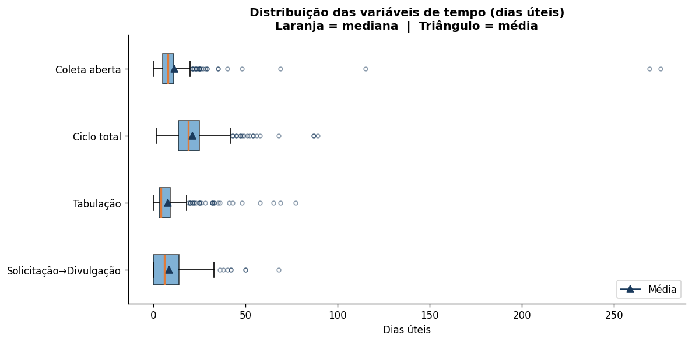

    <small>Boxplots das variáveis de tempo — laranja = mediana, triângulo = média. A distância entre os dois evidencia a assimetria.</small>

#### Participantes por pesquisa e market share

| Variável | n | Média | Mediana | Mín | Máx | Amplitude | Desvio Padrão | CV (%) |
|:---|---:|---:|---:|---:|---:|---:|---:|---:|
| Participantes por pesquisa | 335 | 60,7 | 54,0 | 6 | 358 | 352 | 41,3 | 68,1% |
| Market share das respondentes (%) | 322 | 49,9 | 51,0 | 0 | 83 | 83 | 14,7 | 29,5% |

> O CV de 68,1% em `participantes` reforça que a média (60,7) é um representante ruim — pesquisas menores e pesquisas de grande adesão convivem no mesmo portfólio. O market share das respondentes tem distribuição mais estável (CV de 29,5%), mas o valor de 83% de máximo indica que algumas pesquisas concentram empresas de altíssima representatividade.

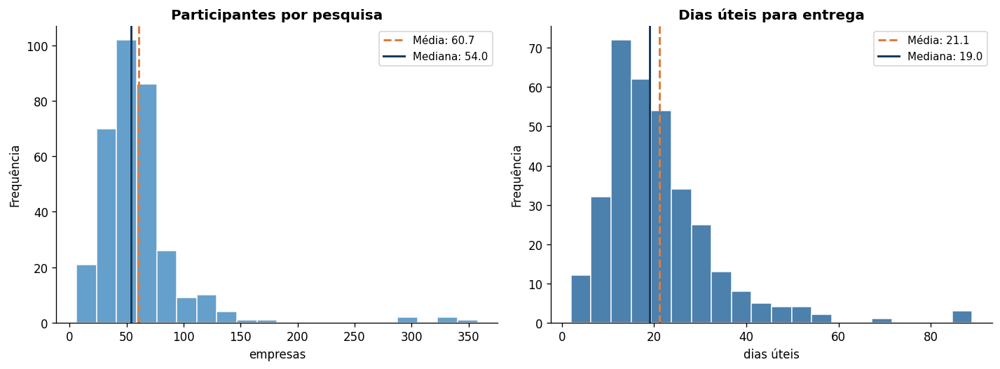

    <small>Histogramas de participantes por pesquisa e dias úteis para entrega — ambos com assimetria positiva</small>

#### Concentração de market share — empresas.csv

A distribuição de market share entre as 779 empresas cadastradas é extremamente concentrada: apenas 160 empresas (20,5%) têm share maior que zero, e as 10 maiores concentram 44,8% do mercado. A mediana é zero — a empresa típica do cadastro não possui share mensurável. Isso tem implicação direta no indicador I09 (representatividade): a métrica relevante é a **soma acumulada** das participantes, não a média.

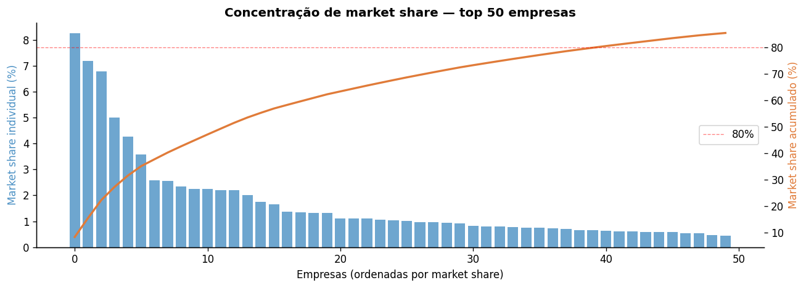

    <small>Curva de concentração de market share das top 50 empresas (estilo Pareto)</small>

---

### 4.3 Variáveis temporais

#### Distribuição de pesquisas por ano

Os dados cobrem o período de 2022 a 2027, mas os anos com cobertura completa são **2023, 2024 e 2025**. O crescimento de volume de 2023 (95 pesquisas) para 2025 (119 pesquisas) representa **+25,3%** em dois anos — tendência de crescimento consistente que reforça o argumento para automação do fluxo.

Os dados de 2022 (5 registros) e 2026–2027 (44 registros combinados) representam períodos parciais e não devem ser usados em comparações anuais sem correção por período.

#### Distribuição por mês (2023–2025)

A análise mensal revela um padrão com **pico em outubro** (39 pesquisas), volumes intermediários entre março e setembro, e queda acentuada em dezembro (5 pesquisas). Julho (20) e novembro (20) também apresentam volumes mais baixos. O padrão sugere concentração no segundo semestre, com recuo no fim de ano — provavelmente influenciado pelo calendário de associados e pela dinâmica dos departamentos solicitantes.

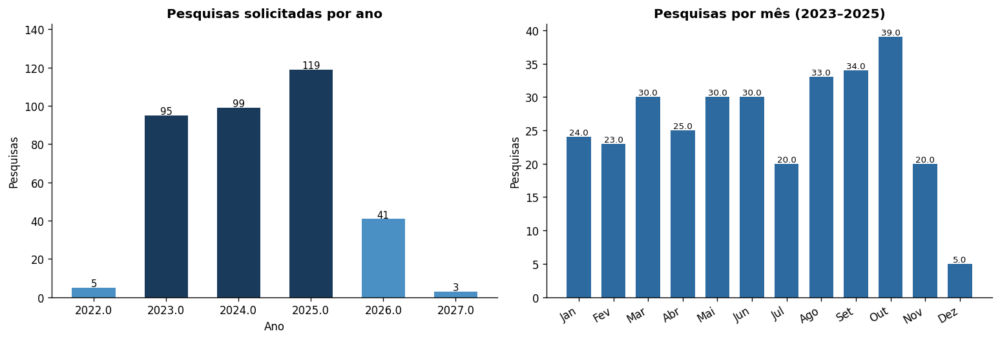

    <small>Volume de pesquisas por ano (esquerda) e por mês 2023–2025 (direita)</small>

#### Padrão semanal de lançamento

Das 358 pesquisas com `data_divulgacao` registrada, **36,9% foram lançadas na segunda-feira** — muito acima dos ~20% esperados em uma distribuição uniforme. Sexta-feira representa apenas 4,5% dos lançamentos. Isso sugere uma preferência operacional por início de semana, o que pode ser explorado para automatizar agendamentos de divulgação.

| Dia da semana | Lançamentos | Percentual |
|:---|---:|---:|
| Segunda | 132 | 36,9% |
| Terça | 87 | 24,3% |
| Quarta | 77 | 21,5% |
| Quinta | 46 | 12,9% |
| Sexta | 16 | 4,5% |

#### Volume por área e ano

"Sindical Trabalhista e RH" cresce de 32 pesquisas (2023) para 57 (2025), um aumento de 78% em dois anos, enquanto "Assuntos Regulatórios" cai de 33 para 22 no mesmo período. Esse cruzamento mostra que o crescimento geral do portfólio não é uniforme entre áreas — dashboards com filtro por área são essenciais para capturar essa heterogeneidade.

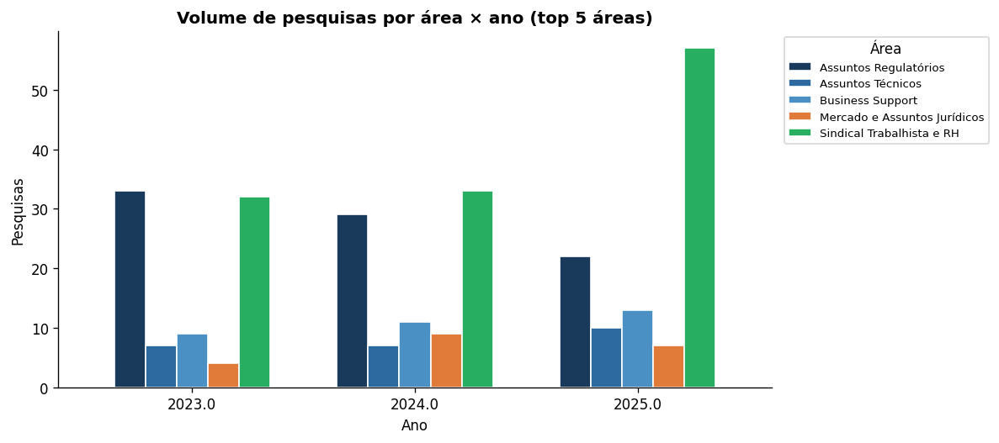

    <small>Volume de pesquisas por área × ano para as top 5 áreas (2023–2025)</small>

---

## 5. Indicadores Iniciais

### I01 — Volume de pesquisas por período

**Objetivo:** Quantificar o volume de pesquisas solicitadas em um período, permitindo identificar tendências de crescimento e sazonalidade.

**Fórmula:**

$$\text{Volume}_{(p)} = \text{COUNT}(\text{pesquisas}) \mid \text{data\_solicitacao} \in p$$

**Variáveis:** `pesquisas.data_solicitacao`, `pesquisas.id`

**Resultado observado:**

| Período | Volume |
|:---|---:|
| 2023 | 95 pesquisas |
| 2024 | 99 pesquisas |
| 2025 | 119 pesquisas |
| Crescimento 2023→2025 | +25,3% |

**Interpretação:** O volume cresce consistentemente. 2025 representa o maior volume registrado nos anos completos disponíveis. A projeção para 2026, com 41 pesquisas já registradas nos primeiros meses, sugere que o crescimento continuará — aumentando a pressão sobre o fluxo manual atual.

---

### I02 — Distribuição do portfólio por status

**Objetivo:** Monitorar em tempo real a composição do portfólio entre pesquisas do acervo (Finalizadas) e do pipeline ativo (demais status), identificando gargalos operacionais.

**Fórmula:**

$$\text{Pct}_{(s)} = \frac{\text{COUNT}(\text{pesquisas} \mid \text{status} = s)}{\text{COUNT}(\text{pesquisas})} \times 100$$

**Variáveis:** `pesquisas.status`

**Resultado observado:**

| Situação | Pesquisas | Percentual |
|:---|---:|---:|
| Acervo (Finalizada) | 332 | 90,7% |
| Pipeline ativo (demais) | 34 | 9,3% |

**Interpretação:** 90,7% das pesquisas na base estão finalizadas — os dados disponibilizados representam principalmente o histórico. O pipeline ativo tem 34 pesquisas em diferentes etapas. Nos dashboards operacionais (D01), este indicador deve ser atualizado em tempo real a partir do banco centralizado, sem atualização manual.

---

### I03 — Taxa de adesão por pesquisa

**Objetivo:** Medir a proporção de empresas que efetivamente responderam em relação às empresas convidadas, avaliando o engajamento relativo de cada pesquisa.

**Fórmula:**

$$\text{Taxa de adesão}_{(i)} = \frac{\text{COUNT DISTINCT}(\text{id\_empresa} \mid \text{id\_pesq} = i)}{\text{participantes}_i} \times 100$$

**Variáveis:** `respondentes.id_empresa`, `respondentes.id_pesq`, `pesquisas.participantes`

**Resultado observado (326 pesquisas com dados suficientes):**

| Estatística | Valor |
|:---|---:|
| Média | 98,4% |
| Mediana | 100,0% |
| Mínimo | 34,5% |
| Máximo | 100,0% |

**Interpretação:** A mediana de 100% indica que a maioria das pesquisas tem adesão plena de todas as convidadas. A média de 98,4% está próxima, mas o mínimo de 34,5% revela que ao menos uma pesquisa teve adesão muito baixa. Este indicador merece análise por área e tipo para identificar fatores de engajamento.

> **Atenção:** Para pesquisas com `tipo de resposta = indivíduo`, o denominador correto é o número de indivíduos convidados, não de empresas. O indicador deve ser calculado separadamente para cada tipo de resposta.

---

### I04 — Tempo mediano de ciclo (solicitação → entrega)

**Objetivo:** Medir o tempo real de entrega das pesquisas em dias úteis, servindo de base para definição e monitoramento de SLA.

**Fórmula:**

$$\text{Tempo médio de ciclo} = \text{MEDIAN}(\text{dias\_uteis\_para\_entrega} \mid \text{status} = \text{'Finalizada'})$$

**Variáveis:** `pesquisas.dias_uteis_para_entrega`, `pesquisas.status`

**Resultado observado:**

| Subetapa | Mediana (d.u.) | Média (d.u.) | CV (%) |
|:---|---:|---:|---:|
| Solicitação → Divulgação | 6 | 8,6 | 117,5% |
| Coleta aberta | 8 | 11,3 | 190,1% |
| Tabulação | 4 | 7,7 | 129,7% |
| **Ciclo total** | **19** | **21,1** | **57,6%** |

**Interpretação:** O tempo mediano do ciclo completo é de **19 dias úteis** (≈ 4 semanas). A etapa com maior variabilidade é a coleta aberta (CV de 190,1%), influenciada por prorrogações. Para definir SLAs realistas, recomenda-se usar o percentil 75 (25 dias úteis) como limiar de alerta, e não a média.

---

### I05 — Taxa de prorrogação de pesquisas

**Objetivo:** Identificar qual fração das pesquisas precisou de extensão de prazo, sinalizando onde o planejamento inicial foi insuficiente.

**Fórmula:**

$$\text{Taxa de prorrogação} = \frac{\text{COUNT}(\text{pesquisas} \mid \text{prorrogada\_ate} \neq \text{NULL})}{\text{COUNT}(\text{pesquisas} \mid \text{data\_limite} \neq \text{NULL})} \times 100$$

**Variáveis:** `pesquisas.prorrogada_ate`, `pesquisas.data_limite`

**Resultado observado:**

| Métrica | Valor |
|:---|---:|
| Pesquisas com data_limite | 358 |
| Pesquisas prorrogadas | 68 |
| Taxa de prorrogação | **19,0%** |

**Interpretação:** 1 em cada 5 pesquisas precisou de prorrogação de prazo. Isso representa retrabalho operacional e pode indicar subestimação do tempo de resposta no planejamento. O indicador deve ser cruzado com `area` e `complexidade` para identificar padrões — por exemplo, pesquisas de alta complexidade têm maior taxa de prorrogação?

---

### I06 — Completude de campos críticos

**Objetivo:** Medir a qualidade de preenchimento dos campos essenciais para calcular os demais KPIs, sinalizando onde o pipeline de dados encontrará lacunas.

**Fórmula:**

$$\text{Completude}_{(c)} = \left(1 - \frac{\text{COUNT}(\text{nulos}_c)}{n}\right) \times 100$$

**Variáveis:** qualquer campo crítico de qualquer base

**Resultado observado:**

| Campo | Completude | Status |
|:---|---:|:---|
| `pesquisas.complexidade` | 24,6% | ⚠ Crítico |
| `pesquisas.tempo_preenchimento` | 63,1% | ⚠ Insuficiente |
| `pesquisas.objetivos` | 66,4% | ⚠ Insuficiente |
| `pesquisas.part_mercado` | 88,0% | ⚠ Abaixo de 90% |
| `pesquisas.participantes` | 91,5% | Aceitável |
| `pesquisas.data_solicitacao` | 98,9% | Bom |
| `respondentes.id_cliente` | 95,4% | Aceitável |

**Interpretação:** `complexidade` é o campo com pior completude (24,6%) e representa o maior risco para análises de segmentação. O indicador I06 deve ser monitorado continuamente no dashboard D04 (Qualidade e Governança) e o limiar de alerta recomendado é **90%** de completude para campos operacionais.

---

## 6. Granularidade e Síntese Final

### 6.1 Como a granularidade altera a interpretação dos indicadores

#### Indicador I03 — Taxa de adesão

A taxa de adesão muda de significado dependendo do nível de granularidade adotado:

**Na granularidade da pesquisa** (um valor por pesquisa): a taxa de 98,4% de média global parece excelente, mas mascara a variação entre pesquisas. Uma pesquisa específica pode ter 34,5% de adesão sem que isso apareça na média geral.

**Na granularidade da empresa** (quantas pesquisas cada empresa respondeu): revela quais empresas são parceiras consistentes e quais participam raramente. Uma empresa pode ter 100% de adesão nas poucas pesquisas que recebe, mas participar de apenas 20% do portfólio total — as duas métricas contam histórias diferentes.

**Na granularidade do período** (taxa média por trimestre ou ano): permite identificar se o engajamento está crescendo, estável ou caindo ao longo do tempo — informação estratégica que o valor global esconde.

**Na granularidade da área temática** (taxa média por área): pode revelar que "Assuntos Regulatórios" tem adesão sistematicamente menor do que "RH", orientando ações diferenciadas de engajamento por público.

**Cuidado prático:** ao mudar de granularidade, o denominador muda. Taxa por empresa usa total de pesquisas disponíveis para aquela empresa como denominador; taxa por área usa total de pesquisas daquela área. Misturar denominadores produz indicadores inconsistentes.

---

#### Indicador I04 — Tempo mediano de ciclo

**Na granularidade da pesquisa** (um valor por pesquisa): mediana de 19 dias úteis, com alta variabilidade (CV de 57,6%). O valor único esconde que pesquisas simples levam 5 dias e pesquisas complexas levam 60+.

**Na granularidade do tipo ou complexidade**: se a mediana for calculada separadamente para pesquisas de complexidade alta versus baixa, os valores provavelmente diferem substancialmente — mas apenas 90 registros têm `complexidade` preenchida, o que limita essa análise.

**Na granularidade da área**: "Assuntos Regulatórios" pode ter um ciclo estruturalmente mais longo do que "RH" por exigir validação técnica adicional. Um SLA único para todas as áreas seria injusto e inatingível para algumas.

**Na granularidade do ano**: a mediana de 19 dias em 2025 pode ser diferente da de 2023. Se estiver caindo, indica ganho de eficiência; se estiver subindo, indica degradação — ambos invisíveis no valor global.

**Cuidado prático:** o campo `dias_uteis_para_entrega` só está preenchido para pesquisas finalizadas. Incluir pesquisas em andamento no cálculo do ciclo total é incorreto — a etapa ainda não terminou. O filtro `status = 'Finalizada'` deve ser aplicado antes de qualquer cálculo de tempo de ciclo.

---

### 6.2 Variáveis e indicadores mais importantes para o projeto

Com base nas análises realizadas, as variáveis e indicadores de maior impacto para o projeto são:

**Variáveis mais importantes:**
- `pesquisas.status` — filtro fundamental para qualquer análise; separa acervo histórico do pipeline ativo.
- `pesquisas.data_solicitacao` — âncora temporal de todos os KPIs de volume e ciclo.
- `pesquisas.participantes` — denominador do indicador de adesão; ausência em 8,5% bloqueia o cálculo.
- `pesquisas.dias_uteis_para_entrega` — KPI de SLA mais direto; alta variabilidade exige atenção ao tipo de pesquisa.
- `empresas.% de mercado` — único campo para calcular representatividade de mercado; armazenado como texto é o maior bloqueio técnico atual.
- `pesquisas.area` e `pesquisas.tipo` — dimensões de segmentação que revelam heterogeneidade invisível nas médias globais.

**Indicadores com maior valor estratégico:**
- **I03 (Taxa de adesão)** — KPI de engajamento central; diferentes granularidades revelam diferentes oportunidades de melhoria.
- **I04 (Tempo mediano de ciclo)** — base para SLAs e para detectar etapas com gargalo operacional.
- **I02 (Portfólio por status)** — único indicador em tempo real do trabalho em andamento; hoje depende de atualização manual.
- **I05 (Taxa de prorrogação)** — proxy de qualidade do planejamento; 19% é um nível que justifica investigação.

### 6.3 Problemas de qualidade que precisam ser tratados antes de automatizar os KPIs

| Prioridade | Problema | Ação recomendada |
|:---:|:---|:---|
| Alta | Percentuais como texto em 3 campos de 3 bases | Converter na camada de ingestão: `str.replace("%","").replace(",",".").astype(float)` |
| Alta | `complexidade` ausente em 75,4% das pesquisas | Solicitar backfill ao parceiro; enquanto isso, documentar nos dashboards que a base é parcial |
| Alta | 55 participações com `id_pesq=304` sem match em pesquisas | Mapear o ID 304 ou registrar como quarentena com flag de reconciliação |
| Média | Capitalização divergente em `País` e `Associado` | Normalizar com `str.strip().str.title()` na ingestão |
| Média | Tipos incompatíveis de `id_cliente` entre tabelas | Definir tipo canônico e normalizar nas duas tabelas antes do join |
| Baixa | 856 participações sem `id_cliente` em respondentes | Registrar como "não informado" no DW; não excluir — afeta contagem total de participações |

### 6.4 Cuidados matemáticos antes de automatizar os KPIs

1. **Nunca usar a média para variáveis com CV acima de 50%.** Dias de ciclo, dias de tabulação e dias de coleta têm assimetria positiva com outliers expressivos. Usar mediana e IQR nos dashboards.

2. **Aplicar filtros de denominador antes de calcular proporções.** Taxa de adesão requer `pesquisas.tipo de resposta` para definir se o denominador é empresas ou indivíduos. Taxa de prorrogação requer `data_limite IS NOT NULL`. Taxa de ciclo requer `status = 'Finalizada'`.

3. **Tratar completude de `complexidade` como nota de rodapé obrigatória.** Qualquer segmentação por complexidade deve exibir automaticamente o n da base preenchida (90 de 366), para que o usuário não interprete o resultado como representativo do portfólio completo.

4. **Não somar linhas de `respostas.csv` para contar respondentes.** O grão atômico dessa tabela é o elemento de resposta — perguntas de múltipla seleção geram N linhas por respondente. Sempre agregar por `(pesquisa_id, respondent_id)` antes de contar.

5. **Isolar anos parciais em análises de tendência temporal.** 2022 (5 registros) e 2026–2027 (44 registros) são anos incompletos e não devem ser incluídos em comparações anuais de volume sem correção por período.

6. **Converter percentuais de mercado antes de qualquer agregação.** A soma de shares das respondentes por pesquisa é a métrica correta para representatividade — não a média, que seria distorcida pelas muitas empresas com share zero.
