# Nome do Projeto: Governança e Integração de Dados da Central de Pesquisas

## Nome do Grupo: Synapse

## Integrantes:

- [Anna Riciopo](https://www.linkedin.com/in/anna-riciopo/)
- [Karine Paixão](https://www.linkedin.com/in/karine-paixao/)
- [Lucas Nunes Matheus](https://www.linkedin.com/in/lucas-nunes-matheus/)
- [Marlos Guedes](https://www.linkedin.com/in/marlos-do-carmo-guedes-366987250/)
- [Milena Castro Vieira](https://www.linkedin.com/in/milena-castro-vieira/)
- [Otávio Vasconcelos](https://www.linkedin.com/in/otavio-vasc/)
- [Vitor Balbo](https://www.linkedin.com/in/vitor-balbo/)

# Sumário

- [1. Introdução](#1-introdução)
  - [1.1 Finalidade do documento](#11-finalidade-do-documento)
  - [1.2 Fontes primárias de contexto](#12-fontes-primárias-de-contexto)
  - [1.3 Como distinguir evidência e proposta](#13-como-distinguir-evidência-e-proposta)
  - [1.4 Escopo do Projeto](#14-escopo-do-projeto)
- [2. Descrição do Problema](#2-descrição-do-problema)
  - [2.1 Fluxo de Valor](#21-fluxo-de-valor)
  - [2.4 Objetivos Estratégicos Atendidos](#24-objetivos-estratégicos-atendidos)
- [3. Objetivos](#3-objetivos)
- [4. Arquitetura de Dados (ISO/IEC 10746)](#4-arquitetura-de-dados-isoiec-10746)
  - [4.0 Estado Atual (AS-IS)](#40-estado-atual-as-is)
  - [4.1 Visão de Informação](#41-visão-de-informação-information-viewpoint)
  - [4.2 Visão de Tecnologia](#42-visão-de-tecnologia-technology-viewpoint)
  - [4.3 Visão de Engenharia](#43-visão-de-engenharia-engineering-viewpoint)
  - [4.4 Aspectos Não Funcionais](#44-aspectos-não-funcionais)
- [5. Modelagem Dimensional e Cubos OLAP](#5-modelagem-dimensional-e-cubos-olap)
  - [5.1 Visão Geral do Modelo Dimensional (Data Model Canvas)](#51-visão-geral-do-modelo-dimensional-data-model-canvas)
  - [5.2 Cubos Analíticos](#52-cubos-analíticos)
    - [5.2.1 C01 — Portfólio e Ciclo](#521-c01--portfólio-e-ciclo)
    - [5.2.2 C02 — Participação e Representatividade](#522-c02--participação-e-representatividade)
    - [5.2.3 C03 - Pipeline Mensal](#523-c03---pipeline-mensal)
    - [5.2.4 C04 — Resultados e Questionários](#524-c04--resultados-e-questionários)
  - [5.3 Qualidade e Validação de Dados](#53-qualidade-e-validação-de-dados)
  - [5.4 Rastreabilidade Analítica](#54-rastreabilidade-analítica)
  - [5.5 Infraestrutura de Dados](#55-infraestrutura-de-dados)
  - [5.6 Mapa de Cobertura de Indicadores](#56-mapa-de-cobertura-de-indicadores)
  - [5.7 Mapa de Cobertura de Dashboards](#57-mapa-de-cobertura-de-dashboards)
- [6. Requisitos e Governança de Dados](#6-requisitos-e-governança-de-dados)
  - [6.1 Requisitos Funcionais](#61-requisitos-funcionais)
  - [6.2 Requisitos Não Funcionais (ISO/IEC 25010)](#62-requisitos-não-funcionais-isoiec-25010)
  - [6.3 Perguntas de Negócio](#63-perguntas-de-negócio)
  - [6.4 Indicadores e Métricas de Negócio](#64-indicadores-e-métricas-de-negócio)
  - [6.5 Dashboards Analíticos](#65-dashboards-analíticos)
  - [6.6 Governança, Segurança da Informação e LGPD](#66-governança-segurança-da-informação-e-lgpd)
  - [6.7 Fluxo de Interação Anotado](#67-fluxo-de-interação-anotado)
- [7. Referências](#7-referências)
- [8. Avaliação dos Resultados](#8-avaliação-dos-resultados)
  - [8.1 Resultados Quantitativos](#81-resultados-quantitativos)
  - [8.2 Diagnóstico Qualitativo](#82-diagnóstico-qualitativo)
  - [8.3 Tabela de Fontes e Auditabilidade](#83-tabela-de-fontes-e-auditabilidade)

# 1. Introdução

Este documento especifica a arquitetura de dados proposta para a Central de
Pesquisas do Sindusfarma. Ele reúne escopo, fluxo de valor, diagnóstico das
fontes, requisitos, indicadores, dashboards, modelagem dimensional e controles
de governança. Resultados observados nos CSVs são separados de sínteses
derivadas e de decisões ainda pendentes; as fontes e limitações de cada bloco
estão consolidadas na §8.3 e em
[`docs/fontes-e-dependencias.md`](fontes-e-dependencias.md).

## 1.1 Finalidade do documento

A Sprint 1 consolida o entendimento do problema, os requisitos da solução
analítica, a modelagem quantitativa inicial e o Data Model Canvas. O documento
não declara implantação produtiva de banco, pipeline, dashboards conectados,
automação contínua ou política final de acesso; esses pontos pertencem ao MVP e
às próximas etapas de implementação e homologação.

## 1.2 Fontes primárias de contexto

O contexto do projeto é sustentado por duas fontes primárias: o TAPI [<sup>[1]</sup>](#ref-1) e a
[Arquitetura de Negócio](arquitetura-de-negocio.md) [<sup>[2]</sup>](#ref-2). A Arquitetura de
Negócio foi incorporada à pasta `docs/` para manter o repositório autocontido
mesmo quando os insumos temporários de trabalho forem removidos.

Essas fontes confirmam que a Central de Pesquisas atua com ferramentas
operacionais distribuídas, como planilhas, SurveyMonkey, Trello, sistema
interno, automações pontuais e repositório público. O projeto não propõe
substituir essas ferramentas: a solução esperada é integrar, governar e tornar
rastreável o ciclo de vida das pesquisas, preservando a operação existente e
reduzindo a dependência de cruzamentos manuais.

## 1.3 Como distinguir evidência e proposta

Ao longo do documento, afirmações sobre o estado atual do parceiro são tratadas
como evidência apenas quando aparecem nas fontes primárias ou nos dados
perfilados. Requisitos, dashboards, cubos, políticas, perfis de acesso e
automação são contratos propostos pela equipe quando ainda dependem de validação
do parceiro, integração técnica ou implantação futura.

## 1.4 Escopo do Projeto

O escopo abaixo consolida os resultados pretendidos descritos nas referências
[<sup>[1]</sup>](#ref-1), [<sup>[2]</sup>](#ref-2), [<sup>[13]</sup>](#ref-13) e [<sup>[14]</sup>](#ref-14) e nos requisitos da §6.1. O TAPI [<sup>[1]</sup>](#ref-1) e a Arquitetura de
Negócio [<sup>[2]</sup>](#ref-2) foram conferidos diretamente nesta auditoria. “Incluído” indica
responsabilidade do projeto, não funcionalidade já implantada ou concluída
nesta Sprint.

### Escopo incluído no projeto

- implementar um banco relacional em nuvem que centralize o ciclo da pesquisa, preservando origem e rastreabilidade;
- implementar ao menos um pipeline de ingestão das fontes atuais, com tratamento de inconsistências, deduplicação e padronização;
- entregar um data app com dashboards operacionais e estratégicos alimentados pelo banco central;
- estabelecer governança, qualidade, segurança, privacidade e controle de acesso por perfil;
- integrar resultados autorizados ao acervo público, mantendo consistência com a informação interna;
- documentar o modelo de dados, a arquitetura, o pipeline, os protocolos de governança e a orientação de uso.

### Entregas documentais da Sprint 1

Esta Sprint entrega a base documental e analítica para o MVP, sem declarar que
a infraestrutura produtiva já está implantada:

- diagnóstico e método reproduzível de perfilamento do snapshot recebido;
- contratos de perguntas, requisitos, indicadores, dashboards e cubos;
- protótipos D01–D04 com agregados sem identificação;
- Data Model Canvas exportado e validado;
- propostas de governança, privacidade, qualidade e rastreabilidade.

### MVP do projeto confirmado no TAPI

| Componente mínimo | Critério confirmado na fonte |
| :--- | :--- |
| Banco de dados | banco relacional em nuvem modelando solicitação, planejamento, execução e resultado |
| Pipeline | ao menos uma ingestão funcional de uma fonte atual, com tratamento básico de inconsistências e deduplicação |
| Dashboard | conjunto inicial de KPIs alimentado pelo banco central, sem atualização manual |
| Acesso e proteção | controle por perfil e tratamento de dados sensíveis em conformidade com a LGPD |

### Escopo não incluído

| Item | Justificativa |
| :--- | :--- |
| Substituição de SurveyMonkey, Trello, repositório público ou demais ferramentas operacionais | o TAPI afirma que o projeto integra e governa essas ferramentas, sem substituí-las |
| Publicação aberta de CSVs, respostas individuais ou dados pessoais | os arquivos possuem e-mail, chaves estáveis e texto livre; o projeto trabalha com agregação, minimização e autorização |
| Inferência de identidade entre cliente, participação e resposta | não existe ponte comprovada entre as fontes; sem contrato aprovado, a união produziria rastreabilidade falsa |
| Taxa de adesão ou engajamento sem universo elegível | a fonte atual não contém os denominadores necessários; indisponibilidade não pode ser substituída por zero ou estimativa |
| Alegar atualização em tempo real antes da implantação e medição | “tempo real” é benefício esperado no TAPI; o snapshot não comprova timestamp de carga, integração contínua nem SLA operacional |
| Garantia de conformidade produtiva apenas com a documentação | políticas, papéis, bases legais e controles dependem de validação e implantação pelo parceiro |

Essa delimitação preserva o MVP oficial do projeto e separa dele as entregas
documentais desta Sprint. Banco, pipeline, dashboard conectado e controle de
acesso continuam incluídos no MVP, mas só podem ser considerados prontos após
implementação, homologação e operação controlada.

# 2. Descrição do Problema

A Central de Pesquisas do Sindusfarma conduz pesquisas setoriais que passam por solicitação, elaboração, validação, divulgação, coleta, tabulação, análise e publicação. O problema central observado é que esse ciclo de vida ainda é sustentado por fontes e ferramentas distribuídas, como planilhas, formulários de coleta, gestão de tarefas, automações pontuais e repositório publicado, sem uma camada integrada de dados que mantenha a mesma pesquisa rastreável do início ao fim.[<sup>[1]</sup>](#ref-1)[<sup>[14]</sup>](#ref-14)

Essa fragmentação faz com que informações sobre status, participantes, empresas, questionários, respostas, prazos e publicação fiquem espalhadas entre sistemas diferentes. O fluxo atual possui ferramentas consolidadas em cada etapa, mas o único ponto de conexão identificado replica novas solicitações e não consolida nem governa o dado ao longo de todo o processo. Assim, a organização não possui uma visão única, integrada e confiável de todo o ciclo de vida das pesquisas.[<sup>[1]</sup>](#ref-1)[<sup>[2]</sup>](#ref-2)[<sup>[14]</sup>](#ref-14)

As principais dores identificadas são:

| Dor do processo atual | Causas relacionadas | Impactos operacionais e estratégicos |
| :--- | :--- | :--- |
| Fragmentação das fontes | Dados distribuídos entre planilhas, SurveyMonkey, Trello, repositório do site, sistema interno e automações pontuais | Dificulta a consolidação das informações, aumenta o risco de divergência entre fontes e impede a formação de uma fonte única da verdade |
| Dependência de planilhas e cruzamentos manuais | Ausência de Data Warehouse corporativo e de pipelines de ingestão cobrindo o ciclo completo da pesquisa | Aumenta o esforço da equipe, torna a atualização dos indicadores mais lenta e reduz o tempo disponível para análise de valor |
| Baixa rastreabilidade ponta a ponta | Etapas, responsáveis, versões, status e resultados não ficam conectados por uma identidade única de pesquisa | Limita auditoria, dificulta acompanhamento de prioridades e reduz a confiança sobre qual dado sustenta cada decisão |
| Qualidade inconsistente dos dados | Falta de padronização, campos incompletos, identificadores divergentes e regras de negócio distribuídas | Pode distorcer indicadores de adesão, prazo, representatividade e qualidade, exigindo validações manuais antes da tomada de decisão |
| Baixa escalabilidade operacional | O crescimento do volume de pesquisas aumenta proporcionalmente a necessidade de conferência, tabulação e atualização manual | Reduz agilidade de entrega, concentra conhecimento operacional em poucas pessoas e limita a evolução para uma gestão orientada por dados |

Essas causas produzem impacto direto na operação da Central de Pesquisas: maior custo de retrabalho, menor agilidade para acompanhar pesquisas em andamento, dificuldade para medir adesão por empresa, área ou perfil de respondente e risco de inconsistência entre o acervo publicado e as informações internas. Do ponto de vista estratégico, a falta de integração compromete a capacidade de identificar tendências históricas, comparar desempenho entre períodos e sustentar decisões com indicadores atualizados e auditáveis.[<sup>[14]</sup>](#ref-14)

Portanto, o projeto se justifica pela necessidade de transformar um processo fragmentado e predominantemente manual em uma arquitetura de dados integrada, governada e confiável, capaz de reduzir esforço operacional, melhorar a qualidade dos indicadores e apoiar decisões estratégicas da Central de Pesquisas sem substituir as ferramentas operacionais já utilizadas pelo parceiro. O TAPI [<sup>[1]</sup>](#ref-1) confirma que as ferramentas são consolidadas em cada etapa, mas não possuem integração estruturada; o dashboard é atualizado manualmente, o acervo é isolado, não há rastreabilidade automatizada e decisões dependem de cruzamentos em planilhas. A Arquitetura de Negócio [<sup>[2]</sup>](#ref-2) confirma a fragmentação ao longo do fluxo. A magnitude de esforço, custo, demora e retrabalho não foi medida nesta Sprint e continua pendente de linha de base operacional.

Os dados permitem confirmar problemas mais específicos: domínios de identificadores não coincidentes, relações órfãs, ausência de ponte comprovada entre participação e resposta, percentuais textuais e metadados insuficientes para alguns indicadores. A matriz completa separa cada dor, causa, impacto, necessidade, objetivo, KPI, público, papel e risco em [`docs/matriz-evidencias-problem-canvas.md`](matriz-evidencias-problem-canvas.md).
## 2.1 Fluxo de Valor

O valor central confirmado na Arquitetura de Negócio [<sup>[2]</sup>](#ref-2) é **“transformar uma necessidade de informação do setor farmacêutico em conhecimento estruturado e confiável”**. Rastreabilidade e autorização são condições propostas para que esse conhecimento percorra o fluxo sem perder origem nem expor conteúdo indevido. As ferramentas aparecem apenas como contexto operacional.

### Fluxo atual (AS-IS)

| Etapa e atividade | Entrada | Saída de valor | Atores | Fontes/sistemas relacionados | Limitação atual e contribuição da solução |
| :--- | :--- | :--- | :--- | :--- | :--- |
| 1. Solicitação — registrar a necessidade | necessidade, objetivo e contexto da área | demanda registrada | solicitante e Central | `pesquisas.csv`; ferramentas operacionais citadas no TAPI | integrar a origem da demanda à pesquisa |
| 2. Triagem e aprovação — decidir continuidade | demanda registrada | decisão e pesquisa priorizada | Central, gestor e área técnica | `pesquisas.csv` | preservar decisão, status e responsáveis; prioridade ainda não existe no snapshot |
| 3. Planejamento — definir cronograma e questionário | demanda aprovada | plano, prazos e instrumento proposto | Central | `pesquisas.csv` e `questoes.csv` | vincular cronograma e perguntas à mesma pesquisa |
| 4. Validação técnica — revisar o conteúdo | questionário proposto | instrumento validado | áreas técnicas e Central | `questoes.csv`; metadados operacionais futuros | versionar revisão, decisão e autoria; esses metadados não estão no snapshot |
| 5. Divulgação — disponibilizar a pesquisa | instrumento validado | convite e prazo comunicados | Central e participantes | `pesquisas.csv` e ferramentas de coleta | ligar divulgação e prazo ao ciclo rastreável |
| 6. Coleta e monitoramento — acompanhar participação | pesquisa divulgada | participações observadas | Central, empresas e pessoas participantes | `respondentes.csv`, `clientes.csv` e `empresas.csv` | consolidar participação sem inventar o universo elegível |
| 7. Registro das respostas — capturar elementos | questão apresentada ao participante | elementos atômicos de resposta | participantes e Central | `respostas.csv` e `questoes.csv` | manter questão, pesquisa e origem; não tratar linha como questionário ou pessoa |
| 8. Encerramento e validação — verificar os dados | coleta encerrada | conjunto classificado por validade e completude | Central e Data Stewards | CSVs e dicionário | aplicar regras por tipo, reconciliar chaves e preservar anomalias |
| 9. Tabulação e análise — produzir indicadores | conjunto validado e perguntas de negócio | resultados agregados e contextualizados | Central, áreas técnicas e gestores | conjunto integrado, PB01–PB13 e I01–I25 | usar fórmulas e denominadores consistentes; mostrar indisponibilidade quando necessário |
| 10. Entrega e publicação — disponibilizar resultado | resultado agregado e contexto de origem | entrega autorizada e acervo consistente | Central, solicitante e público autorizado | `pesquisas.csv` e repositório público | registrar autorização, versão e linhagem antes da publicação |

As dez etapas são confirmadas na Arquitetura de Negócio [<sup>[2]</sup>](#ref-2). Os CSVs
comprovam objetos e campos associados a parte delas; não comprovam, sozinhos,
que cada controle operacional ou integração esteja implantado.

### Fluxo alvo (TO-BE)

No fluxo alvo, propõe-se usar a **Pesquisa** como eixo de continuidade,
condicionado à reconciliação das chaves de origem e à aprovação do contrato de
identidade. Cada etapa preserva a origem e produz uma saída consumida pela
etapa seguinte, sem unir identidades por semelhança nem preencher ausência com
estimativa.

```text
Necessidade de informação
  → solicitação registrada
  → triagem e aprovação rastreáveis
  → pesquisa e questionário planejados
  → questionário validado e versionado
  → divulgação vinculada ao prazo
  → participação monitorada
  → respostas atômicas registradas
  → coleta encerrada e dados validados
  → tabulação e análise agregadas
  → entrega e publicação autorizadas
```

| Mudança de valor | Contribuição proposta da solução | Critério de validação proposto |
| :--- | :--- | :--- |
| Continuidade entre etapas | Pesquisa como referência proposta de continuidade, com origens preservadas | marcos, versões e elos consultáveis sem perda ou criação silenciosa de identidade |
| Menos reconciliação manual | dados padronizados e tratamento explícito de anomalias e conflitos | anomalias explicadas, decisões registradas e correções verificáveis |
| Indicadores consistentes | perguntas, fórmulas, grãos e denominadores compartilhados pelos dashboards | o mesmo recorte produz o mesmo indicador e indisponibilidade aparece como indisponibilidade |
| Decisão no momento certo | visões de negócio para gargalos, participação, resultados e qualidade | usuário identifica a ação apoiada, a fonte, o período e a limitação do indicador |
| Publicação responsável | autorização, agregação, linhagem e vínculo com a pesquisa antes do acervo | resultado publicado possui decisão, versão, origem e perfil autorizado |

O TO-BE é contrato de arquitetura e processo. Ele não prova que pipeline,
autenticação, data warehouse ou publicação automática já estejam implantados;
essas fronteiras estão delimitadas na §1.4.

## 2.4 Objetivos Estratégicos Atendidos

O projeto contribui para os objetivos estratégicos da Central de Pesquisas ao transformar um fluxo hoje fragmentado e dependente de consolidações manuais em uma base organizacional mais confiável para acompanhar, analisar e publicar pesquisas setoriais. O valor esperado não está apenas na adoção de uma nova arquitetura técnica, mas na capacidade de melhorar a gestão do ciclo de vida das pesquisas, fortalecer a confiança nos indicadores e apoiar decisões do Sindusfarma com informações rastreáveis.[<sup>[1]</sup>](#ref-1)[<sup>[2]</sup>](#ref-2)[<sup>[14]</sup>](#ref-14)

| Objetivo estratégico atendido | Como a solução contribui | Valor organizacional gerado |
| :--- | :--- | :--- |
| Aumentar adesão e engajamento das indústrias participantes | Permite acompanhar participação por pesquisa, empresa, área, cargo e departamento, distinguindo contagens observadas de taxas que dependem de denominador validado. | Ajuda a identificar públicos pouco engajados, orientar ações de convite e ampliar a representatividade das pesquisas setoriais. |
| Reduzir esforço manual e tempo de entrega | Centraliza informações hoje distribuídas entre planilhas, formulários, ferramentas de gestão, automações pontuais e repositório publicado. | Libera a equipe da Central para análise e tomada de decisão, reduzindo retrabalho, conferências manuais e dependência de conhecimento individual. |
| Apoiar decisões estratégicas com dados confiáveis | Organiza indicadores sobre volume, status, prazos, adesão, representatividade, respostas agregadas e qualidade dos dados. | Dá aos gestores uma visão mais consistente para priorizar demandas, acompanhar desempenho e planejar novas pesquisas com base em evidências. |
| Estabelecer governança e rastreabilidade ponta a ponta | Mantém a pesquisa como eixo de rastreabilidade, conectando solicitação, planejamento, questionário, coleta, tabulação, análise e publicação. | Aumenta auditabilidade, clareza de responsabilidades e confiança sobre qual fonte sustenta cada indicador ou resultado publicado. |
| Garantir conformidade com a LGPD e proteção das informações | Prevê separação entre dados internos, dados identificáveis e resultados agregados, além de controle de acesso por perfil e uso de dados anonimizados ou fictícios no contexto acadêmico. | Reduz risco regulatório e protege a confidencialidade de empresas, respondentes e respostas individuais. |
| Tornar a Central referência em dados do setor farmacêutico | Consolida histórico, metadados, indicadores e resultados autorizados em uma fonte única e governada. | Fortalece o papel do Sindusfarma como entidade capaz de produzir inteligência setorial confiável para a indústria farmacêutica. |
| Melhorar qualidade e relevância das pesquisas | Usa indicadores de completude, validade, inconsistências e rastreabilidade para orientar melhorias no processo e nos questionários. | Reduz distorções nos dashboards, melhora a interpretação dos resultados e aumenta a utilidade das pesquisas para as áreas técnicas e empresas participantes. |
| Evoluir para uma cultura orientada por dados | Disponibiliza informações analíticas de forma estruturada para equipe da Central, áreas técnicas e gestores. | Incentiva decisões baseadas em evidências, aprendizado histórico e acompanhamento contínuo dos resultados da operação. |

Assim, a solução atende aos objetivos estratégicos ao conectar melhoria operacional, governança e inteligência de negócio. A Central ganha meios para reduzir manualidade, aumentar confiabilidade, monitorar adesão e publicar resultados com maior consistência, mantendo as ferramentas operacionais existentes como fontes do processo e não como silos isolados.

# 3. Objetivos

**Objetivo geral confirmado no TAPI:** construir a espinha dorsal de dados da
Central de Pesquisas do Sindusfarma, integrando as fontes existentes em uma
base central na nuvem, com governança, qualidade e consumo por data app. Esta
Sprint especifica parte dessa arquitetura; banco, integrações e operação
automatizada ainda não são capacidades entregues.[<sup>[1]</sup>](#ref-1)

**Objetivos específicos:** cada objetivo traz o valor pretendido e o indicador
que permitiria acompanhá-lo (ver §6.4). Integração, rastreabilidade, redução de
esforço, adesão, apoio a decisões, governança e LGPD são confirmados no TAPI e
na Arquitetura de Negócio [<sup>[1]</sup>](#ref-1), [<sup>[2]</sup>](#ref-2). Sua implantação e seus resultados ainda
dependem de medição.

| Objetivo (verbo de ação) | Valor para o parceiro | Como é medido |
| :--- | :--- | :--- |
| Integrar as fontes de dados hoje dispersas em um repositório central único | Pretende reduzir cruzamentos manuais e manter uma referência compartilhada | I24 somente após existir catálogo versionado e registro de execuções |
| Garantir rastreabilidade ponta a ponta do ciclo de vida da pesquisa, da solicitação à publicação | Pretende tornar origem, marcos e limitações auditáveis | I18 e I22; a linhagem atual é parcial e possui relações em reconciliação |
| Reduzir o esforço manual e o tempo de entrega das pesquisas | Pretende liberar capacidade para análise | I04 mede intervalos observáveis; ganho de esforço exige baseline operacional ainda ausente |
| Ampliar a adesão e o engajamento das indústrias participantes | Pretende apoiar ações sobre participação | I07 é observável; I08 e I11 exigem universo elegível, e identidade não conciliada não representa pessoa única |
| Sustentar decisões com dashboards operacionais e estratégicos | Pretende oferecer visão consolidada, sem afirmar atualização automática ou em tempo real | I01–I25 conforme disponibilidade da §5.6; frescor depende de I21 e metadado de carga |
| Assegurar governança, segurança da informação e conformidade no tratamento de dados | Pretende proteger participantes e registrar responsabilidades | I16–I20 são observáveis; I23 e I25 dependem de política, decisão e logs aprovados |

# 4. Arquitetura de Dados (ISO/IEC 10746)

Esta seção separa o diagnóstico confirmado documentalmente para o cenário atual
da arquitetura alvo proposta. O AS-IS da §4.0 combina o TAPI e a Arquitetura de
Negócio auditados [<sup>[1]</sup>](#ref-1), [<sup>[2]</sup>](#ref-2) com medições reproduzíveis das bases. As §§4.1–4.4
descrevem contratos de informação, tecnologia, engenharia e qualidade; não
comprovam infraestrutura implantada.

## 4.0 Estado Atual (AS-IS)

O estado atual possui duas camadas de evidência. A estrutura, as contagens e os
problemas de qualidade são observados diretamente nos seis CSVs identificados
na §5.3.6. O processo, as ferramentas e a ausência de integração são
confirmados no TAPI e na Arquitetura de Negócio [<sup>[1]</sup>](#ref-1), [<sup>[2]</sup>](#ref-2). Detalhes atribuídos
exclusivamente a referências complementares são usados apenas como apoio e não
como confirmação primária isolada.

### 4.0.1 Fontes de dados e ferramentas atuais

O workspace contém seis arquivos CSV estruturados (separador `;`), atribuídos
aos insumos do projeto e identificados pelos hashes da §5.3.6. Eles somam cerca
de 46 mil registros e representam pesquisa, empresa, pessoa/cliente,
participação, questão e elemento de resposta. A proveniência e a natureza real
ou sintética das linhas não podem ser confirmadas sem as fontes primárias; por
isso, os arquivos permanecem fora do Git. O quadro abaixo resume a estrutura
observada, e as “colunas úteis” desconsideram colunas vazias remanescentes da
exportação.

<div align="center">
<sub>Tabela — Inventário das bases disponibilizadas</sub><br>

| Base | Registros | Colunas úteis | Colunas brutas |
| :--- | ---: | ---: | ---: |
| `pesquisas.csv` | 366 | 22 | 33 |
| `empresas.csv` | 779 | 9 | 9 |
| `clientes.csv` | 5.430 | 5 | 5 |
| `respondentes.csv` | 18.735 | 6 | 6 |
| `questoes.csv` | 231 | 13 | 13 |
| `teste.csv` (nome canônico: `respostas.csv`) | 20.607 | 9 | 9 |

<sup>Material produzido pelos autores (2026)</sup>

</div><br>

O arquivo recebido como `teste.csv` é tratado neste documento pelo nome
canônico de negócio `respostas.csv`, adotado nas tabelas de estrutura, no
dicionário e nos requisitos. Essa equivalência é de nomenclatura; a integração
entre a fonte recebida e as demais bases ainda precisa ser verificada.

Em `pesquisas.csv`, 11 das 33 colunas são resíduos vazios da exportação e foram desconsideradas (22 úteis). As tabelas a seguir detalham, por base, os campos e seus tipos — **técnico** (como o dado está armazenado) e **semântico** (o papel do campo na análise).

#### pesquisas.csv

<div align="center">
<sub>Tabela — Estrutura de pesquisas.csv</sub><br>

| Campo | Tipo técnico | Tipo semântico |
| :--- | :--- | :--- |
| id | inteiro | identificador |
| titulo | texto | texto |
| status | texto | categórico |
| tipo | texto | categórico |
| area | texto | categórico |
| participantes | inteiro | numérico |
| part_mercado | texto | numérico |
| data_solicitacao | data | temporal |
| data_aprov | data | temporal |
| data_divulgacao | data | temporal |
| data_limite | data | temporal |
| prorrogada_ate | data | temporal |
| data_entrega | data | temporal |
| dias_uteis_para_entrega | inteiro | numérico |
| complexidade | texto | categórico |
| tipo de resposta | texto | categórico |
| tempo_preenchimento | inteiro | numérico |
| objetivos | texto | texto |
| dia da semana de lançamento | inteiro | numérico |
| dias úteis aberta | inteiro | numérico |
| dias entre a solicitação e a divulgação | inteiro | numérico |
| dias para tabulação | inteiro | numérico |

<sup>Material produzido pelos autores (2026)</sup>

</div><br>

#### empresas.csv

<div align="center">
<sub>Tabela — Estrutura de empresas.csv</sub><br>

| Campo | Tipo técnico | Tipo semântico |
| :--- | :--- | :--- |
| ID | inteiro | identificador |
| Nome Fantasia | texto | texto |
| % de mercado | texto | numérico |
| Nacionalidade | texto | categórico |
| Associado | texto | categórico |
| Tipo de Associado | texto | categórico |
| Cidade | texto | categórico |
| Estado | texto | categórico |
| País | texto | categórico |

<sup>Material produzido pelos autores (2026)</sup>

</div><br>

#### clientes.csv

<div align="center">
<sub>Tabela — Estrutura de clientes.csv</sub><br>

| Campo | Tipo técnico | Tipo semântico |
| :--- | :--- | :--- |
| id_cliente | texto | identificador |
| id_empresa | inteiro | identificador |
| cargo | texto | categórico |
| departamento | texto | categórico |
| e-mail | texto | texto |

<sup>Material produzido pelos autores (2026)</sup>

</div><br>

#### respondentes.csv

<div align="center">
<sub>Tabela — Estrutura de respondentes.csv</sub><br>

| Campo | Tipo técnico | Tipo semântico |
| :--- | :--- | :--- |
| id_pesq | inteiro | identificador |
| hora_inicio | data/hora | temporal |
| hora_termino | data/hora | temporal |
| id_empresa | inteiro | identificador |
| market_share | texto | numérico |
| id_cliente | inteiro | identificador |

<sup>Material produzido pelos autores (2026)</sup>

</div><br>

#### questoes.csv

<div align="center">
<sub>Tabela — Estrutura de questoes.csv</sub><br>

| Campo | Tipo técnico | Tipo semântico |
| :--- | :--- | :--- |
| id_pergunta | inteiro | identificador |
| pesquisa_id | inteiro | identificador |
| pesquisa_titulo | texto | categórico |
| enunciado | texto | texto |
| tipo | texto | categórico |
| qtd_alternativas | inteiro | numérico |
| alternativas | texto | texto |
| linhas_matriz | texto | categórico |
| colunas_matriz | texto | categórico |
| confianca | texto | categórico |
| formato_arquivo | texto | categórico |
| col_origem | texto | texto |
| observacoes | vazio | — (sem preenchimento) |

<sup>Material produzido pelos autores (2026)</sup>

</div><br>

#### respostas.csv

<div align="center">
<sub>Tabela — Estrutura de respostas.csv</sub><br>

| Campo | Tipo técnico | Tipo semântico |
| :--- | :--- | :--- |
| id_resposta | inteiro | identificador |
| pesquisa_id | inteiro | identificador |
| id_pergunta | inteiro | identificador |
| respondent_id | inteiro | identificador |
| id_empresa | inteiro | identificador |
| alternativa | texto | categórico |
| linha_matriz | texto | categórico |
| coluna_matriz | texto | categórico |
| valor | texto | categórico |

<sup>Material produzido pelos autores (2026)</sup>

</div><br>

Dois pontos observados na estrutura, a serem quantificados no diagnóstico de qualidade: as medidas de participação de mercado (`part_mercado`, `% de mercado`, `market_share`) são numéricas mas estão armazenadas como texto; e `id_cliente` aparece como texto em `clientes.csv` e como inteiro em `respondentes.csv`, o que exige conciliação de identidade entre as bases.

### 4.0.2 Fluxo de trabalho atual

Esta subseção detalha limitações organizacionais do AS-IS. A narrativa
canônica do fluxo de valor, com estados de evidência e comparação com o TO-BE,
está na §2.1; em caso de divergência, prevalece a qualificação daquela seção.

O TAPI confirma Excel, SurveyMonkey, Trello, repositório do site e um workflow
pontual em n8n, sem integração estruturada ao longo do ciclo. A Arquitetura de
Negócio confirma as dez etapas detalhadas na §2.1 e a necessidade de manter os
objetos ligados à mesma Pesquisa [<sup>[1]</sup>](#ref-1), [<sup>[2]</sup>](#ref-2). A situação alvo da tabela permanece
uma proposta e não comprova implantação.

- **Solicitação e triagem** — registro e aprovação da demanda de uma nova pesquisa.
- **Planejamento e validação do questionário** — estruturação das perguntas e revisão técnica com as áreas responsáveis.
- **Divulgação, coleta e participação** — disponibilização da pesquisa e acompanhamento da adesão de empresas e respondentes.
- **Encerramento, tabulação e análise** — consolidação das respostas e produção de indicadores.
- **Publicação e acervo** — entrega dos resultados e disponibilização no repositório.

<div align="center">
<sub>Tabela — Processos organizacionais impactados</sub><br>

| Processo | Situação atual | Limitações existentes | Melhorias esperadas |
| :--- | :--- | :--- | :--- |
| Solicitação e triagem | Demanda registrada manualmente e distribuída entre ferramentas isoladas | Sem rastreabilidade da solicitação até o resultado; status disperso | Registro único e rastreável da demanda, com status consolidado |
| Planejamento e validação do questionário | Questionário estruturado e revisado fora de um repositório central | Versões e validações não ficam ligadas à pesquisa de forma auditável | Perguntas e validações vinculadas à pesquisa, com histórico auditável |
| Divulgação, coleta e participação | Acompanhamento manual atribuído à síntese do AS-IS | Visão fragmentada; o snapshot não contém universo elegível | Participação consolidada, com taxa somente quando houver denominador e atualização registrada |
| Encerramento, tabulação e análise | Cruzamento manual em planilhas atribuído à síntese do AS-IS | Tempo e erro operacional não foram medidos nesta Sprint | Indicadores reproduzíveis quando fontes, regras e denominadores estiverem disponíveis |
| Publicação e acervo | Atualização manual e isolamento atribuídos à síntese do AS-IS | Estado, autorização e data de publicação não existem no snapshot | Integração condicionada a autorização, versão, origem e decisão registrada |

<sup>Material produzido pelos autores (2026)</sup>

</div><br>

### 4.0.3 Gargalos quantificados

O perfilamento encontrou 55 participações ligadas ao ID de pesquisa 304, que
não existe em `pesquisas.csv`; 43 de 231 questões e 3.592 de 20.607 elementos
de resposta também apontam para pesquisas ausentes no cadastro recebido. Além
disso, 41 de 188 títulos comparáveis divergem entre `questoes.csv` e
`pesquisas.csv`. Esses números medem inconsistências do snapshot, não tempo,
custo ou retrabalho operacional. Não foi recebida uma linha de base confiável
para quantificar esforço manual ou retorno financeiro nesta Sprint.

### 4.0.4 Contexto e implicações

As bases brutas permanecem fora do Git por conterem identificadores estáveis,
e-mail e texto livre. O snapshot não traz universo convidado, timestamp de
carga, autorização de publicação, logs de acesso ou uma ponte comprovada entre
participação e resposta. Essas ausências limitam taxas de adesão, frescor,
linhagem e análises de pessoa. Tamanho de time, capacidade operacional, custo e
ROI não foram fornecidos em fonte auditável e, portanto, não são estimados.

### 4.0.5 Síntese para a proposta TO-BE

| Pergunta de partida (AS-IS) | Responde em |
| :--- | :--- |
| Como preservar a origem e reconciliar IDs divergentes? | §§4.1, 5.3 e 5.6 |
| Como transformar etapas isoladas em um fluxo rastreável? | §§2.1, 4.3 e 5.2 |
| Quais indicadores são calculáveis e quais dependem de integração? | §§5.6 e 6.4 |
| Como limitar acesso, publicação e uso de dados pessoais? | §§4.4 e 6.6 |
| Como provar cobertura entre perguntas, indicadores e consumo? | §§5.4, 5.7 e 8.3 |

<!-- QUANTI:UT-03:START -->
### 4.0.6 Distribuição temporal e sazonalidade observadas

Adota-se `data_divulgacao` como eixo temporal porque ela marca a entrada em campo e é o único marco validado contra outra variável da mesma base: a coluna `dia da semana de lançamento` coincide com o dia derivado em 100% dos 358 registros datados. São 358 de 366 pesquisas datadas (97,8%). `data_solicitacao` tem cobertura ligeiramente maior, com 362 registros (98,9%); sua série alternativa é apresentada ao final desta subseção.

#### Cobertura dos marcos temporais

| Marco | Registros | Cobertura | Janela observada |
| :--- | ---: | ---: | :--- |
| `data_solicitacao` | 362 | 98,9% | 22/11/2022–07/06/2027 |
| `data_divulgacao` | 358 | 97,8% | 24/11/2022–07/06/2027 |
| `data_limite` | 358 | 97,8% | 02/12/2022–18/09/2027 |
| `data_entrega` | 334 | 91,3% | 14/10/2022–18/03/2026 |
| `prorrogada_ate` | 68 | 18,6% | 15/03/2023–23/02/2026 |
| `data_aprov` | 20 | 5,5% | 05/04/2023–16/03/2026 |

`data_aprov`, com 5,5% de cobertura, não sustenta indicador temporal. Isso é uma restrição do dado observado, não uma decisão de escopo.

#### Volume por ano de divulgação

| Ano | Pesquisas divulgadas |
| ---: | ---: |
| 2022 | 3 |
| 2023 | 97 |
| 2024 | 99 |
| 2025 | 117 |
| 2026 | 39 |
| 2027 | 3 |
| Sem data | 8 |

A média dos três anos completos (2023–2025) é 104,3. Os anos de 2026 e 2027 misturam dados parciais e pesquisas apenas agendadas; 12 pesquisas têm divulgação posterior a 14/08/2026, com `data_limite` chegando a 18/09/2027. Qualquer série deve filtrar por uma data de referência.

#### Sazonalidade mensal

| Mês | Pesquisas |
| :--- | ---: |
| Jan | 25 |
| Fev | 30 |
| Mar | 36 |
| Abr | 34 |
| Mai | 30 |
| Jun | 32 |
| Jul | 24 |
| Ago | 30 |
| Set | 37 |
| Out | 43 |
| Nov | 28 |
| Dez | 9 |

Dezembro tem 9 divulgações contra 43 em outubro. A comparação mês contra mês imediato é enganosa; a comparação válida é com o mesmo mês do ano anterior ou por trimestre.

#### Dia da semana da divulgação

| Código | Dia | Pesquisas |
| ---: | :--- | ---: |
| 2 | Segunda-feira | 132 |
| 3 | Terça-feira | 87 |
| 4 | Quarta-feira | 77 |
| 5 | Quinta-feira | 46 |
| 6 | Sexta-feira | 16 |

O código `7` aparece em 5 pesquisas, todas sem `data_divulgacao`, funcionando como sentinela implícita de “não lançada” dentro de um domínio numérico. Essa convenção deve ser formalizada no catálogo antes de qualquer soma ou média; há ainda 3 registros sem código.

#### Evolução do desempenho

| Ano | n | Mediana do ciclo | Desvio-padrão | Taxa de prorrogação |
| ---: | ---: | ---: | ---: | ---: |
| 2022 | 3 | 16 | 2,65 | — |
| 2023 | 97 | 19 | 14,42 | 26,8% |
| 2024 | 99 | 19 | 12,60 | 25,3% |
| 2025 | 117 | 18 | 9,63 | 11,1% |
| 2026 | 15 | 19 | 11,39 | 10,3% |

No conjunto global de 331 pesquisas, a mediana é aproximadamente 19 dias úteis. A característica observada é de estabilidade da mediana e redução da dispersão (14,4 para 9,6), acompanhada de redução da prorrogação (26,8% para 11,1%); isso não demonstra efeito da solução proposta.

#### Participação ao longo do tempo e variáveis temporais auxiliares

Empresas distintas estabilizam em aproximadamente 330–339 desde 2024 enquanto pessoas continuam crescendo, indicando que o crescimento recente vem de mais pessoas nas mesmas empresas. Há 194 registros de participação sem ano atribuível. `hora_inicio` e `hora_termino` estão preenchidos em 807 de 18.735 registros (4,3%), concentrados em 15 pesquisas entre 12/01/2026 e 17/03/2026; a duração derivada tem mediana de 3 minutos e máximo de 19.918 minutos e mede intervalo entre acessos, não tempo ativo. Ela não deve ser comparada com `tempo_preenchimento`, cuja mediana declarada é de 5 minutos.

#### Série alternativa por `data_solicitacao`

| Ano | Por `data_solicitacao` | Por `data_divulgacao` |
| ---: | ---: | ---: |
| 2022 | 5 | 3 |
| 2023 | 95 | 97 |
| 2024 | 99 | 99 |
| 2025 | 119 | 117 |
| 2026 | 41 | 39 |
| 2027 | 3 | 3 |
| Sem data | 4 | 8 |
| **Total datado** | **362** | **358** |

A média dos três anos completos coincide nos dois eixos: 104,3. A escolha do eixo altera a atribuição anual de pesquisas individuais, não a ordem de grandeza.
<!-- QUANTI:UT-03:END -->

## 4.1 Visão de Informação (Information Viewpoint)

O vocabulário canônico distingue **Pesquisa**, **Empresa**, **Pessoa/Cliente**,
**Participação em Pesquisa**, **Questão**, **Elemento de Resposta** e
**Publicação/Resultado**. Participação não é sinônimo de pessoa, e uma linha de
`respostas.csv` representa um elemento atômico, não um questionário completo.
As chaves de origem são preservadas; qualquer identidade canônica ou ponte
entre `respondent_id` e participação depende de reconciliação aprovada. Os
grãos, fatos, métricas e dimensões resultantes estão na §5.2.

## 4.2 Visão de Tecnologia (Technology Viewpoint)

O projeto versiona documentação, scripts de perfilamento, protótipos e o
`dmc.json`. Banco ou data warehouse, serviço de nuvem, ferramenta de BI,
orquestrador e mecanismo de autenticação não foram aprovados em fonte
auditável. Essas escolhas permanecem decisões futuras; os contratos desta
Sprint evitam depender de um fornecedor específico.

## 4.3 Visão de Engenharia (Engineering Viewpoint)

A engenharia alvo propõe receber snapshots identificados por hash, validar
schema e encoding, preservar valores de origem, criar uma camada tipada,
classificar anomalias, reconciliar identidades e publicar somente agregados
autorizados. Falhas de schema interrompem a carga; nulos condicionais,
sentinelas e chaves órfãs seguem regras distintas. O perfilador reproduz a
etapa de diagnóstico quando as fontes externas estão disponíveis, mas o
pipeline automatizado ainda não foi implantado.

## 4.4 Aspectos Não Funcionais

Os aspectos não funcionais priorizam segurança, rastreabilidade,
confiabilidade, desempenho de consulta, usabilidade e manutenção. As metas da
§6.2 são provisórias e precisam de medição sobre uma arquitetura implantada.
Não há SLA, latência de carga, disponibilidade ou volume futuro confirmados;
por isso, o documento não promete tempo real nem apresenta meta aspiracional
como resultado obtido.

# 5. Modelagem Dimensional e Cubos OLAP

O modelo dimensional traduz perguntas e indicadores em quatro contratos de
cubo. A §5.2 registra grão, fato, métricas, dimensões e disponibilidade; a §5.3
documenta o diagnóstico reproduzível; e as §§5.4–5.7 registram cobertura e
lacunas. “Calculável agora” descreve disponibilidade de campos no snapshot, não
uma carga de data warehouse já implementada.

## 5.1 Visão Geral do Modelo Dimensional (Data Model Canvas)

O Data Model Canvas versionado em [`docs/dmc.json`](dmc.json) usa o schema 1 da
ferramenta oficial e organiza o escopo em Negócio, Consumo Analítico,
Governança Corporativa e quatro cards de cubo. A seção Negócio foi reconciliada
com as definições canônicas deste documento; as demais seções mantêm seu
baseline até a revisão específica. Os quatro cubos foram preenchidos como
contratos técnicos propostos, mantendo a distinção entre evidência observada no
snapshot e desenho ainda sujeito a homologação.

### Síntese do negócio

Os três arrays de Negócio consolidam o objetivo geral e os objetivos
específicos da §3, as PB01–PB13 da §6.3 e os macroprocessos observados na
§4.0.2. No JSON, objetivos são marcados como resultados pretendidos e processos
como atuais; assim, uma capacidade futura não é apresentada como resultado já
alcançado.

**Objetivos de negócio.** O objetivo geral é construir a espinha dorsal de dados
da Central de Pesquisas, com os seguintes resultados pretendidos:

0. Construir a espinha dorsal de dados da Central de Pesquisas, cobrindo integração, centralização, governança, qualidade e visualização ao longo do ciclo das pesquisas.
0. Integrar as fontes hoje dispersas em um repositório central único.
0. Garantir rastreabilidade ponta a ponta, da solicitação à publicação.
0. Reduzir esforço manual e tempo de entrega das pesquisas.
0. Ampliar adesão e engajamento das indústrias participantes.
0. Sustentar decisões estratégicas com dashboards operacionais e estratégicos atualizados a partir do banco central.
0. Assegurar governança, segurança da informação e conformidade com a LGPD.

**Perguntas de negócio.** O modelo deve sustentar as treze decisões analíticas
formalizadas na §6.3:

0. PB01 — Quais pesquisas compõem o portfólio e como se distribuem por período, tipo, área, complexidade e status?
0. PB02 — Em que etapa está cada pesquisa, quais marcos foram observados ou derivados e quais informações do seu detalhe estão disponíveis?
0. PB03 — Quais pesquisas estão atrasadas, foram prorrogadas ou demandam prioridade, qual denominador sustenta cada comparação e como os tempos do ciclo se comparam?
0. PB04 — A participação alcançada é suficiente e representa as empresas ou parcelas de mercado relevantes, e qual denominador sustenta essa leitura?
0. PB05 — Quais áreas, departamentos e cargos participam mais ou menos, e qual é o denominador disponível para o engajamento?
0. PB06 — Quais dados estão completos e válidos, quais lacunas permanecem e qual é o estado de atualização de cada fonte?
0. PB07 — Qual sistema ou arquivo sustenta cada elo do agregado, qual é o estado observado, em reconciliação ou proposto, e como tratar os quatro `pesquisa_id` (424, 1116, 1139 e 1147) sem correspondência e as 55 participações com `id_pesq=304` ausente?
0. PB08 — Que dados cada perfil pode consultar, detalhar ou publicar sem expor informações não autorizadas?
0. PB09 — O resultado foi autorizado e publicado, quais metadados sustentam essa decisão e ele está consistente com a pesquisa interna correspondente?
0. PB10 — Qual foi a distribuição das respostas para cada questão, qual denominador está disponível e como ela varia entre pesquisas ou segmentos permitidos?
0. PB11 — Qual evidência agregada sustenta este resultado, que contexto está disponível e a consulta individual é autorizada e suportada pelos dados?
0. PB12 — Quais fontes foram recebidas, atualizadas e padronizadas, quais registros foram deduplicados e qual origem sustenta cada dado?
0. PB13 — Qual versão do questionário foi revisada por qual área técnica, em que estado de validação e antes de qual marco do ciclo?

**Processos de negócio.** Os macroprocessos cobrem o ciclo completo sem
confundir as ferramentas atuais com a arquitetura-alvo:

0. Solicitação e triagem — registrar, avaliar e aprovar a demanda de uma nova pesquisa.
0. Planejamento e validação do questionário — estruturar perguntas, cronograma e revisão técnica.
0. Divulgação, coleta e participação — disponibilizar a pesquisa e acompanhar empresas e respondentes.
0. Encerramento, tabulação e análise — validar e consolidar respostas para produzir indicadores agregados.
0. Publicação e acervo — entregar resultados autorizados e disponibilizá-los no repositório.

### Síntese do consumo analítico

O consumo analítico conecta perguntas, indicadores e decisões sem presumir que
os dashboards, perfis ou integrações já estejam implantados. A disponibilidade
de cada indicador segue a §5.6: **calculável agora** descreve o que o snapshot
permite calcular, não uma entrega produtiva; **exige normalização ou
mapeamento** identifica uma regra ou reconciliação pendente; e **depende de
integração futura** indica que falta uma fonte ou metadado. O JSON preserva o
baseline documental e reconcilia a lista de consumo com I01–I25. Cada item
informa a unidade ou o denominador necessário e explicita quando o cálculo
depende de regra, reconciliação, fonte ou metadado futuro. Os quatro eixos
abaixo agrupam essa leitura sem mudar as classificações de disponibilidade.

| Eixo de consumo | Indicadores | Usuário e forma de consumo propostos | Decisões apoiadas |
| :--- | :--- | :--- | :--- |
| Portfólio e ciclo | I01–I05 calculáveis; I06 aguarda regra de atraso, prioridade e data de referência | Central de Pesquisas e gestores; D01, filtros, detalhe condicionado à autorização e relatório | Priorizar pesquisas, localizar marcos ausentes, comparar durações e avaliar prorrogação sem misturar dias corridos e úteis |
| Adesão e participação | I07 calculável; I09–I10 exigem reconciliação; I08 e I11 aguardam o universo elegível | Central, áreas técnicas e gestores; D02 e tabelas com numerador, denominador e indisponibilidade | Identificar empresas participantes e públicos com menor participação; taxa de adesão ou engajamento só apoia decisão quando o denominador existir |
| Resultados e questionários | I12–I14 calculáveis; I15 aguarda versão e decisão de validação | Áreas técnicas, Central e gestores; D03, filtros por questão e resultados agregados | Interpretar distribuições, avaliar a composição do instrumento e verificar validação sem tratar elemento de resposta como pessoa |
| Qualidade, rastreabilidade e publicação | I16–I20 calculáveis; I22 exige mapeamento; I21 e I23–I25 aguardam integração | Central e papéis de governança ainda a designar; D04, relatórios de exceção, drill-down agregado e trilha futura | Priorizar correções, investigar órfãos, avaliar frescor, acesso e publicação somente quando metadados e decisões estiverem disponíveis |

Os públicos de consumo são distintos. A **Central de Pesquisas** acompanha o
fluxo operacional; as **áreas técnicas** validam instrumentos e interpretam
resultados agregados; os **gestores** usam recortes consolidados para priorizar
portfólio e capacidade; e **solicitantes ou participantes externos** acessam
apenas resultados autorizados no acervo. Data Owner, Data Steward, Data
Custodian/TI e auditor são papéis de governança propostos, ainda sem designação
formal confirmada. Dashboards D01–D04, relatórios, tabelas equivalentes, filtros,
drill-down agregado e downloads autorizados são formas propostas de consumo;
os protótipos não comprovam operação produtiva, atualização automática ou
controle de acesso implantado.

As seguintes decisões permanecem abertas e limitam o consumo:

| Decisão ou risco | Efeito analítico | Estado |
| :--- | :--- | :--- |
| Universo de empresas e pessoas convidadas/elegíveis | Sem denominador, I08 e I11 ficam indisponíveis | Pendente de fonte e regra |
| Fonte autoritativa de participação de mercado | Divergências impedem homologar I09 | Pendente de decisão do parceiro |
| Ponte entre participação, pessoa e elemento de resposta | Impede afirmar respondentes únicos entre fontes | Pendente de reconciliação |
| Timestamp de carga, catálogo, versões, autorização e logs | Limita I15 e I21–I25 | Depende de integração futura |
| Plataforma de dados, papel do n8n, perfis de acesso e alimentação do acervo | Define a implementação, sem alterar o contrato analítico | Proposta da equipe a validar |
| Campos incompletos, inválidos ou identificáveis | Exigem tratamento, minimização e controles antes de detalhar ou exportar | Risco observado no snapshot e condicionado à governança |

### Evidência e proposta

| Elemento do canvas | Evidência disponível | Proposta ainda a validar ou implementar |
| :--- | :--- | :--- |
| Negócio | TAPI, Arquitetura de Negócio, JTBD e Problem Canvas registram a fragmentação das fontes, os públicos, as necessidades de decisão e o ciclo atual [<sup>[1]</sup>](#ref-1), [<sup>[2]</sup>](#ref-2), [<sup>[13]</sup>](#ref-13), [<sup>[14]</sup>](#ref-14). O snapshot confirma campos e limitações descritos nas §§4.0.1 e 5.3. | Os objetivos são resultados pretendidos, não resultados medidos. PB01–PB13 são contratos de decisão; a disponibilidade de cálculo de cada resposta segue §§5.6 e 6.4. Representar todo o ciclo de forma integrada no DW é TO-BE. |
| Consumo Analítico | O JSON registra I01–I25 em correspondência com o catálogo da §5.6 e preserva usuários/canais, decisões e riscos como baseline documental [<sup>[3]</sup>](#ref-3). | Dashboards automáticos, taxas sem denominador disponível, atualização em tempo real e integração automática permanecem condicionados às limitações das §§5.6–6.5; indicador indisponível não recebe valor zero. |
| Governança Corporativa | O JSON preserva os nomes e textos preenchidos pelo orientador como baseline documental [<sup>[3]</sup>](#ref-3). | A formalização jurídica e operacional dos papéis ainda deve ser validada pelo parceiro; política de acesso, retenção, auditoria e publicação também requer aprovação antes da produção. |
| Cubos | O JSON define quatro recortes: portfólio e ciclo, participação e representatividade, pipeline mensal e resultados/questionários. | Os quatro modelos foram preenchidos como contratos propostos; grãos, fatos e dimensões ainda exigem homologação do grupo e do parceiro antes da implantação produtiva. |

Trechos interrompidos pela paginação do PDF terminam no mesmo ponto no JSON; nenhuma continuação foi reconstruída a partir do TAPI, da Arquitetura de Negócio ou do Problem Canvas. Essa preservação separa o que o artefato recebido efetivamente evidencia do que os demais documentos apenas permitiriam inferir.

## 5.2 Cubos Analíticos

Os cubos abaixo são contratos analíticos propostos a partir do snapshot dos seis CSV. Eles não afirmam a existência de um data warehouse implantado. A estrutura em estrela preserva as chaves recebidas como chaves de origem e só admite uma chave canônica depois da reconciliação. Dimensões degeneradas mantêm IDs e títulos para auditoria; dimensões de perfil não expõem e-mail nem resposta individual nos painéis.

| ID / cubo | Grão e estrutura | Tipo de fato e eventos | Métricas | Dimensões e dimensões especiais | Disponibilidade |
| :--- | :--- | :--- | :--- | :--- | :--- |
| C01 — Ciclo de Vida das Pesquisas | Uma linha por pesquisa, acumulando os marcos observados da solicitação à entrega; estrela | Snapshot acumulado; solicitação, aprovação, divulgação, prazo, prorrogação e entrega | I01–I06 | Pesquisa, papéis de Tempo para cada marco, tipo, área, complexidade, status e tipo de resposta | Calculável agora para I01–I05; I06 depende de regra e data de referência aprovadas |
| C02 — Adesão e Participação | Uma linha por registro de participação de `respondentes.csv`, sem afirmar unicidade de pessoa; estrela | Fato transacional; participação, início e término registrados | I07–I11 | Pesquisa, Empresa, Tempo, Cargo e Departamento; Cliente/Pessoa somente após conciliação | Calculável agora para I07; I08–I11 dependem de denominador, normalização ou reconciliação |
| C03 — Pipeline Mensal | Uma linha por combinação de mês, status, área, tipo e perfil; star schema | Snapshot periódico; fluxo de pesquisas por status a cada fim de mês | quantidade de pesquisas no status, quantidade de entradas no mês, quantidade de saídas no mês | Tempo, Status, Área, Tipo e Perfil da pesquisa | Calculável após go-live; dados históricos anteriores não disponíveis |
| C04 — Resultados e Questionários | Uma linha por pergunta associada a uma pesquisa; star schema | Fato de associação (factless fact); conexões entre pesquisa e perguntas | quantidade de perguntas, quantidade de alternativas | Pesquisa, Pergunta, Tempo | Cobertura limitada a 10 pesquisas (2,7% do acervo); extensível quando dados completos forem disponibilizados |

No C01, prorrogação é um marco do ciclo e I05 é a contagem canônica da ocorrência registrada. O C03 complementa essa visão ao registrar o pipeline mensal de status a partir do go-live, sem reconstruir histórico que não foi recebido. O C04 fica restrito ao conteúdo dos questionários, conectando pesquisas e perguntas, sem substituir indicadores de qualidade, publicação ou governança que dependem de regras e integrações futuras.

Os quatro cubos não criam uma ponte observada entre participação e resposta. Os 542 `respondent_id` distintos em `respostas.csv` não podem ser ligados aos clientes de `respondentes.csv` sem contrato aprovado. Por isso, o C04 documenta o instrumento de pesquisa e permanece como ponto de extensão para um futuro `FATO_RESPOSTA`, mas não afirma a existência de respostas individuais conciliadas.

**Registro da revisão KP-09.** A conferência entre esta seção e
`docs/dmc.json` preservou quatro cubos. C01 mantém uma linha por pesquisa e
explicita a cobertura de aprovação de 20/366; C02 separa participação de
resposta e bloqueia a representatividade até homologar a fonte; C03 trata o
estoque como semi-aditivo e condiciona entradas e saídas ao histórico de
transições; C04 permanece fato de associação pesquisa–pergunta, com contagens
derivadas e sem ponte presumida para pessoa. `DIM_TEMPO` é conformada nos quatro
cubos; `DIM_PESQUISA`, em C01, C02 e C04; e Status, Área, Tipo e Perfil, em C01
e C03. Nenhuma dimensão futura foi declarada como compartilhamento atual.

### 5.2.1 C01 — Portfólio e Ciclo

Este cubo modela o ciclo de vida completo de uma pesquisa. Ele armazena os principais marcos do processo (solicitação, aprovação, divulgação, limite de coleta, prorrogação e entrega) em uma única linha por pesquisa. O objetivo é permitir análises de duração de cada etapa, volume de entregas e identificação de gargalos operacionais.

O grão do cubo é uma linha por pesquisa, totalizando aproximadamente 366 linhas no snapshot atual. A fonte de dados é o arquivo `pesquisas.csv`. O tipo de fato é um acumulador (accumulating snapshot), pois a linha é atualizada conforme a pesquisa avança pelos marcos do ciclo, em vez de gerar uma nova linha a cada evento.  A estrutura do cubo pode ser visualizada abaixo.

<div align="center">
  <p> <b> Diagrama Cubo 1 </b> </p>
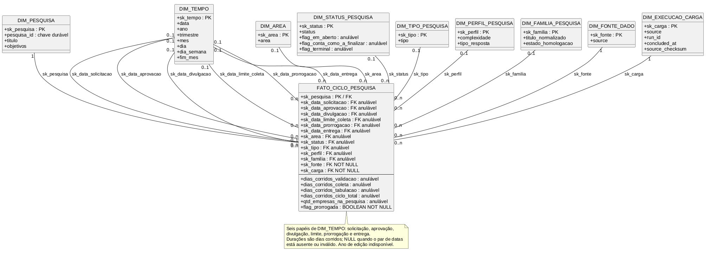
  <p><b>Fonte:</b> Material elaborado pela equipe.</p>
</div>

#### Métricas

As métricas são os números calculados e armazenados no cubo. A coluna **Aditividade** define se o número pode ser somado em agregações, como somar no ano inteiro.

**dias_uteis_validacao**
- Tipo: inteiro
- Fonte ou regra de cálculo: `data_aprov` menos `data_solicitacao`
- Aditividade: aditiva
- Observação: Cobertura de 5,5% das pesquisas; o indicador deve informar o denominador válido e não sustenta uma leitura geral do ciclo

**dias_uteis_coleta**
- Tipo: inteiro
- Fonte ou regra de cálculo: `data_limite` ou `prorrogada_ate` menos `data_divulgacao`
- Aditividade: aditiva
- Observação: Se existir prorrogação, usa a data prorrogada

**dias_uteis_tabulacao**
- Tipo: inteiro
- Fonte ou regra de cálculo: `data_entrega` menos `data_limite` ou `prorrogada_ate`
- Aditividade: aditiva

**dias_uteis_ciclo_total**
- Tipo: inteiro
- Fonte ou regra de cálculo: `data_entrega` menos `data_solicitacao`
- Aditividade: não aditiva
- Observação: O ciclo total é a soma das fases. Somar as quatro métricas causaria dupla contagem. Para agregar o tempo total de ciclo, deve-se usar apenas esta métrica, sem somá-la às fases

**qtd_empresas_na_pesquisa**
- Tipo: inteiro
- Fonte ou regra de cálculo: coluna `participantes` do CSV
- Aditividade: não aditiva
- Observação: É uma contagem declarada pela origem e só pode ser lida no nível da pesquisa; não substitui a contagem distinta observada no C02 e não pode ser somada entre pesquisas

**qtd_respondentes_na_pesquisa**
- Tipo: inteiro
- Fonte ou regra de cálculo: métrica removida de C01; contagens de respondentes devem ser calculadas no C02 a partir de `respondentes.csv`, usando a unidade de participação ou pessoa conciliada conforme o denominador aprovado
- Aditividade: não aditiva
- Observação: `tempo_preenchimento` é duração declarada, não quantidade de respondentes. Mantê-la como contagem em C01 produziria interpretação incorreta

**flag_prorrogada**
- Tipo: booleano (0 ou 1)
- Fonte ou regra de cálculo: 1 se `prorrogada_ate` não for nulo, 0 caso contrário
- Aditividade: não é para somar
- Observação: Usada como filtro, como mostrar apenas prorrogadas

#### Dimensões

As dimensões são as formas de agrupar e filtrar os dados. Cada dimensão é uma tabela separada, e o cubo armazena apenas a chave estrangeira (FK).

**sk_pesquisa**
- Tabela dimensional: `DIM_PESQUISA`
- Descrição: Contém atributos da pesquisa como título, objetivos e ano da edição

**sk_data_solicitacao**
- Tabela dimensional: `DIM_TEMPO`
- Descrição: Data de solicitação. Permite agrupar por mês ou ano de origem

**sk_data_aprovacao**
- Tabela dimensional: `DIM_TEMPO`
- Descrição: Data de aprovação

**sk_data_divulgacao**
- Tabela dimensional: `DIM_TEMPO`
- Descrição: Data de divulgação

**sk_data_limite_coleta**
- Tabela dimensional: `DIM_TEMPO`
- Descrição: Data limite original

**sk_data_prorrogacao**
- Tabela dimensional: `DIM_TEMPO`
- Descrição: Data limite prorrogada, pode ser nula

**sk_data_entrega**
- Tabela dimensional: `DIM_TEMPO`
- Descrição: Data de entrega

**sk_area**
- Tabela dimensional: `DIM_AREA`
- Descrição: Área responsável pela pesquisa, coluna `area` do `pesquisas.csv`

**sk_status**
- Tabela dimensional: `DIM_STATUS_PESQUISA`
- Descrição: Status atual da pesquisa, coluna `status` do `pesquisas.csv`

**sk_tipo**
- Tabela dimensional: `DIM_TIPO_PESQUISA`
- Descrição: Tipo da pesquisa, coluna `tipo` do `pesquisas.csv`

**sk_perfil**
- Tabela dimensional: `DIM_PERFIL_PESQUISA`
- Descrição: Perfil da pesquisa. Contém atributos imutáveis como complexidade e tipo de resposta

**sk_familia**
- Tabela dimensional: `DIM_FAMILIA_PESQUISA`
- Descrição: Derivada do título da pesquisa. Permite agrupar edições recorrentes, como "Premiação da Força de Vendas"

**sk_fonte**
- Tabela dimensional: `DIM_FONTE_DADO`
- Descrição: Dimensão de linhagem. Indica o sistema de origem

**sk_carga**
- Tabela dimensional: `DIM_EXECUCAO_CARGA`
- Descrição: Dimensão de governança. Registra a execução de ETL que carregou a linha

#### Observações

Os `pesquisa_id` 424, 1116, 1139 e 1147 não existem no `pesquisas.csv`. No cubo, serão tratados como chaves órfãs em reconciliação, apontando para um registro "Não mapeado" na `DIM_PESQUISA`. Essa decisão preserva os dados originais sem criar entidades artificiais, e a reconciliação poderá ser feita futuramente quando os mapeamentos forem validados.

A data de aprovação (`data_aprov`) tem cobertura de 5,5% das pesquisas (20 de 366). As métricas que dependem dela (`dias_uteis_validacao`) terão muitos valores NULL. Os painéis devem informar o denominador válido e exibir indisponibilidade quando o recorte não sustentar a comparação.

A dimensão `DIM_FAMILIA_PESQUISA` é derivada dos títulos e deve ser validada pelo Sindusfarma. A derivação foi feita por normalização de título, removendo anos e padronizando o texto. Das 32 famílias identificadas, a maior parte é composta por pesquisas anuais recorrentes, como "Premiação da Força de Vendas" e "Gestão de Frotas".

Este cubo não armazena dados individuais de respondentes, respeitando a política de k-anonimato e LGPD. O acesso aos dados é controlado por camadas: a camada externa só publica agregações com mais de cinco empresas, e a camada interna mantém o detalhe para a equipe da Central de Pesquisas.

---

### 5.2.2 C02 — Participação e Representatividade

Este cubo modela a participação de empresas e pessoas nas pesquisas. Cada linha representa um registro de participação de `respondentes.csv`, não uma resposta individual a uma questão. O cubo permite análises de alcance observado, engajamento e representatividade de mercado, sem afirmar taxa de adesão quando o universo elegível não estiver disponível.

O grão do cubo é uma linha por participação, totalizando aproximadamente 18.735 linhas no snapshot atual. A fonte de dados principal é o arquivo `respondentes.csv`, complementado por `pesquisas.csv` para a data de divulgação da pesquisa, `clientes.csv` para atributos da pessoa respondente e `empresas.csv` para atributos da empresa. O tipo de fato é uma transação (transaction fact), pois cada linha representa um evento único e não acumula estados. A estrutura do cubo pode ser visualizada abaixo.

<div align="center">
  <p><b>Diagrama Cubo 2</b></p>
  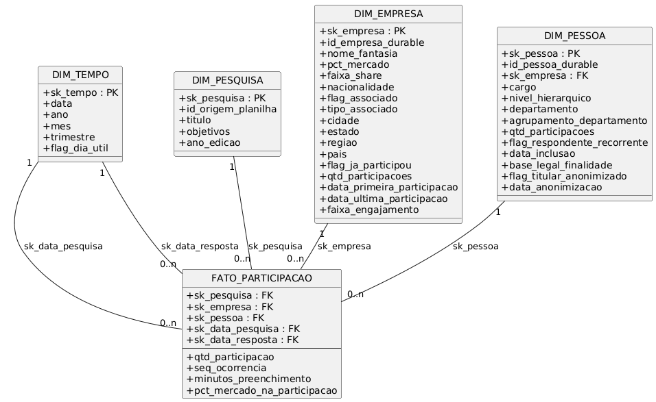
  <p><b>Fonte:</b> Material elaborado pela equipe.</p>
</div>

#### Métricas

As métricas são os números calculados e armazenados no cubo. A coluna **Aditividade** define se o número pode ser somado em agregações, como somar participações no ano inteiro.

**qtd_participacao**
- Tipo: inteiro
- Fonte ou regra de cálculo: sempre 1, pois cada linha é uma participação
- Aditividade: aditiva
- Observação: Representa o volume de registros de participação; não deve ser rotulada como quantidade de respostas a questões

**seq_ocorrencia**
- Tipo: inteiro
- Fonte ou regra de cálculo: número sequencial para duplicatas de (pesquisa, pessoa). A primeira ocorrência recebe 1, as seguintes 2, 3, etc.
- Aditividade: não aditiva
- Observação: Usada como filtro para remover duplicatas, selecionando apenas `seq_ocorrencia = 1` quando necessário

**minutos_preenchimento**
- Tipo: inteiro
- Fonte ou regra de cálculo: Calculado como a diferença entre `hora_termino` e `hora_inicio`, em minutos
- Aditividade: aditiva onde existir
- Observação: Cobertura de aproximadamente 4,3% das linhas, pois muitos registros não possuem ambos os horários preenchidos

**pct_mercado_na_participacao**
- Tipo: decimal
- Fonte ou regra de cálculo: Coluna `market_share` do `respondentes.csv` no momento da participação
- Aditividade: não aditiva
- Observação: Só pode ser lida no nível da participação enquanto a fonte autoritativa não for homologada. Depois da homologação, I09 soma uma vez por pesquisa o valor normalizado de cada empresa participante distinta; conflito entre as duas fontes bloqueia o recorte

#### Dimensões

As dimensões são as formas de agrupar e filtrar os dados. Cada dimensão é uma tabela separada, e o cubo armazena apenas a chave estrangeira (FK).

**sk_pesquisa**
- Tabela dimensional: `DIM_PESQUISA`
- Descrição: A pesquisa respondida. Permite agrupar por título, tipo, área, etc.

**sk_empresa**
- Tabela dimensional: `DIM_EMPRESA`
- Descrição: A empresa à qual o respondente pertence. Contém atributos como nome, nacionalidade, cidade, tipo de associado e o share de mercado atual

**sk_pessoa**
- Tabela dimensional: `DIM_PESSOA`
- Descrição: O respondente. Contém cargo, departamento, nível hierárquico e agrupamento de departamento (para anonimização). O e-mail é removido por ser um pseudônimo reversível

**sk_data_pesquisa**
- Tabela dimensional: `DIM_TEMPO`
- Descrição: Data da pesquisa, herdada da data de divulgação da pesquisa (`data_divulgacao`) em `pesquisas.csv`. Esta é a chave temporal primária, com cobertura de 97,8% das participações

**sk_data_resposta**
- Tabela dimensional: `DIM_TEMPO`
- Descrição: Data da resposta, extraída da coluna `hora_inicio` do `respondentes.csv`. É uma chave opcional, com cobertura de aproximadamente 4,3% das linhas, utilizada para análises de sazonalidade ou tempo de preenchimento

#### Observações

O arquivo `respondentes.csv` contém 838 casos de duplicatas onde a mesma pessoa aparece respondendo a mesma pesquisa mais de uma vez. O campo `seq_ocorrencia` foi criado para numerar essas ocorrências. Para análises de respondentes únicos, deve-se filtrar por `seq_ocorrencia = 1`. Isso permite que o cubo suporte tanto a contagem bruta de participações quanto a contagem de pessoas distintas, sem perder dados.

A data da resposta (`hora_inicio`) tem cobertura reduzida, de aproximadamente 4,3%. Por isso, a chave temporal primária é a data da pesquisa (`sk_data_pesquisa`), que é derivada de `data_divulgacao` em `pesquisas.csv` e cobre praticamente todas as participações. A data da resposta fica como um campo opcional para análises específicas de duração.

O campo `minutos_preenchimento`, calculado a partir de `hora_inicio` e `hora_termino`, também tem cobertura baixa, de aproximadamente 4,3%, e deve ser usado com cautela. Para métricas de tempo médio de preenchimento, recomenda-se filtrar apenas as linhas com ambos os campos preenchidos.

A coluna `market_share` em `respondentes.csv` e o campo `% de mercado` em `empresas.csv` divergem. O projeto não presume precedência entre eles: a fonte autoritativa deve ser homologada antes de calcular I09, e o recorte permanece bloqueado quando houver conflito.

A dimensão `DIM_PESSOA` contém cargo e departamento em seus valores brutos, mas esses campos são classificados como restritos. Na camada externa, eles devem ser substituídos por níveis hierárquicos (Diretoria, Gerência, Especialista, Analista, etc.) e agrupamentos de departamento (ex.: Recursos Humanos, Jurídico, etc.), garantindo que nenhuma célula com menos de 5 pessoas seja publicada, conforme a política de k-anonimato. O e-mail foi removido da dimensão por ser um pseudônimo reversível (`cliente<N>@empresa<M>.com`), e nenhum dos relatórios previstos o exige.

Para contagens distintas de empresas ou pessoas, deve-se utilizar as chaves duráveis (`id_empresa_durable` e `id_pessoa_durable`) em vez das chaves substitutas, garantindo que a contagem permaneça correta mesmo que futuramente sejam adotadas versões históricas (SCD2).


### 5.2.3 C03 - Pipeline Mensal

Este cubo modela a carga de trabalho da Central de Pesquisas ao longo do tempo. Ele é um instantâneo periódico (periodic snapshot) que registra, ao final de cada mês, quantas pesquisas estavam em cada combinação de status, área, tipo e perfil. O objetivo é responder perguntas como quantas pesquisas estavam em andamento em um determinado mês, qual a evolução do fluxo de entregas e onde ocorrem os gargalos operacionais.

O grão do cubo é uma linha por combinação de mês, status, área, tipo e perfil. A fonte de dados é derivada do Cubo 1, mas com uma limitação importante: não há registro histórico de status anteriores, portanto este cubo só começa a ser alimentado a partir do momento em que o sistema entrar em produção (go-live). O tipo de fato é um instantâneo periódico (periodic snapshot), pois captura o estado do pipeline em um momento específico (o fim de cada mês). A estrutura do cubo pode ser visualizada abaixo.

<div align="center">
  <p><b>Diagrama Cubo 3 - Pipeline Mensal</b></p>
  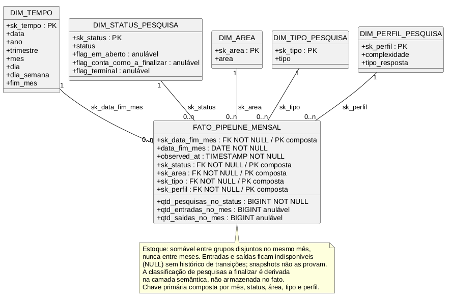
  <p><b>Fonte:</b> Material elaborado pela equipe.</p>
</div>

#### Métricas

As métricas são os números calculados e armazenados no cubo. A coluna **Aditividade** define em quais dimensões o número pode ser somado. Medidas de estoque do snapshot não podem ser somadas entre meses; medidas de fluxo podem ser acumuladas no tempo.

**qtd_pesquisas_no_status**
- Tipo: inteiro
- Fonte ou regra de cálculo: Contagem de pesquisas que estavam naquele status no último dia do mês
- Aditividade: semi-aditiva
- Observação: Pode ser agregada entre categorias disjuntas no mesmo fechamento, mas não entre meses. Para contar finalizações no ano, deve-se usar o fluxo de entradas no status terminal, não somar estoques mensais

**qtd_entradas_no_mes**
- Tipo: inteiro
- Fonte ou regra de cálculo: Quantidade de pesquisas que chegaram àquele status durante o mês
- Aditividade: aditiva
- Observação: Representa o fluxo de entrada no status e exige histórico de transições; diferenças entre dois snapshots capturam apenas a mudança líquida, não todas as transições do mês

**qtd_saidas_no_mes**
- Tipo: inteiro
- Fonte ou regra de cálculo: Quantidade de pesquisas que saíram daquele status durante o mês
- Aditividade: aditiva
- Observação: Representa o fluxo de saída do status e exige histórico de transições; fica indisponível enquanto esse histórico não existir

#### Dimensões

As dimensões são as formas de agrupar e filtrar os dados. Cada dimensão é uma tabela separada, e o cubo armazena apenas a chave estrangeira (FK).

**sk_data_fim_mes**
- Tabela dimensional: `DIM_TEMPO`
- Descrição: Último dia do mês. Permite agrupar as métricas por ano, trimestre ou mês

**sk_status**
- Tabela dimensional: `DIM_STATUS_PESQUISA`
- Descrição: Status da pesquisa no snapshot. Ex.: "Em andamento", "Em tabulação", "Finalizada"

**sk_area**
- Tabela dimensional: `DIM_AREA`
- Descrição: Área responsável pela pesquisa. Ex.: "Sindical Trabalhista e RH", "Assuntos Regulatórios"

**sk_tipo**
- Tabela dimensional: `DIM_TIPO_PESQUISA`
- Descrição: Tipo da pesquisa. Ex.: "Solicitação de associado", "Pesquisa fixa anual"

**sk_perfil**
- Tabela dimensional: `DIM_PERFIL_PESQUISA`
- Descrição: Perfil da pesquisa. Contém atributos imutáveis como complexidade e tipo de resposta

#### Observações

Este cubo não possui dados históricos. O backfill não é possível porque os status anteriores nunca foram registrados em nenhuma base disponível. O painel de fluxo mostrará dados apenas a partir do go-live. Isso deve ser comunicado claramente ao cliente.

A métrica `qtd_a_finalizar` foi removida do modelo na revisão adversarial porque, quando calculada como uma agregação sobre múltiplos status, multiplicava o estoque de pesquisas em até sete vezes. No lugar dela, o cálculo de pesquisas a finalizar deve ser feito na camada semântica, utilizando a flag `flag_conta_como_a_finalizar` presente na `DIM_STATUS_PESQUISA`.

A dimensão `DIM_TEMPO` deve ter um papel específico para o último dia do mês (`sk_data_fim_mes`). O grão da `DIM_TEMPO` permanece diário, e esse papel é usado exclusivamente para este cubo.

A dimensão `DIM_STATUS_PESQUISA` deve conter flags que auxiliem na interpretação dos status: `flag_em_aberto`, `flag_conta_como_a_finalizar` e `flag_terminal`. Essas flags permitem que a camada semântica faça cálculos consistentes sem necessidade de hardcode de status no código.

Para o fluxo mensal, recomenda-se que o snapshot seja gerado automaticamente no primeiro dia útil de cada mês, considerando o fechamento do mês anterior. Isso garante que o dado esteja sempre disponível para análises comparativas entre períodos.

---

### 5.2.4 C04 — Resultados e Questionários

Este cubo descreve o conteúdo dos questionários, ou seja, quais perguntas foram feitas em cada pesquisa. Ele é um fato de associação (factless fact), pois não possui métricas numéricas tradicionais para somar, mas sim conexões entre dimensões. O objetivo é responder perguntas como quantas perguntas cada pesquisa possui, qual o tipo predominante de questões e quais pesquisas compartilham perguntas semelhantes.

O grão do cubo é uma linha por pergunta em uma pesquisa, totalizando 231 linhas no snapshot atual, cobrindo apenas 10 das 366 pesquisas (aproximadamente 2,7% do acervo). A fonte de dados é o arquivo questoes.csv. O tipo de fato é um fato de associação, pois conecta a pesquisa à pergunta sem armazenar medidas numéricas de soma. A estrutura do cubo pode ser visualizada abaixo.

<div align="center">
  <p><b>Diagrama Cubo 4</b></p>
  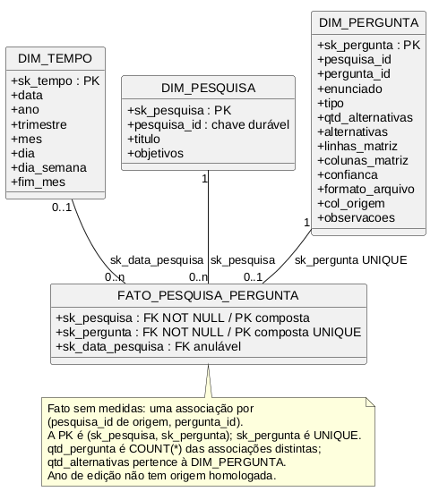
  <p><b>Fonte:</b> Material elaborado pela equipe.</p>
</div>

#### Métricas derivadas

Como este é um fato de associação, o fato não armazena medidas numéricas tradicionais. As contagens abaixo são derivadas das linhas e dos atributos dimensionais no momento da consulta.

qtd_pergunta
- Tipo: inteiro
- Fonte ou regra de cálculo: `COUNT(*)` das associações distintas entre pesquisa e pergunta
- Aditividade: derivada no grão consultado
- Observação: representa o volume de perguntas cobertas por pesquisa sem persistir uma medida constante no fato

qtd_alternativas
- Tipo: inteiro
- Fonte ou regra de cálculo: atributo `qtd_alternativas` da `DIM_PERGUNTA`
- Aditividade: não se aplica como medida do fato
- Observação: somas e médias devem considerar perguntas distintas no recorte para não repetir o atributo em associações duplicadas

#### Dimensões

As dimensões são as formas de agrupar e filtrar os dados. Cada dimensão é uma tabela separada, e o cubo armazena apenas a chave estrangeira (FK).

sk_pesquisa
- Tabela dimensional: DIM_PESQUISA
- Descrição: a pesquisa que contém a pergunta

sk_pergunta
- Tabela dimensional: DIM_PERGUNTA
- Descrição: a pergunta em si. Contém o enunciado, o tipo de questão, o número de alternativas, o formato de arquivo de origem e outras características

sk_data_pesquisa
- Tabela dimensional: DIM_TEMPO
- Descrição: data da pesquisa, herdada da data de divulgação (data_divulgacao) em pesquisas.csv. Permite agrupar por ano ou trimestre

#### Observações

O arquivo questoes.csv contém 10 pesquisas distintas, mas quatro delas (IDs 424, 1116, 1139 e 1147) não existem em pesquisas.csv. Para essas quatro pesquisas, a ligação com DIM_PESQUISA é feita por fallback utilizando o título da pesquisa, que apresenta correspondência exata com os títulos da planilha principal. As seis pesquisas restantes (112, 238, 274, 377, 414 e 415) ligam diretamente pelos IDs, cobrindo 188 das 231 linhas (81,4% do arquivo).

A base de questões cobre apenas 2,7% do acervo total de pesquisas (10 de 366). Os relatórios que dependem deste cubo, como o Relatório #07 (Resultados da Pesquisa) e o Relatório #10 (Benchmark Setorial), só funcionarão plenamente para essas 10 pesquisas. Para as demais, os painéis mostrarão "Dados não disponíveis" ou uma mensagem similar, a menos que a extração de questões seja estendida para todo o acervo.

O cubo é um ponto de extensão para uma futura `FATO_RESPOSTA` conciliada. O projeto possui `respostas.csv`, mas a ponte entre `respondent_id` e a identidade de `respondentes.csv` não está comprovada. Distribuições agregadas no grão questão podem ser calculadas quando válidas; análises por pessoa, participação ou segmento permanecem bloqueadas até a reconciliação, sem união por similaridade.

A dimensão DIM_PERGUNTA contém metadados adicionais que podem ser úteis para análises futuras: o formato do arquivo de origem, a coluna de origem no arquivo bruto e um campo de confiança que indica o nível de certeza sobre a extração da pergunta.

`qtd_alternativas` é atributo da `DIM_PERGUNTA`. Totais ou médias podem ser derivados sobre perguntas distintas, deixando explícitos o conjunto coberto e o denominador; o atributo não transforma o fato de associação em um fato com medida armazenada.

#### Dimensões conformadas entre os cubos

Uma dimensão é classificada como conformada somente quando é compartilhada por
mais de um cubo com o mesmo significado e contrato de chave.

| Dimensão conformada | Cubos |
| :--- | :--- |
| `DIM_TEMPO` | C01, C02, C03 e C04 |
| `DIM_PESQUISA` | C01, C02 e C04 |
| `DIM_STATUS_PESQUISA` | C01 e C03 |
| `DIM_AREA` | C01 e C03 |
| `DIM_TIPO_PESQUISA` | C01 e C03 |
| `DIM_PERFIL_PESQUISA` | C01 e C03 |

`DIM_EMPRESA` e `DIM_PESSOA` são próprias do C02; `DIM_PERGUNTA`, do C04;
`DIM_FAMILIA_PESQUISA`, `DIM_FONTE_DADO` e `DIM_EXECUCAO_CARGA`, do C01 no
recorte atualmente documentado. Elas não são chamadas de conformadas apenas por
serem dimensões ou por poderem ser reutilizadas numa evolução futura.

### 5.2.5 Matriz de Rastreabilidade (PB → RF → Indicador → Cubo → Dashboard)

Matriz de rastreamento entre perguntas de negócio, requisitos, indicadores, cubos, artefatos analíticos e dashboards. Garante que cada PB está vinculada a indicadores e a uma base analítica adequada, sem forçar indicadores de qualidade e governança dentro do cubo C04 de resultados/questionários.

| Pergunta de negócio | Requisito | Indicador(es) | Cubo(s) / artefato(s) | Dashboard(s) |
| :--- | :--- | :--- | :--- | :--- |
| PB01 — Quais pesquisas compõem o portfólio e como se distribuem por período, tipo, área, complexidade e status? | RF01 | I01, I02 | C01: Contém cada pesquisa com seus atributos (tipo, área, complexidade, status), permitindo análise de composição e distribuição do portfólio | D01 |
| PB02 — Em que etapa está cada pesquisa, quais marcos foram observados ou derivados e quais informações do seu detalhe estão disponíveis? | RF02 | I03, I04 | C01: Acumula marcos do ciclo (solicitação, aprovação, divulgação, prorrogação, entrega) para cada pesquisa | D01 |
| PB03 — Quais pesquisas estão atrasadas, foram prorrogadas ou demandam prioridade, qual denominador sustenta cada comparação e como os tempos do ciclo se comparam? | RF03 | I04, I05, I06 | C01 e C03: C01 fornece datas dos marcos e prorrogações para calcular atrasos e prioridades; C03 mostra evolução do pipeline mensalmente para comparação de ciclos e identificação de gargalos | D01 |
| PB04 — A participação alcançada é suficiente e representa as empresas ou parcelas de mercado relevantes, e qual denominador sustenta essa leitura? | RF04 | I07, I08, I09 | C02: Contém cada participação associada a empresa e mercado, permitindo cálculo de adesão e representatividade | D02 |
| PB05 — Quais áreas, departamentos e cargos participam mais ou menos, e qual é o denominador disponível para o engajamento? | RF05 | I10, I11 | C02: Armazena participação ligada a pessoa, cargo e departamento para análise de engajamento por público | D02 |
| PB06 — Quais dados estão completos e válidos, quais lacunas permanecem e qual é o estado de atualização de cada fonte? | RF06 | I16, I17, I18, I19, I20, I21 | Perfilamento de qualidade e governança (§5.3 e §6.6): mede completude, duplicidade, parseabilidade, integridade, frescor e pendências por fonte/campo | D04 |
| PB07 — Qual sistema ou arquivo sustenta cada elo do agregado, qual é o estado observado, em reconciliação ou proposto, e como tratar os quatro `pesquisa_id` (424, 1116, 1139 e 1147) sem correspondência e as 55 participações com `id_pesq=304` ausente? | RF07 | I18, I22 | Perfilamento de qualidade e governança (§5.3 e §6.6): registra elos observados, órfãos e estados de reconciliação sem transformar isso em fato de questionário | D04 |
| PB08 — Que dados cada perfil pode consultar, detalhar ou publicar sem expor informações não autorizadas? | RF08 | I25 | Política de acesso proposta (§6.6): depende de perfis aprovados, decisão do Data Owner e logs de autorização | D04 |
| PB09 — O resultado foi autorizado e publicado, quais metadados sustentam essa decisão e ele está consistente com a pesquisa interna correspondente? | RF09 | I23 | Política de publicação proposta (§6.6): depende de autorização, estado de publicação, metadados do acervo e decisão registrada | D04 |
| PB10 — Qual foi a distribuição das respostas para cada questão, qual denominador está disponível e como ela varia entre pesquisas ou segmentos permitidos? | RF10 | I12, I13 | C04: Contém perguntas associadas a pesquisas, permitindo análise de questionários e instrumentos | D03 |
| PB11 — Qual evidência agregada sustenta este resultado, que contexto está disponível e a consulta individual é autorizada e suportada pelos dados? | RF11 | I12, I13, I18, I22 | C04 para o instrumento de questionário; perfilamento de qualidade e governança (§5.3 e §6.6) para integridade e linhagem agregada | D03, D04 |
| PB12 — Quais fontes foram recebidas, atualizadas e padronizadas, quais registros foram deduplicados e qual origem sustenta cada dado? | RF12 | I17, I19, I21, I24 | Perfilamento de qualidade e governança (§5.3 e §6.6): sustenta deduplicação, parseabilidade, frescor futuro e cobertura de processamento | D04 |
| PB13 — Qual versão do questionário foi revisada por qual área técnica, em que estado de validação e antes de qual marco do ciclo? | RF13 | I14, I15 | C04: Contém histórico de questionários associados a pesquisas e suas versões | D03 |

## 5.3 Qualidade e Validação de Dados

Esta seção diagnostica dados ausentes e registros duplicados nas seis bases disponibilizadas, para apoiar as regras de qualidade da solução. A medição foi executada pelo artefato versionado `scripts/data_quality/profile_csv.py`, conforme `scripts/data_quality/manifest.json`, usando UTF-8 (BOM aceito), separador `;`, decimal brasileiro e percentual com sufixo `%`. O manifesto registra `teste.csv` como alias local conceitual de `respostas.csv`; o arquivo bruto não foi copiado para o repositório nem para as saídas. O dicionário é validado de fato: cabeçalho, nove variáveis, conteúdo mínimo e alegações verificáveis de cardinalidade e nulos são confrontados com a base. **Não houve duplicidade de linha nem das chaves declaradas** nas seis fontes. Chaves estrangeiras (FKs) podem repetir legitimamente por representarem muitos registros filhos para uma mesma entidade e não foram tratadas como duplicatas. As ausências, por outro lado, exigem leitura cuidadosa: parte é **condicional** — estrutural e esperada, seguindo o tipo da pergunta ou o estágio do ciclo de vida da pesquisa (ex.: `linha_matriz` só existe em perguntas de matriz; `prorrogada_ate` só quando há prorrogação) — e parte é **a investigar**, indicando possível lacuna de preenchimento a tratar antes de automatizar indicadores.[<sup>[2]</sup>](#ref-2)[<sup>[12]</sup>](#ref-12)

O grão de `respostas` é **um elemento atômico de resposta de um respondente para uma pergunta de uma pesquisa**. Uma linha não representa necessariamente um questionário completo: caixas de seleção e matrizes podem produzir várias linhas para o mesmo respondente e pergunta. Portanto, `COUNT(*)` nessa fonte mede elementos de resposta, e não respondentes; qualquer KPI de adesão deve usar a chave e a unidade de análise explicitamente.

<div align="center">
<sub>Tabela — Resumo de qualidade por base</sub><br>

| Base | Registros | Duplicados | Variáveis com ausência |
| :--- | ---: | ---: | ---: |
| `pesquisas.csv` | 366 | 0 | 16 |
| `empresas.csv` | 779 | 0 | 6 |
| `clientes.csv` | 5.430 | 0 | 4 |
| `respondentes.csv` | 18.735 | 0 | 4 |
| `questoes.csv` | 231 | 0 | 5 |
| `respostas.csv` (alias local `teste.csv`) | 20.607 | 0 | 5 |

<sup>Material produzido pelos autores (2026)</sup>

</div><br>

As tabelas a seguir detalham, por base, apenas as variáveis com ausência — quantidade, percentual e natureza (condicional ou a investigar). Percentuais de ausência são calculados sobre as linhas da própria base; um valor ausente não é convertido em zero.

O resumo de chaves separa unicidade de completude: todas as seis chaves são `UNICA`, mas `clientes.id_cliente` tem 1 linha semanticamente incompleta (`s/i`) e `respondentes.(id_pesq,id_empresa,id_cliente)` tem 857 linhas incompletas (856 vazios e 1 `s/i`). A taxa de completude da chave de respondentes é 95,4%; a ausência não é tratada como duplicata nem como correspondência válida.

#### pesquisas.csv

<div align="center">
<sub>Tabela — Ausências em pesquisas.csv</sub><br>

| Variável | Ausentes | % | Natureza |
| :--- | ---: | ---: | :--- |
| data_aprov | 346 | 94,5% | condicional |
| prorrogada_ate | 298 | 81,4% | condicional |
| complexidade | 276 | 75,4% | a investigar |
| tempo_preenchimento | 135 | 36,9% | a investigar |
| objetivos | 123 | 33,6% | a investigar |
| part_mercado | 44 | 12,0% | a investigar |
| dias para tabulação | 36 | 9,8% | condicional |
| dias_uteis_para_entrega | 35 | 9,6% | condicional |
| dias entre a solicitação e a divulgação | 34 | 9,3% | condicional |
| data_entrega | 32 | 8,7% | condicional |
| participantes | 31 | 8,5% | a investigar |
| data_divulgacao | 8 | 2,2% | condicional |
| data_limite | 8 | 2,2% | condicional |
| data_solicitacao | 4 | 1,1% | a investigar |
| dia da semana de lançamento | 3 | 0,8% | condicional |
| dias úteis aberta | 3 | 0,8% | condicional |

<sup>Material produzido pelos autores (2026)</sup>

</div><br>

#### empresas.csv

<div align="center">
<sub>Tabela — Ausências em empresas.csv</sub><br>

| Variável | Ausentes | % | Natureza |
| :--- | ---: | ---: | :--- |
| Nacionalidade | 69 | 8,9% | a investigar |
| País | 58 | 7,4% | a investigar |
| Tipo de Associado | 49 | 6,3% | condicional |
| Estado | 43 | 5,5% | a investigar |
| Cidade | 42 | 5,4% | a investigar |
| Associado | 1 | 0,1% | a investigar |

<sup>Material produzido pelos autores (2026)</sup>

</div><br>

#### clientes.csv

<div align="center">
<sub>Tabela — Ausências em clientes.csv</sub><br>

| Variável | Ausentes | % | Natureza |
| :--- | ---: | ---: | :--- |
| cargo | 35 | 0,6% | a investigar |
| departamento | 31 | 0,6% | a investigar |
| id_empresa | 1 | 0,0% | a investigar |
| e-mail | 1 | 0,0% | a investigar |

<sup>Material produzido pelos autores (2026)</sup>

</div><br>

#### respondentes.csv

<div align="center">
<sub>Tabela — Ausências em respondentes.csv</sub><br>

| Variável | Ausentes | % | Natureza |
| :--- | ---: | ---: | :--- |
| hora_inicio | 17.928 | 95,7% | condicional |
| hora_termino | 17.928 | 95,7% | condicional |
| id_cliente | 856 | 4,6% | a investigar |
| market_share | 5 | 0,0% | a investigar |

<sup>Material produzido pelos autores (2026)</sup>

</div><br>

#### questoes.csv

<div align="center">
<sub>Tabela — Ausências em questoes.csv</sub><br>

| Variável | Ausentes | % | Natureza |
| :--- | ---: | ---: | :--- |
| observacoes | 231 | 100,0% | condicional |
| linhas_matriz | 228 | 98,7% | condicional |
| colunas_matriz | 228 | 98,7% | condicional |
| alternativas | 29 | 12,6% | condicional |
| qtd_alternativas | 25 | 10,8% | condicional |

<sup>Material produzido pelos autores (2026)</sup>

</div><br>

#### respostas.csv

<div align="center">
<sub>Tabela — Ausências em respostas.csv</sub><br>

| Variável | Ausentes | % | Natureza |
| :--- | ---: | ---: | :--- |
| linha_matriz | 16.603 | 80,6% | condicional |
| coluna_matriz | 16.603 | 80,6% | condicional |
| alternativa | 10.266 | 49,8% | condicional |
| valor | 8.307 | 40,3% | condicional |
| id_empresa | 10 | 0,0% | a investigar |

<sup>Material produzido pelos autores (2026)</sup>

</div><br>

As ausências **a investigar** mais relevantes concentram-se em `pesquisas.csv` (`complexidade`, `objetivos`, `tempo_preenchimento`, `participantes` e `part_mercado`) e nas lacunas cadastrais de `empresas.csv` (localização e nacionalidade). Já `id_cliente` ausente em `respondentes.csv` (4,6%) e `id_empresa` ausente em `respostas.csv` e `clientes.csv` reforçam a necessidade de conciliação de identidade entre as bases antes de consolidar os indicadores.

### 5.3.1 Evidências adicionais do perfilamento

O manifesto e os arquivos gerados em diretório temporário tornam o diagnóstico repetível sem armazenar CSV bruto. A execução produziu seis fontes com 366, 779, 5.430, 18.735, 231 e 20.607 registros, respectivamente. `pesquisas.csv` possui 33 colunas, das quais 11 têm cabeçalho vazio e nenhum valor; `questoes.observacoes` é a única coluna nomeada integralmente vazia (231/231). Os demais números de ausência estão nas tabelas acima.

Todos os valores de data não nulos foram parseáveis. Foram comparáveis 20 pares `data_solicitacao`–`data_aprov`, 20 pares `data_aprov`–`data_divulgacao`, 331 pares `data_solicitacao`–`data_entrega` e 68 pares `data_limite`–`prorrogada_ate`; não houve violação na ordem temporal. Em `respondentes`, 807 pares `hora_inicio`–`hora_termino` foram comparáveis e também não houve violação. O timezone não é informado na exportação: a origem e o horário local precisam ser confirmados antes de converter fusos. A coerência temporal cobre somente pares com ambas as datas preenchidas e parseáveis, sem imputação; o resultado não mede completude do processo.

O perfilamento de domínios seguros encontrou inconsistências que precisam de normalização: `empresas.Associado` possui `Sim` (612), `sim` (1), `<SENTINELA:->` (165) e 1 vazio; `empresas.País` possui `Brasil` (669), `BRASIL` (46) e `brasil` (4), além de 58 vazios. Em `questoes`, os tipos são `multipla_escolha` (123), `caixas_de_selecao` (80), `matriz_avaliacao` (3), `numerica` (21) e `aberta` (4), o que sustenta regras de completude condicionais. O domínio de respostas não é exportado pelo perfilador, pois pode conter texto fornecido por participantes; a saída `nulos_condicionais.csv` apresenta apenas contagens por tipo.

As três medidas de participação de mercado continuam armazenadas como texto (`part_mercado`, `% de mercado` e `market_share`); a interpretação deve converter a vírgula decimal e remover `%` somente em uma camada tipada, preservando o texto original para auditoria. O arquivo `percentuais.csv` mediu 322/322, 779/779 e 18.730/18.730 valores não nulos parseáveis, respectivamente; foram 0 inválidos e 0 fora do intervalo proposto `[0,100]` em cada campo. Sem essa conversão, médias e comparações podem ser lexicográficas ou falhar silenciosamente.

As sentinelas são configuradas por campo, não por substituição textual global: `s/i` não participa de chaves de cliente; `NA` em `respostas.valor` é nulo semântico; `-` é sentinela em `empresas.Associado`, mas continua texto livre válido em `respostas.valor`. Assim, `valor` possui 8.307 vazios físicos, 2 `NA` e 8.309 nulos semânticos. Esse é o motivo da divergência documentada pelo dicionário: a alegação de 8.309 nulos não coincide com a contagem física de vazios, mas coincide após a regra semântica.

### 5.3.2 Chaves, órfãos e identidades entre sistemas

As verificações de relacionamento usam apenas chaves não nulas e reportam o denominador comparável. Os resultados medidos foram:

| Relação | Comparáveis | Encontradas | Órfãs | % órfãs | Interpretação |
| :--- | ---: | ---: | ---: | ---: | :--- |
| `clientes.id_empresa → empresas.ID` | 5.429 | 5.429 | 0 | 0,0% | 1 cliente sem `id_empresa` não entra no teste de chave |
| `respondentes.id_empresa → empresas.ID` | 18.735 | 18.735 | 0 | 0,0% | Relação empresa–participação presente |
| `respondentes.id_pesq → pesquisas.id` | 18.735 | 18.680 | 55 | 0,3% | 55 linhas apontam para o ID 304 ausente; afeta adesão e série temporal |
| `respostas.id_empresa → empresas.ID` | 20.597 | 20.597 | 0 | 0,0% | 10 respostas sem empresa exigem decisão de tratamento |
| `respondentes.id_cliente → clientes.id_cliente` | 17.878 | 17.878 | 0 | 0,0% | 856 vazios e 1 `s/i` não são comparáveis; igualdade normalizada não prova identidade histórica |
| `respostas.(pesquisa_id,id_pergunta) → questoes` | 20.607 | 20.607 | 0 | 0,0% | Grão atômico de resposta preservado |
| `questoes.pesquisa_id → pesquisas.id` | 231 | 188 | 43 | 18,6% | IDs históricos precisam de identidade canônica |
| `respostas.pesquisa_id → pesquisas.id` | 20.607 | 17.015 | 3.592 | 17,4% | Não atribuir silenciosamente a pesquisa atual |

Os domínios de identificador reforçam a hipótese de múltiplos sistemas: há 366 `pesquisas.id` distintos, 327 `respondentes.id_pesq` e 10 `pesquisa_id` distintos em cada uma de `questoes` e `respostas`. A relação `respondentes.id_pesq → pesquisas.id` tem 55 linhas órfãs concentradas no ID 304; isso pode retirar participações de uma pesquisa dos KPIs de adesão e de suas séries temporais se for descartado sem mapeamento. As interseções entre `pesquisas.id` e `questoes.pesquisa_id` e entre `pesquisas.id` e `respostas.pesquisa_id` são de 6; entre `questoes` e `respostas`, 10. Isso é evidência de reconciliação necessária, não autorização para descartar os IDs órfãos.

`id_cliente` aparece como texto no cadastro e como identificador numérico/textual na participação. O perfilamento encontrou 5.429 valores distintos em cada lado e interseção de 5.429 após normalização, mas a diferença de tipo e o registro `s/i` do cadastro exigem regra explícita. `respostas.respondent_id` possui 542 valores distintos e não tem uma chave homônima em `respondentes.csv`; por isso o perfilador não o classifica como órfão, apenas como identidade ainda não ligada.

A verificação da cópia denormalizada `questoes.pesquisa_titulo` contra `pesquisas.titulo` encontrou 188 pares comparáveis, 147 coincidentes e 41 divergências (21,8%), todas concentradas nos IDs 414 (13 linhas) e 415 (28 linhas). O título canônico deve vir de `pesquisas`; a divergência não deve criar uma segunda identidade nem ser corrigida sobrescrevendo a origem sem auditoria.

`nulos_condicionais.csv` classifica cada campo de resposta por `questoes.tipo`, separando linhas aplicáveis, não aplicáveis, preenchidas, ausências condicionais e ausências inesperadas. Para `linha_matriz` e `coluna_matriz`, foram 4 ausências inesperadas em 4.008 linhas de `matriz_avaliacao` (0,1%); `alternativa` é obrigatória em `caixas_de_selecao` e não teve ausência inesperada. As regras são explícitas no manifesto e devem ser revisadas pelo Data Steward antes de virarem bloqueio de ingestão.

### 5.3.3 Indicadores, fórmulas, unidades e grãos

As métricas abaixo são as definições usadas nos artefatos de perfilamento. Quando o resultado é medido, a fonte é o CSV local indicado; quando a regra ainda depende do processo futuro, ela está marcada como proposta.

| Indicador | Fórmula | Unidade | Grão | Fonte | Resultado/interpretação |
| :--- | :--- | :--- | :--- | :--- | :--- |
| Completude de campo | `(linhas − nulos) / linhas × 100` | % | campo por base | `campos.csv` | Mede preenchimento; não transforma vazio condicional em erro |
| Taxa de duplicação de linhas/chaves declaradas | `duplicadas_extras / linhas × 100` | % | linha ou chave declarada da base | `resumo.csv` | 0,0% nas seis bases medidas; repetição de FK é legítima |
| Taxa de órfãos | `órfãos / comparáveis × 100` | % | chave de relação | `relacionamentos.csv` | 18,6% em questões→pesquisas e 17,4% em respostas→pesquisas |
| Elementos de resposta | `COUNT(respostas.id_resposta)` | registros | elemento atômico de resposta | `respostas.csv`/alias `teste.csv` | 20.607; não equivale a respondentes |
| Respondentes distintos | `COUNT(DISTINCT respondent_id)` | respondentes | pesquisa e respondente | `respostas.csv`/alias `teste.csv` | 542 distintos; vínculo com `respondentes` ainda não está comprovado |
| Violação temporal | `pares fora de ordem / pares comparáveis × 100` | % | par temporal por pesquisa/participação | `coerencia_temporal.csv` | 0,0% nos pares preenchidos medidos; completude continua separada |
| Consistência de domínio | `contagem por valor normalizado / linhas × 100` | % | campo categórico | `dominios.csv` | Identifica `Sim/sim`, `Brasil/BRASIL/brasil` e vazios |
| Percentual parseável | `valores parseáveis / valores não nulos × 100` | % | campo percentual | `percentuais.csv` | 100,0% nos três campos; inválidos e fora de `[0,100]` = 0 |
| Ausência condicional inesperada | `ausências obrigatórias / linhas aplicáveis × 100` | % | tipo de questão e campo de resposta | `nulos_condicionais.csv` | 0,1% em cada dimensão de matriz; regra proposta por tipo |
| Divergência denormalizada | `títulos divergentes / pares comparáveis × 100` | % | questão–pesquisa | `denormalizados.csv` | 41/188 (21,8%), IDs 414 e 415 |
| Divergência do dicionário | `alegação − medição física/semântica` | registros | cada um dos nove campos de `respostas` | `dicionario_validacao.csv` | Cardinalidades e nulos verificáveis conferem; em `valor`, 8.309 alegados − 8.307 vazios = 2 sentinelas |

Os indicadores de negócio devem registrar ainda a dimensão usada (pesquisa, empresa, pergunta, respondente e período), a fórmula, a unidade e a origem. Por exemplo, adesão por pesquisa deve usar empresas/participações deduplicadas no grão definido, e não o número de linhas de `respostas`; tempo de entrega deve usar somente pares de datas válidos e declarar o denominador.

### 5.3.4 Impacto nos KPIs e controles de qualidade

| Desafio observado | Impacto no KPI/dashboard | Controle preventivo | Controle detectivo | Controle corretivo |
| :--- | :--- | :--- | :--- | :--- |
| Exportação com 11 colunas sem nome e `questoes.observacoes` 100% vazia | Metadados podem ser confundidos com atributos analíticos | Contrato de schema no manifesto e catálogo de campos | Falha explícita de cabeçalho/contagem e alerta de coluna vazia | Remover apenas após aprovação e preservar o mapeamento da origem |
| Percentuais armazenados como texto com vírgula e `%` | Média, soma e filtros podem ser lexicográficos ou inválidos | Tipo semântico e conversor único com regra brasileira | Contagem de parseáveis, valores fora do domínio e amostra independente | Corrigir na camada tipada, mantendo o valor original e a evidência |
| Ausências condicionais em perguntas/matrizes | Denominador errado e falso alerta de incompletude | Regra por `questoes.tipo` e dicionário | Completude condicional por tipo e relatório de nulos | Solicitar correção na fonte ou registrar “não aplicável”; não preencher com zero |
| Sentinelas misturadas a vazios (`s/i`, `NA`, `-`) | Chaves e completude podem contar “sem informação” como categoria válida | Sentinelas configuradas por campo e preservação do valor original | `campos.csv`, `dominios.csv` e `dicionario_validacao.csv` separam físico, sentinela e semântico | Confirmar significado com o Data Steward; corrigir camada tipada sem tratar `-` de texto livre como nulo |
| `complexidade`, `objetivos`, `participantes` e prazos incompletos | Comparação de prazo, volume e cobertura pode ter viés | Campos críticos definidos pelo Data Steward | `campos.csv`, `datas.csv` e revisão de amostra | Backfill na fonte, quarentena do registro ou exclusão documentada do denominador |
| `questoes.pesquisa_id` e `respostas.pesquisa_id` órfãos | Pesquisa, período e área podem ser atribuídos incorretamente | Tabela de identidade canônica e chave de origem por sistema | `relacionamentos.csv` e reconciliação de interseções | Mapear ID legado, reprocessar e manter órfão pendente até decisão |
| `respondentes.id_pesq` órfão (55 linhas, ID 304) | Participações podem desaparecer de adesão e série temporal | Relação obrigatória no contrato de ingestão | `relacionamentos.csv` com linhas e chaves órfãs distintas | Mapear ID 304 ou manter pendente; não descartar participação |
| `questoes.pesquisa_titulo` divergente (41 linhas) | Filtros e agrupamentos podem usar título inconsistente | Título canônico em `pesquisas` e chave de origem preservada | `denormalizados.csv` e reconciliação dos IDs 414/415 | Corrigir fonte/mapeamento após auditoria; não sobrescrever silenciosamente |
| Ausência de chave explícita entre `respondent_id` e `respondentes` | Adesão de pessoas e respostas pode ser duplicada ou não ligada | Definir contrato de identidade antes do KPI | Checagem de cardinalidade e relatório de identidade sem descarte | Criar mapeamento aprovado; não inferir pessoa apenas por coincidência |
| Datas ausentes ou fora de ordem | Tempos médios e SLA podem ser artificialmente baixos | Regras de ordem e fuso documentadas na entrada | `coerencia_temporal.csv` e checagem de pares comparáveis | Corrigir origem ou marcar a métrica como não calculável |

Como proposta inicial, a equipe pode submeter à aprovação do Data Steward os limiares de 0% para duplicação, falha de schema, falha de parsing e órfãos em chaves obrigatórias, e 0% de violações temporais nos pares comparáveis. Campos condicionais não recebem um limiar universal; cada tipo de pergunta deve ter regra e denominador próprios. Esses limiares são propostas de controle, não resultados obtidos nem garantia de publicação segura.

### 5.3.5 Fluxo detectar → auditar → corrigir

0. **Detectar:** executar o manifesto em diretório somente leitura e guardar `resumo.csv`, `campos.csv`, `datas.csv`, `dominios.csv`, `relacionamentos.csv`, `coerencia_temporal.csv`, `identidades.csv`, `nulos_condicionais.csv`, `percentuais.csv`, `denormalizados.csv`, `dicionario_validacao.csv` e o manifesto aplicado. Falha de arquivo, UTF-8, separador, cabeçalho ou quantidade de campos interrompe o processo com código explícito.
0. **Classificar:** separar ausência estrutural/condicional, ausência a investigar, falha de domínio, órfão, duplicata, falha temporal, percentual inválido, sentinela e divergência de identidade. O denominador comparável deve acompanhar cada alerta.
0. **Auditar:** o Data Steward revisa a regra e uma amostra independente de primeira, mediana e última linha de cada base, confrontando contagem, chaves, nulos e datas com a exportação recebida. Para respostas, a revisão confirma que múltiplas linhas por respondente/pergunta são compatíveis com o tipo da questão.
0. **Corrigir:** solicitar backfill na fonte, normalizar em camada tipada, criar mapeamento canônico ou colocar o registro em quarentena. Não apagar silenciosamente respostas ou IDs órfãos.
0. **Reprocessar e aprovar:** executar novamente, comparar hashes dos agregados e registrar decisão, responsável, data, versão do manifesto e evidências. Só então liberar o conjunto aprovado para o próximo estágio do pipeline, sem inferir que o perfilamento autoriza publicar os dados.

O arquivo `scripts/data_quality/README.md` documenta o comando, a validação do dicionário e as salvaguardas. Os testes unitários cobrem BOM, separador, percentual brasileiro, falha de schema, dicionário arbitrário e ausência de valores brutos nas saídas; a validação operacional deste diagnóstico também incluiu `py_compile`, duas execuções independentes e `git diff --check`.

### 5.3.6 Identidade do snapshot usado nos dashboards

Os indicadores e dashboards desta especificação usam o mesmo snapshot local analisado pelo perfilador. A execução separa nulo físico, sentinela e nulo condicional e produz somente agregados. Para permitir a conferência exata das fontes, os seis arquivos recebidos têm os seguintes SHA-256:

| Arquivo recebido | SHA-256 |
| :--- | :--- |
| `clientes.csv` | `5073960065f3ce92a3eab34eeebb38af2b0aaa7e398c862963444a5b608719af` |
| `empresas.csv` | `850aaa1840cd24f43c033a0f06d339c9b5186bdaad10f1b653c956e307d3ded5` |
| `pesquisas.csv` | `b8b5773018953a59d25fabb0875825660efe1723fdd37af58a2d85b46b80e7dc` |
| `questoes.csv` | `e2c592898d75d13fd4cc6a5181966707d8c836e7c52ad99ccbaef69b3efbec8f` |
| `respondentes.csv` | `cb53e8517e7c43793f14131bd76a792f658c808c034f56da95c3235444afca05` |
| `teste.csv` (nome canônico: `respostas.csv`) | `db4ebd90fdaf203084aff947b50d19a55dab9d0b05b6b692bcbb6eee9f3dd82a` |

O snapshot recebido não informa a data de carga. Para execuções futuras, propõe-se registrar `execution_id`, os hashes dos seis arquivos, `processado_em` e a versão do perfilador. `processado_em` identifica o processamento e não prova carregamento ou atualidade da fonte. O `execution_id` só deve ser emitido quando a serialização canônica do manifesto estiver versionada; até lá, os hashes individuais acima são a identidade reproduzível, sem inventar um hash combinado.

## 5.4 Rastreabilidade Analítica

A matriz fecha a cadeia PB → RF → indicador → cubo → dashboard. Os vínculos
indicam cobertura de especificação, não implementação. Os IDs permanecem
estáveis entre as §§5.2, 5.6, 6.3, 6.4 e 6.5. O contrato executável está em
[`scripts/traceability/manifest.json`](../scripts/traceability/manifest.json) e
é validado contra os IDs e nomes presentes em `docs/dmc.json`.

| Pergunta de negócio | Requisito | Indicador(es) | Cubo(s) | Dashboard(s) |
| :--- | :--- | :--- | :--- | :--- |
| PB01 | RF01 | I01, I02 | C01 | D01 |
| PB02 | RF02 | I03, I04 | C01 | D01 |
| PB03 | RF03 | I04, I05, I06 | C01 | D01 |
| PB04 | RF04 | I07, I08, I09 | C02 | D02 |
| PB05 | RF05 | I10, I11 | C02 | D02 |
| PB06 | RF06 | I16, I17, I18, I19, I20, I21 | Perfilamento de qualidade e governança | D04 |
| PB07 | RF07 | I18, I22 | Perfilamento de qualidade e governança | D04 |
| PB08 | RF08 | I25 | Política de acesso proposta | D04 |
| PB09 | RF09 | I23 | Política de publicação proposta | D04 |
| PB10 | RF10 | I12, I13 | C04; fato de resposta conciliado pendente de integração futura | D03 |
| PB11 | RF11 | I12, I13, I18, I22 | C04; fato de resposta conciliado pendente de integração futura | D03, D04 |
| PB12 | RF12 | I17, I19, I21, I24 | Perfilamento de qualidade e governança | D04 |
| PB13 | RF13 | I14, I15 | C04; metadados de versão e validação pendente de integração futura | D03 |

RF01–RF13 e PB01–PB13 chegam a pelo menos um indicador, um dashboard e um cubo.
A cobertura dimensional ainda não está completa para respostas conciliadas:
PB10 e PB11, com I12–I13, dependem de uma futura `FATO_RESPOSTA`; PB13 depende
de metadados de versão e validação para I15. O C04 cobre o instrumento de
questionário observado, sem inferir vínculo individual entre participação e
resposta. O cruzamento D03 → D04 em PB11 é navegação de linhagem agregada, não
autorização para consultar indivíduos.

## 5.5 Infraestrutura de Dados

Nesta Sprint, os CSVs permanecem em armazenamento externo e somente contratos,
scripts e agregados seguros são versionados. O repositório não contém data
warehouse, orquestração ou ambiente produtivo. A arquitetura alvo prevê zonas
separadas para origem imutável, dados tipados, dados reconciliados e consumo
autorizado, com catálogo e registros de execução. Tecnologia, retenção,
localização e frequência de carga dependem de decisão do parceiro e dos
controles da §6.6.

## 5.6 Mapa de Cobertura de Indicadores

Este mapa não confunde disponibilidade de cálculo com indicador implementado.
São usados exclusivamente os rótulos **Calculável agora**, **Exige normalização
ou mapeamento** e **Depende de integração futura**. “Calculável agora” significa
que o snapshot contém os campos necessários; a implementação e a homologação
do painel continuam propostas.

| Indicador | Disponibilidade | Cubo / fonte | Evidência ou dependência verificável |
| :--- | :--- | :--- | :--- |
| I01 — Pesquisas no portfólio | Calculável agora | C01 / `pesquisas.csv` | `id` e `data_solicitacao`; 366 registros recebidos |
| I02 — Distribuição do portfólio | Calculável agora | C01 / `pesquisas.csv` | `tipo`, `area`, `complexidade`, `status` e `tipo de resposta`; nulos ficam explícitos |
| I03 — Cobertura dos marcos do ciclo | Calculável agora | C01 / `pesquisas.csv` | Seis datas documentadas; ausência por marco já perfilada na §5.3 |
| I04 — Tempo observado entre marcos | Calculável agora | C01 e C03 / `pesquisas.csv` | Diferenças calculadas são dias corridos; campos declarados em dias úteis preservam a convenção original e não são tratados como equivalentes sem calendário confirmado |
| I05 — Taxa observada de prorrogação | Calculável agora | C01 e C04 / `pesquisas.csv` | `prorrogada_ate` presente em 68 de 366 linhas; denominador analítico restringe-se às linhas com `data_limite` |
| I06 — Pesquisas atrasadas ou prioritárias | Exige normalização ou mapeamento | C01 / regra de negócio + `pesquisas.csv` | Faltam data de referência, elegibilidade de atraso e campo/regra aprovada de prioridade |
| I07 — Empresas participantes distintas | Calculável agora | C02 / `respondentes.csv` | Contagem distinta de `id_empresa` por `id_pesq`; nulos separados |
| I08 — Taxa de adesão de empresas | Depende de integração futura | C02 / universo de convites | O snapshot não contém empresas convidadas/elegíveis por pesquisa |
| I09 — Participação de mercado observada | Exige normalização ou mapeamento | C02 / `respondentes.csv` + `empresas.csv` | `market_share` e `% de mercado` estão em texto; divergência entre fontes bloqueia homologação até definir fonte autoritativa, sem precedência presumida |
| I10 — Engajamento por público | Exige normalização ou mapeamento | C02 / `respondentes.csv` + `clientes.csv` + `pesquisas.csv` | `id_cliente` tem tipos incompatíveis; 856 vazios e 1 `s/i` em respondentes e 1 `s/i` em clientes viram não informado antes da ponte |
| I11 — Taxa de engajamento do público | Depende de integração futura | C02 / cadastro de convidados elegíveis | Não existe denominador convidado por área, cargo ou departamento |
| I12 — Distribuição agregada de respostas | Calculável agora | C04 + futura `FATO_RESPOSTA` / `respostas.csv` + `questoes.csv` | Elementos atômicos válidos por alternativa/valor/matriz; 8.307 vazios físicos e dois `NA` em `valor` ficam fora da base válida |
| I13 — Respondentes distintos na fonte de respostas | Calculável agora | C04 + futura `FATO_RESPOSTA` / `respostas.csv` | 542 `respondent_id` distintos na fonte; sem ponte para `respondentes.id_cliente` |
| I14 — Questões por tipo | Calculável agora | C04 / `questoes.csv` | `id_pergunta`, `pesquisa_id` e `tipo`; 43 questões têm pesquisa ausente em `pesquisas.csv` |
| I15 — Estado de validação e versão do questionário | Depende de integração futura | C04 + metadados do repositório de questionários | Versão, área revisora, decisão e timestamp de validação não existem no snapshot |
| I16 — Completude aplicável | Calculável agora | Perfilamento / seis CSV | Ausências por campo e natureza documentadas na §5.3; quatro ausências inesperadas nas 4.008 células de matriz aplicáveis |
| I17 — Taxa de duplicidade | Calculável agora | Perfilamento / seis CSV | Não foram observadas linhas ou IDs primários duplicados; FKs repetidas não são duplicatas |
| I18 — Integridade referencial | Calculável agora | Perfilamento / chaves dos seis CSV | Por relação: `respondentes → pesquisas`, 18.680/18.735 correspondências, 55 órfãs (0,3%) no ID 304; `questoes → pesquisas`, 188/231, 43 órfãs (18,6%); `respostas → pesquisas`, 17.015/20.607, 3.592 órfãs (17,4%); as duas últimas usam os IDs 424, 1116, 1139 e 1147; `s/i` é não informado antes do teste |
| I19 — Parseabilidade por tipo | Calculável agora | Perfilamento / seis CSV | Datas, inteiros e medidas numéricas armazenadas como texto podem ser testados sem imputação; `s/i` é inválido/não informado, não valor de chave |
| I20 — Divergência de título de pesquisa | Calculável agora | Perfilamento / `pesquisas.csv` + `questoes.csv` | 41 linhas de questão divergentes entre 188 linhas comparáveis |
| I21 — Frescor da fonte | Depende de integração futura | Governança / metadado de carga | Nenhum timestamp de extração/carga ou regra de frescor foi recebido |
| I22 — Cobertura da linhagem agregada | Exige normalização ou mapeamento | Perfilamento e governança / chaves dos seis CSV | Chaves permitem elos parciais; sistema de origem e ponte participação–resposta estão ausentes |
| I23 — Estado de publicação autorizada | Depende de integração futura | Governança / decisão do Data Owner + acervo | Autorização, estado e data de publicação não existem; `data_divulgacao` não os substitui |
| I24 — Cobertura do processamento das fontes | Depende de integração futura | Governança / catálogo e execuções de ingestão | Faltam catálogo de fontes esperadas, execução, resultado e timestamp de carga |
| I25 — Conformidade de acesso | Depende de integração futura | Governança / política e auditoria de acesso | Perfis finais, decisões do Data Owner e logs de autorização precisam ser aprovados e integrados |

## 5.7 Mapa de Cobertura de Dashboards

A disponibilidade do dashboard é a condição mais restritiva entre seus
indicadores. Mesmo quando o painel completo depende de preparação adicional,
os indicadores marcados **Calculável agora** podem ser prototipados a partir do
snapshot, mantendo visível a disponibilidade de cada bloco.

| Dashboard | Disponibilidade | Objetivo e cobertura | Indicadores | Filtros principais | Evidência / dependência |
| :--- | :--- | :--- | :--- | :--- | :--- |
| D01 — Operação: portfólio e prazos | Exige normalização ou mapeamento | Priorizar acompanhamento; PB01–PB03 / RF01–RF03 | I01–I06 | Período com `data_solicitacao` padrão, tipo, área, complexidade, status e tipo de resposta | I01–I05 usam `pesquisas.csv`; I06 aguarda referência temporal, elegibilidade e prioridade aprovadas |
| D02 — Adesão e representatividade | Depende de integração futura | Avaliar alcance e públicos; PB04–PB05 / RF04–RF05 | I07–I11 | Pesquisa, marco temporal explícito, área, empresa e atributos empresariais; cargo/departamento após reconciliação | I07 é observável; mercado e identidades exigem normalização; taxas aguardam universos convidados |
| D03 — Resultados e questionários | Depende de integração futura | Interpretar agregados e validar instrumentos; PB10–PB11 e PB13 / RF10–RF11 e RF13 | I12–I15 | Pesquisa, questão, tipo, alternativa, linha e coluna de matriz | Distribuições e contagens usam `questoes.csv`/`respostas.csv`; versão e validação aguardam metadados |
| D04 — Qualidade e governança | Depende de integração futura | Decidir correção, custódia, acesso e publicação; PB06–PB09 e PB12 / RF06–RF09 e RF12 | I16–I25 | Fonte, campo, regra, natureza do nulo, execução, linhagem, perfil e publicação | Perfilamento atual sustenta I16–I20; demais blocos aguardam reconciliação, carga, política, catálogo ou decisão |

# 6. Requisitos e Governança de Dados

Esta seção conecta os comportamentos esperados da solução às perguntas de
negócio, indicadores, dashboards e controles de dados. Requisitos e políticas
são contratos propostos para validação; apenas as medições explicitamente
ligadas ao snapshot ou aos testes são tratadas como observadas.

## 6.1 Requisitos Funcionais

Os requisitos funcionais abaixo traduzem necessidades da Central em comportamentos
observáveis de consulta, acompanhamento, análise, controle e publicação. Os
identificadores são estáveis e a cobertura considera os objetivos (§3), os
processos atuais (§4.0.2), o dicionário de dados (§4.0.1), o diagnóstico de
qualidade (§5.3), o TAPI e a Arquitetura de Negócio ([<sup>[1]</sup>](#ref-1) e [<sup>[2]</sup>](#ref-2)), o Data Model
Canvas ([<sup>[3]</sup>](#ref-3)) e os artefatos locais de JTBD/HMW e Problem Canvas ([<sup>[13]</sup>](#ref-13) e [<sup>[14]</sup>](#ref-14)).
A menção a uma fonte sem campo correspondente no dicionário registra uma
necessidade a confirmar, não um dado já disponível.

Esta tabela delimita escopo e comportamento funcional; não prescreve tecnologia,
SLA, periodicidade ou atualização em tempo real. Os critérios de aceitação e os
testes de usuário que tornam cada requisito verificável estão descritos nas
subseções 6.1.1 e 6.1.2. Eles devem ser avaliados com os dados e as permissões
disponíveis no momento da validação, sem transformar informação ausente em zero
ou em erro e sem inferir vínculos que as fontes não sustentam.

As personas usadas nas User Stories correspondem aos públicos do projeto:
analista ou operador da Central (acompanha e analisa o ciclo), gestor da Central
(prioriza e autoriza), responsável de área técnica (valida e versiona o
questionário), auditor de dados (confere qualidade e linhagem) e solicitante ou
participante autorizado (consulta resultados permitidos). “Leitor autorizado”
é a forma curta para o solicitante ou participante com permissão de consulta;
“auditor de dados” é um papel funcional de governança, não uma afirmação de
cargo adicional na organização. Esses papéis são derivados dos usuários
primário, secundário e terciário do TAPI [<sup>[1]</sup>](#ref-1) e dos públicos do Problem Canvas
[<sup>[14]</sup>](#ref-14).

Na governança, o Data Owner é o responsável de negócio por aprovar prioridades,
acessos e publicação; o Data Steward cuida de definições, qualidade e linhagem;
e o Data Custodian/TI responde pela custódia, atualização e sustentação das
fontes. A atribuição nominal desses papéis ainda é um ponto a validar com o
parceiro e não cria requisitos adicionais.

| ID | Nome curto | User Story | Funcionalidade analítica | Pergunta(s) de negócio | Fonte/motivação |
| :--- | :--- | :--- | :--- | :--- | :--- |
| RF01 | Portfólio de pesquisas | Como gestor ou analista da Central, quero consultar o portfólio de pesquisas por período, tipo, área, complexidade e status, para decidir quais demandas acompanhar. | Listar e segmentar as pesquisas e apresentar a distribuição do portfólio pelos atributos disponíveis, preservando o identificador e o título de cada pesquisa. | Quais pesquisas compõem o portfólio e como elas se distribuem por período, tipo, área, complexidade e status? | Objetivos (§3); processos de solicitação e triagem (§4.0.2); campos de `pesquisas.csv` (§4.0.1); TAPI [<sup>[1]</sup>](#ref-1), JTBD/HMW [<sup>[13]</sup>](#ref-13) e Problem Canvas [<sup>[14]</sup>](#ref-14). |
| RF02 | Ciclo e detalhe da pesquisa | Como analista da Central, quero acompanhar a etapa e abrir o detalhe de uma pesquisa, para entender sua situação e o que precisa ser acompanhado. | Exibir status, datas e detalhes do ciclo — solicitação, aprovação, divulgação, coleta, entrega, tabulação e publicação — classificando cada marco como observado (registrado na fonte), derivado (inferido de dados disponíveis) ou futuro/proposto (ainda não representado); ausência de registro não deve ser apresentada como conclusão do marco. | Em que etapa está cada pesquisa, quais marcos foram observados ou derivados e quais informações do seu detalhe estão disponíveis? | Fluxo de trabalho e processos (§4.0.2); datas, status, objetivos e participantes de `pesquisas.csv`, além de `questoes.csv` (§4.0.1); Arquitetura de Negócio [<sup>[2]</sup>](#ref-2). |
| RF03 | Prazos e prioridades | Como gestor ou analista da Central, quero analisar prazos, tempos, atrasos, prorrogações e as prioridades informadas, para ordenar o acompanhamento das pesquisas. | Comparar datas de solicitação, divulgação, limite, prorrogação e entrega e consultar medidas de tempo disponíveis, como dias em aberto e para tabulação; informar marcos ausentes e não classificar atraso, duração ou prorrogação quando faltar data de referência, denominador ou outro dado necessário. A prioridade é uma regra proposta e só deve ser usada quando houver prioridade declarada. | Quais pesquisas estão atrasadas, foram prorrogadas ou demandam prioridade, qual denominador sustenta cada comparação e como os tempos do ciclo se comparam entre elas? | Objetivos (§3); `data_limite`, `prorrogada_ate`, `data_entrega`, `dias úteis aberta`, `dias para tabulação`, `complexidade` e demais campos temporais (§4.0.1); Arquitetura de Negócio [<sup>[2]</sup>](#ref-2), JTBD/HMW [<sup>[13]</sup>](#ref-13) e Problem Canvas [<sup>[14]</sup>](#ref-14). O dicionário atual não lista campo próprio de prioridade; a regra é proposta. |
| RF04 | Adesão e representatividade | Como analista da Central, quero comparar adesão e participação de empresas com a participação de mercado disponível, para avaliar a representatividade da pesquisa. | Calcular e segmentar adesão por pesquisa e empresa somente quando houver universo convidado, esperado ou outro denominador documentado; exibir numerador e denominador, declarando denominador indisponível quando não existir. Relacionar respondentes, empresas e medidas de mercado somente após conciliação de identidade e distinguir ausência de dado de baixa participação. | A participação alcançada é suficiente e representa as empresas ou parcelas de mercado relevantes, e qual denominador sustenta essa leitura? | Objetivo de ampliar adesão (§3); processo de divulgação, coleta e participação (§4.0.2); `participantes`, `part_mercado`, `market_share`, `empresas.csv` e `respondentes.csv` (§4.0.1); TAPI [<sup>[1]</sup>](#ref-1), JTBD/HMW [<sup>[13]</sup>](#ref-13) e Problem Canvas [<sup>[14]</sup>](#ref-14). |
| RF05 | Engajamento dos públicos | Como gestor ou analista da Central, quero analisar o engajamento por área, departamento e cargo, para identificar públicos mais ou menos participantes. | Agrupar pesquisas, participações e respostas por área da pesquisa, departamento e cargo do cliente, após conciliação dos identificadores; apresentar contagens e calcular taxas apenas quando houver denominador documentado, declarando-o indisponível quando não houver. | Quais áreas, departamentos e cargos participam mais ou menos, qual é o denominador disponível e onde há oportunidade de ampliar o engajamento? | Objetivo de ampliar adesão (§3); `area` de `pesquisas.csv`, `departamento` e `cargo` de `clientes.csv`, e vínculos de `respondentes.csv` (§4.0.1); JTBD/HMW [<sup>[13]</sup>](#ref-13) e Problem Canvas [<sup>[14]</sup>](#ref-14). |
| RF06 | Qualidade e atualização | Como Data Steward ou analista da Central, quero verificar a completude, a validade e a atualização das fontes, para interpretar os indicadores com confiança. | Consultar, por fonte e campo, registros de ausência, inconsistências de identidade, tipos armazenados e data ou estado de atualização disponível, distinguindo ausência condicional de lacuna a investigar e indicando quando a fonte não oferece a informação; o Data Steward acompanha as definições e a qualidade, e o Custodian/TI informa a custódia ou atualização disponível. | Quais dados estão completos e válidos para análise, quais lacunas permanecem e qual é o estado de atualização de cada fonte? | Diagnóstico de qualidade (§5.3), dicionário (§4.0.1), rastreabilidade (§5.4), objetivo de governança e qualidade (§3), DMC [<sup>[3]</sup>](#ref-3), JTBD/HMW [<sup>[13]</sup>](#ref-13) e Problem Canvas [<sup>[14]</sup>](#ref-14). |
| RF07 | Linhagem agregada ponta a ponta | Como Data Steward ou auditor de dados, quero rastrear a origem de um resultado agregado, para verificar como o dado foi produzido sem presumir uma consulta individual. | Exibir, para cada elo da linhagem agregada fonte → pesquisa → participação → questão → resposta, o sistema ou arquivo de origem, a chave disponível e o estado **observado** (registro/chave encontrado), **em reconciliação** (incompatibilidade ou ausência de correspondência) ou **proposto** (metadado ou vínculo ainda não representado). Quando o sistema de origem não estiver identificado, declarar essa ausência e usar apenas o arquivo recebido. A análise verificou `pesquisa_id` 424, 1116, 1139 e 1147 em `questoes.csv`/`respostas.csv` sem correspondência em `pesquisas.csv`, além de 55 participações em `respondentes.csv` com `id_pesq=304` ausente em `pesquisas.csv`; esses casos permanecem em reconciliação. Não prometer vínculo individual: não há ponte explícita entre `respostas.respondent_id` e `respondentes.id_cliente` nos arquivos recebidos. | Qual fonte e sistema sustentam cada elo do agregado, qual é o estado de cada relação e quais anomalias ou vínculos ainda precisam de conciliação? | Objetivo de rastreabilidade (§3); processos de planejamento, coleta, tabulação e publicação (§4.0.2); chaves de `pesquisas.csv`, `respondentes.csv`, `questoes.csv` e `respostas.csv` (§4.0.1); Arquitetura de Negócio [<sup>[2]</sup>](#ref-2), DMC [<sup>[3]</sup>](#ref-3), Problem Canvas [<sup>[14]</sup>](#ref-14) e dicionário [<sup>[12]</sup>](#ref-12). |
| RF08 | Acesso por perfil | Como Data Owner ou gestor da Central, quero que cada perfil veja apenas os dados permitidos, para proteger informações de empresas e respondentes. | Aplicar a visibilidade definida para perfis internos, áreas técnicas e solicitantes externos, diferenciando dados operacionais, respostas identificáveis e resultados agregados; o Data Owner aprova a regra de acesso e a decisão é registrada quando aplicável. | Que dados cada perfil pode consultar, detalhar ou publicar sem expor informações não autorizadas? | Objetivo de governança, segurança e LGPD (§3); processo de publicação e acervo (§4.0.2); requisito não funcional de segurança (RNF02); TAPI [<sup>[1]</sup>](#ref-1), Arquitetura de Negócio [<sup>[2]</sup>](#ref-2) e Problem Canvas [<sup>[14]</sup>](#ref-14). |
| RF09 | Publicação autorizada | Como Data Owner ou gestor da Central, quero publicar somente resultados autorizados e acompanhar seu estado de publicação, para manter o acervo público coerente com o processo interno. | Tratar autorização, estado e data de publicação como metadados propostos, dependentes da integração futura com o acervo; o Data Owner aprova a publicação e o Custodian/TI sustenta a disponibilização conforme essa decisão. Disponibilizar no acervo apenas conteúdo explicitamente autorizado e manter o vínculo com a pesquisa de origem. `data_divulgacao` é uma data da pesquisa e não prova autorização ou publicação. | O resultado foi autorizado e publicado, quais metadados sustentam essa decisão e ele está consistente com a pesquisa interna correspondente? | Processo de publicação e acervo (§4.0.2); `data_divulgacao` e status de `pesquisas.csv` (§4.0.1), que não comprovam publicação; objetivo de rastreabilidade (§3); Arquitetura de Negócio [<sup>[2]</sup>](#ref-2), DMC [<sup>[3]</sup>](#ref-3) e Problem Canvas [<sup>[14]</sup>](#ref-14). |
| RF10 | Resultados agregados | Como analista da Central ou leitor autorizado, quero consultar resultados agregados por pesquisa e questão, para interpretar as respostas sem expor registros individuais. | Apresentar contagens ou distribuições por alternativa, valor e, quando aplicável, linha e coluna de matriz, com recortes por pesquisa e questão; informar o número de respostas válidas e declarar denominador populacional indisponível quando não houver universo de referência, sem inferir uma taxa. | Qual foi a distribuição das respostas para cada questão, qual denominador está disponível e como ela varia entre pesquisas ou segmentos permitidos? | Processo de encerramento, tabulação e análise (§4.0.2); `questoes.csv` e `respostas.csv` (§4.0.1); cubos propostos no DMC [<sup>[3]</sup>](#ref-3); objetivo de apoiar decisões (§3); JTBD/HMW [<sup>[13]</sup>](#ref-13) e Problem Canvas [<sup>[14]</sup>](#ref-14). |
| RF11 | Contexto de resposta autorizado | Como auditor de dados ou analista da Central autorizado, quero consultar o contexto disponível de uma resposta agregada, para conferir a interpretação sem expor dados individuais. | Relacionar o agregado à questão, pesquisa e participação somente pelos elos disponíveis; declarar denominador de respostas ou da população indisponível quando não houver base para calculá-lo. Qualquer consulta individual fica limitada a ambiente e perfil autorizados e depende de uma ponte de identidade existente. Nos arquivos recebidos, não há ponte explícita entre `respostas.respondent_id` e `respondentes.id_cliente`; ausência dessa ponte deve ser exibida, não compensada por inferência. | Qual evidência agregada sustenta este resultado, que contexto está disponível e a consulta individual é autorizada e suportada pelos dados? | Rastreabilidade analítica (§5.4); chaves e atributos de `respostas.csv`, `questoes.csv` e `respondentes.csv` (§4.0.1); requisitos de acesso e publicação (RF08 e RF09); DMC [<sup>[3]</sup>](#ref-3), Problem Canvas [<sup>[14]</sup>](#ref-14) e dicionário [<sup>[12]</sup>](#ref-12). |
| RF12 | Integração e atualização das fontes | Como Data Custodian/TI ou analista da Central, quero acompanhar a integração e a atualização das fontes, para usar dados padronizados, não duplicados e com origem preservada. | Consolidar registros recebidos com padronização de nomes, tipos e domínios; detectar duplicidades e tratar reprocessamentos com idempotência, sem duplicar registros; preservar a origem de cada dado e informar o estado ou a data de atualização disponível. O Custodian/TI acompanha a custódia e a atualização; integrações automáticas entre ferramentas são dependência futura e não são pressupostas neste requisito. | Quais fontes foram recebidas, atualizadas e padronizadas, quais registros foram deduplicados e qual origem sustenta cada dado? | Objetivo de integrar fontes (§3); limitações e melhoria esperada do fluxo (§4.0.2); dicionário (§4.0.1); TAPI [<sup>[1]</sup>](#ref-1), Arquitetura de Negócio [<sup>[2]</sup>](#ref-2), DMC [<sup>[3]</sup>](#ref-3), JTBD/HMW [<sup>[13]</sup>](#ref-13) e Problem Canvas [<sup>[14]</sup>](#ref-14). |
| RF13 | Questionário validado e versionado | Como responsável de uma área técnica, quero revisar e versionar o questionário associado à pesquisa, para assegurar que perguntas e validações estejam identificadas antes da divulgação. | Associar a cada versão a pesquisa, área revisora, estado da validação e histórico de alterações quando esses metadados estiverem registrados; classificar a validação como observada ou proposta e não afirmar que uma versão foi validada quando não houver registro. | Qual versão do questionário foi revisada por qual área técnica, em que estado de validação e antes de qual marco do ciclo? | Processo de planejamento e validação (§4.0.2); `questoes.csv` (§4.0.1); capacidade de validação técnica da Arquitetura de Negócio [<sup>[2]</sup>](#ref-2); TAPI [<sup>[1]</sup>](#ref-1), JTBD/HMW [<sup>[13]</sup>](#ref-13) e Problem Canvas [<sup>[14]</sup>](#ref-14). |

### 6.1.1 Critérios de aceitação dos requisitos funcionais

Os critérios abaixo descrevem resultados observáveis, independentemente da
tecnologia de implementação. “Sem dados” significa que a consulta foi executada
com sucesso e não encontrou registros; “indisponível” significa que a fonte não
fornece o dado necessário; e “erro” significa que a consulta não pôde ser
concluída. Essas situações devem permanecer distintas.

#### RF01 — Portfólio de pesquisas

- **Consulta principal:** Dado um gestor ou analista autorizado e pesquisas disponíveis, quando consultar o portfólio, então cada item apresenta ao menos o identificador e o título preservados da fonte.
- **Filtros e segmentações:** Dado o portfólio carregado, quando aplicar combinações dos filtros de período, tipo, área, complexidade e status, então a lista e a distribuição exibem somente pesquisas compatíveis e permitem retirar os filtros. O período usa `data_solicitacao` por padrão; outro marco temporal só é usado quando selecionado explicitamente e seu campo fica rotulado no resultado.
- **Estado vazio:** Dado um conjunto de filtros sem correspondência, quando executar a consulta, então o resultado informa que não há pesquisas para o recorte, sem apresentar falha de carregamento ou contagens de outro recorte.
- **Erro:** Dado que a fonte não pôde ser consultada, quando abrir ou filtrar o portfólio, então a indisponibilidade é informada e nenhum resultado parcial é apresentado como completo.
- **Acesso:** Dado um perfil sem permissão para o portfólio interno, quando tentar consultá-lo, então os dados são bloqueados sem revelar títulos, identificadores ou atributos restritos.

#### RF02 — Ciclo e detalhe da pesquisa

- **Consulta principal:** Dada uma pesquisa existente, quando abrir seu detalhe, então são exibidos o identificador, o status e os marcos disponíveis de solicitação, aprovação, divulgação, coleta, entrega, tabulação e publicação.
- **Classificação dos marcos:** Dado um marco registrado, inferível ou ainda não representado, quando o detalhe for exibido, então ele é identificado respectivamente como **observado**, **derivado** ou **proposto**, com a informação que sustenta a classificação.
- **Dado ausente:** Dado um marco sem registro suficiente, quando abrir o detalhe, então o marco é informado como indisponível ou proposto, conforme o caso, e não como concluído.
- **Pesquisa inexistente:** Dado um identificador sem correspondência, quando solicitar o detalhe, então a interface informa que a pesquisa não foi encontrada e não reutiliza dados da consulta anterior.
- **Erro ou acesso:** Dada uma falha de consulta ou um perfil sem permissão para o detalhe interno, quando tentar abri-lo, então a situação correspondente é informada sem expor conteúdo restrito.

#### RF03 — Prazos e prioridades

- **Comparação temporal:** Dadas pesquisas com datas de referência disponíveis, quando consultar prazos e tempos, então cada medida ou classificação de atraso, duração ou prorrogação identifica o par de campos e os valores usados na comparação, sem usar “período” como referência temporal ambígua.
- **Prorrogação:** Dada uma pesquisa com `prorrogada_ate` registrada, quando compará-la ao prazo original, então o novo marco é apresentado sem substituir ou ocultar a data limite original.
- **Filtros:** Dado o conjunto de pesquisas, quando filtrar por `data_solicitacao` como campo temporal padrão, estado de prazo, prorrogação ou prioridade declarada, então somente os registros compatíveis compõem a lista e as comparações; outro marco temporal só é usado quando selecionado explicitamente e seu campo fica rotulado no resultado.
- **Informação indisponível:** Dada uma pesquisa sem uma data necessária ou sem prioridade declarada, quando analisá-la, então a classificação dependente aparece como indisponível e não como atraso, ausência de prioridade ou duração igual a zero.
- **Erro ou acesso:** Dada uma falha da fonte ou um perfil sem acesso aos dados operacionais, quando consultar prazos, então a consulta é interrompida com mensagem própria e sem expor detalhes restritos.

#### RF04 — Adesão e representatividade

- **Contrato de denominador:** Dada uma pesquisa com universo documentado, quando consultar adesão, então o resultado identifica fonte, unidade, pesquisa e período de referência, transformação aprovada, numerador e denominador usados no cálculo. Se qualquer elemento obrigatório do contrato estiver ausente, a taxa fica indisponível, sem substituição por outro denominador.
- **Segmentação:** Dados vínculos conciliados, quando segmentar por pesquisa ou empresa, então as contagens e medidas de mercado refletem somente o recorte selecionado e preservam a origem dos valores.
- **Denominador ausente:** Dada uma pesquisa sem universo convidado, esperado ou equivalente documentado, quando consultar adesão, então são exibidas as contagens disponíveis e a indicação “denominador indisponível”, sem taxa inferida.
- **Identidade em reconciliação:** Dada uma participação ou empresa sem correspondência conciliada, quando compor a análise, então o registro é sinalizado como em reconciliação e não é associado por semelhança de nome ou identificador incompatível.
- **Vazio, erro ou acesso:** Dado um recorte sem participação, uma falha de consulta ou um perfil não autorizado, quando executar a análise, então cada estado é distinguido e dados de empresas ou pessoas não são expostos indevidamente.

#### RF05 — Engajamento dos públicos

- **Agrupamentos:** Dados identificadores conciliados, quando agrupar a participação por área da pesquisa, departamento ou cargo, então cada grupo apresenta sua contagem e o recorte aplicado.
- **Filtros:** Dado o resultado agrupado, quando filtrar por pesquisa, período, empresa ou uma dimensão disponível, então os agrupamentos são recalculados apenas para o recorte selecionado.
- **Taxa sustentada:** Dado um denominador documentado para um grupo, quando exibir uma taxa de engajamento, então numerador e denominador ficam identificáveis; sem esse universo, apenas as contagens são exibidas e o denominador é marcado como indisponível.
- **Ausência distinta de zero:** Dado um cargo ou departamento ausente na fonte, quando formar os grupos, então ele aparece como informação não disponível e não como categoria com participação zero.
- **Vazio, erro ou acesso:** Dado um recorte sem registros, uma falha da fonte ou um perfil sem permissão, quando consultar o engajamento, então a situação é informada sem reutilizar resultados anteriores nem revelar dados pessoais.

#### RF06 — Qualidade e atualização

- **Consulta principal:** Dado um Data Steward ou analista autorizado, quando consultar a qualidade, então é possível identificar a fonte, o campo, a regra avaliada e a quantidade ou os registros afetados.
- **Nulos condicionais:** Dada uma regra dependente do tipo de questão ou do contexto do campo, quando avaliar completude, então uma ausência permitida é classificada separadamente de uma lacuna a investigar.
- **Validade e identidade:** Dadas variações de domínio, tipo ou chave entre fontes, quando avaliadas, então as ocorrências incompatíveis são sinalizadas sem correção silenciosa ou associação presumida.
- **Atualização:** Dada uma fonte com data ou estado de atualização disponível, quando consultá-la, então essa informação e sua origem são exibidas; sem metadado correspondente, o estado é “indisponível”, não “desatualizado”.
- **Vazio, erro ou acesso:** Dada uma consulta sem ocorrências, uma falha de leitura ou um perfil não autorizado, quando acessar a análise, então “nenhuma ocorrência”, “erro de consulta” e “acesso negado” são apresentados como estados distintos.

#### RF07 — Linhagem agregada ponta a ponta

- **Elos observáveis:** Dados registros com chaves correspondentes, quando consultar a linhagem, então os elos arquivo → registro, pesquisa → participação, pesquisa → questão e questão → elemento de resposta são exibidos separadamente como **observados**, cada qual com sua própria chave e fonte de sustentação.
- **Participação e resposta:** Dado que não há ponte explícita entre `respostas.respondent_id` e `respondentes.id_cliente`, quando a linhagem alcançar a relação participação ↔ resposta, então esse elo aparece **em reconciliação**; um vínculo ou metadado futuro ainda não registrado aparece **proposto**, nunca observado.
- **Origem não identificada:** Dado um elo cujo sistema de origem não está registrado, quando exibir a linhagem, então o arquivo recebido é mostrado como origem disponível e o sistema é marcado como indisponível.
- **Pesquisas órfãs:** Dados os `pesquisa_id` 424, 1116, 1139 e 1147 presentes em questões ou respostas sem pesquisa correspondente, quando consultar a linhagem, então esses elos aparecem **em reconciliação** e não são associados a outra pesquisa.
- **Participações órfãs:** Dadas as 55 participações com `id_pesq=304` sem correspondência em `pesquisas.csv`, quando consultar a linhagem, então o vínculo com a pesquisa aparece **em reconciliação**, mantendo os registros e seus identificadores de origem.
- **Vazio, erro ou acesso:** Dado um agregado sem elo disponível, uma falha de consulta ou um perfil sem permissão de auditoria, quando solicitar a linhagem, então a situação correspondente é informada sem fabricar elos nem expor respostas individuais.

#### RF08 — Acesso por perfil

- **Visibilidade por perfil:** Dada a mesma consulta realizada por equipe interna, área técnica e solicitante externo, quando cada perfil acessar o resultado, então recebe apenas dados operacionais, identificáveis ou agregados permitidos pela regra aprovada para esse perfil.
- **Detalhamento:** Dado um perfil que pode consultar o agregado, mas não registros identificáveis, quando tentar detalhá-lo, então o detalhamento restrito é bloqueado sem revelar o conteúdo protegido.
- **Exportação:** Dado um perfil autorizado apenas a resultados agregados, quando exportar uma consulta, então o arquivo contém o mesmo recorte permitido na tela e nenhum campo identificável adicional.
- **Regra sem aprovação:** Dada uma combinação de perfil e operação sem regra aprovada, quando o usuário tentar consultar, detalhar, exportar ou publicar, então a operação é bloqueada, nenhum dado da operação é retornado e a tentativa fica registrada com perfil, operação e resultado para verificação por pessoa autorizada.
- **Registro da decisão:** Dada uma tentativa permitida ou bloqueada, quando ela ocorrer, então perfil, operação, regra aplicada e resultado da decisão podem ser verificados por pessoa autorizada.

#### RF09 — Publicação autorizada

- **Autorização explícita:** Dado um resultado com autorização registrada pelo Data Owner, quando o Custodian/TI o disponibilizar, então o estado de publicação, a decisão e o vínculo com a pesquisa de origem ficam consultáveis.
- **Ausência de autorização:** Dado um resultado sem autorização explícita, quando houver tentativa de publicação, então ele não é disponibilizado e o estado informa que a autorização está ausente.
- **Data insuficiente:** Dada uma pesquisa com `data_divulgacao`, mas sem metadado de autorização ou publicação, quando consultar seu estado, então a data não é usada como prova de que o resultado foi autorizado ou publicado.
- **Consistência:** Dado um conteúdo publicado, quando compará-lo à referência interna permitida, então o identificador da pesquisa e os metadados de publicação correspondem; divergências são sinalizadas sem substituição silenciosa.
- **Acervo vazio:** Dado um recorte sem publicações em um acervo disponível, quando executar a consulta, então o resultado informa que a consulta foi concluída sem itens e não a apresenta como falha.
- **Indisponibilidade ou acesso:** Dada uma falha do acervo ou um perfil sem permissão de publicar, quando executar a operação, então a falha ou o bloqueio correspondente é informado separadamente e conteúdo não autorizado permanece indisponível.

#### RF10 — Resultados agregados

- **Distribuição:** Dada uma pesquisa e questão com respostas, quando consultar seus resultados, então são exibidas as contagens por alternativa ou valor e o número de elementos de resposta válidos no recorte.
- **Granularidade atômica:** Dadas questões que geram múltiplas linhas por respondente, como checkbox ou matriz, quando contar os dados, então cada linha é tratada como elemento de resposta e não é apresentada automaticamente como um questionário ou respondente único.
- **Matriz:** Dada uma questão matricial, quando consultar a distribuição, então linha, coluna e valor disponíveis permanecem associados à questão e ao recorte da pesquisa.
- **Filtros e denominador:** Dado um filtro permitido por pesquisa, questão ou segmento, quando aplicá-lo, então a distribuição é recalculada para o recorte; na ausência de universo populacional, o denominador é indicado como indisponível e nenhuma taxa populacional é inferida.
- **Vazio, erro ou acesso:** Dada uma questão sem respostas, uma falha de consulta ou um perfil limitado ao agregado, quando abrir o resultado, então o estado é informado e nenhum registro individual é exibido.

#### RF11 — Contexto de resposta autorizado

- **Contexto agregado:** Dado um resultado agregado, quando um analista ou auditor autorizado consultar seu contexto, então são exibidos somente os elos disponíveis com pesquisa, questão e participação e os denominadores efetivamente sustentados.
- **Ponte individual ausente:** Dado que os arquivos recebidos não oferecem ponte explícita entre `respostas.respondent_id` e `respondentes.id_cliente`, quando solicitar contexto individual, então a ausência do vínculo é informada e nenhuma associação por nome, posição ou semelhança é produzida.
- **Permissão individual:** Dado um perfil sem autorização para dados individuais, quando tentar detalhar o agregado, então a consulta é bloqueada mesmo que algum identificador esteja presente na fonte.
- **Denominador ausente:** Dado um agregado sem universo de respostas ou população documentado, quando exibir seu contexto, então o denominador é marcado como indisponível e não é substituído pela quantidade de linhas.
- **Vazio ou erro:** Dado um resultado sem contexto relacionável ou uma falha de consulta, quando abrir o contexto, então a ausência de elos e o erro são distinguidos e não se exibe contexto de outra consulta.

#### RF12 — Integração e atualização das fontes

- **Recebimento e origem:** Dada uma fonte recebida, quando consultar sua integração, então são identificáveis o snapshot de entrada, seu identificador, os identificadores dos registros, a fonte, o estado ou data de atualização disponível e a origem preservada.
- **Padronização:** Dados nomes, tipos ou domínios divergentes, quando a fonte for consolidada, então cada transformação verificada permite comparar valor original → valor transformado e retornar ao snapshot e ao identificador de entrada correspondentes.
- **Duplicidades:** Dados registros que atendam à regra documentada de duplicidade, quando processados, então são sinalizados ou consolidados conforme essa regra sem eliminar silenciosamente registros distintos.
- **Reprocessamento idempotente:** Dado o mesmo conteúdo de origem já processado, quando ele for reprocessado sem alteração, então não surgem registros adicionais e o estado da execução pode ser verificado.
- **Metadado ausente, erro ou acesso:** Dada uma fonte sem data de atualização, uma execução com falha ou um perfil não autorizado, quando consultar a integração, então os estados “indisponível”, “erro” e “acesso negado” permanecem distintos e não se presume integração automática.

#### RF13 — Questionário validado e versionado

- **Versão observada:** Dado um questionário com metadados de versão e validação registrados, quando abrir seu histórico, então pesquisa, versão, área revisora, estado da validação e alterações disponíveis podem ser conferidos.
- **Criação de versão futura:** Dado um questionário e os metadados propostos de versionamento disponíveis em ambiente de teste, quando um responsável autorizado criar uma nova versão, então a nova versão recebe identificação própria e referência à anterior, enquanto o conteúdo e os metadados da versão anterior permanecem imutáveis.
- **Relação temporal:** Dados marcos de validação e divulgação registrados, quando consultar o questionário, então é possível verificar sua ordem sem afirmar que a validação ocorreu antes da divulgação quando faltar uma das datas.
- **Metadados ausentes:** Dadas questões associadas a uma pesquisa, mas sem versão, área revisora ou aprovação registradas, quando consultar o questionário, então esses metadados aparecem como propostos ou indisponíveis e o questionário não é rotulado como validado.
- **Filtros e histórico:** Dados questionários de diferentes pesquisas ou estados, quando filtrar por pesquisa, área ou estado disponível, então somente versões compatíveis são exibidas e versões anteriores não são sobrescritas no histórico.
- **Vazio, erro ou acesso:** Dada uma pesquisa sem questões, uma falha de consulta ou um perfil sem permissão de revisão, quando abrir, editar ou criar versão, então a situação correspondente é informada, nenhuma alteração ou aprovação é registrada e as versões existentes permanecem inalteradas.

### 6.1.2 Testes de usuário dos requisitos funcionais

Os testes devem usar um ambiente controlado, perfis de validação sem dados
pessoais reais e uma versão identificada das fontes. Sempre que uma
pré-condição depender de metadado ainda proposto — como autorização de
publicação, versionamento ou regra nominal de acesso — o dado deve ser preparado
como massa de teste e identificado como tal. A equipe da Central de Pesquisas é
a responsável pela aprovação funcional, com participação do papel de governança
indicado em cada roteiro.

#### RF01 — Teste do portfólio de pesquisas

- **Persona e objetivo:** gestor ou analista da Central; localizar pesquisas e conferir a distribuição do portfólio para uma combinação de filtros previamente definida.
- **Pré-condições e dados:** perfil autorizado; fonte `pesquisas.csv` identificada; combinação explícita de período por `data_solicitacao`, tipo, área, complexidade e status, acompanhada da lista esperada de identificadores; outra combinação explícita sem resultado; recorte equivalente usando outro marco temporal existente; mecanismo controlado para simular falha da consulta; perfil sem acesso interno.
- **Passos:**
  0. Abrir o portfólio e conferir identificador e título de pesquisas da fonte.
  0. Aplicar a combinação preparada usando o período padrão por `data_solicitacao` e comparar os identificadores retornados ao conjunto esperado.
  0. Selecionar explicitamente o outro marco temporal, conferir seu rótulo e comparar o resultado ao recorte preparado.
  0. Retirar filtros e confirmar a restauração do conjunto permitido.
  0. Aplicar o recorte previamente identificado sem correspondências.
  0. Repetir a consulta durante a falha controlada e com o perfil sem acesso.
- **Resultado esperado:** lista e distribuição correspondem exatamente aos identificadores esperados; `data_solicitacao` é o padrão e qualquer outro marco temporal aparece selecionado e rotulado; retirar filtros restaura o conjunto permitido; recorte vazio, erro e bloqueio de acesso têm mensagens distintas; nenhum dado restrito aparece ao perfil sem acesso.
- **Evidência:** tabela combinação de filtros × identificadores esperados × identificadores obtidos, capturas do campo temporal padrão e alternativo, do vazio, do erro e do bloqueio, acompanhadas do recorte da fonte usado na conferência.
- **Aprovação:** gestor ou analista da Central registra aprovação se todos os resultados corresponderem à fonte e nenhum estado for confundido com outro.

#### RF02 — Teste do ciclo e detalhe da pesquisa

- **Persona e objetivo:** analista da Central; entender a etapa e os marcos sustentados no detalhe de uma pesquisa.
- **Pré-condições e dados:** perfil autorizado; uma pesquisa existente com marcos registrados e ausentes; regra documentada para eventual marco derivado; identificador comprovadamente inexistente; falha controlada; perfil sem acesso ao detalhe interno.
- **Passos:**
  0. Abrir a pesquisa existente e comparar status, datas e marcos com a fonte.
  0. Conferir as classificações observado, derivado e proposto e a evidência disponível para cada uma.
  0. Consultar o identificador inexistente.
  0. Repetir a abertura durante a falha controlada e com o perfil sem acesso.
- **Resultado esperado:** o detalhe preserva a pesquisa consultada; marcos sem registro não aparecem como concluídos; o identificador inexistente não retorna outro registro; erro e bloqueio são distintos e não expõem conteúdo.
- **Evidência:** captura do detalhe e de suas classificações, comparação com as linhas da fonte e registros dos estados inexistente, erro e bloqueado.
- **Aprovação:** analista da Central aprova quando consegue explicar cada classificação a partir da evidência exibida.

#### RF03 — Teste de prazos e prioridades

- **Persona e objetivo:** gestor ou analista da Central; comparar prazos e ordenar o acompanhamento sem conclusões temporais indevidas.
- **Pré-condições e dados:** pesquisas com datas de referência completas, com `prorrogada_ate` e com datas necessárias ausentes; tabela esperada que nomeie, para cada medida testada, o par de campos e os valores usados; se houver teste de prioridade, metadado de prioridade declarado como massa proposta; perfil restrito e falha controlada.
- **Passos:**
  0. Consultar as pesquisas com datas completas e conferir, para cada medida, rótulo, par de campos, valores e resultado contra a tabela esperada.
  0. Abrir a pesquisa prorrogada e verificar prazo original e novo prazo.
  0. Aplicar filtros temporais e conferir qual campo de data está selecionado, além dos filtros de prazo, prorrogação e, quando disponível, prioridade declarada.
  0. Consultar a pesquisa com data ausente e repetir a consulta sob falha e acesso restrito.
- **Resultado esperado:** toda medida temporal mostra os campos e valores de referência, sem período implícito; a prorrogação não apaga o prazo original; dados ausentes ficam indisponíveis, sem zero ou conclusão; erro e acesso negado não exibem resultados operacionais.
- **Evidência:** planilha medida × par de campos × valores × resultado esperado/obtido, capturas dos filtros temporais rotulados e registros dos estados indisponível, erro e bloqueado.
- **Aprovação:** gestor ou analista da Central aprova se reproduzir as comparações a partir das datas disponíveis e não encontrar prioridade inferida.

#### RF04 — Teste de adesão e representatividade

- **Persona e objetivo:** analista da Central; validar uma leitura de adesão e representatividade sem inventar universo ou identidade.
- **Pré-condições e dados:** pesquisa com contrato de denominador documentado em massa controlada, contendo fonte, unidade, pesquisa e período de referência, transformação aprovada, numerador e denominador; pesquisa sem ao menos um desses elementos obrigatórios; participações e empresas conciliadas; caso em reconciliação; recorte vazio; perfil não autorizado e falha controlada.
- **Passos:**
  0. Consultar a pesquisa com contrato completo, conferir cada elemento e recalcular a medida usando numerador e denominador exibidos.
  0. Segmentar por pesquisa e empresa e conferir contagens e medidas de mercado com as fontes.
  0. Consultar a pesquisa com contrato incompleto e o caso de identidade em reconciliação.
  0. Executar o recorte vazio e repetir a consulta sob falha e acesso restrito.
- **Resultado esperado:** somente o contrato completo apresenta taxa; o contrato incompleto apresenta contagem disponível e taxa indisponível, sem escolher outro denominador; identidade não conciliada não é unida automaticamente; vazio, erro e bloqueio permanecem distintos.
- **Evidência:** ficha do contrato de denominador, memória de cálculo, identificação da transformação aprovada, extratos anonimizados das fontes, capturas das segmentações e registros dos estados excepcionais.
- **Aprovação:** analista da Central e Data Steward aprovam se o cálculo for reproduzível a partir de todos os elementos do contrato e os vínculos usados estiverem conciliados ou explicitamente sinalizados.

#### RF05 — Teste de engajamento dos públicos

- **Persona e objetivo:** gestor ou analista da Central; comparar participação por área, departamento e cargo sem interpretar ausência como zero.
- **Pré-condições e dados:** identificadores conciliados entre pesquisas, participações e clientes; grupos preenchidos e ausentes; denominador documentado apenas para um recorte controlado; recorte vazio; falha controlada e perfil sem acesso a dados pessoais.
- **Passos:**
  0. Agrupar por área, departamento e cargo e comparar as contagens com as fontes.
  0. Aplicar filtros por pesquisa, período, empresa e dimensão disponível.
  0. Conferir o recorte com denominador e outro sem universo documentado.
  0. Consultar um atributo ausente, o recorte vazio, a falha controlada e o perfil restrito.
- **Resultado esperado:** grupos e filtros preservam o recorte; taxa aparece somente com numerador e denominador; atributo ausente não vira grupo de participação zero; dados pessoais não são revelados no bloqueio.
- **Evidência:** tabela de reconciliação das contagens, memória de cálculo e capturas dos agrupamentos e estados excepcionais.
- **Aprovação:** gestor ou analista da Central aprova se as contagens forem reproduzíveis e Data Steward confirma o tratamento das ausências.

#### RF06 — Teste de qualidade e atualização

- **Persona e objetivo:** Data Steward ou analista da Central; distinguir lacunas reais, ausências condicionais e metadados indisponíveis.
- **Pré-condições e dados:** versão identificada das fontes e do dicionário; questão aberta sem campos de matriz; questão matricial com os campos aplicáveis; variações de domínio ou tipo conhecidas; fonte com e sem metadado de atualização; perfil restrito e falha controlada.
- **Passos:**
  0. Executar as regras de completude sobre os dois tipos de questão e conferir a classificação dos nulos.
  0. Consultar ocorrências de validade, domínio e identidade por fonte e campo.
  0. Comparar o estado de atualização das fontes com os metadados disponíveis.
  0. Consultar uma regra sem ocorrências e repetir sob falha e acesso restrito.
- **Resultado esperado:** nulo permitido não é lacuna; inconsistências permanecem visíveis; fonte sem metadado aparece como indisponível, não desatualizada; zero ocorrências, erro e bloqueio são distintos.
- **Evidência:** relatório das regras executadas com versão das fontes, amostras anonimizadas das ocorrências e capturas dos estados avaliados.
- **Aprovação:** Data Steward aprova após confirmar regra, fonte, campo e interpretação de cada resultado.

#### RF07 — Teste de linhagem agregada ponta a ponta

- **Persona e objetivo:** Data Steward ou auditor de dados; rastrear um agregado e confirmar que anomalias não recebem vínculos inventados.
- **Pré-condições e dados:** pesquisa e participação com chave correspondente; pesquisa, questão e elementos de resposta com chaves correspondentes; arquivos de origem identificados; ausência da ponte explícita `respostas.respondent_id` → `respondentes.id_cliente`; casos `pesquisa_id` 424, 1116, 1139 e 1147; 55 participações com `id_pesq=304`; caso sem sistema de origem registrado; perfil sem auditoria e falha controlada.
- **Passos:**
  0. Abrir a linhagem e conferir separadamente os elos observados arquivo → registro, pesquisa → participação, pesquisa → questão e questão → elemento de resposta.
  0. Inspecionar a relação participação ↔ resposta e conferir que a ponte ausente está em reconciliação ou, para metadado futuro não registrado, proposta.
  0. Consultar um elo cujo sistema de origem não esteja identificado.
  0. Consultar separadamente os quatro `pesquisa_id` órfãos e as participações vinculadas a `id_pesq=304`.
  0. Repetir a consulta sob falha e com o perfil sem auditoria.
- **Resultado esperado:** somente cada elo sustentado aparece como observado; participação ↔ resposta nunca compõe um caminho observado nesta versão; sistema ausente é declarado; casos órfãos permanecem em reconciliação com seus IDs originais; falha e bloqueio não fabricam linhagem nem expõem resposta individual.
- **Evidência:** exportação ou captura individual de cada elo e seu estado, conferência das chaves nas fontes, captura da ponte em reconciliação e registro da quantidade de participações órfãs.
- **Aprovação:** Data Steward ou auditor aprova se conseguir conferir os elos observados isoladamente e confirmar que a ligação participação ↔ resposta e todas as anomalias não foram promovidas a observadas.

#### RF08 — Teste de acesso por perfil

- **Persona e objetivo:** Data Owner ou gestor da Central; confirmar que consulta, detalhe e exportação obedecem à regra aprovada.
- **Pré-condições e dados:** matriz mínima perfil × operação × classe de dado, preparada especificamente para o teste com regras propostas e aprovadas para o cenário, sem representar a política atual do parceiro; dados exclusivamente fictícios ou anonimizados; contas de teste para equipe interna, área técnica e solicitante externo; operações de consulta, detalhe, exportação e publicação; classes operacional, identificável e agregada; combinação obrigatória de perfil e operação sem regra aprovada; acesso autorizado ao registro das decisões.
- **Passos:**
  0. Executar a mesma consulta com cada perfil e registrar os campos e níveis de detalhe visíveis.
  0. Tentar abrir dado identificável com um perfil limitado ao agregado.
  0. Exportar a consulta com cada perfil autorizado e comparar arquivo e tela.
  0. Executar a combinação obrigatória sem regra aprovada, confirmar que nenhum dado foi retornado e consultar o registro da tentativa.
- **Resultado esperado:** cada perfil vê apenas o permitido; detalhe restrito é bloqueado; exportação não amplia o acesso; a operação sem regra é bloqueada sem retornar dados; perfil, operação, regra aplicada e resultado ficam registrados e verificáveis.
- **Evidência:** matriz de teste marcada como proposta e específica do cenário, perfil × operação × classe de dado × regra × resultado, capturas com dados fictícios ou anonimizados, arquivos exportados inspecionados campo a campo, captura do bloqueio sem dados e registro correspondente da tentativa.
- **Aprovação:** Data Owner aprova os resultados contra a matriz proposta para o cenário e confirma que nenhum caminho de tela ou exportação ultrapassa essas regras; a aprovação não formaliza a política definitiva do parceiro.

#### RF09 — Teste de publicação autorizada

- **Persona e objetivo:** Data Owner ou gestor da Central; comprovar que somente resultado explicitamente autorizado chega ao acervo.
- **Pré-condições e dados:** resultados de teste autorizado e não autorizado; decisão identificada do Data Owner; pesquisa com `data_divulgacao` e sem metadado de publicação; referência interna permitida; perfil sem permissão de publicar; acervo disponível com recorte comprovadamente vazio; acervo indisponível por falha controlada.
- **Passos:**
  0. Publicar o resultado autorizado e conferir estado, decisão e vínculo com a pesquisa.
  0. Tentar publicar o resultado sem autorização explícita.
  0. Consultar a pesquisa que possui apenas `data_divulgacao` e comparar o conteúdo publicado à referência interna.
  0. Consultar o recorte vazio enquanto o acervo estiver disponível e registrar a mensagem apresentada.
  0. Repetir a consulta durante a indisponibilidade controlada e registrar a mensagem apresentada.
  0. Tentar publicar com o perfil sem permissão.
- **Resultado esperado:** somente o autorizado é disponibilizado; `data_divulgacao` não prova publicação; divergências ficam sinalizadas; o recorte vazio informa consulta concluída sem itens; a indisponibilidade informa falha de acesso ao acervo; falta de permissão não libera conteúdo.
- **Evidência:** registro da autorização, capturas antes e depois das tentativas, referência do item no acervo, comparação dos metadados e capturas separadas das mensagens de vazio, indisponibilidade e bloqueio por perfil.
- **Aprovação:** Data Owner aprova a disponibilização e a equipe da Central confirma o vínculo; qualquer publicação sem decisão explícita reprova o teste.

#### RF10 — Teste de resultados agregados

- **Persona e objetivo:** analista da Central ou leitor autorizado; conferir distribuições sem confundir elemento de resposta, respondente e questionário.
- **Pré-condições e dados:** pesquisa com questão de alternativa ou valor; questão do tipo checkbox; questão matricial; questão sem respostas; recortes permitidos; perfil limitado ao agregado e falha controlada.
- **Passos:**
  0. Consultar e recalcular as distribuições da questão de alternativa ou valor.
  0. Comparar quantidade de linhas, respondentes distintos e questões no caso de checkbox, sem tratá-las como a mesma medida.
  0. Conferir linha, coluna e valor da questão matricial e aplicar filtros permitidos.
  0. Abrir a questão sem respostas e repetir sob falha e com o perfil limitado ao agregado.
- **Resultado esperado:** distribuições correspondem aos elementos válidos e exibem rótulo, unidade, granularidade e total do recorte; checkbox e matriz preservam a granularidade atômica; denominador populacional ausente não gera taxa; vazio e erro são distintos; nenhum identificador individual é exibido.
- **Evidência:** memória de contagem por tipo de questão, extratos anonimizados das fontes e checklist observável de rótulo, unidade, granularidade, total e ausência de identificadores individuais, além das capturas dos filtros e estados excepcionais.
- **Aprovação:** analista da Central aprova se reproduzir as distribuições; leitor autorizado confirma no checklist a presença de rótulo, unidade, granularidade e total e a ausência de identificadores individuais.

#### RF11 — Teste de contexto de resposta autorizado

- **Persona e objetivo:** auditor de dados ou analista autorizado; verificar o contexto sustentado de um agregado sem presumir identidade individual.
- **Pré-condições e dados:** agregado relacionado a pesquisa e questão; arquivos desta versão sem ponte explícita entre `respostas.respondent_id` e `respondentes.id_cliente`; perfil autorizado ao agregado e perfil sem acesso individual; caso sem contexto relacionável; falha controlada.
- **Passos:**
  0. Abrir o contexto do agregado e conferir cada elo e denominador com as fontes.
  0. Solicitar o contexto individual baseado nos dois campos sem ponte explícita.
  0. Tentar o detalhamento com o perfil sem acesso individual.
  0. Abrir o caso sem contexto e repetir durante a falha controlada.
- **Resultado esperado:** somente elos sustentados são exibidos; a ponte ausente é declarada e não inferida; o perfil restrito é bloqueado; contexto ausente e erro não reutilizam dados de outra consulta.
- **Evidência:** captura do contexto agregado, consulta das chaves nas fontes e registros das tentativas individual, bloqueada, vazia e com erro.
- **Aprovação:** auditor ou analista e Data Steward aprovam se nenhum vínculo individual ou denominador for criado sem evidência.

#### RF12 — Teste de integração e atualização das fontes

- **Persona e objetivo:** Data Custodian/TI ou analista da Central; verificar origem, padronização, deduplicação e reprocessamento sem duplicação.
- **Pré-condições e dados:** snapshot imutável da entrada com identificador próprio; cópia controlada de uma fonte com origem identificada; identificadores de entrada preservados; valores de domínio ou tipo que exijam padronização; duplicatas segundo regra documentada e registros semelhantes que não atendam à regra; fonte sem data de atualização; perfil restrito; execução com falha controlada.
- **Passos:**
  0. Registrar o identificador do snapshot e os identificadores de entrada antes do processamento.
  0. Processar a fonte e conferir origem, estado ou data disponível e tratamento das duplicatas.
  0. Selecionar valores padronizados e percorrer o mapeamento original → transformado até o snapshot e o identificador de entrada correspondentes.
  0. Confirmar que registros apenas semelhantes não foram eliminados.
  0. Reprocessar sem alteração exatamente o mesmo conteúdo e comparar as quantidades e identificadores antes e depois.
  0. Consultar a fonte sem metadado, a execução com falha e o perfil restrito.
- **Resultado esperado:** cada transformação selecionada retorna ao valor original, ao identificador de entrada e ao snapshot; a regra de duplicidade é respeitada; o reprocessamento não cria registros adicionais; metadado indisponível, falha e acesso negado são estados distintos.
- **Evidência:** identificação e integridade do snapshot, relatório original → transformado com IDs de entrada, rastreio de volta ao valor original, contagens e identificadores antes/depois e registros das execuções.
- **Aprovação:** Data Custodian/TI aprova a execução e Data Steward confirma que padronização e deduplicação seguem regras documentadas.

#### RF13 — Teste de questionário validado e versionado

- **Persona e objetivo:** responsável de área técnica; conferir versão, revisão e validação de um questionário sem afirmar metadados inexistentes.
- **Natureza do teste:** futuro, executável somente quando os metadados propostos de versão, vínculo entre versões, área revisora, validação e histórico de alterações estiverem disponíveis no ambiente de teste; até lá, permanece não verificável na prática.
- **Pré-condições e dados:** questionário de teste com versão e validação registradas; conteúdo preparado para uma nova versão; cópia ou assinatura da versão anterior para conferência de imutabilidade; outro questionário com questões, mas sem metadados de versão, área revisora ou aprovação; marcos temporais disponíveis e ausentes; pesquisa sem questões; perfil autorizado e perfil sem permissão de revisão; falha controlada.
- **Passos:**
  0. Abrir o histórico do questionário versionado e registrar pesquisa, versão, área, estado, alterações e ordem temporal.
  0. Com o perfil autorizado, criar uma nova versão a partir do conteúdo preparado e conferir seu identificador e referência à anterior.
  0. Comparar conteúdo e metadados da versão anterior antes e depois da criação para confirmar que permaneceram imutáveis.
  0. Filtrar por pesquisa, área e estado e retornar às duas versões na ordem registrada.
  0. Abrir o questionário sem metadados e verificar a relação possível com o marco de divulgação.
  0. Com o perfil sem permissão, tentar editar a versão anterior, criar outra versão e registrar validação.
  0. Consultar a pesquisa sem questões e tentar criar versão durante a falha controlada.
- **Resultado esperado:** a nova versão possui identificação, vínculo, metadados e posição temporal próprios; a anterior permanece imutável; ordem temporal só é afirmada com marcos disponíveis; metadados ausentes aparecem como propostos ou indisponíveis; operações não autorizadas, vazio e erro não alteram nem validam versões.
- **Evidência:** capturas e exportação do histórico antes/depois, comparação ou assinatura da versão anterior, metadados da nova versão, registro da ordem dos marcos e registros separados das tentativas sem permissão, sem questões e com erro.
- **Aprovação:** responsável da área técnica aprova criação e histórico; Data Steward confirma imutabilidade, metadados e ausência de inferências; qualquer alteração da versão anterior ou edição não autorizada reprova o teste.

## 6.2 Requisitos Não Funcionais (ISO/IEC 25010)

Os requisitos não funcionais abaixo seguem as características da ISO/IEC 25010 e priorizam desempenho, segurança, confiabilidade, usabilidade e manutenibilidade, derivados das necessidades do parceiro. As metas numéricas são **provisórias e aspiracionais**, a serem confirmadas por medição (ver §4.4 — Aspectos Não Funcionais).[<sup>[1]</sup>](#ref-1)

<div align="center">
<sub>Tabela — Requisitos não funcionais (ISO/IEC 25010)</sub><br>

| ID | Categoria (ISO 25010) | User Story | Critério de aceitação | Teste |
| :--- | :--- | :--- | :--- | :--- |
| RNF01 | Eficiência de desempenho | Como analista da Central de Pesquisas, quero que as consultas dos dashboards respondam rapidamente para acompanhar os indicadores sem espera. | Consultas dos painéis retornam em menos de 5 s no volume atual (~46 mil registros). | Abrir o dashboard de volume de pesquisas e cronometrar a resposta ao aplicar filtros de período e área. |
| RNF02 | Segurança | Como gestor da Central, quero que cada usuário acesse apenas os dados permitidos ao seu perfil, para proteger dados sensíveis e cumprir a LGPD. | Acesso controlado por perfil (equipe interna, áreas técnicas e solicitantes externos); tentativa de acesso não autorizado é bloqueada e registrada. | Autenticar com um perfil externo e confirmar que dados internos ou identificáveis não são exibidos nem baixáveis. |
| RNF03 | Confiabilidade | Como equipe da Central, quero que a plataforma esteja disponível no horário de trabalho para operar o fluxo sem interrupção. | Disponibilidade ≥ 99,9% no horário comercial. | Monitorar o uptime por um período e verificar se as indisponibilidades ficam dentro do limite. |
| RNF04 | Usabilidade | Como usuário das áreas técnicas, quero navegar pelos dashboards de forma intuitiva para encontrar indicadores sem treinamento extenso. | Um usuário novo localiza um indicador-chave (ex.: taxa de adesão) em até 3 cliques e 2 minutos, sem consultar manual. | Pedir a um usuário sem treino que encontre a taxa de adesão de uma pesquisa e medir cliques e tempo. |
| RNF05 | Manutenibilidade | Como responsável técnico, quero que incluir uma nova fonte no pipeline seja simples, para manter a solução evoluindo com baixo esforço. | Adicionar uma nova fonte não exige reescrever o modelo central; a configuração é documentada e as alterações são versionadas. | Simular a adição de uma fonte de teste e verificar que o pipeline a ingere pela configuração documentada, sem alterar o schema central. |

<sup>Material produzido pelos autores (2026)</sup>

</div><br>

## 6.3 Perguntas de Negócio

As perguntas abaixo explicitam o vínculo mínimo entre os requisitos e o uso
analítico. Elas não definem dashboards, visualizações ou critérios de teste;
essas especificações ficam nas seções de indicadores, dashboards e requisitos
não funcionais deste documento.

| ID | Pergunta de negócio | Requisito(s) associado(s) |
| :--- | :--- | :--- |
| PB01 | Quais pesquisas compõem o portfólio e como se distribuem por período, tipo, área, complexidade e status? | RF01 |
| PB02 | Em que etapa está cada pesquisa, quais marcos foram observados ou derivados e quais informações do seu detalhe estão disponíveis? | RF02 |
| PB03 | Quais pesquisas estão atrasadas, foram prorrogadas ou demandam prioridade, qual denominador sustenta cada comparação e como os tempos do ciclo se comparam? | RF03 |
| PB04 | A participação alcançada é suficiente e representa as empresas ou parcelas de mercado relevantes, e qual denominador sustenta essa leitura? | RF04 |
| PB05 | Quais áreas, departamentos e cargos participam mais ou menos, e qual é o denominador disponível para o engajamento? | RF05 |
| PB06 | Quais dados estão completos e válidos, quais lacunas permanecem e qual é o estado de atualização de cada fonte? | RF06 |
| PB07 | Qual sistema ou arquivo sustenta cada elo do agregado, qual é o estado observado, em reconciliação ou proposto, e como tratar os quatro `pesquisa_id` (424, 1116, 1139 e 1147) sem correspondência e as 55 participações com `id_pesq=304` ausente? | RF07 |
| PB08 | Que dados cada perfil pode consultar, detalhar ou publicar sem expor informações não autorizadas? | RF08 |
| PB09 | O resultado foi autorizado e publicado, quais metadados sustentam essa decisão e ele está consistente com a pesquisa interna correspondente? | RF09 |
| PB10 | Qual foi a distribuição das respostas para cada questão, qual denominador está disponível e como ela varia entre pesquisas ou segmentos permitidos? | RF10 |
| PB11 | Qual evidência agregada sustenta este resultado, que contexto está disponível e a consulta individual é autorizada e suportada pelos dados? | RF11 |
| PB12 | Quais fontes foram recebidas, atualizadas e padronizadas, quais registros foram deduplicados e qual origem sustenta cada dado? | RF12 |
| PB13 | Qual versão do questionário foi revisada por qual área técnica, em que estado de validação e antes de qual marco do ciclo? | RF13 |

## 6.4 Indicadores e Métricas de Negócio

As definições abaixo são independentes de ferramenta de BI e não prescrevem
DAX. Cada taxa explicita numerador e denominador. Divisão por zero ou denominador
ausente produz indicador indisponível, nunca zero. Em todos os indicadores,
duplicidade significa repetição da chave/grão definido; repetição legítima de
chave estrangeira não é removida.

| ID / indicador; objetivo de decisão | Fórmula e unidade | Grão e segmentações | Fonte e campos | Nulos e duplicidade | Disponibilidade |
| :--- | :--- | :--- | :--- | :--- | :--- |
| I01 — Pesquisas no portfólio; dimensionar e localizar demandas | `contagem distinta de pesquisas.id`; pesquisas | Período de `data_solicitacao`, tipo, área, complexidade, status e tipo de resposta; uma pesquisa | `pesquisas.csv`: `id`, `data_solicitacao`, `tipo`, `area`, `complexidade`, `status`, `tipo de resposta` | `id` nulo ou duplicado invalida a linha; atributo nulo vira “não informado”, sem imputação | Calculável agora |
| I02 — Distribuição do portfólio; comparar composição | Numerador = pesquisas distintas da categoria; denominador = I01 no mesmo recorte; `numerador / denominador × 100`; pesquisas e % | Uma categoria por período, tipo, área, complexidade, status ou tipo de resposta | `pesquisas.csv`: campos de I01 | Categoria nula é grupo “não informado”; `id` repetido conta uma vez e é sinalizado por I17 | Calculável agora |
| I03 — Cobertura dos marcos do ciclo; saber o que está documentado | Para cada marco, numerador = pesquisas distintas com data válida; denominador = pesquisas distintas elegíveis no recorte; `numerador / denominador × 100`; pesquisas e % | Uma pesquisa e um marco; segmentos de I01 | `pesquisas.csv`: `id`, `data_solicitacao`, `data_aprov`, `data_divulgacao`, `data_limite`, `prorrogada_ate`, `data_entrega` | Nulo é “não registrado” e pode ser condicional; ID duplicado não duplica o numerador | Calculável agora |
| I04 — Tempo observado entre marcos; comparar duração sem inferência | Medida A = diferença em dias corridos entre duas datas válidas explicitamente escolhidas; medida B = valor original de cada campo declarado como dias úteis ou dias, mantendo sua convenção; dias corridos e dias da convenção de origem nunca são somados nem comparados como equivalentes | Uma pesquisa, um par de marcos e uma convenção temporal; segmentos de I01 | `pesquisas.csv`: seis datas de I03, `dias_uteis_para_entrega`, `dias úteis aberta`, `dias entre a solicitação e a divulgação`, `dias para tabulação` | Par incompleto não é calculado e entra na contagem de excluídos; calendário de dias úteis não informado impede recalcular/validar esses campos; uma pesquisa duplicada é erro de grão | Calculável agora |
| I05 — Taxa observada de prorrogação; medir ocorrência registrada | Numerador = pesquisas distintas com `prorrogada_ate` válida; denominador = pesquisas distintas com `data_limite` válida; `numerador / denominador × 100`; pesquisas e % | Uma pesquisa; período, tipo, área, complexidade e status | `pesquisas.csv`: `id`, `data_limite`, `prorrogada_ate` | `data_limite` nula exclui da base; `prorrogada_ate` nula no elegível conta como sem prorrogação observada; ID repetido conta uma vez e é erro | Calculável agora |
| I06 — Pesquisas atrasadas ou prioritárias; ordenar acompanhamento | Contagem distinta que satisfaz regra aprovada de atraso ou prioridade; pesquisas, sem taxa implícita | Uma pesquisa; segmentos de I01 e regra aplicada | `pesquisas.csv`: `id`, `status`, `data_limite`, `prorrogada_ate`, `data_entrega`, mais data de referência e regra de prioridade aprovadas | Sem referência, elegibilidade ou prioridade, classificação fica indisponível; duplicação de ID é erro | Exige normalização ou mapeamento |
| I07 — Empresas participantes distintas; medir alcance observado | `contagem distinta de id_empresa não nulo por id_pesq`; empresas | Uma pesquisa; empresa e atributos empresariais após vínculo | `respondentes.csv`: `id_pesq`, `id_empresa`; `empresas.csv`: `ID` e atributos | `id_empresa` nulo é contado à parte; linhas repetidas são participações, não empresas adicionais; duplicata exata é erro | Calculável agora |
| I08 — Taxa de adesão de empresas; comparar alcance com universo | Numerador = empresas distintas participantes elegíveis; denominador = empresas distintas convidadas/elegíveis; `numerador / denominador × 100`; empresas e % | Uma pesquisa e um universo versionado; segmentos empresariais | I07 + fonte futura de convites com `pesquisa_id`, `empresa_id`, elegibilidade e versão | IDs nulos ou não conciliados ficam fora e são reportados; convite duplicado pela chave pesquisa–empresa–versão conta uma vez e é erro | Depende de integração futura |
| I09 — Participação de mercado observada; avaliar representatividade | Após homologação da fonte autoritativa, soma do valor normalizado de cada empresa participante distinta; pontos percentuais, sem chamar de taxa de adesão | Uma pesquisa e empresa; nacionalidade, associação, tipo, cidade, estado e país | `respondentes.csv`: `id_pesq`, `id_empresa`, `market_share`; `empresas.csv`: `ID`, `% de mercado` e atributos | Valor nulo ou não parseável é excluído e contado; conflito entre `market_share` e `% de mercado` bloqueia a homologação do recorte, sem precedência presumida; empresa repetida soma uma vez por pesquisa | Exige normalização ou mapeamento |
| I10 — Engajamento por público; localizar participação observada | Contagem de registros de participação e, separadamente, contagem distinta de clientes reconciliados; participações e clientes | Pesquisa, área, departamento e cargo | `respondentes.csv`: `id_pesq`, `id_cliente`; `clientes.csv`: `id_cliente`, `departamento`, `cargo`; `pesquisas.csv`: `id`, `area` | Vazio e sentinela `s/i` viram “não informado” antes do vínculo: são 856 vazios e 1 `s/i` em `respondentes.id_cliente`, além de 1 `s/i` em `clientes.id_cliente`; registro repetido só é removido se duplicata exata, nunca por compartilhar FK | Exige normalização ou mapeamento |
| I11 — Taxa de engajamento do público; comparar públicos com base equivalente | Numerador = identidades participantes distintas elegíveis; denominador = identidades convidadas/elegíveis distintas no mesmo público; `numerador / denominador × 100`; pessoas e % | Pesquisa, área, departamento e cargo, com universo versionado | I10 + cadastro futuro de convidados/elegíveis | Identidade não conciliada é excluída e contada; duplicata na chave pesquisa–identidade–versão conta uma vez e é erro | Depende de integração futura |
| I12 — Distribuição agregada de respostas; interpretar resultado | Numerador = elementos atômicos válidos da categoria; denominador = elementos atômicos válidos da mesma questão/recorte; `numerador / denominador × 100`; respostas atômicas e % | Pesquisa, questão, tipo, alternativa, linha e coluna de matriz | `respostas.csv`: `id_resposta`, `pesquisa_id`, `id_pergunta`, `alternativa`, `linha_matriz`, `coluna_matriz`, `valor`; `questoes.csv`: definição da questão | Vazio físico, `NA` e valor não aplicável ficam fora do denominador e são contados; `id_resposta` duplicado é erro; uma linha não é um respondente | Calculável agora |
| I13 — Respondentes distintos na fonte de respostas; dimensionar a base interna dessa fonte | `contagem distinta de respondent_id não nulo`; IDs da fonte de respostas | Pesquisa e questão dentro de `respostas.csv`, sem dimensão pessoal externa | `respostas.csv`: `respondent_id`, `pesquisa_id`, `id_pergunta` | Nulo é excluído e contado; repetição é esperada entre respostas e conta uma vez; não há união com `respondentes.id_cliente` | Calculável agora |
| I14 — Questões por tipo; avaliar composição do instrumento | `contagem distinta de id_pergunta`; questões | Pesquisa, tipo e quantidade declarada de alternativas | `questoes.csv`: `id_pergunta`, `pesquisa_id`, `tipo`, `qtd_alternativas`, `alternativas`, `linhas_matriz`, `colunas_matriz` | Campos condicionais nulos não são erro; `id_pergunta` duplicado é erro; pesquisa órfã permanece com ID original | Calculável agora |
| I15 — Estado de validação e versão do questionário; decidir se está apto ao marco | Contagem de versões por estado de validação; versões, sem percentual implícito | Pesquisa, versão, área revisora, estado e marco | Fonte futura: `pesquisa_id`, `versao`, `area_revisora`, `estado_validacao`, `decisao_em`, `marco_associado` | Metadado ausente impede afirmar validação; chave pesquisa–versão duplicada é erro | Depende de integração futura |
| I16 — Completude aplicável; priorizar correção | Numerador = células não nulas entre as aplicáveis à regra; denominador = células aplicáveis avaliadas; `numerador / denominador × 100`; células e % | Fonte, campo, regra, natureza e execução | Todos os campos dos seis CSV e regra de aplicabilidade | Nulo condicional fica fora da base quando não aplicável; nulo aplicável reduz o numerador; duplicata de linha não corrige completude | Calculável agora |
| I17 — Taxa de duplicidade; controlar reprocessamento | Numerador = linhas além da primeira na chave do grão; denominador = linhas avaliadas; `numerador / denominador × 100`; linhas e % | Fonte, chave candidata e execução | Seis CSV; chaves primárias descritas na §4.0.1 ou hash da linha completa | Nulo em chave é regra separada; FKs repetidas são legítimas; somente repetição da chave/grão entra no numerador | Calculável agora |
| I18 — Integridade referencial; localizar elos órfãos | Por relação: numerador = FKs semanticamente informadas com correspondência; denominador = FKs semanticamente informadas avaliadas; `numerador / denominador × 100`; chaves e %; órfãs = denominador − numerador | Uma ocorrência da relação, fonte filha, chave e execução | Medido: `respondentes.id_pesq → pesquisas.id`, 18.680/18.735 correspondências, 55 órfãs (0,3%) no ID 304; `questoes.pesquisa_id → pesquisas.id`, 188/231, 43 órfãs (18,6%); `respostas.pesquisa_id → pesquisas.id`, 17.015/20.607, 3.592 órfãs (17,4%); as duas últimas concentram-se nos quatro IDs distintos 424, 1116, 1139 e 1147 | FK vazia é completude, não órfã; `s/i` é não informado antes do teste — 856 vazios e 1 `s/i` em `respondentes.id_cliente`, e 1 `s/i` em `clientes.id_cliente`; ocorrências repetidas são avaliadas no grão da relação, sem deduplicação silenciosa | Calculável agora |
| I19 — Parseabilidade por tipo; validar uso analítico | Numerador = valores semanticamente informados convertíveis para o tipo declarado; denominador = valores semanticamente informados avaliados; `numerador / denominador × 100`; valores e % | Fonte, campo, tipo esperado e execução | Datas/horas, inteiros e textos numéricos das estruturas da §4.0.1 | Nulo físico é reportado por I16; sentinela `s/i` é inválido/não informado antes da conversão — 1 em `clientes.id_cliente`, 1 em `respondentes.id_cliente`, além dos 856 vazios nessa última fonte; valor repetido continua sendo ocorrência avaliada | Calculável agora |
| I20 — Divergência de título de pesquisa; evitar união por texto | Numerador = linhas de questão comparáveis cujo `pesquisa_titulo` difere do título da pesquisa de mesmo ID; denominador = linhas de questão com ID correspondente e ambos os títulos presentes; `numerador / denominador × 100`; linhas de questão e % | Uma linha de `questoes.csv` comparável à pesquisa de mesmo ID | `pesquisas.csv`: `id`, `titulo`; `questoes.csv`: `id_pergunta`, `pesquisa_id`, `pesquisa_titulo`; resultado medido 41/188 | Título nulo ou ID órfão fica fora e é contado; cada linha de questão comparável permanece no denominador; `id_pergunta` duplicado é erro | Calculável agora |
| I21 — Frescor da fonte; decidir se o dado é atual | `instante da consulta − maior timestamp de carga concluída`; tempo decorrido, comparado à regra aprovada | Fonte e execução | Metadado futuro: fonte, `carregada_em`, estado e regra de frescor | Timestamp nulo torna o indicador indisponível; execuções duplicadas pela chave fonte–execução são erro | Depende de integração futura |
| I22 — Cobertura da linhagem agregada; auditar produção | Numerador = elos observados com chave correspondente; denominador = elos elegíveis do caminho selecionado; `numerador / denominador × 100`; elos e % | Resultado agregado, elo, fonte e estado observado/em reconciliação/proposto | Chaves dos seis CSV + catálogo futuro de sistema de origem; caminho fonte–pesquisa–participação–questão–resposta | Chave nula ou órfã fica em reconciliação; aresta repetida conta uma vez e é sinalizada | Exige normalização ou mapeamento |
| I23 — Estado de publicação autorizada; impedir publicação indevida | Contagem de resultados por estado de autorização/publicação; resultados, sem taxa implícita | Pesquisa, resultado, decisão, estado e data | Fonte futura: pesquisa de origem, resultado, decisão do Data Owner, autorizado em, estado e publicado em; acervo | Ausência de decisão mantém indisponível; chave resultado–decisão duplicada ou estados conflitantes são erro | Depende de integração futura |
| I24 — Cobertura do processamento das fontes; acompanhar integração | Numerador = fontes esperadas com execução concluída e válida; denominador = fontes esperadas no catálogo/versionamento; `numerador / denominador × 100`; fontes e % | Fonte, versão, execução e ambiente | Catálogo e orquestrador futuros: fonte esperada, versão, execução, estado, início, fim e origem | Fonte sem execução reduz numerador; reprocessamento com mesma chave deve ser idempotente e duplicata é erro | Depende de integração futura |
| I25 — Conformidade de acesso; verificar proteção por perfil | Numerador = tentativas avaliadas cujo resultado coincide com política aprovada; denominador = tentativas de acesso avaliadas; `numerador / denominador × 100`; tentativas e % | Perfil, recurso, ação, decisão, ambiente e período | Política futura aprovada pelo Data Owner + log de autorização: perfil, recurso, ação, decisão, timestamp | Perfil/regra ausente torna o caso não avaliável e é contado à parte; evento duplicado pelo ID de auditoria é erro | Depende de integração futura |

## 6.5 Dashboards Analíticos

Os quatro dashboards são propostas de consumo dos contratos das §§5.2 e 6.4.
Cada gráfico deve ter título, fonte, período, disponibilidade, definição do
denominador e alternativa tabular ou resumo textual. A identidade visual usa
azul escuro estrutural, azul médio para ações e laranja somente como anotação,
sem depender de cor, hover ou tooltip. Foco visível, reflow a 320 CSS px, zoom de
400% e redução de movimento são obrigatórios.

O mapa de equivalência abaixo torna explícita a alternativa acessível dos
visuais principais. Ela contém os mesmos filtros, unidades, numeradores,
denominadores e estados do gráfico, e não depende de cor ou tooltip.

| Indicador(es) | Visual principal | Alternativa acessível equivalente |
| :--- | :--- | :--- |
| I01 | Linha mensal | Tabela período × quantidade de pesquisas, com resumo de tendência |
| I02 | Barras horizontais por categoria | Tabela categoria × numerador × denominador × proporção, na mesma ordem das barras |
| I03–I06 | Diagrama de marcos, boxplot e parte-do-todo | Tabela por pesquisa/marco e tabela de estatísticas com unidade e base; I06 inclui motivo da indisponibilidade |
| I07–I08 | Tabela por pesquisa e parte-do-todo | A própria tabela com empresas observadas e, para I08, numerador, denominador e disponibilidade |
| I09 | Barras de participação de mercado | Tabela empresa/pesquisa × valor normalizado × fonte × estado de conflito; recorte conflitante fica bloqueado |
| I10 | Small multiples por área, departamento e cargo | Tabela público × participações × clientes reconciliados × não informados, com a base de cada grupo |
| I11 | Barra de parte-do-todo | Tabela público × numerador × denominador × taxa ou motivo de indisponibilidade |
| I12–I15 | Barras, heatmap e histórico | Tabelas de distribuição, matriz com rótulo por célula, questões e versões, preservando `n`, `N` e estado |
| I16–I20 e I22 | Matriz fonte × regra e fluxo de linhagem | Tabela fonte/campo/regra × afetados × avaliados e lista ordenada de elos com estado textual |
| I21 e I23–I25 | Tabelas de execução, decisão e acesso | Tabelas com timestamp disponível, origem, perfil, recurso, ação, decisão e motivo de indisponibilidade |

O protótipo navegável e autocontido está em
`docs/assets/prototipos-dashboards/index.html`. O snapshot agregado exibido é
gerado por script a partir dos seis CSVs externos. A natureza real ou sintética
das linhas não foi confirmada; por isso, somente agregados sem identificação
entram no protótipo, com data de processamento, hashes e regras de privacidade
documentadas no mesmo diretório.

### D01 — Operação: portfólio e prazos

**Objetivo, usuários e decisão.** Permitir que gestores e analistas da Central
priorizem o acompanhamento do portfólio sem confundir marco ausente com etapa
concluída. Atende RF01–RF03 e PB01–PB03. Apresenta I01–I06; atraso e prioridade
só aparecem quando a regra e a referência temporal estiverem aprovadas.

**Visuais justificados.** Uma tabela ordenável de pesquisas é o visual principal
porque preserva `pesquisas.id`, título, status e marcos auditáveis. Barras
horizontais mostram I02 por categoria com contagem e proporção, evitando a
comparação imprecisa de setores circulares. Uma linha mensal usa
`data_solicitacao` como período padrão para I01. Um diagrama de marcos por
pesquisa mostra somente datas observadas; I04 usa boxplot e tabela de quantis
apenas para pares comparáveis; I05 usa barra de parte-do-todo com numerador e
denominador explícitos. I06 fica como tabela indisponível até haver regra, pois
um alerta visual inventado induziria prioridade operacional falsa.

O detalhe enumera todo o ciclo solicitado e não transforma falta de campo em
conclusão. Cada etapa recebe um dos estados **observado**, **derivado**,
**proposto** ou **indisponível**:

| Etapa | Evidência e classificação permitida |
| :--- | :--- |
| Solicitação | **observado** quando `data_solicitacao` é válida; caso contrário, **indisponível** |
| Aprovação | **observado** quando `data_aprov` é válida; caso contrário, **indisponível**, sem inferência pelo status |
| Divulgação | **observado** quando `data_divulgacao` é válida; caso contrário, **indisponível** |
| Coleta | **derivado** somente quando regra aprovada e participações reconciliadas sustentarem início/fim; enquanto a regra estiver desenhada mas não integrada, **proposto**; sem regra ou evidência suficiente, **indisponível** |
| Entrega | **observado** quando `data_entrega` é válida; caso contrário, **indisponível** |
| Tabulação | O campo `dias para tabulação` é uma duração observada, não um marco; a etapa só pode ser **derivada** com regra aprovada e datas suficientes; enquanto a regra estiver por integrar, **proposto**; sem regra ou evidência, **indisponível** |
| Publicação | **proposto** até existirem autorização, estado e data de publicação; `data_divulgacao` não a torna observada |

**Filtros e interações.** Período por `data_solicitacao` (padrão), tipo, área,
complexidade, status e tipo de resposta; a troca do marco temporal exige seleção
explícita e altera o rótulo do período. Selecionar uma barra filtra a tabela;
abrir uma pesquisa revela seus campos e a classificação do marco como observado,
derivado ou proposto, sem acessar resposta individual. “Limpar filtros” restaura
o período padrão e a URL/estado exportado registra os filtros aplicados.

**Estados operacionais.** Vazio significa consulta concluída sem pesquisas no
recorte e mostra os filtros ativos. Erro significa falha de leitura ou cálculo,
não exibe parcial como total e oferece tentativa novamente. Desatualizado só é
usado quando existir timestamp de carga e a regra de frescor estiver vencida;
enquanto I21 não existir, exibe “data de atualização indisponível”, nunca “em
tempo real”. Nulo de marco é mostrado como “não registrado”.

**Permissões e limitações.** Gestor e analista consultam o agregado e o detalhe
operacional permitido; demais perfis recebem somente o recorte autorizado. Não
há dado individual. `data_divulgacao` não prova publicação, prioridade não tem
campo próprio, e ausência de data impede classificar atraso ou duração.

<div align="center">
  <p><strong>Figura 1 — Dashboard de operação e portfólio de pesquisas</strong></p>
  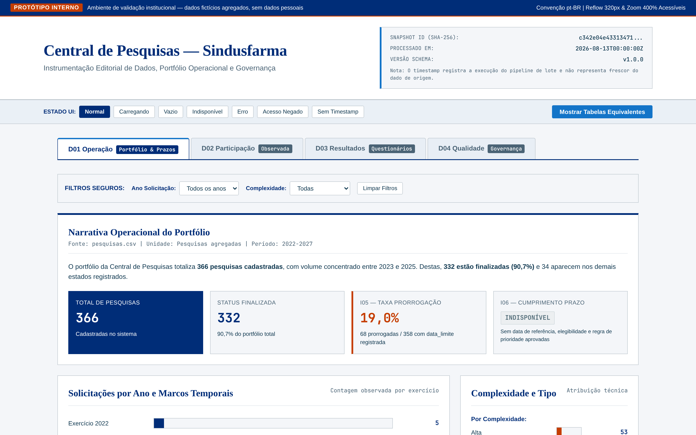
  <p><sub>Protótipo visual do grupo. Fonte: agregados dos CSVs externos clientes.csv, empresas.csv, pesquisas.csv, questoes.csv, respondentes.csv e teste.csv, normalizado conceitualmente como respostas.csv. A natureza real ou sintética das linhas não foi confirmada; nenhum registro individual é exibido. Dados processados em 13/08/2026.</sub></p>
</div>

### D02 — Adesão e representatividade

**Objetivo, usuários e decisão.** Ajudar gestores e analistas a identificar onde
ampliar participação sem chamar contagem observada de taxa de adesão. Atende
RF04–RF05 e PB04–PB05. Apresenta I07–I11, sempre separando empresa participante,
registro de participação, cliente conciliado e respondente da fonte de respostas.

**Visuais justificados.** Uma tabela por pesquisa apresenta empresas distintas
observadas (I07) e, quando existirem, numerador e denominador de I08. Barras
horizontais ordenadas com valores e base exibem I09 por empresa ou pesquisa.
Small multiples por área, departamento e cargo exibem I10 sem ocultar diferenças
de base. I11 usa barra de parte-do-todo somente após o universo elegível ser
registrado; antes disso, um bloco metodológico informa a indisponibilidade em
vez de desenhar zero. Nenhum visual lista pessoa, e-mail ou resposta individual.

**Filtros e interações.** Pesquisa (`id_pesq` preservado), período do marco
explicitamente escolhido, área, empresa, nacionalidade, associação, tipo de
associado, estado, departamento e cargo; os últimos recortes só são habilitados
para vínculos reconciliados e permissões aprovadas. A seleção cruza apenas
agregados. Comparações mostram a base de cada grupo e desabilitam taxa quando o
denominador for ausente ou zero.

**Estados operacionais.** Vazio informa que o recorte não contém participações;
não equivale a adesão zero. Erro de fonte ou reconciliação bloqueia os números
afetados e identifica o elo. Desatualizado segue I21; sem timestamp, mostra “data
de atualização indisponível”. Nulos de mercado ou identidade são “não
informado” ou “em reconciliação”, sem imputação.

**Permissões e limitações.** Gestor e analista veem agregados; Data Steward pode
ver diagnóstico de vínculo; áreas e solicitantes externos veem apenas recortes
autorizados. A política final depende do Data Owner. Não existe universo
convidado, as medidas de mercado estão em texto e `id_cliente` tem tipos
incompatíveis; por isso I08, I09, I10 e I11 respeitam sua disponibilidade e os
542 IDs da fonte de respostas não são unidos por semelhança.

<div align="center">
  <p><strong>Figura 2 — Dashboard de participação observada e representatividade</strong></p>
  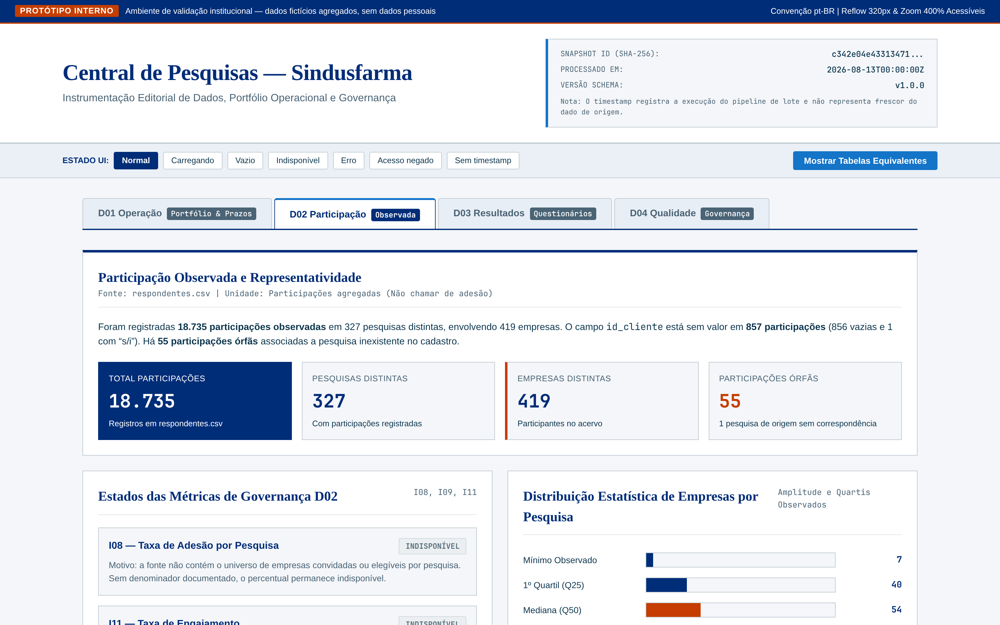
  <p><sub>Protótipo visual do grupo. Fonte: agregados dos CSVs externos clientes.csv, empresas.csv, pesquisas.csv, questoes.csv, respondentes.csv e teste.csv, normalizado conceitualmente como respostas.csv. A natureza real ou sintética das linhas não foi confirmada; nenhum registro individual é exibido. Dados processados em 13/08/2026.</sub></p>
</div>

### D03 — Resultados e questionários

**Objetivo, usuários e decisão.** Permitir que analistas, áreas técnicas e
leitores autorizados interpretem distribuições agregadas e avaliem a estrutura
do questionário sem exposição individual. Atende RF10, RF11 e RF13 e PB10, PB11
e PB13. Apresenta I12–I15.

**Visuais justificados.** Barras ordenadas exibem a distribuição I12 por
alternativa ou valor; matrizes usam tabela/heatmap com rótulo textual em cada
célula e alternativa tabular. Toda proporção mostra `n` da categoria e `N` de
elementos válidos da questão. Uma tabela de questões apresenta I14, enunciado,
tipo e quantidade declarada de alternativas. I13 aparece como contagem distinta
na própria `respostas.csv`, nunca como substituto do número de participações. Um
histórico de versão e validação mostra I15 somente após os metadados existirem.

**Filtros e interações.** Pesquisa e questão preservam os IDs de origem; tipo de
questão, alternativa, linha e coluna de matriz segmentam resultados. Selecionar
uma questão atualiza a distribuição e o resumo metodológico. Drill-through leva
à linhagem agregada de D04, não à resposta individual. Recortes por empresa ou
pessoa ficam desabilitados até identidade, autorização e limiar de agregação
serem aprovados.

**Estados operacionais.** Vazio distingue “questão sem elemento válido no
recorte” de “questão não encontrada”. Erro de parse, fonte ou vínculo bloqueia o
agregado afetado e aponta D04. Desatualizado depende de I21; sem timestamp,
exibe “data de atualização indisponível”. Valores fisicamente vazios e `NA` não
entram no denominador válido e são informados separadamente.

**Permissões e limitações.** Analistas e áreas técnicas consultam agregados
autorizados; leitor externo só recebe resultado com regra de acesso e publicação
aprovadas. Auditor autorizado chega à evidência agregada, não à pessoa. Há 43
questões e 3.592 elementos ligados a pesquisas ausentes, e não há ponte entre
`respondent_id` e `id_cliente`; versão e validação do questionário também não
estão representadas no snapshot.

<div align="center">
  <p><strong>Figura 3 — Dashboard de resultados e questionários</strong></p>
  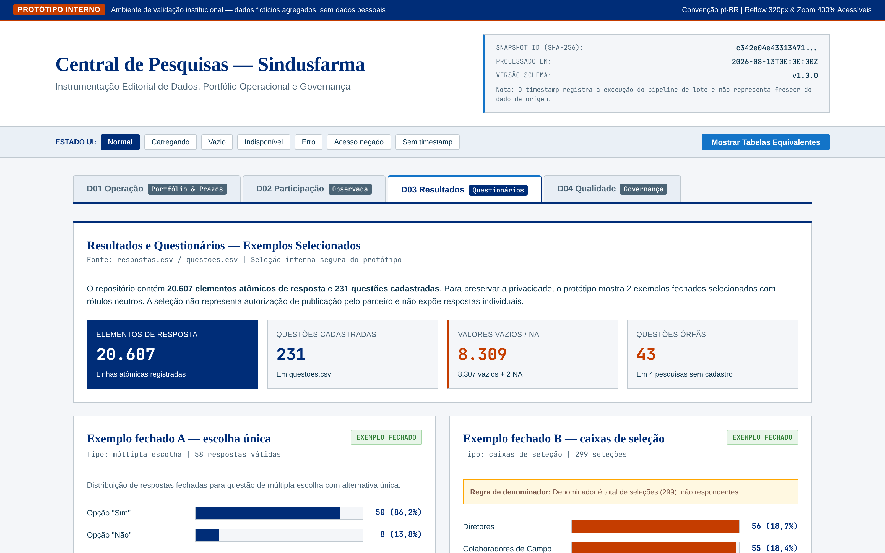
  <p><sub>Protótipo visual do grupo. Fonte: agregados dos CSVs externos clientes.csv, empresas.csv, pesquisas.csv, questoes.csv, respondentes.csv e teste.csv, normalizado conceitualmente como respostas.csv. A natureza real ou sintética das linhas não foi confirmada; nenhum registro individual é exibido. Dados processados em 13/08/2026.</sub></p>
</div>

### D04 — Qualidade e governança

**Objetivo, usuários e decisão.** Dar ao Data Steward, Data Custodian/TI, Data
Owner e auditor evidência para aceitar, corrigir, restringir ou publicar um dado.
Atende RF06–RF09 e RF12 e PB06–PB09 e PB12. Apresenta I16–I25.

**Visuais justificados.** Uma matriz fonte × regra mostra somente I16–I20 com
contagem afetada e base avaliada; tabela é preferida porque expõe a definição e
permite auditoria. Um fluxo textual fonte → pesquisa → participação → questão →
resposta apresenta I22 com cada elo marcado exatamente como **observado**, **em
reconciliação** ou **proposto**. Uma tabela de execuções mostra I21 e I24 quando
houver timestamps. Uma fila de decisões apresenta I23 somente com autorização,
estado, data e pesquisa de origem registrados; `data_divulgacao` nunca ocupa
esses campos. I25 aparece separadamente em uma tabela perfil × recurso/ação ×
decisão, alimentada pela política aprovada e pelo log de autorização, para não
misturar conformidade de acesso com qualidade de campo.

**Filtros e interações.** Fonte, campo, regra, natureza do nulo (condicional ou a
investigar), execução, estado de linhagem, pesquisa de origem, perfil e estado
de publicação. Selecionar uma célula abre a definição e contagens agregadas; o
drill-through preserva chaves de origem e não revela resposta individual.
Exportação inclui filtros, execução, fórmula e disponibilidade.

**Estados operacionais.** Vazio significa regra executada sem ocorrência ou
consulta sem itens, conforme rótulo distinto. Erro significa validação não
concluída e não pode ser exibido como zero. Desatualizado exige timestamp e regra
de frescor; sem ambos, I21 fica indisponível. Nulos condicionais não recebem
alerta de erro. Decisão de publicação ausente mantém o conteúdo indisponível.

**Permissões e limitações.** Data Steward consulta qualidade e reconciliação;
Custodian/TI consulta execuções e sustenta disponibilização; Data Owner decide
acesso e publicação; auditor consulta linhagem agregada. Perfis de negócio veem
somente diagnósticos agregados permitidos. A matriz de perfis ainda precisa de
aprovação do parceiro, e o snapshot não contém sistema de origem, timestamp de
carga, autorização, versão ou histórico de execução.

A matriz abaixo é uma **proposta para validação**, não uma política atual nem
evidência de autorização. “Condicionado” exige escopo atribuído, finalidade e
registro da decisão; “não proposto no dashboard” mantém a ação fora dos painéis.
A aprovação final de todas as células cabe ao Data Owner.

| Perfil | Classe de dado | Consultar | Detalhar | Exportar | Publicar |
| :--- | :--- | :--- | :--- | :--- | :--- |
| Gestor/analista da Central | Operacional não pessoal e agregado interno | Proposto: condicionado ao escopo | Proposto: pesquisa e agregado | Proposto: agregado com filtros e auditoria | Não proposto; depende de decisão do Data Owner |
| Área técnica | Questionário e agregado interno da área | Proposto: condicionado à área atribuída | Proposto: questão e agregado, sem pessoa | Proposto: agregado autorizado | Não proposto; encaminha para aprovação |
| Solicitante/leitor externo | Agregado autorizado para publicação | Proposto: somente conteúdo autorizado | Proposto: somente contexto publicado | Proposto: se a decisão permitir | Não proposto |
| Data Steward | Qualidade, metadados e linhagem agregada | Proposto: condicionado à função | Proposto: regra, campo e elo agregado | Proposto: diagnóstico sem dado individual | Não proposto |
| Data Custodian/TI | Metadados técnicos, execução e conteúdo autorizado | Proposto: condicionado à função | Proposto: execução e falha técnica | Proposto: log/diagnóstico auditável | Proposto: somente executar decisão explícita do Data Owner |
| Data Owner | Agregados, governança e decisões | Proposto: condicionado à função | Proposto: evidência agregada da decisão | Proposto: registro auditável | Proposto: aprovar ou negar; disponibilização técnica cabe ao Custodian/TI |
| Auditor de dados | Qualidade e linhagem agregada | Proposto: condicionado ao mandato | Proposto: evidência e elo agregados | Proposto: evidência auditável autorizada | Não proposto |
| Qualquer perfil nos dashboards | Resposta individual, e-mail ou identidade pessoal | Não proposto no dashboard | Não proposto no dashboard | Não proposto no dashboard | Não proposto no dashboard |

<div align="center">
  <p><strong>Figura 4 — Dashboard de qualidade e governança dos dados</strong></p>
  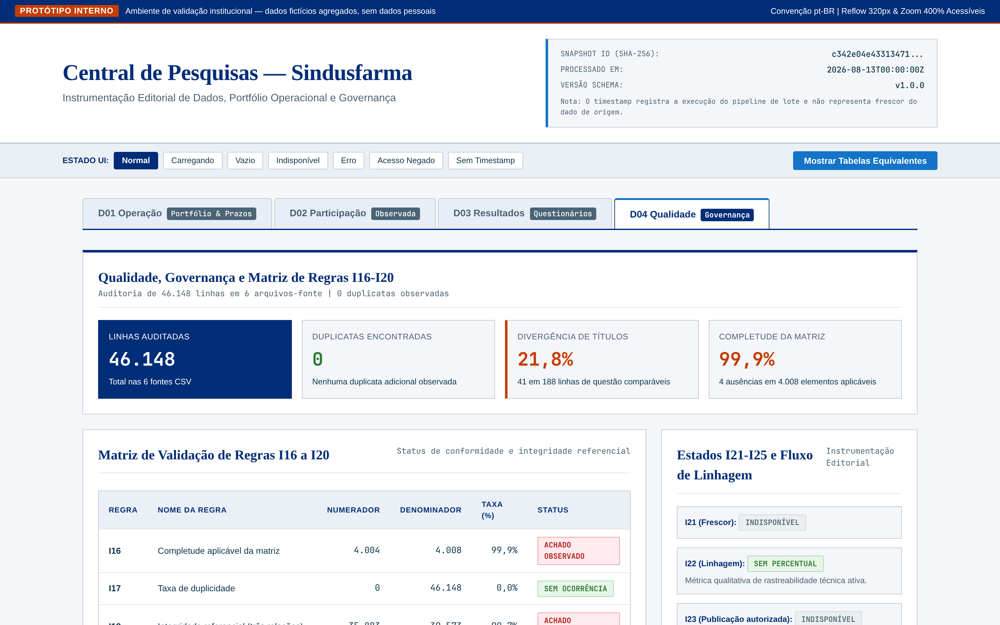
  <p><sub>Protótipo visual do grupo. Fonte: agregados dos CSVs externos clientes.csv, empresas.csv, pesquisas.csv, questoes.csv, respondentes.csv e teste.csv, normalizado conceitualmente como respostas.csv. A natureza real ou sintética das linhas não foi confirmada; nenhum registro individual é exibido. Dados processados em 13/08/2026.</sub></p>
</div>

## 6.6 Governança, Segurança da Informação e LGPD

Esta seção consolida uma proposta de governança para a arquitetura da Central de Pesquisas. Ela distingue o que foi observado nos artefatos de contexto do que ainda precisa ser decidido e validado pelo Sindusfarma. A presença de um campo em um CSV não prova, por si só, a finalidade, a hipótese legal, a titularidade ou a existência de um controle. A classificação e os controles abaixo devem ser confirmados pelo controlador e pelo encarregado antes de qualquer tratamento em produção.[<sup>[4]</sup>](#ref-4)

### 6.6.1 Mapa preliminar de dados e classificação

Os seis arquivos de negócio analisados representam pesquisa, empresa, pessoa/cliente, participação, questionário e elemento de resposta. A identificação das fontes parte do TAPI e da Arquitetura de Negócio, e a organização dos objetos segue o Data Model Canvas.[<sup>[1]</sup>](#ref-1)[<sup>[2]</sup>](#ref-2)[<sup>[3]</sup>](#ref-3) O mapa a seguir registra somente campos e categorias observados nos arquivos locais; não reproduz valores reais nem infere que uma categoria sensível esteja presente hoje.

Para evitar ambiguidade de nomenclatura, `respostas.csv` é o nome canônico usado nesta documentação para o conjunto de respostas; `teste.csv` é o arquivo original recebido fora do repositório de código. A equivalência é considerada apenas no nível de campos e categorias, não como prova de identidade, completude ou autorização para uso em produção.

| Fonte | Campos/categorias observados | Classificação preliminar | Cuidados para o projeto |
| :--- | :--- | :--- | :--- |
| `clientes.csv` | `id_cliente`, `id_empresa`, `cargo`, `departamento`, `e-mail` | Dados pessoais de identificação relacional, contexto profissional e contato | Manter a chave de identidade separada da camada analítica; não publicar e-mail, cargo, departamento ou combinações reidentificáveis. |
| `respondentes.csv` | `id_pesq`, `id_empresa`, `id_cliente`, `hora_inicio`, `hora_termino`, `market_share` | Participação vinculada a pessoa/empresa; horários podem ser pessoais quando associados a um identificador | Restringir o vínculo pessoa–pesquisa; exibir apenas adesão agregada; validar se horários e participação são necessários para cada finalidade. |
| `respostas.csv` | `id_resposta`, `pesquisa_id`, `id_pergunta`, `respondent_id`, `id_empresa`, `alternativa`, `linha_matriz`, `coluna_matriz`, `valor` | Identificadores e respostas de pessoa/empresa; `valor` é categoria aberta a conteúdo pessoal ou sensível conforme o enunciado | Classificar a pergunta e a resposta antes da ingestão; bloquear respostas individuais no repositório público e nos dashboards de gestão. |
| `questoes.csv` | Enunciado, tipo, alternativas, matriz, confiança, formato e observações | Metadados de questionário; podem revelar a finalidade da coleta e elevar o risco quando combinados com respostas | Catalogar finalidade e nível de risco por pergunta; evitar expor enunciados ou observações internas quando permitirem inferência sobre participantes. |
| `empresas.csv` | Identificador, nome, percentual de mercado, nacionalidade, associação, tipo, cidade, estado e país | Dados de organização e indicadores de negócio; podem identificar pessoa natural quando a organização for unipessoal ou quando combinados com outras fontes | Tratar indicadores comerciais como informação restrita; confirmar se a granularidade empresa é necessária em cada painel e se a divulgação foi autorizada. |
| `pesquisas.csv` | Identificador, título, status, tipo, área, participantes, datas, prazos, complexidade, tipo de resposta, objetivos e campos relacionais | Metadados operacionais; `objetivos` e outros campos textuais podem conter ou apontar para dados pessoais | Remover contatos e chaves de ambientes públicos; manter histórico e prazo somente pelo período necessário à finalidade documentada. |

Não foi identificado, apenas pelos nomes dos campos, um campo explicitamente de origem racial ou étnica, convicção religiosa, opinião política, filiação a sindicato ou a organização de caráter religioso, filosófico ou político, saúde, vida sexual, dado genético ou biométrico. Isso não autoriza concluir que dados pessoais sensíveis não existam: o conteúdo de `valor`, `enunciado`, `objetivos` e observações precisa ser amostrado e classificado antes da carga. Se uma resposta revelar qualquer dessas categorias, aplicam-se as hipóteses e salvaguardas próprias do art. 11 da LGPD; não se deve tratá-la como dado comum por estar em uma coluna textual.[<sup>[4]</sup>](#ref-4)

### 6.6.2 Estrutura de Governança de Dados da Central de Pesquisas

Os papéis de governança não equivalem automaticamente aos agentes jurídicos da
LGPD. A indicação de Data Owner, Data Steward ou Data Custodian é
organizacional; controlador, operador, suboperador e encarregado devem ser
definidos pela realidade de cada operação, pelas instruções e pelos contratos.
A tabela preserva os nomes do baseline documental do DMC como referência, sem
inferir designação jurídica. O TAPI [<sup>[1]</sup>](#ref-1) confirma lideranças do projeto e a
Arquitetura [<sup>[2]</sup>](#ref-2) registra os papéis de Owner, Stewards e Custodian. O DMC em PDF
[<sup>[3]</sup>](#ref-3) continua indisponível para conferência direta, e controlador, operador e
encarregado ainda dependem da realidade de cada tratamento.

| Papel de governança de dados | Referência do projeto | Responsabilidade proposta, sujeita a validação |
| :--- | :--- | :--- |
| Data Owner | Fabio Moreira, conforme baseline do DMC | Aprovar finalidades, classificações, acesso por perfil, indicadores e publicação; decidir sobre exceções e risco residual. |
| Data Steward | Felipe Rojas, Reinaldo Nobrega e Lucas Andrade, conforme grafia do baseline do DMC | Manter o catálogo e o dicionário, definir significado e regras de qualidade, acompanhar origem, linhagem, minimização e atendimento operacional das solicitações. |
| Data Custodian | Rodrigo Giorgetto/TI e RentalHost, conforme baseline do DMC | Administrar infraestrutura, credenciais, cópias, logs e segregação técnica segundo instruções aprovadas; não decidir finalidade por conta própria. |
| Controlador | A definir pelo Sindusfarma para cada fluxo | Decidir finalidades e meios, validar bases legais, instruir operadores, aprovar compartilhamentos e coordenar respostas e comunicações quando aplicável. |
| Encarregado | A indicar pelo controlador | Atuar como canal entre titulares, controlador e ANPD, receber reclamações e comunicações, orientar as equipes e apoiar o atendimento dos direitos e incidentes. |

As áreas envolvidas na governança combinam operação, negócio, tecnologia e consumo dos resultados. A Central de Pesquisas é a área principal, pois opera o ciclo completo das pesquisas e valida o valor dos indicadores. As áreas técnicas do Sindusfarma participam da revisão de questionários, da interpretação de resultados e do acompanhamento da adesão nas pesquisas relacionadas aos seus temas. A TI sustenta armazenamento, segurança, disponibilidade e integrações. A RentalHost entra como custódia externa quando houver dados ou componentes mantidos no sistema interno ou no repositório público. Gestores, empresas participantes, solicitantes e respondentes consomem ou fornecem informações, mas devem acessar apenas os recortes autorizados para sua finalidade.

| Área ou ator | Participação na governança | Decisões ou validações esperadas |
| :--- | :--- | :--- |
| Central de Pesquisas | Opera solicitações, planejamento, coleta, tabulação, análise e publicação | Priorizar demandas, validar indicadores, solicitar correções e propor publicação de resultados. |
| Data Owner | Responsável de negócio pelas decisões finais de uso dos dados | Aprovar finalidade, acesso por perfil, publicação, exceções e risco residual. |
| Data Stewards e responsáveis técnicos | Mantêm significado, qualidade, linhagem e regras de uso | Aprovar dicionário, regras de qualidade, critérios de completude, reconciliação de chaves e tratamento de inconsistências. |
| TI / Data Custodian | Sustenta infraestrutura, banco, integrações, logs e segurança técnica | Validar viabilidade técnica, disponibilidade, backup, controle de acesso e execução das decisões aprovadas. |
| RentalHost | Custódia externa do sistema interno ou repositório público, quando aplicável | Operar componentes hospedados segundo contrato e instruções aprovadas, sem decidir finalidade ou publicação. |
| Áreas técnicas | Validam conteúdo de questionários e acompanham pesquisas por tema | Revisar questionários, interpretar resultados agregados e indicar necessidades de negócio. |
| Solicitantes, participantes e público autorizado | Consomem resultados permitidos e podem fornecer informações | Acessar apenas acervo e resultados autorizados, agregados e compatíveis com a finalidade informada. |

Os processos de aprovação devem seguir a lógica de que decisões de negócio ficam com o Data Owner, definições semânticas e qualidade ficam com os Data Stewards, e execução técnica fica com o Data Custodian. Quando não existir uma estrutura formal implementada, a decisão deve ser registrada como proposta ou decisão pendente, com responsável, justificativa, fonte usada, data, impacto esperado e condição para revisão. Nenhuma regra provisória deve ser tratada como política definitiva de produção.

| Decisão de dados | Responsável principal | Fluxo de aprovação proposto |
| :--- | :--- | :--- |
| Nova fonte ou nova carga de dados | Data Stewards e Data Custodian | Data Steward define significado, campos críticos e regras de qualidade; Data Custodian valida armazenamento e ingestão; Data Owner aprova finalidade e uso. |
| Regra de qualidade, completude ou reconciliação | Data Stewards | Data Steward propõe e testa a regra; Central valida impacto no indicador; Data Owner aprova exceções relevantes ou bloqueios de publicação. |
| Indicador, métrica ou dashboard | Central de Pesquisas e Data Stewards | Central define pergunta de negócio; Data Steward valida fórmula, grão e denominador; Data Owner aprova uso gerencial e exposição. |
| Acesso por perfil | Data Owner, com apoio de TI e Data Stewards | Data Steward classifica dados; TI implementa controle; Data Owner aprova perfis, permissões e exceções. |
| Publicação no acervo público | Data Owner e Central de Pesquisas | Central prepara resultado agregado; Data Steward revisa risco de reidentificação e linhagem; Data Owner autoriza; Data Custodian/RentalHost executa a disponibilização. |
| Correção de inconsistência ou alteração em dado histórico | Data Stewards | Data Steward registra problema, origem, correção e impacto; Data Custodian aplica quando necessário; Data Owner decide se houver impacto estratégico ou publicação. |

As políticas de governança de dados identificadas nos artefatos do projeto e as diretrizes propostas para a solução devem cobrir, no mínimo, controle de acesso por perfil, uso restrito dos dados às finalidades das pesquisas, anonimização ou agregação antes de publicação externa, não publicação de dados reais no repositório acadêmico, retenção e descarte conforme finalidade, auditoria de acessos e versionamento de regras de qualidade. Até a formalização pelo parceiro, essas políticas devem ser tratadas como diretrizes de projeto e critérios de validação, não como comprovação de conformidade produtiva.

As ferramentas relacionadas à governança são as fontes e sistemas já citados no contexto do projeto: Excel e bases CSV como origem histórica ou operacional, SurveyMonkey para coleta, Trello para gestão de tarefas, Outlook para comunicação e pastas, n8n como automação/orquestração inicial de solicitações, sistema interno e repositório público do site, banco relacional em nuvem previsto para o MVP, dashboards do data app e artefatos de documentação como Data Model Canvas, catálogo/dicionário de dados, scripts de perfilamento e matriz de rastreabilidade. O projeto não substitui essas ferramentas nesta etapa; ele define como elas devem ser conectadas, catalogadas e governadas.

Antes da produção, o parceiro deve registrar no inventário, por fluxo: controlador, operador, eventual suboperador, encarregado, finalidade, categorias de titulares e dados, origem, destinos, localização, prazo e mecanismo de descarte. SurveyMonkey, Trello, Excel, Outlook, n8n, hospedagem do site, banco em nuvem e ferramentas de dashboard entram nesse inventário somente se realmente tratarem dados pessoais; os respectivos contratos e instruções devem esclarecer acesso, subcontratação, devolução/eliminação e auditoria.[<sup>[5]</sup>](#ref-5)

### 6.6.3 Decisões pendentes e riscos de governança de dados

Os artefatos da sprint registram decisões ainda abertas sobre a arquitetura de dados, a automação do fluxo e os controles de governança. Esses pontos não impedem a especificação inicial da solução, mas precisam ser tratados antes da entrada em produção, pois afetam custódia, rastreabilidade, qualidade, segurança, LGPD e consistência entre o ambiente interno e o repositório público.[<sup>[1]</sup>](#ref-1)[<sup>[3]</sup>](#ref-3)[<sup>[14]</sup>](#ref-14)

| Decisão pendente | Situação registrada nos artefatos | Risco de governança | Encaminhamento necessário |
| :--- | :--- | :--- | :--- |
| Plataforma de banco em nuvem | O TAPI prevê banco relacional em nuvem, citando Amazon RDS, Google Cloud SQL ou equivalente, sem fixar a plataforma final. | Escolha da plataforma altera região de armazenamento, contratos, operadores, backups, logs, custos, controle administrativo e eventual transferência internacional. | Selecionar a plataforma com TI e Data Owner, registrar região, perfis administrativos, política de backup, criptografia, retenção, trilha de auditoria e responsabilidades contratuais. |
| Uso futuro do n8n | O TAPI informa que hoje há um workflow em n8n para replicar novas solicitações, mas o Data Model Canvas trata seu papel futuro como decisão a confirmar. | Manter ou substituir o n8n muda a governança de credenciais, logs, reprocessamento, idempotência, tratamento de falhas e linhagem das integrações. | Definir se o n8n será orquestrador oficial, componente temporário ou substituído; documentar dono técnico, segredos usados, eventos gerados, política de retry e evidência de execução. |
| Política de acesso por perfil | O projeto prevê controle por perfil, mas os perfis finais, regras de autorização e logs de acesso ainda dependem de aprovação. | Acesso amplo demais pode expor contatos, respostas individuais, indicadores comerciais ou dados com risco de reidentificação; acesso restritivo demais pode impedir a operação da Central. | Aprovar matriz de perfis pelo Data Owner, separar ambiente interno, dashboards e acervo público, registrar exceções e auditar consultas, exportações e publicações. |
| Alimentação do repositório público | O TAPI prevê integração com o repositório público do site, e o Data Model Canvas indica que a automação da publicação ainda precisa ser definida. | Publicação sem regra clara pode gerar divergência entre resultado interno e acervo, divulgar dado não autorizado ou manter versão desatualizada no site. | Definir fluxo de publicação com aprovação, versão, origem, data, responsável, regra de anonimização/agregação, mecanismo de retirada/correção e validação pela custódia externa. |

Além dessas decisões, há riscos de governança ligados à qualidade e à integração das fontes já identificados no diagnóstico do projeto:

| Risco | Evidência no projeto | Impacto potencial | Controle recomendado |
| :--- | :--- | :--- | :--- |
| Qualidade inconsistente dos dados | O Problem Canvas aponta campos incompletos, inválidos ou divergentes; o perfilamento do §5.3 encontrou ausências, colunas vazias, diferenças de tipo e domínios não padronizados. | Indicadores podem ficar indisponíveis, divergentes ou exigir interpretação manual, reduzindo confiança nos dashboards e nas decisões. | Manter regras de completude, validade, domínio e reconciliação por fonte, com status explícito para dado calculável, dado a normalizar e dado dependente de integração futura. |
| Campos incompletos ou metadados ausentes | Alguns indicadores dependem de informações ainda não presentes no snapshot, como universo de convites, versão de questionário, timestamp de carga, autorização de publicação e logs de acesso. | A solução pode sugerir métricas sem denominador, frescor, autorização ou rastreabilidade suficientes para auditoria. | Exibir indisponibilidade quando faltar metadado obrigatório, evitando inferência; registrar campos mínimos esperados no catálogo e exigir preenchimento antes da automação do KPI. |
| Validação das integrações com sistemas existentes | O fluxo atual usa ferramentas separadas, como SurveyMonkey, Trello, Excel, Outlook, n8n e repositório público, sem integração estruturada de ponta a ponta. | Falhas de mapeamento, duplicidade, perda de origem ou diferença de status entre sistemas podem comprometer a fonte única da verdade. | Validar cada conector com testes de carga, reconciliação de chaves, logs de erro, reprocessamento idempotente, versionamento da fonte e aprovação do Data Steward antes de liberar o dado para consumo. |

Enquanto esses pontos estiverem abertos, qualquer dashboard, publicação externa ou automação deve deixar claro o estado do dado, a origem utilizada, a limitação conhecida e a decisão de governança pendente. A passagem para produção deve ocorrer apenas quando as decisões acima estiverem registradas e aprovadas pelos responsáveis definidos na estrutura de governança.

### 6.6.4 Finalidades e hipóteses legais a confirmar

Consentimento não é uma autorização universal para o projeto. Cada finalidade deve ser específica, informada, necessária e associada a uma hipótese legal adequada; a hipótese escolhida, a forma de informação ao titular e a eventual necessidade de consentimento devem ser confirmadas pelo controlador e pelo encarregado. Quando essa hipótese for escolhida, consentimento significa manifestação livre, informada e inequívoca para finalidade determinada; o controlador deve conservar prova da obtenção, evitar autorizações genéricas e facilitar a revogação por procedimento gratuito. Consentimentos escritos devem estar destacados das demais cláusulas; para dados pessoais sensíveis, a manifestação deve ser específica e destacada para finalidades específicas. A revogação impede a continuidade de novos tratamentos baseados nesse consentimento, resguardados os tratamentos anteriores válidos e as hipóteses de conservação aplicáveis, e exige reavaliar a eliminação quando cabível.[<sup>[4]</sup>](#ref-4)

| Finalidade proposta | Dados minimizados | Hipótese a avaliar com o controlador | Evidência/decisão necessária |
| :--- | :--- | :--- | :--- |
| Operar o ciclo da pesquisa, convite, participação e acompanhamento de prazos | IDs de pesquisa/empresa/participação e, somente quando necessário, contato profissional | Execução de contrato ou procedimentos preliminares, obrigação legal/regulatória ou legítimo interesse com teste de necessidade e balanceamento; não presumir uma delas | Identificar a relação jurídica com o participante e documentar a informação fornecida. |
| Receber respostas e produzir indicadores internos | Respostas e chaves pseudonimizadas; retirar contato da camada de métricas | Legítimo interesse documentado, consentimento ou outra hipótese do art. 7º; para dado sensível, hipótese do art. 11 | Registrar finalidade por questionário, risco de reidentificação e regra de acesso. |
| Compartilhar resultado com solicitante, participante ou público | Resultado agregado, com supressão de células pequenas e sem chaves | Hipótese aplicável à divulgação e compatibilidade com a informação prestada; dado efetivamente anonimizado pode não ser dado pessoal, mas a eficácia deve ser avaliada | Aprovação do Data Owner e revisão de reidentificação antes da publicação. |
| Segurança, auditoria, prevenção a fraude e prestação de contas | Identidade de usuário, evento, recurso acessado e carimbo de tempo | Obrigação legal, exercício regular de direitos ou outra hipótese aplicável | Política de acesso, trilha de auditoria, retenção e responsáveis. |
| Atendimento de direitos dos titulares e gestão de incidentes | Dados necessários para localizar o titular, responder e registrar a decisão | Cumprimento de obrigação legal e exercício regular de direitos | Canal, procedimento, autenticação, prazo legal aplicável e registro de encerramento. |
| Uso acadêmico e demonstração do projeto | Dados sintéticos, anonimizados ou agregados; nunca a exportação bruta real | Finalidade acadêmica e hipótese legal a validar; consentimento não substitui a minimização nem autorização de publicação | Separar ambiente acadêmico da operação do parceiro e aprovar o material antes da entrega. |

As hipóteses acima são um roteiro de análise, não um parecer jurídico. A documentação final deve registrar, para cada operação, a finalidade, a base escolhida, a necessidade, a proporcionalidade, a transparência e as salvaguardas. A pesquisa que envolver pessoas identificáveis ou riscos além da vida cotidiana deve ainda ser confrontada com as normas éticas do Conselho Nacional de Saúde, especialmente as Resoluções CNS nº 466/2012 e nº 510/2016, sem presumir que todo levantamento setorial seja automaticamente pesquisa submetida ao CEP/Conep.[<sup>[10]</sup>](#ref-10)[<sup>[11]</sup>](#ref-11)

O uso acadêmico exige separar três situações: (i) protótipo da sprint, que deve usar dados sintéticos, anonimizados ou agregados; (ii) pesquisa acadêmica ou TCC, cuja finalidade deve ser registrada, com avaliação do orientador e verificação de aplicabilidade da Resolução CNS nº 510/2016 e do fluxo CEP/Conep antes de usar dados identificáveis; e (iii) operação administrativa ou comercial do parceiro, à qual a LGPD se aplica integralmente. O art. 4º, II, “b”, afasta parcialmente a LGPD para tratamento exclusivamente acadêmico, pois preserva a aplicação dos arts. 7º e 11; não afasta esses requisitos nem cobre o uso operacional, administrativo, comercial ou de publicação do parceiro. A decisão sobre o enquadramento, o consentimento e as salvaguardas deve ser registrada com o orientador e o parceiro.[<sup>[4]</sup>](#ref-4)[<sup>[10]</sup>](#ref-10)

### 6.6.5 Minimização, pseudonimização e divulgação

O princípio operacional é coletar e disponibilizar somente o que for adequado, necessário e proporcional à finalidade registrada. A camada de identificação deve ficar separada da camada analítica, com acesso restrito e vínculo controlado. Recomenda-se que o data warehouse de indicadores não carregue e-mail, cargo, departamento ou qualquer contato quando a métrica puder ser calculada sem esses campos; a chave de ligação deve ser substituída por um identificador pseudonimizado e rotacionável por finalidade.

Pseudonimização e anonimização não são sinônimos. Na pseudonimização, a associação é removida do dado de trabalho, mas pode ser refeita com informação adicional mantida separadamente; o resultado continua sendo dado pessoal e sujeito à LGPD. Na anonimização, a identificação deixa de ser possível considerando meios técnicos razoáveis e disponíveis no contexto, mas a organização deve avaliar risco de reidentificação, sobretudo por combinação de empresa, período, cargo, pergunta e resposta. Um hash sem gestão da chave, uma remoção superficial do nome ou um agrupamento com poucas pessoas não deve ser apresentado como anonimização comprovada.[<sup>[4]</sup>](#ref-4)

Para os dashboards e o acervo público, propõem-se as seguintes salvaguardas, ainda sujeitas a teste com dados reais:

- agregar resultados por pesquisa, período ou grupo de empresas, evitando a exposição de respondente, `id_cliente`, `respondent_id`, e-mail e resposta bruta;
- suprimir células com menos de cinco pessoas ou empresas (`k < 5`) e combinações que permitam dedução por diferença; o limiar `k = 5` é uma proposta inicial, não um controle já implantado;
- aplicar o mesmo teste a filtros, exportações, drill-downs e tabelas de baixa frequência, incluindo cargo, departamento, cidade e empresa;
- manter `market_share` e outros indicadores comerciais na menor granularidade compatível com a finalidade, validando se uma publicação por empresa é autorizada;
- bloquear a publicação quando a pergunta, o texto livre ou a combinação de dimensões puder revelar dado pessoal ou sensível, mesmo que os identificadores diretos tenham sido removidos.

### 6.6.6 Segurança da informação, acesso e auditoria

A segurança da informação deve proteger o ciclo da pesquisa sem impedir o trabalho legítimo da Central. Como o projeto trata fontes fragmentadas, respostas individuais, dados de empresas, indicadores comerciais e publicação no acervo, os controles abaixo devem seguir menor privilégio, necessidade de conhecer, segregação entre ambientes, rastreabilidade e revisão periódica. A matriz é um desenho de referência para o projeto; nenhum perfil deve ser considerado existente ou homologado sem comprovação no ambiente correspondente.[<sup>[1]</sup>](#ref-1)[<sup>[3]</sup>](#ref-3)

| Perfil proposto | Nível de permissão proposto | Acesso permitido | Restrições e revisão |
| :--- | :--- | :--- | :--- |
| Equipe da Central | Operacional interno | Operar pesquisas, acompanhar status e consultar indicadores internos conforme a finalidade aprovada | Sem acesso automático a contatos, respostas sensíveis ou exports completos; revisão periódica pelo Data Owner. |
| Áreas técnicas | Validação temática | Consultar questionários, metadados e indicadores necessários à validação da área relacionada | Sem exportação de identidade e sem acesso a outra área sem justificativa registrada. |
| Data Owner | Decisão e aprovação | Aprovar finalidades, perfis, exceções, indicadores, publicação e risco residual | Não substitui custódia técnica; toda decisão deve gerar evidência auditável. |
| Data Steward ou auditor de dados | Qualidade e rastreabilidade | Consultar catálogo, regras de qualidade, linhagem agregada, anomalias e evidências de processamento | Não deve acessar resposta individual identificável quando a análise agregada for suficiente. |
| Solicitantes/participantes | Consulta restrita | Acessar resultado aprovado para sua pesquisa, grupo ou finalidade específica | Apenas visão agregada; nenhuma navegação para registros de terceiros. |
| Público do site | Consulta pública | Acessar acervo expressamente aprovado, anonimizado ou agregado | Sem dados de contato, chaves, respostas individuais ou filtros que desfaçam a agregação. |
| Custódia técnica | Administração controlada | Administrar infraestrutura, credenciais, integrações, banco, cópias e logs necessários à operação | Acesso emergencial justificado, temporário e auditado; não usar os dados para finalidade própria. |
| Acadêmico | Artefatos não produtivos | Utilizar documentação, código e dados sintéticos, anonimizados ou agregados aprovados | Sem credenciais de produção, cópia dos CSVs reais ou acesso ao mapeamento de identidade. |

**Observação:** os perfis, níveis de permissão e restrições acima representam o entendimento proposto pelo grupo nesta etapa da Sprint 1. Eles ainda precisam ser validados com o parceiro e consolidados após essa validação, antes de serem tratados como política formal de segurança ou regra operacional do ambiente produtivo.

Os controles mínimos de segurança devem ser tratados como critérios de validação antes da entrada em produção:

| Controle | Diretriz para o projeto | Evidência esperada antes da produção |
| :--- | :--- | :--- |
| Autenticação e autorização | Cada acesso deve ser individual, autenticado e autorizado por perfil, recurso, ação e finalidade. | Matriz de perfis aprovada, registro de exceções, revogação de desligados e teste de acesso permitido/negado. |
| Auditoria de acessos | Leituras, exportações, alterações, publicações, falhas e acessos administrativos devem gerar log com usuário, data/hora, operação, recurso, origem e resultado. | Logs protegidos contra alteração, retenção definida, consulta por incidente e evidência de investigação. |
| Rastreabilidade | Cada dado consumido deve preservar origem, versão, execução, transformação, regra aplicada e decisão de publicação quando existir. | `execution_id` ou identificador equivalente, hashes de entrada, catálogo de fontes, linhagem agregada e estado de reconciliação. |
| Backups e recuperação | Cópias de segurança devem ter inventário, periodicidade, retenção, criptografia, controle de acesso e teste de restauração. | Política de backup, registro de teste de restauração, prazo de expiração e bloqueio de restauração indevida. |
| Criptografia e segredos | Dados em trânsito e em repouso devem usar criptografia compatível com a criticidade; chaves, tokens e senhas não podem estar em repositórios ou planilhas. | Configuração de TLS, criptografia do banco/armazenamento, gestão de segredos e varredura do repositório antes de publicação. |
| Prevenção de vazamentos | Dados reais, e-mails, chaves estáveis, respostas individuais e exports completos não devem ser publicados em GitLab, site acadêmico, dashboards públicos ou acervo sem aprovação. | Revisão humana antes de push/publicação, bloqueio de exports sensíveis, anonimização/agregação e busca por identificadores no diff. |
| Segregação de ambientes | Ambientes acadêmico, desenvolvimento, homologação e produção devem permanecer separados, com dados reais apenas quando houver decisão documentada do controlador. | Contas, bases, credenciais e permissões separadas; ausência de CSV real no repositório acadêmico. |
| Monitoramento e incidentes | Falhas de autorização, acessos incomuns, erro de integração e publicação indevida devem acionar registro de ocorrência e triagem. | Procedimento de incidente, responsável definido, trilha de comunicação e referência ao RIPD quando aplicável. |

Esses controles complementam os requisitos RF07, RF08, RF09 e RF12 e os indicadores I21 e I23 a I25, que dependem de política aprovada, logs, metadados de carga, decisões de publicação e validação das integrações. Portanto, dashboards, automações e acervo público devem exibir indisponibilidade ou pendência quando a política de acesso, o log, a origem ou a autorização ainda não estiverem registrados.

### 6.6.7 Direitos dos titulares e fluxo de atendimento

O titular deve ter canal de fácil acesso e gratuito para solicitar, conforme aplicável, confirmação de tratamento, acesso, correção, anonimização, bloqueio ou eliminação de dados desnecessários ou tratados em desconformidade, portabilidade, informação sobre compartilhamentos, informação sobre a possibilidade e as consequências de não fornecer consentimento, revogação do consentimento, oposição ao tratamento nas hipóteses e condições do art. 18, § 2º, e petição contra o controlador perante a ANPD. Também pode solicitar revisão de decisão automatizada, quando aplicável. A confirmação e o acesso devem ser fornecidos em formato simplificado imediatamente ou por declaração completa e clara em até 15 dias; os demais pedidos seguem os prazos e procedimentos específicos da LGPD e da regulamentação aplicável, sem que esta seção fixe prazo não confirmado para o caso concreto.[<sup>[4]</sup>](#ref-4)[<sup>[9]</sup>](#ref-9)

Fluxo mínimo proposto:

0. receber a solicitação no canal do controlador/encarregado e registrar protocolo, data, finalidade e pedido;
0. autenticar o solicitante de forma proporcional, sem exigir novos dados desnecessários;
0. localizar o titular na camada de identidade e mapear cópias, relacionamentos, respostas, exports, dashboards, backups e operadores;
0. classificar o pedido, verificar base legal, direitos de terceiros, segredo comercial e outras restrições documentadas;
0. executar ou justificar a medida (acesso, correção, anonimização, bloqueio, eliminação, informação ou negativa), propagando-a aos operadores quando aplicável;
0. responder em linguagem clara dentro do prazo legal aplicável e manter evidência da decisão, da revisão e do encerramento.

O registro de direitos deve ser uma trilha do atendimento, não um novo repositório de respostas. A equipe não deve apagar evidências necessárias à segurança, à auditoria ou ao exercício regular de direitos sem registrar a justificativa e o prazo de retenção correspondente.

### 6.6.8 Incidentes e RIPD sem duplicação

O procedimento de incidente deve ter um registro operacional único para o fluxo: detecção, contenção, preservação de evidências, avaliação de dados e titulares afetados, decisão do controlador, comunicações, medidas corretivas e encerramento. Um incidente pode envolver CSV local, GitLab, banco, dashboard, site, credencial ou operador; a origem não muda a necessidade de triagem. A comunicação é devida quando os critérios do art. 5º da Resolução CD/ANPD nº 15/2024 estiverem presentes cumulativamente: o incidente puder afetar significativamente interesses e direitos fundamentais e envolver pelo menos uma categoria de dados sensíveis, de crianças/adolescentes/idosos, financeiros, de autenticação, protegidos por sigilo legal/judicial/profissional ou em larga escala. Atendidos esses critérios, o controlador deve comunicar a ANPD e os titulares em três dias úteis contados do conhecimento de que o incidente afetou dados pessoais, salvo prazo específico diferente; se os critérios não se confirmarem, o incidente continua registrado e avaliado. O operador deve informar o controlador sem demora injustificada e fornecer as informações necessárias; contratos devem estabelecer esse fluxo.[<sup>[6]</sup>](#ref-6)

O RIPD deve ser tratado como política interna preventiva proposta para avaliar o processo de tratamento: mapa de dados, operações, finalidades, hipóteses legais, necessidade, riscos, salvaguardas, risco residual, responsáveis e decisões. A abertura ou atualização deve ser um gatilho de governança quando houver resposta sensível, novo operador, mudança de finalidade, publicação, exportação, transferência internacional, combinação de bases ou incidente que altere o risco, mas sempre condicionada à avaliação de alto risco e às exigências aplicáveis; não constitui obrigação legal automática para qualquer operação. O registro de incidente referencia a versão do RIPD e as medidas adotadas; não duplica toda a análise de risco nem substitui a comunicação exigida. A ANPD orienta o RIPD quando o tratamento puder gerar alto risco e indica seu conteúdo mínimo, cabendo ao controlador avaliar a necessidade, eventual exigência específica e publicidade no caso concreto.[<sup>[7]</sup>](#ref-7)

### 6.6.9 Retenção, descarte e cópias de segurança

Não se propõe um prazo único para todas as tabelas. O critério é manter o mínimo necessário enquanto durar a finalidade, obrigação legal, exercício regular de direitos ou necessidade de prestação de contas; terminada a justificativa, eliminar, anonimizar ou bloquear o dado, observando os requisitos que impeçam a eliminação imediata. Devem ser verificadas as hipóteses de conservação do art. 16 da LGPD, como cumprimento de obrigação legal ou regulatória, estudo por órgão de pesquisa com anonimização sempre que possível, transferência a terceiro respeitados os requisitos legais ou uso exclusivo do controlador com acesso de terceiro vedado.[<sup>[4]</sup>](#ref-4)

| Classe | Critério de retenção proposto | Descarte e backup |
| :--- | :--- | :--- |
| Contatos e mapa de identidade | Até cessar a finalidade de convite, atendimento ou vínculo, salvo obrigação documentada | Eliminar da produção e das filas/exports; expirar cópias de segurança conforme a política e registrar a conclusão. |
| Respostas brutas e participação identificável | Pelo período necessário à validação, entrega, contestação e obrigação aplicável | Bloquear acesso após encerramento; eliminar ou anonimizar após revisão do Data Owner e propagação aos operadores. |
| Dados pseudonimizados para indicadores | Enquanto a finalidade analítica existir e o risco for aceitável | Remover a chave de reidentificação quando não for mais necessária; não confundir pseudonimização com descarte. |
| Resultado agregado publicado | Enquanto houver finalidade de transparência/acervo e não houver reidentificação razoável | Manter somente a versão aprovada; corrigir ou retirar publicação incompatível e registrar a decisão. |
| Logs de acesso e auditoria | Pelo período necessário à responsabilização, investigação e obrigações aplicáveis | Proteger contra alteração; definir expiração formal e acesso restrito. |
| Registro de incidente com dados pessoais | No mínimo cinco anos contados da data do registro, inclusive para incidente não comunicado, salvo obrigação adicional que exija prazo maior | Guardar em repositório restrito, com evidências e referência ao processo, sem reter cópias desnecessárias dos dados afetados; essa regra não elimina as hipóteses de conservação do art. 16 da LGPD. |
| Artefatos acadêmicos | Apenas durante a finalidade acadêmica e a guarda exigida pela instituição, se aplicável | Entregar somente versão sintética/anonimizada aprovada e eliminar rascunhos, exports e caches reais. |

Backups devem ter inventário, criptografia, controle de acesso, periodicidade e teste de restauração definidos; a eliminação lógica na base primária não basta se a cópia continuar acessível. O procedimento deve prever expiração automática, destruição segura ou sobrescrita conforme a tecnologia e bloqueio de restauração indevida. Esses são critérios propostos, não evidência de que os backups atuais os atendam.

### 6.6.10 Compartilhamento, operadores e transferência internacional

O compartilhamento deve ser limitado ao mínimo necessário, com finalidade, campos, destinatários, período, instruções e responsabilidade registrados. Para cada fornecedor ou integração, a Central deve decidir se há operador, suboperador ou controlador independente, exigir confidencialidade e segurança, controlar subcontratação, prever apoio a direitos e incidentes, devolução/eliminação ao término e possibilidade de auditoria. O fluxo não deve enviar a um fornecedor o conjunto inteiro de CSVs quando a operação exige apenas um subconjunto.

| Destino | Compartilhamento previsto | Condição de validação |
| :--- | :--- | :--- |
| Equipe Central e áreas técnicas | Metadados e indicadores necessários à operação | Perfil, finalidade, necessidade e trilha de acesso aprovados. |
| Solicitantes, participantes e site | Resultado aprovado, agregado e revisado | Supressão `k < 5`, teste de reidentificação e aprovação para publicação. |
| SurveyMonkey, Trello, Outlook, n8n e outros sistemas | Somente os campos necessários ao fluxo específico | Contrato/instrução, operador e suboperadores identificados, retenção e eliminação verificadas. |
| Banco, dashboard e hospedagem em nuvem | Dados tratados sob custódia técnica | Região de armazenamento, acesso administrativo, cópias, suporte e resposta a incidentes documentados. |
| GitLab e site acadêmico | Código, documentação e dados sintéticos/anonimizados | Bloqueio de bases reais, contatos, chaves e respostas individuais; varredura antes de cada publicação. |

Se um fornecedor, suporte ou infraestrutura permitir acesso a dados pessoais a partir de país estrangeiro ou hospedagem fora do Brasil, há transferência internacional a ser analisada; não se presume sua existência nem sua inexistência. O inventário deve identificar país ou organismo de destino, exportador, importador, finalidade, categorias, duração, operação de acesso/armazenamento, eventuais transferências posteriores e subcontratados. O controlador deve confirmar a hipótese legal e o mecanismo de transferência, registrar as instruções ao importador e exigir salvaguardas, inclusive cláusulas-padrão contratuais da ANPD quando essa for a base escolhida, condições para transferências posteriores, apoio aos direitos, incidentes, término e eliminação. A validação deve observar a LGPD e a Resolução CD/ANPD nº 19/2024.[<sup>[8]</sup>](#ref-8)

### 6.6.11 Impacto por ambiente e critérios de liberação

| Ambiente/artefato | Risco principal | Regra de liberação proposta |
| :--- | :--- | :--- |
| CSVs de trabalho e ingestão | Cópias locais, e-mail, exportação ou repositório com contatos e respostas identificáveis | Armazenamento restrito, inventário de cópias, criptografia e eliminação após a carga; nenhum commit de dado real. |
| GitLab e site acadêmico | Compartilhamento público permanente e forks/cache fora do controle da equipe | Somente código, documentação e dados sintéticos/anonimizados; revisão humana e busca por e-mail, IDs e respostas antes do push/publicação. |
| Dashboards internos | Inferência por filtros, células pequenas ou exportações | Perfil, agregação, supressão `k < 5`, bloqueio de drill-down e auditoria de download. |
| Acervo público do site | Divulgação incompatível com a finalidade ou reidentificação por combinação | Publicar apenas resultado aprovado e compatível com a informação aos titulares; manter mecanismo de retirada/correção. |
| Produção do parceiro | Mistura de identidade, respostas e indicadores; acesso administrativo excessivo | Separar ambientes, usar dados reais somente sob decisão documentada do controlador e validar segurança, RIPD, contratos e recuperação antes da operação. |
| Entrega acadêmica | Confusão entre protótipo da sprint e sistema produtivo | Tratar a entrega como ambiente acadêmico independente; não prometer conformidade operacional nem reproduzir controles não verificados. |

Assim, a governança proposta atende ao ciclo completo — coleta, integração, análise, publicação, atendimento e descarte — sem afirmar que os controles já existem. A passagem para produção deve ser condicionada ao fechamento do inventário, à validação das bases legais e papéis, à revisão do RIPD, ao teste de acesso e de reidentificação, à confirmação de retenção/backups e à aprovação da publicação pelo parceiro.

**Registro da revisão KP-07.** As regras corporativas de `docs/dmc.json` foram
conferidas contra esta seção. O canvas passou a registrar minimização,
segregação de ambientes, retenção por finalidade, menor privilégio, quarentena
de rejeitados e publicação condicionada como diretrizes propostas, e não como
controles já implantados. Controlador, operador, encarregado, hipótese legal,
prazo de retenção, matriz final de perfis e limiar de supressão continuam
dependentes de homologação. A dependência MG-01 (`#170`) permanece aberta;
portanto, nenhuma regra de schema ou domínio ainda não inventariada é tratada
como confirmada.

## 6.7 Fluxo de Interação Anotado

Esta seção organiza a base do Fluxo de Interação Anotado da Sprint 2 para o
perfil operacional principal: a equipe interna da Central de Pesquisas. O texto
parte do JTBD definido em discussão do grupo, da Arquitetura de Negócio
[<sup>[2]</sup>](#ref-2), do fluxo de valor da §2.1, dos requisitos funcionais da §6.1 e
das perguntas de negócio da §6.3. O objetivo é manter um apoio textual curto
para o diagrama, sem substituir a representação visual exigida pelo artefato.

### 6.7.1 Perfil, JTBD e critérios de sucesso

O perfil operacional principal opera o ciclo das pesquisas desde a solicitação
até a entrega/publicação, acompanhando status, prazos, participantes, resultados
e qualidade em um processo hoje distribuído entre planilhas, SurveyMonkey,
Trello, sistema interno e acervo publicado.

O JTBD usado como base é:

> Quando preciso acompanhar uma pesquisa desde a solicitação até a publicação,
> quero acessar em um único ambiente dados integrados e atualizados sobre
> status, prazos, adesão e resultados, para reduzir o trabalho manual,
> identificar gargalos e tomar decisões com mais agilidade e confiança.

<div align="center">
<sub>Tabela 6.7.1 - Jobs operacionais e critérios de sucesso do perfil principal</sub><br>

| ID | Job operacional | Critério de sucesso associado | Evidência na documentação |
| :--- | :--- | :--- | :--- |
| JOP01 | Registrar e iniciar uma pesquisa com identidade rastreável. | A pesquisa foi criada ou localizada sem duplicidade aparente, com origem e status inicial explícitos. | Fluxo de valor (§2.1, etapas 1 e 2), requisitos RF01/RF02 (§6.1) e PB01 (§6.3). |
| JOP02 | Acompanhar status, prazos e marcos do ciclo. | O usuário vê etapa atual, próximos marcos, prazos, pendências e motivo de atraso/prorrogação quando aplicável. | Fluxo de valor (§2.1, etapas 2 a 6), C01 (§5.2.1) e D01 (§6.5). |
| JOP03 | Monitorar participação e risco de baixa adesão. | A participação é exibida com numerador, denominador quando existir e limitação quando o cálculo de adesão não for possível. | Fluxo de valor (§2.1, etapa 6), C02 (§5.2.2) e requisitos RF04/RF05 (§6.1). |
| JOP04 | Validar qualidade antes de tabular ou publicar. | Inconsistências, órfãos, duplicidades e ausências críticas aparecem com impacto no indicador e ação esperada. | Fluxo de valor (§2.1, etapa 8), requisitos RF06/RF07 (§6.1) e D04 (§6.5). |
| JOP05 | Entregar e publicar resultado autorizado. | O resultado só avança com autorização, versão, perfil permitido e vínculo com a pesquisa interna. | Fluxo de valor (§2.1, etapas 9 e 10), requisito RF09 (§6.1), PB09 (§6.3) e governança de publicação (§6.6). |

<sup>Material produzido pelos autores (2026)</sup>

</div><br>

### 6.7.2 Pontos de checagem do fluxo

Os pontos abaixo selecionam quatro momentos em que o usuário operacional checa
se o trabalho está progredindo. Eles servem como âncoras do fluxo visual.

<div align="center">
<sub>Tabela 6.7.2 - Pontos de checagem do fluxo do perfil operacional</sub><br>

| Momento | Confirmação necessária | Dados informados pelo sistema | Estado esperado do dado após a ação |
| :--- | :--- | :--- | :--- |
| 1. Receber ou localizar solicitação | Confirmar criação ou localização da pesquisa e sinalizar duplicidade/conflito. | ID, título, origem, status inicial, data de solicitação e responsável quando disponível. | `Pesquisa` existe como entidade operacional, com origem preservada e pendências marcadas. |
| 2. Acompanhar ciclo e carteira ativa | Confirmar atualização de marco e indicar se atraso, prorrogação ou prioridade são calculáveis. | Etapa atual, datas do ciclo, campos ausentes, regra aplicada e motivo da classificação. | Marcos ficam atualizados; ausências permanecem pendentes; cálculo fica disponível ou marcado como insuficiente. |
| 3. Monitorar participação e qualidade | Confirmar numeradores, denominadores disponíveis e anomalias que afetam KPIs. | Participações, empresas/pessoas relacionadas, representatividade, completude, duplicidade, órfãos e impacto no indicador. | Participações são ligadas quando há chave observada; ausência de denominador bloqueia taxa; campos recebem estado de qualidade. |
| 4. Preparar entrega ou publicação | Confirmar autorização ou bloqueio, perfil permitido e vínculo com a versão publicada. | Estado de autorização/publicação, versão, data, responsável, regra de agregação e pendências do acervo. | Resultado agregado fica autorizado ou bloqueado como pendente; acervo não é atualizado sem decisão registrada. |

<sup>Material produzido pelos autores (2026)</sup>

</div><br>

### 6.7.3 Fluxo principal de ponta a ponta

A sequência abaixo representa o fluxo previsto para a equipe interna da Central
de Pesquisas, do recebimento da demanda até a entrega ou publicação do
resultado. A tabela não descreve todas as regras de tela; ela identifica os
atores, passos sequenciais e interfaces que devem aparecer no diagrama do perfil
principal.

O diagrama abaixo resume o fluxo de ponta a ponta do perfil operacional
principal. Os nós de checagem correspondem aos momentos definidos na §6.7.2 e
servem como pontos de anotação para conflitos, alertas e mudanças de estado.

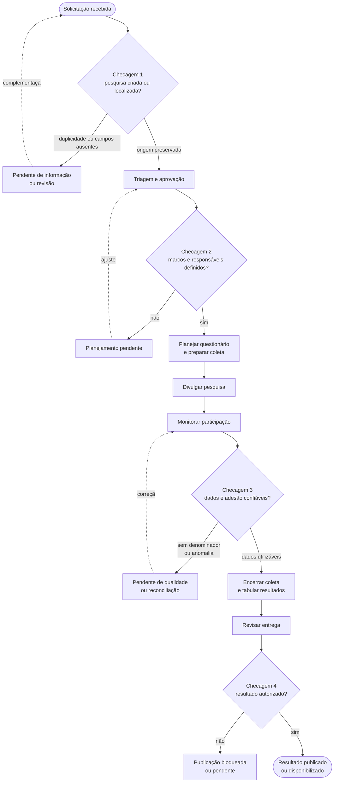

<div align="center"><sub>Figura 6.7.1 - Fluxo principal de ponta a ponta do perfil operacional</sub><br><sup>Material produzido pelos autores (2026)</sup></div>

<div align="center">
<sub>Tabela 6.7.3 - Passos do fluxo principal de ponta a ponta</sub><br>

| Ordem | Etapa do fluxo | Atores envolvidos | Interface ou canal | Ação principal | Resposta esperada da solução | Ponto de checagem |
| :--- | :--- | :--- | :--- | :--- | :--- | :--- |
| 1 | Receber demanda de pesquisa | Solicitante, equipe da Central | Outlook, n8n, sistema interno | Receber solicitação e registrar necessidade, objetivo e contexto. | Criar ou localizar uma pesquisa com origem preservada e status inicial. | Checagem 1 |
| 2 | Triar e aprovar continuidade | Equipe da Central, coordenação/Data Owner, área técnica quando necessário | Sistema interno ou fila operacional | Validar se a demanda deve seguir, ser ajustada ou ser recusada. | Atualizar status de triagem, registrar decisão e marcar pendências de informação. | Checagem 2 |
| 3 | Planejar pesquisa e questionário | Equipe da Central, área técnica | Sistema interno, SurveyMonkey, documentos de apoio | Definir cronograma, público, perguntas, alternativas e responsáveis. | Associar plano e questionário à pesquisa; preservar versão ou indicar que metadados ainda estão pendentes. | Checagem 2 |
| 4 | Criar tarefas e preparar coleta | Equipe da Central | Trello, SurveyMonkey, Outlook | Criar tarefas operacionais, configurar formulário e preparar comunicação aos participantes. | Confirmar tarefas vinculadas, instrumento preparado e pendências antes da divulgação. | Checagem 2 |
| 5 | Divulgar pesquisa | Equipe da Central, empresas/participantes | Outlook, SurveyMonkey | Enviar convite e abrir coleta. | Registrar data de divulgação, prazo de coleta e estado da pesquisa como em andamento. | Checagem 2 |
| 6 | Monitorar participação | Equipe da Central, empresas/participantes | Dashboard operacional, SurveyMonkey, base de respondentes | Acompanhar respostas, empresas participantes e sinais de baixa adesão. | Exibir participação observada, limitações de denominador, representatividade disponível e alertas. | Checagem 3 |
| 7 | Encerrar coleta e validar dados | Equipe da Central, Data Steward | Dashboard de qualidade, bases CSV, regras de validação | Encerrar coleta, verificar completude, duplicidade, chaves órfãs e consistência. | Classificar dados como válidos, pendentes, órfãos ou dependentes de integração futura. | Checagem 3 |
| 8 | Tabular e analisar resultados | Equipe da Central, área técnica | Dashboard de resultados, planilha de apoio quando necessária | Consolidar respostas e interpretar agregados por pesquisa, pergunta e recorte permitido. | Exibir resultados agregados com `n`, `N`, filtros permitidos e limitações de cálculo. | Checagem 3 |
| 9 | Revisar entrega | Equipe da Central, área técnica, coordenação/Data Owner | Sistema interno, dashboard, documento de resultado | Revisar consistência, autorização, versão e público de destino. | Registrar aprovação, bloqueio ou pendência antes de qualquer disponibilização externa. | Checagem 4 |
| 10 | Publicar ou disponibilizar resultado | Equipe da Central, Data Owner, Data Custodian/RentalHost, solicitante ou público autorizado | Acervo do site, dashboard ou relatório autorizado | Disponibilizar apenas o resultado aprovado para o perfil correto. | Atualizar acervo ou manter bloqueado; preservar vínculo entre pesquisa, resultado, versão e autorização. | Checagem 4 |

<sup>Material produzido pelos autores (2026)</sup>

</div><br>

### 6.7.4 Divergências, atritos e suporte ao usuário

Nesta etapa, o solicitante é tratado como o perfil que demanda uma pesquisa ou
consulta seu resultado, esperando resposta útil no menor tempo possível. A
equipe interna, por sua vez, precisa manter o ciclo rastreável, validar dados e
evitar publicação sem autorização. Os conflitos abaixo indicam pontos do fluxo
em que os dois perfis esperam comportamentos diferentes sobre o mesmo objeto; a
classificação final como acomodação, ruptura deliberada ou lacuna deve ser feita
no diagrama anotado.

<div align="center">
<sub>Tabela 6.7.4 - Divergências de expectativa entre equipe interna e solicitante</sub><br>

| Ponto do fluxo | Objeto em disputa | Expectativa da equipe interna | Expectativa do solicitante | Razão do conflito em relação ao negócio e ao JTBD |
| :--- | :--- | :--- | :--- | :--- |
| Etapas 1-2: recebimento e triagem | Demanda/pesquisa | Confirmar se a solicitação gera uma nova pesquisa, se já existe demanda equivalente ou se faltam dados para seguir. | Considerar que a demanda enviada já virou uma pesquisa em andamento. | O objetivo de rastreabilidade exige evitar duplicidade e preservar decisão de triagem; o JTBD da equipe interna depende de origem e status confiáveis antes de acelerar o fluxo. |
| Etapas 2-5: planejamento e divulgação | Status e prazo | Exibir status apenas quando marcos, responsáveis e datas mínimas estiverem definidos ou marcados como pendentes. | Receber previsão rápida de prazo e acompanhamento contínuo, mesmo antes de o plano estar fechado. | O negócio busca reduzir tempo de entrega, mas sem linha de base e sem campos completos a solução não deve transformar expectativa em SLA não comprovado. |
| Etapas 3-4: questionário e preparação da coleta | Escopo da pesquisa | Preservar versão do questionário, validação técnica e vínculo com a pesquisa antes da coleta. | Ver suas perguntas incorporadas com pouca mediação, mantendo o foco da demanda original. | A qualidade e a comparabilidade dos dados dependem de instrumento validado; o JTBD operacional prioriza confiança e redução de retrabalho, não apenas rapidez de criação. |
| Etapa 6: monitoramento da participação | Adesão/engajamento | Mostrar participação observada e bloquear taxa quando o universo elegível ou denominador não estiver disponível. | Acompanhar uma taxa simples de adesão para saber se a pesquisa está indo bem. | Aumentar adesão é objetivo de negócio, mas o indicador só é confiável quando numerador e denominador têm grão compatível; estimar sem base compromete decisão. |
| Etapas 8-10: entrega e publicação | Resultado publicado | Disponibilizar apenas resultado agregado, autorizado, versionado e compatível com o perfil de acesso. | Acessar o resultado completo ou publicável assim que a tabulação termina. | O objetivo de tornar a Central referência em dados exige consistência entre sistema interno e acervo; o JTBD da equipe interna só se cumpre se publicação, autorização e linhagem forem verificáveis. |

<sup>Material produzido pelos autores (2026)</sup>

</div><br>

As marcações abaixo identificam pontos críticos de atrito do perfil principal
para o rascunho visual. Elas não adicionam novas etapas ao fluxo; apenas indicam
onde o operador tende a gastar mais esforço cognitivo, depender de conferência
manual ou acionar suporte antes de seguir.

<div align="center">
<sub>Tabela 6.7.5 - Pontos críticos de atrito do perfil principal</sub><br>

| ID | Passo crítico no fluxo | Tipo de atrito | Por que exige mais esforço | Marcação preliminar no diagrama |
| :--- | :--- | :--- | :--- | :--- |
| AT01 | Etapas 1-2: receber e triar demanda | Decisão de identidade | O operador precisa distinguir nova pesquisa, solicitação incompleta e possível duplicidade sem perder a origem da demanda. | Marcar como `atenção: duplicidade/pendência`. |
| AT02 | Etapas 3-4: planejar questionário e criar tarefas | Intervenção manual entre ferramentas | Trello, SurveyMonkey, documentos de apoio e sistema interno precisam permanecer vinculados mesmo sem integração plena. | Marcar como `manual assistido`. |
| AT03 | Etapa 5: divulgar pesquisa | Dependência de confirmação externa | A coleta só deve avançar se envio, prazo e instrumento estiverem confirmados; falha de envio não pode parecer coleta ativa. | Marcar como `confirmação obrigatória`. |
| AT04 | Etapa 6: monitorar participação | Interpretação de indicador | A leitura de adesão depende de numerador, denominador e recorte compatível; sem isso, o operador precisa interpretar indisponibilidade. | Marcar como `indicador condicionado`. |
| AT05 | Etapas 7-8: validar e tabular dados | Reconciliação de qualidade | Órfãos, duplicidades, campos ausentes e diferenças de grão exigem decisão antes de consolidar resultados. | Marcar como `reconciliação`. |
| AT06 | Etapas 9-10: revisar e publicar | Governança e autorização | O operador precisa separar resultado tabulado, resultado revisado e resultado autorizado para evitar publicação indevida. | Marcar como `bloqueio/autorização`. |

<sup>Material produzido pelos autores (2026)</sup>

</div><br>

Para manter percepção de progresso, cada transição relevante do fluxo principal
(§6.7.3) deve devolver uma confirmação imediata ao operador. Os textos abaixo
representam o comportamento esperado da solução e servem como insumo para a
anotação visual; não são cópia final de interface.

<div align="center">
<sub>Tabela 6.7.6 - Confirmações e alertas esperados por transição do fluxo</sub><br>

| ID | Transição no fluxo | Mensagem de sistema esperada | Alerta quando houver exceção | Indicador visual exigido | Checagem relacionada |
| :--- | :--- | :--- | :--- | :--- | :--- |
| CP01 | Etapa 1: solicitação recebida ou localizada | Pesquisa registrada/localizada, com ID, origem e status inicial. | Possível duplicidade, chave divergente ou campos mínimos ausentes. | Selo `nova`, `em triagem` ou `pendente de informação`. | Checagem 1 (§6.7.2) |
| CP02 | Etapa 2: triagem concluída | Decisão registrada e próxima etapa indicada. | Demanda recusada, ajuste solicitado ou ausência de responsável/data crítica. | Linha do tempo com marco de triagem marcado e próxima ação destacada. | Checagem 2 (§6.7.2) |
| CP03 | Etapas 3-4: planejamento, questionário e tarefas preparados | Questionário, tarefas e comunicação vinculados à pesquisa. | Questionário sem versão, tarefa sem vínculo ou instrumento ainda não validado. | Checklist de preparação com itens concluídos, pendentes e bloqueados. | Checagem 2 (§6.7.2) |
| CP04 | Etapa 5: pesquisa divulgada | Coleta aberta, data de divulgação e prazo visíveis. | Prazo ausente, envio não confirmado ou integração com SurveyMonkey/Trello pendente. | Barra de ciclo movida para `em coleta` e contador de dias de coleta. | Checagem 2 (§6.7.2) |
| CP05 | Etapa 6: participação monitorada | Participação observada exibida com numerador, denominador disponível e recorte permitido. | Denominador inexistente, baixa adesão, representatividade indisponível ou relação órfã. | Cartão de adesão com estado `calculável`, `indisponível` ou `atenção`. | Checagem 3 (§6.7.2) |
| CP06 | Etapa 7: coleta encerrada e dados validados | Dados classificados como válidos, pendentes, órfãos ou dependentes de integração futura. | Duplicidade, ausência crítica, quebra de chave ou campo com impacto no indicador. | Painel de qualidade com contagem por severidade e fonte afetada. | Checagem 3 (§6.7.2) |
| CP07 | Etapas 9-10: resultado revisado para entrega/publicação | Resultado aprovado, bloqueado ou pendente, com versão e perfil autorizado. | Falta de autorização, risco de reidentificação, regra de agregação ausente ou acervo sem vínculo. | Selo `autorizado`, `bloqueado` ou `pendente`, ligado à versão do resultado. | Checagem 4 (§6.7.2) |

<sup>Material produzido pelos autores (2026)</sup>

</div><br>

Na abertura da pesquisa, a expectativa de agilidade só é atendida quando a
automação preserva origem, vínculo e pendências. O operador não precisa que
Outlook, Trello, SurveyMonkey e sistema interno sejam substituídos; precisa que
a solicitação deixe de circular como informação solta e passe a ser acompanhada
por uma identidade comum.

<div align="center">
<sub>Tabela 6.7.7 - Expectativas do operador na abertura da pesquisa</sub><br>

| ID | Passo de abertura | Interface ou canal | Entidade/registro esperado | Expectativa do operador | Validação da expectativa | Checagem |
| :--- | :--- | :--- | :--- | :--- | :--- | :--- |
| AP01 | Receber solicitação | Outlook, n8n ou entrada manual no sistema interno | `Pesquisa` solicitada, com origem, data, título e solicitante quando disponível. | Identificar rapidamente se há uma nova demanda acompanhável. | Atendida se o sistema cria ou localiza a pesquisa e explicita campos mínimos ausentes; parcial se a origem ficar apenas no e-mail. | Checagem 1 (§6.7.2) |
| AP02 | Registrar pesquisa inicial | Sistema interno e dashboard operacional | `Pesquisa` com ID, status inicial, responsável e pendências de triagem. | Evitar duplicidade e começar o acompanhamento sem cruzamento manual. | Atendida se houver ID comum e alerta de demanda semelhante; não atendida se o registro depender de planilha paralela. | Checagem 1 (§6.7.2) |
| AP03 | Criar tarefa operacional | Trello vinculado ao sistema interno | Tarefa associada ao ID da pesquisa, etapa, responsável e prazo operacional. | Acompanhar responsabilidades sem abrir múltiplas ferramentas para descobrir o estado do trabalho. | Atendida parcialmente enquanto a integração Trello-sistema não for automática; o vínculo pendente deve aparecer como alerta. | Checagem 2 (§6.7.2) |
| AP04 | Preparar formulário de coleta | SurveyMonkey, documentos de apoio e sistema interno | Questionário associado à pesquisa, com versão ou pendência de versão, status de preparação e responsável. | Saber se o instrumento já pode seguir para divulgação. | Atendida se o fluxo confirma formulário preparado ou bloqueia a divulgação quando faltar validação, versão ou vínculo com a pesquisa. | Checagem 2 (§6.7.2) |

<sup>Material produzido pelos autores (2026)</sup>

</div><br>

Na tabulação e publicação, a expectativa de entrega só é atendida quando o
resultado deixa claro de quais respostas veio, quais validações foram aplicadas
e em que estado de autorização está. Para o operador, dado publicado deve
significar dado agregado, rastreável e disponível ao perfil correto; quando
autorização, versão ou vínculo com o acervo não existirem, a solução deve mostrar
indisponibilidade ou bloqueio, não conclusão automática.

<div align="center">
<sub>Tabela 6.7.8 - Expectativas do operador na tabulação e publicação</sub><br>

| ID | Passo de tabulação/publicação | Interface ou canal | Entidade/registro esperado | Expectativa do operador | Validação da expectativa | Checagem |
| :--- | :--- | :--- | :--- | :--- | :--- | :--- |
| TP01 | Consolidar respostas encerradas | SurveyMonkey, bases CSV e dashboard de qualidade | `Resposta`, `Questao` e `Pesquisa` vinculadas, com órfãos e duplicidades classificados. | Iniciar a tabulação a partir de um conjunto de respostas confiável. | Atendida se a consolidação informa registros válidos, pendentes e em reconciliação; não atendida se respostas sem vínculo forem somadas sem alerta. | Checagem 3 (§6.7.2) |
| TP02 | Validar agregados e indicadores | Dashboard de resultados e regras analíticas | Resultado agregado por pesquisa, pergunta e recorte permitido, com `n`, `N` disponível e limitação declarada. | Confiar que o indicador exibido corresponde ao dado coletado e ao grão correto. | Atendida se numerador, denominador e filtros ficam explícitos; parcial quando o denominador não existe e o sistema bloqueia taxa ou marca como indisponível. | Checagem 3 (§6.7.2) |
| TP03 | Revisar entrega antes da publicação | Sistema interno, dashboard e documento de resultado | Resultado revisado, com versão, responsável, público de destino e decisão pendente/aprovada/bloqueada. | Saber se o resultado já pode ser entregue ou se ainda depende de autorização. | Atendida se a revisão separa `tabulado`, `revisado` e `autorizado`; não atendida se tabulação for tratada como publicação. | Checagem 4 (§6.7.2) |
| TP04 | Publicar ou disponibilizar no acervo | Acervo do site, dashboard ou relatório autorizado | Resultado publicado ou bloqueado, vinculado à pesquisa interna, versão e decisão do Data Owner. | Supor que o dado disponível no acervo é confiável, atual e permitido para aquele perfil. | Atendida se o acervo preserva vínculo, versão, data e perfil autorizado; enquanto esses metadados forem futuros, a disponibilidade deve aparecer como proposta ou pendente. | Checagem 4 (§6.7.2) |

<sup>Material produzido pelos autores (2026)</sup>

</div><br>

### 6.7.5 Premissas e validação de consistência

A equipe interna é tratada como perfil com autonomia operacional para acompanhar
o ciclo das pesquisas, mas não como administradora irrestrita dos dados. As
premissas abaixo delimitam o que o fluxo assume sobre treinamento, permissões e
capacidade técnica; se elas não se confirmarem, a adoção da solução pode exigir
mais mediação, suporte ou revisão de papéis.

<div align="center">
<sub>Tabela 6.7.9 - Premissas de autonomia do perfil operacional principal</sub><br>

| ID | Premissa de autonomia | Descrição | Impacto se não se confirmar |
| :--- | :--- | :--- | :--- |
| PA01 | Treinamento básico no fluxo | A equipe interna reconhece etapas, status, pendências e checagens do ciclo de pesquisa descrito na §6.7.3. | O operador pode interpretar alertas como erro do sistema, manter controles paralelos e reduzir a confiança no acompanhamento integrado. |
| PA02 | Permissão de consulta operacional | O perfil principal pode visualizar pesquisas, marcos, participação, qualidade e estado de publicação necessários ao trabalho diário. | A solução perde valor como ambiente único; a equipe volta a depender de SurveyMonkey, Trello, planilhas e acervo separados para confirmar progresso. |
| PA03 | Permissão controlada de edição | A equipe pode registrar ou corrigir metadados operacionais, como responsável, status, prazo, pendência e vínculo de tarefa/questionário, dentro de regras aprovadas. | Se a edição depender sempre de outro perfil, aumenta o tempo de atualização e a percepção de automação fica parcial; se for ampla demais, cresce o risco de inconsistência e falta de auditoria. |
| PA04 | Capacidade de interpretar qualidade do dado | O operador compreende estados como `válido`, `pendente`, `em reconciliação`, `indisponível` e `bloqueado`. | Indicadores podem ser usados fora do contexto, especialmente adesão sem denominador, resultados órfãos ou publicações sem autorização. |
| PA05 | Suporte técnico disponível quando houver exceção | Casos de chave órfã, integração pendente, falha de carga, versão ausente ou publicação bloqueada têm encaminhamento para área técnica, Data Steward ou Data Owner. | Pendências críticas podem ficar sem dono, gerando frustração, atraso e retorno ao processo manual. |

<sup>Material produzido pelos autores (2026)</sup>

</div><br>

Cada critério de sucesso listado em §6.7.1 possui pelo menos um ponto de
confirmação em §6.7.2 e aparece em uma ou mais etapas do fluxo principal da
§6.7.3. A tabela acima deve ser levada para a legenda do artefato visual como
premissas do perfil operacional principal.

Como texto de apoio ao diagrama, as expectativas do perfil operacional devem ser
lidas em quatro blocos: abertura rastreável, acompanhamento do ciclo,
confiabilidade dos dados e publicação autorizada. Esses blocos sintetizam a
Etapa 1 do artefato e justificam as anotações visuais sem substituir os nós,
setas e estados do fluxo.

<div align="center">
<sub>Tabela 6.7.10 - Textos de apoio para anotação do diagrama</sub><br>

| ID | Ponto anotado no diagrama | Texto de apoio para a justificativa | Referência interna |
| :--- | :--- | :--- | :--- |
| TA01 | Solicitação recebida e pesquisa criada/localizada | O avanço começa quando a solicitação deixa de ser uma mensagem isolada e passa a ter identidade operacional, origem preservada e pendências explícitas. | JOP01 (§6.7.1), Checagem 1 (§6.7.2), AP01-AP02 (§6.7.4) |
| TA02 | Planejamento, tarefas e coleta preparados | A agilidade esperada pelo operador depende de vínculos entre sistema interno, Trello e SurveyMonkey; quando a integração ainda for parcial, o fluxo deve mostrar pendência, não esconder trabalho manual. | JOP02 (§6.7.1), Checagem 2 (§6.7.2), AP03-AP04 (§6.7.4) |
| TA03 | Participação monitorada e dados validados | A percepção de progresso não vem apenas da quantidade de respostas, mas da confiança sobre denominadores, vínculos, órfãos, duplicidades e limitações do indicador. | JOP03-JOP04 (§6.7.1), Checagem 3 (§6.7.2), TP01-TP02 (§6.7.4) |
| TA04 | Resultado revisado e publicação decidida | A entrega só deve aparecer como concluída quando resultado, versão, autorização, perfil de acesso e vínculo com o acervo estiverem registrados; sem isso, o estado correto é pendente, bloqueado ou proposto. | JOP05 (§6.7.1), Checagem 4 (§6.7.2), TP03-TP04 (§6.7.4) |

<sup>Material produzido pelos autores (2026)</sup>

</div><br>

Validação de consistência da Etapa 1: cada critério do JTBD foi confrontado com
o fluxo principal para verificar se existe pelo menos um passo em que o operador
recebe confirmação de progresso. Não foram identificadas omissões que exijam
ajuste antes do confronto com o modelo de dados.

<div align="center">
<sub>Tabela 6.7.11 - Validação de consistência dos critérios do JTBD</sub><br>

| Critério do JTBD | Passo de confirmação no fluxo principal | Evidência de suporte | Resultado da validação |
| :--- | :--- | :--- | :--- |
| JOP01 — identidade rastreável da pesquisa | Etapas 1-2: receber demanda, criar/localizar pesquisa e registrar triagem. | Checagem 1 (§6.7.2), CP01 (§6.7.4), AP01-AP02 (§6.7.4), TA01 (§6.7.5). | Coberto, sem ajuste necessário. |
| JOP02 — status, prazos e marcos acompanháveis | Etapas 2-5: triar, planejar, criar tarefas e divulgar a coleta. | Checagem 2 (§6.7.2), CP02-CP04 (§6.7.4), AP03-AP04 (§6.7.4), TA02 (§6.7.5). | Coberto, sem ajuste necessário. |
| JOP03 — participação e risco de baixa adesão | Etapa 6: monitorar participação e limites de cálculo. | Checagem 3 (§6.7.2), CP05 (§6.7.4), TA03 (§6.7.5). | Coberto, com ressalva já registrada sobre denominador indisponível. |
| JOP04 — qualidade antes de tabular/publicar | Etapas 7-8: encerrar coleta, validar dados e consolidar resultados. | Checagem 3 (§6.7.2), CP06 (§6.7.4), TP01-TP02 (§6.7.4), TA03 (§6.7.5). | Coberto, com pendências de reconciliação explicitadas. |
| JOP05 — entrega/publicação autorizada | Etapas 9-10: revisar entrega e publicar ou bloquear resultado. | Checagem 4 (§6.7.2), CP07 (§6.7.4), TP03-TP04 (§6.7.4), TA04 (§6.7.5). | Coberto, sem ajuste necessário. |

<sup>Material produzido pelos autores (2026)</sup>

</div><br>

### 6.7.6 Fluxo de interação do perfil secundário (área técnica)

O perfil secundário é a **área técnica** que dá suporte especializado à Central
de Pesquisas. Diferente da equipe interna — que opera o ciclo de ponta a ponta
(§6.7.3) —, a área técnica não conduz a pesquisa: ela **entra no fluxo em três
instantes pontuais, de alto impacto e alta responsabilidade técnica**. São eles a
validação técnica do questionário (antes da divulgação), o acompanhamento da
adesão sob a ótica de representatividade do setor farmacêutico, e a revisão de
consistência dos resultados antes da tabulação ou publicação. Em todos, o papel é
de **revisão e sinalização qualificada**: possui acesso de leitura qualificada,
valida e devolve, mas não avança o ciclo nem publica por conta própria.

Esse recorte importa porque é justamente nesses três pontos que o **modelo mental
da área técnica tende a divergir** do ciclo de vida modelado pelo grupo. O caso
mais frequente é presumir que um questionário "aprovado tecnicamente" já está
pronto para publicar, quando o modelo ainda exige coleta, tabulação, autorização
e vínculo de versão — divergência classificada na §6.7.12. Por atuar em pontos de
controle, a área técnica é também quem primeiro **observa** os problemas de dado
que a §4.0 já havia diagnosticado (chaves órfãs, participação sem denominador,
respostas que não equivalem a respondentes), o que faz do seu fluxo o principal
gerador de sinalizações de qualidade.

O diagrama abaixo representa o trecho de interação do perfil secundário; os
losangos são os pontos de decisão (S1–S3) e os retângulos, os estados resultantes
no modelo. A notação de estados segue a §6.7.17.

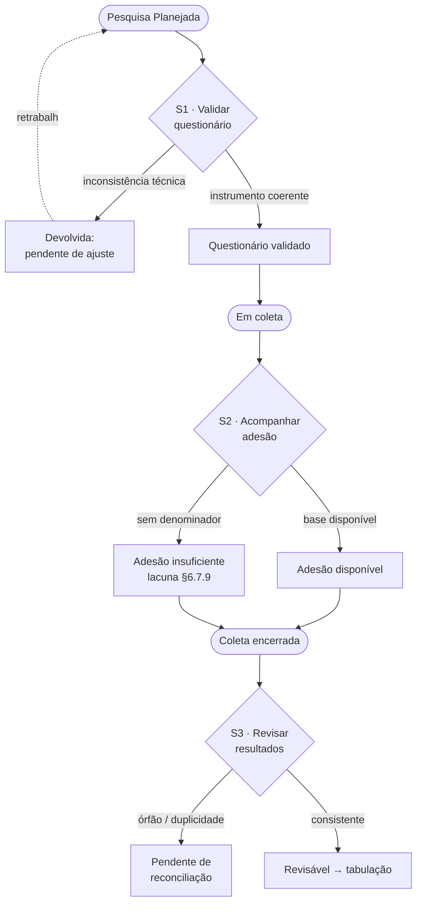

<div align="center"><sub>Figura 6.7.2 - Fluxo de interação do perfil secundário (área técnica)</sub><br><sup>Material produzido pelos autores (2026)</sup></div>

A tabela restringe o escopo a esse trecho de divergência; não repete o fluxo
principal, apenas os passos em que a área técnica age, e associa cada um às
entidades do modelo e ao estado resultante.

<div align="center">
<sub>Tabela 6.7.12 - Passos da área técnica no trecho de divergência</sub><br>

| Ordem | Etapa (área técnica) | Ação principal | Interface ou canal | Entidades tocadas | Resposta esperada da solução | Estado resultante | Checagem (§6.7.2) |
| :--- | :--- | :--- | :--- | :--- | :--- | :--- | :--- |
| S1 | Validar tecnicamente o questionário | Revisar tipos de questão, alternativas, matrizes e coerência do instrumento antes da divulgação. | SurveyMonkey, documentos de apoio, sistema interno | `Questao`, `Pesquisa` | Registrar o questionário como validado ou pendente, preservando versão e vínculo com a pesquisa. | `Questionário validado` ou `Planejada` (com pendência) | Checagem 2 |
| S2 | Acompanhar adesão e representatividade | Avaliar participação observada, empresas respondentes e risco de baixa representatividade. | Dashboard operacional, base de respondentes/empresas | `Respondente`, `Empresa`, `Pesquisa` | Exibir numerador e denominador quando existir; sinalizar limitação de cálculo e baixa cobertura. | Adesão `Disponível` ou `Insuficiente` | Checagem 3 |
| S3 | Revisar consistência dos resultados | Conferir agregados, inconsistências, órfãos e duplicidades antes da tabulação/publicação. | Dashboard de qualidade e de resultados | `Resposta`, `Questao`, `Pesquisa` | Classificar resultado como consistente, pendente ou dependente de reconciliação; nunca liberar sem revisão. | `Revisável` ou `Pendente de reconciliação` | Checagem 3 e 4 |

<sup>Material produzido pelos autores (2026)</sup>

</div><br>

A área técnica atua como **revisora e validadora**, não como operadora do ciclo:
seu acesso é de leitura qualificada e sinalização, e suas ações alimentam as
decisões da equipe interna e do Data Owner, sem substituí-las.


### 6.7.7 Transições de estado do modelo — fluxo principal

Esta subseção associa **cada passo do fluxo principal (§6.7.3)** à transição de
estado que ele provoca no modelo relacional, explicitando qual **entidade** é
alterada, qual **atributo** muda e qual é o **novo estado**. O objetivo é permitir
que o diagrama anotado mostre não apenas a ação de interface, mas o efeito
persistente no dado — e servir de base para localizar, nas §6.7.9 e §6.7.10, onde
fluxo e modelo deixam de se corresponder.

O ciclo de vida do atributo `status` da entidade `Pesquisa` é a espinha dorsal
dessas transições:

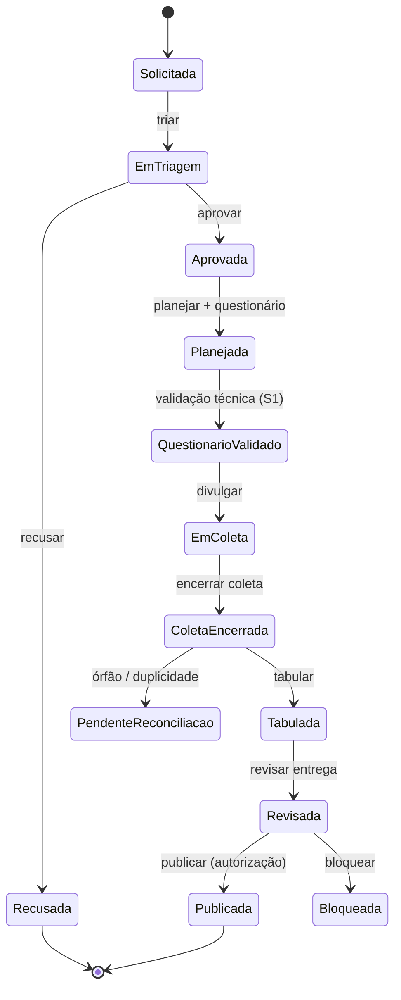

<div align="center"><sub>Figura 6.7.3 - Ciclo de vida do status da entidade Pesquisa</sub><br><sup>Material produzido pelos autores (2026)</sup></div>

<div align="center">
<sub>Tabela 6.7.13 - Transições de estado do modelo no fluxo principal</sub><br>

| Passo (§6.7.3) | Entidade | Atributo alterado | Transição de estado | Observação de integridade |
| :--- | :--- | :--- | :--- | :--- |
| 1. Receber demanda | `Pesquisa` | `status`, `data_solicitacao`, origem | `—` → `Solicitada` | Origem preservada; duplicidade apenas sinalizada — sem campo próprio (§6.7.9). |
| 2. Triar e aprovar | `Pesquisa` | `status`, `data_aprov` | `Solicitada` → `Em triagem` → `Aprovada`/`Recusada` | `data_aprov` ausente em 94,5% do legado — mede validação sobre poucos casos (§4.0). |
| 3. Planejar pesquisa e questionário | `Pesquisa`, `Questao` | `status`, vínculo `Questao`↔`Pesquisa` | `Aprovada` → `Planejada` | Versão do questionário não é persistida (lacuna §6.7.13). |
| 4. Criar tarefas e preparar coleta | `Pesquisa` | preparação operacional | `Planejada` (a preparação não gera novo estado canônico; a validação do instrumento é S1, §6.7.8) | Tarefas de Trello não têm entidade no modelo (§6.7.9). |
| 5. Divulgar pesquisa | `Pesquisa` | `data_divulgacao`, `data_limite`, `status` | `Questionário validado` → `Em coleta` | Divulgação após a validação técnica (S1); marca o início da janela de coleta. |
| 6. Monitorar participação | `Respondente` | cria vínculo `Empresa`/`Cliente`↔`Pesquisa` | cria `Participação` (`Em coleta`) | Denominador de adesão não é atributo do modelo (§6.7.9). |
| 7. Encerrar coleta e validar | `Pesquisa`, `Resposta` | `status`, flags de qualidade | `Em coleta` → `Coleta encerrada` / `Pendente de reconciliação` | Órfãos e duplicidades classificados aqui. |
| 8. Tabular e analisar | `Resposta`, `Questao` | agregação | `Coleta encerrada` → `Tabulada` | 1 linha de `Resposta` ≠ 1 respondente (matriz/checkbox — §6.7.11). |
| 9. Revisar entrega | `Pesquisa` | `status`, autorização | `Tabulada` → `Revisada`/`Bloqueada` | Autorização e perfil não têm atributo próprio (§6.7.14). |
| 10. Publicar resultado | `Pesquisa` | `status`, vínculo com acervo | `Revisada` → `Publicada` | Vínculo com o repositório externo não é modelado (§6.7.14). |

<sup>Material produzido pelos autores (2026)</sup>

</div><br>


### 6.7.8 Transições de estado do modelo — fluxo do perfil secundário

Mesma associação da §6.7.7, agora para os passos da área técnica (§6.7.6). Como o
perfil secundário **revisa e qualifica** em vez de avançar o ciclo, suas
transições são de *qualificação de estado* (validar, sinalizar, liberar); por isso
cada ação declara a **integridade relacional pressuposta** — a condição de dado
que precisa valer para a transição ser legítima, verificada empiricamente na
§6.7.15.

<div align="center">
<sub>Tabela 6.7.14 - Transições de estado do modelo no fluxo do perfil secundário</sub><br>

| Passo (§6.7.6) | Entidade | Atributo alterado | Transição de estado | Integridade relacional pressuposta |
| :--- | :--- | :--- | :--- | :--- |
| S1. Validar questionário | `Questao`, `Pesquisa` | flag de validação técnica, `status` | `Planejada` → `Questionário validado` | Toda `Questao` referencia uma `Pesquisa` existente; matrizes têm alternativas coerentes. |
| S2. Acompanhar adesão | `Respondente`, `Empresa` | estado de cálculo de adesão | `Em coleta` → adesão `Disponível`/`Insuficiente` | `id_empresa` íntegro (100%) e `id_cliente` conciliado; falta o denominador (universo convidado). |
| S3. Revisar resultados | `Resposta`, `Pesquisa` | flag de consistência, `status` | `Coleta encerrada` → `Revisável`/`Pendente de reconciliação` | Toda `Resposta` liga a `Questao` (100%) e `Pesquisa` — exceto as chaves órfãs conhecidas. |

<sup>Material produzido pelos autores (2026)</sup>

</div><br>


### 6.7.9 Passos do fluxo sem correspondência no modelo de dados

Confrontando os fluxos (§6.7.3 e §6.7.6) com o modelo relacional, alguns passos
previstos na interface **não têm entidade ou atributo** que os persista. Cada um é
uma **lacuna potencial de modelagem**: a ação existe na tela, mas o dado que ela
produziria não tem onde morar hoje — e portanto se perde entre uma sessão e outra.

<div align="center">
<sub>Tabela 6.7.15 - Passos do fluxo sem correspondência no modelo de dados</sub><br>

| Passo de interface (fluxo) | O que a tela faz | Entidade/atributo faltante | Consequência se não modelado |
| :--- | :--- | :--- | :--- |
| Sinalizar duplicidade/conflito ao criar pesquisa (passo 1) | Marca suspeita de duplicata | `Pesquisa.flag_duplicidade` / entidade de conflito | Suspeita se perde; sem trilha da deduplicação. |
| Registrar motivo de atraso/prorrogação (passo 2/5) | Explica o atraso | `Pesquisa.motivo_prorrogacao` | Prorrogação vira número sem causa; análise de gargalo fica cega. |
| Preparar tarefas operacionais (passo 4) | Cria tarefas no Trello | Entidade `Tarefa` vinculada à `Pesquisa` | Trabalho operacional não é rastreável no DW. |
| Exibir denominador de adesão (passo 6 / S2) | Calcula taxa de adesão | `Pesquisa.universo_convidado` (denominador) | Taxa de adesão incalculável ou estimada sem base. |
| Capturar consentimento do respondente (coleta) | Registra consentimento LGPD | Entidade/atributo `Consentimento` | Base legal e direito do titular ficam sem rastro. |
| Autorizar publicação com perfil/versão (passo 9/10) | Aprova e versiona a saída | `Pesquisa.autorizacao`, `versao_publicada` | Publicação sem controle de autorização/versão. |
| Registrar parecer da validação técnica (S1) | Guarda o "aceito/devolvido" | Histórico de validação (revisor, data, parecer) | Decisão técnica não é auditável (§6.7.13). |

<sup>Material produzido pelos autores (2026)</sup>

</div><br>


### 6.7.10 Estados do modelo não produzidos por nenhum passo do fluxo

O inverso da §6.7.9: estados ou marcações que o **modelo prevê (ou precisará
prever)**, mas que **nenhuma ação do fluxo de interação alcança**. São estados
isolados — entram por regra de qualidade/governança ou por processo de carga, não
por interação do usuário — e por isso exigem rotina automática ou decisão fora do
fluxo operacional.

<div align="center">
<sub>Tabela 6.7.16 - Estados do modelo não produzidos por passos do fluxo</sub><br>

| Estado/marcação do modelo | Como surge | Por que nenhum passo do fluxo o produz | Encaminhamento |
| :--- | :--- | :--- | :--- |
| `Pesquisa = Não mapeada` (chave órfã) | Reconciliação dos `pesquisa_id` órfãos 424, 1116, 1139, 1147 (e `id_pesq` 304 em respondentes) | Nenhuma tela cria ou resolve o órfão; é decisão de governança com o parceiro | Rotina de qualidade + conciliação (política §2.8 do doc de Governança). |
| `Registro em quarentena` | Bloqueio na ingestão por desvio crítico | O fluxo opera dados já ingeridos; a quarentena é anterior ao usuário | Fluxo de ações corretivas (governança), não o fluxo de interação. |
| Histórico de mudança (SCD Tipo 2) | Versionamento de dimensão (ex.: `Empresa`) | O usuário não versiona dimensão pela tela | Processo de carga/ETL; evolução prevista no blueprint dimensional. |
| `Adesão = Insuficiente (sem denominador)` | Ausência estrutural do universo convidado | Depende de dado inexistente (§6.7.9), não de ação de usuário | Só se resolve quando o denominador for modelado. |

<sup>Material produzido pelos autores (2026)</sup>

</div><br>


### 6.7.11 Pontos de divergência no ciclo de vida das pesquisas

Aqui se localizam os pontos em que o **modelo mental dos usuários contraria o
ciclo de vida do dado** modelado pelo grupo — o coração do fluxo anotado. Cada
divergência é ancorada na fase (coleta no SurveyMonkey, consolidação, liberação do
acervo) e, quando possível, quantificada com o snapshot recebido.

<div align="center">
<sub>Tabela 6.7.17 - Pontos de divergência no ciclo de vida das pesquisas</sub><br>

| Fase do ciclo | Expectativa do usuário | O que o modelo/fluxo exige | Impacto (com evidência) |
| :--- | :--- | :--- | :--- |
| Coleta (SurveyMonkey) | "Cada linha de resposta é uma pessoa." | 1 linha de `Resposta` é um elemento (matriz/checkbox), não um respondente. | 20.607 linhas de `respostas` para 18.735 `respondentes`: contar linha infla participação. |
| Coleta / identidade | "O respondente é o mesmo entre as bases." | `id_cliente` aparece como texto (`s/i`) e como inteiro; exige conciliação de tipo. | Reconcilia 100% como string, mas o sentinela `s/i` quebra join numérico ingênuo. |
| Coleta / cobertura | "Toda pesquisa tem questionário e respostas." | Só **10 das 366 pesquisas** têm questionário/respostas no snapshot. | Cubo de resultados cobre ~2,7% do acervo; indicador de conteúdo é parcial. |
| Consolidação | "Encerrei a coleta, então o resultado está pronto." | Encerrar coleta só muda `status`; validação e tabulação são etapas próprias. | Publicação precoce de dado não validado. |
| Liberação do acervo | "Aprovei tecnicamente, logo está publicado." | Publicação exige autorização, versão e perfil — não modelados (§6.7.14). | Expectativa de publicação automática sem controle. |

<sup>Material produzido pelos autores (2026)</sup>

</div><br>


### 6.7.12 Divergências de expectativa quanto ao status da pesquisa

Detalhamento de uma classe específica da §6.7.11: os momentos em que o **usuário
acredita que a pesquisa está concluída, mas o modelo ainda exige validações
pendentes**. É onde o status percebido descola do status real e gera cobrança ou
publicação indevida.

<div align="center">
<sub>Tabela 6.7.18 - Divergências de expectativa quanto ao status da pesquisa</sub><br>

| Status percebido pelo usuário | Status real no modelo | Validação pendente que falta | Efeito no trabalho |
| :--- | :--- | :--- | :--- |
| "Coleta encerrada = concluída" | `Coleta encerrada` (≠ `Publicada`) | Validação de qualidade + tabulação + revisão | Retrabalho e cobrança indevida de resultado. |
| "Questionário aprovado = pronto para publicar" | `Questionário validado` | Coleta, análise e autorização de publicação | Pressão para publicar antes da coleta. |
| "Tabulado = disponível no acervo" | `Tabulada` | Revisão de entrega + autorização + versionamento | Resultado exposto sem autorização registrada. |
| "Prorroguei, então o prazo não conta" | `Em coleta` com `prorrogada_ate` | Registro de motivo e recálculo de dias úteis | Indicador de tempo distorcido sem a causa da prorrogação. |

<sup>Material produzido pelos autores (2026)</sup>

</div><br>


### 6.7.13 Lacunas no modelo de dados — validação de pesquisas

Documenta o que o banco **precisaria conter** para persistir os históricos de
validação técnica, hoje ausentes. Sem isso, a validação da área técnica (S1)
acontece, mas não deixa rastro consultável nem auditável.

- **O que falta:** entidade/atributos de validação técnica — `Questao.validada`,
  `Pesquisa.versao_questionario` e um registro de *quem validou, quando e com qual
  parecer*.
- **O que o modelo precisaria conter:** um histórico de validação (data, revisor,
  resultado, versão do instrumento) ligado à `Pesquisa`, permitindo auditar por
  que um questionário foi aceito ou devolvido.
- **Evidência da lacuna:** o snapshot não possui nenhuma coluna de parecer ou
  versão de questionário nas 231 linhas de `questoes`; a decisão técnica existe no
  processo, não no dado.
- **Status de implementação:** **pendente** — sinalizado como lacuna; a estrutura
  de versionamento do questionário ainda não existe.


### 6.7.14 Lacunas no modelo de dados — publicação no acervo

Identifica as falhas na estrutura de dados que impedem o **rastreamento
automatizado entre o DW e o repositório público** do site.

- **O que falta:** vínculo persistido entre a `Pesquisa` interna e o item
  publicado — `Pesquisa.autorizacao`, `versao_publicada`, `data_publicacao`,
  `perfil_autorizado` e o identificador do recurso externo.
- **O que o modelo precisaria conter:** uma relação de publicação ligando
  resultado, versão, autorização e destino, preservando a linhagem entre o dado
  interno e o divulgado.
- **Evidência da lacuna:** não há na base qualquer chave que ligue `Pesquisa` ao
  acervo publicado; a publicação hoje é manual e sem vínculo rastreável.
- **Status de implementação:** **pendente** — é uma das evoluções previstas para o
  TO-BE (§2.1).


### 6.7.15 Verificação de alinhamento entre o modelo (DER) e os passos do fluxo

Verificação de consistência (tarefa de teste) que confronta cada **relacionamento
do DER** com os passos dos fluxos §6.7.3 e §6.7.6, para garantir que a
correspondência fluxo↔banco esteja mapeada e que toda chave estrangeira usada nas
transições de estado (§6.7.7 e §6.7.8) se sustente nos dados reais. A checagem é
**reproduzível** pelo script `scripts/data_quality/valida_integridade_referencial.py`,
executado sobre o snapshot do parceiro; os resultados abaixo são a sua saída.

<div align="center">
<sub>Tabela 6.7.19 - Integridade referencial medida nas bases reais (evidência do alinhamento)</sub><br>

| Relacionamento do DER | Chaves distintas | Órfãs | Cobertura | Leitura |
| :--- | ---: | ---: | ---: | :--- |
| `questoes.pesquisa_id` → `pesquisas.id` | 10 | 4 | 60,0% | Órfãos documentados (424, 1116, 1139, 1147). |
| `respostas.pesquisa_id` → `pesquisas.id` | 10 | 4 | 60,0% | Mesmos órfãos; só 10 pesquisas têm questionário. |
| `respostas.id_pergunta` → `questoes.id_pergunta` | 231 | 0 | 100% | Íntegro. |
| `respostas.id_empresa` → `empresas.ID` | 131 | 0 | 100% | Íntegro. |
| `respondentes.id_pesq` → `pesquisas.id` | 327 | 1 | 99,7% | Órfão novo `304` (reter e reconciliar). |
| `respondentes.id_empresa` → `empresas.ID` | 419 | 0 | 100% | Íntegro. |
| `respondentes.id_cliente` → `clientes.id_cliente` | 5.430 | 0 | 100% | Íntegro (reconcilia como texto; há sentinela `s/i`). |
| `clientes.id_empresa` → `empresas.ID` | 410 | 0 | 100% | Íntegro. |

<sup>Material produzido pelos autores (2026)</sup>

</div><br>

Resultado: das oito relações do DER, **seis estão 100% íntegras**; as duas
exceções são as **chaves órfãs de pesquisa** — as quatro já conhecidas (424, 1116,
1139, 1147) e a nova `304` encontrada em `respondentes`, todas encaminhadas para
retenção e reconciliação com o parceiro (§6.7.10 e §2.8 do documento de
Governança). Nenhuma ação do fluxo fica sem correspondência não analisada; as
lacunas residuais (denominador de adesão, consentimento e versão de questionário)
estão registradas nas §6.7.9, §6.7.13 e §6.7.14 como itens de modelagem, não como
inconsistência de dado.


### 6.7.16 Premissas do modelo de dados para o perfil secundário

Hipóteses assumidas sobre a atuação da área técnica, organizadas para compor a
legenda do artefato e para sinalizar o que precisa ser confirmado com o parceiro.

<div align="center">
<sub>Tabela 6.7.20 - Premissas do modelo de dados para o perfil secundário</sub><br>

| Premissa | Descrição | Impacto se não se confirmar |
| :--- | :--- | :--- |
| Acesso de leitura qualificada | A área técnica consulta e sinaliza, mas não edita o ciclo. | Se tiver escrita, muda o modelo de permissões e a trilha de auditoria (§5). |
| Atuação pontual | Entra em S1, S2 e S3, não em todo o ciclo. | Se atuar em mais etapas, o fluxo secundário precisa ser reexpandido. |
| Papel de validação técnica reconhecido | Existe um responsável técnico formal pela validação do questionário. | Sem papel formal, a §6.7.13 vira bloqueio, não só lacuna. |
| Frequência de acesso sob demanda | Acessa nos marcos de validação/revisão, não continuamente. | Se for contínuo, muda requisitos de desempenho e concorrência (RNF01). |
| Denominador obtível no futuro | O universo convidado poderá ser capturado na integração com o SurveyMonkey. | Se nunca existir, a taxa de adesão permanece estruturalmente insuficiente. |

<sup>Material produzido pelos autores (2026)</sup>

</div><br>


### 6.7.17 Validação da notação das transições de estado

Checagem final de notação (tarefa de teste): confirma que as mudanças de estado
das §6.7.7 e §6.7.8 usam **a mesma nomenclatura** de entidades e estados definida
no modelo relacional, evitando divergência de nomes entre fluxo e banco.

- **Entidades** grafadas de forma única, em maiúscula inicial e no singular:
  `Pesquisa`, `Questao`, `Empresa`, `Cliente`, `Respondente`, `Resposta`.
- **Estados de `Pesquisa`** padronizados na sequência do ciclo: `Solicitada` →
  `Em triagem` → `Aprovada` → `Planejada` → `Questionário validado` → `Em coleta`
  → `Coleta encerrada` → `Tabulada` → `Revisada` → `Publicada`; estados
  transversais: `Bloqueada`, `Pendente de reconciliação`, `Não mapeada`.
- **Convenção de nomes:** campos em `snake_case` (ex.: `data_aprov`, `id_cliente`)
  e estados de negócio em linguagem natural — sem misturar as duas convenções na
  mesma célula das tabelas de transição.
- **Correção aplicada:** o rótulo genérico "concluída", antes usado de forma
  ambígua, foi substituído pelo estado real correspondente (`Coleta encerrada`,
  `Tabulada` ou `Publicada`, conforme o ponto), eliminando a ambiguidade apontada
  na §6.7.12.

Resultado: notação consistente entre as §6.7.6–6.7.8 e o modelo de dados; nenhuma
divergência de nomenclatura de campo ou entidade remanescente.

### 6.7.18 Classificação das divergências: acomodação e ruptura deliberada

Esta subseção retoma as divergências já localizadas nas §6.7.4, §6.7.11 e
§6.7.12 e atribui a cada uma uma decisão explícita de **acomodação** ou
**ruptura deliberada**. As divergências que não se resolvem por decisão de
interação — porque o modelo de dados não comporta o que o usuário espera — não
entram aqui; elas são nomeadas como **lacuna** na §6.7.20, categoria que só se
aplica quando a insuficiência é do modelo, e não a pontos em que o grupo apenas
preferiu não decidir.

**Acomodações.** São pontos em que o fluxo se ajusta à expectativa existente
porque preservá-la sustenta o JTBD do perfil, não porque é mais simples de
implementar.

<div align="center">
<sub>Tabela 6.7.21 - Acomodações do fluxo às expectativas dos perfis</sub><br>

| ID | Ponto do fluxo | Expectativa preservada | Por que merece ser preservada |
| :--- | :--- | :--- | :--- |
| AC01 | Etapa 1 — canais de recebimento da solicitação | O solicitante continua enviando pedidos por Outlook, sem precisar aprender um canal novo. | Mudar o canal de entrada exigiria adoção por atores externos fora do controle do grupo (empresas, áreas requisitantes); a automação (n8n) deve normalizar a entrada existente, não impor comportamento novo a quem já usa e-mail — inverter isso adiaria a adoção sem ganho de rastreabilidade. |
| AC02 | Etapas 3-4 — planejamento e preparação da coleta | A equipe interna continua operando com Trello, SurveyMonkey e documentos de apoio, em vez de migrar tudo para o sistema interno de uma vez. | O fluxo AS-IS (§4.0) mostra essas ferramentas em uso corrente; a lacuna real é o *vínculo* entre elas e a pesquisa (§6.7.9), não a ferramenta em si. Forçar abandono simultâneo de processo novo e ferramenta nova aumentaria erro operacional sem resolver o problema de rastreabilidade, que se resolve integrando, não substituindo. |
| AC03 | Etapas 1-2 — etapa de triagem visível | A equipe mantém uma etapa própria de triagem antes de a demanda virar pesquisa oficial, como já ocorre hoje. | A decisão de duplicidade e prioridade (JOP01) já é tomada nesse ponto no processo atual; suprimir a etapa não eliminaria a decisão, apenas a esconderia — e o objetivo de rastreabilidade da §1.4 exige que ela continue explícita. |

<sup>Material produzido pelos autores (2026)</sup>

</div><br>

**Rupturas deliberadas.** São pontos em que o fluxo contraria intencionalmente
a expectativa de algum perfil. Para cada uma, registram-se o ganho que a
sustenta após a aprendizagem, a frequência com que o perfil passa pelo ponto, o
que determina se ele terá repetição suficiente para se acostumar, e o
mecanismo de suporte que reduz o custo — detalhado com seu tipo de interface na
§6.7.19.

<div align="center">
<sub>Tabela 6.7.22 - Rupturas deliberadas e mecanismos de suporte associados</sub><br>

| ID | Ponto do fluxo (origem) | Ruptura em relação a | Ganho após a aprendizagem | Frequência de exposição | O que determina repetição suficiente | Suporte (§6.7.19) |
| :--- | :--- | :--- | :--- | :--- | :--- | :--- |
| R01 | Etapas 1-2 — checagem de duplicidade (§6.7.4, linha 1) | Solicitante, que espera o pedido já em andamento. | Evita duplicar esforço de coleta e preserva a origem da demanda (JOP01); reduz retrabalho de reconciliação mais adiante. | Uma vez por solicitação enviada. | Áreas que solicitam pesquisas com regularidade (ex.: trimestral) acumulam repetições suficientes para internalizar o padrão "confirmação antes de andamento"; áreas que solicitam uma única vez não acumulam essa experiência e cada espera tende a parecer nova frustração. | S01 |
| R02 | Etapas 2-5 — status só após marcos mínimos definidos (§6.7.4, linha 2) | Solicitante, que espera previsão contínua desde o início. | Evita prometer um SLA sem linha de base comprovada (§4.0.3), preservando a credibilidade dos indicadores de prazo (D01). | Alta — o solicitante tende a checar o status repetidamente enquanto aguarda. | Solicitantes que acompanham várias pesquisas ao longo do tempo aprendem que "sem cronograma definido" é um estado informativo, não uma falha; solicitantes ocasionais não desenvolvem essa leitura. | S02 |
| R03 | Etapas 3-4 — validação do instrumento antes da coleta (§6.7.4, linha 3) | Área requisitante, que espera ver suas perguntas incorporadas com pouca mediação. | Garante comparabilidade e qualidade do questionário (JOP04), evitando retabulação por instrumento inconsistente. | Uma vez por pesquisa, mas repetida ao longo do ano para áreas que participam de múltiplos ciclos institucionais. | A recorrência da área junto à Central determina se ela passa a reconhecer a validação como etapa de qualidade ou continua a lê-la como barreira burocrática. | S03 |
| R04 | Etapa 6 — bloqueio de taxa de adesão sem denominador (§6.7.4, linha 4; §6.7.11) | Equipe interna e área técnica, que esperam uma taxa simples de adesão. | Impede decisão baseada em indicador não confiável, protegendo a credibilidade da Central e o JOP03. | Alta — o indicador é consultado continuamente durante a coleta. | Esta ruptura **não converte em aprendizagem plena por repetição**: enquanto o denominador (`universo_convidado`) não existir no modelo (lacuna L04, §6.7.20), o usuário sempre encontrará o indicador bloqueado, então o custo de ruptura só é reduzido de fato quando a lacuna for fechada — a exposição repetida apenas evidencia isso. | S04 |
| R05 | Etapas 8-10 — publicação condicionada à autorização (§6.7.4, linha 5) | Solicitante, que espera acesso ao resultado assim que a tabulação termina. | Impede publicação sem autorização, versão e perfil compatível — requisito de governança e LGPD (§6.6). | Uma vez por pesquisa entregue; repetida para solicitantes recorrentes. | Solicitantes que interagem com a Central em mais de uma pesquisa aprendem a distinguir "tabulado" de "publicado"; solicitantes eventuais tendem a repetir a cobrança indevida registrada na §6.7.12. | S05 |
| R06 | "Coleta encerrada = concluída" (§6.7.12, linha 1) | Equipe interna e solicitante, que leem o encerramento da coleta como entrega pronta. | Preserva a separação entre `Coleta encerrada`, `Tabulada`, `Revisada` e `Publicada` (§6.7.7), evitando cobrança e retrabalho por status mal lido. | Uma vez por ciclo de pesquisa, no encerramento da coleta. | Quanto mais pesquisas a equipe acompanha de ponta a ponta, mais rápido associa "encerrado" a "ainda em validação"; times que só acompanham o início do ciclo não desenvolvem essa leitura sozinhos. | S06 |
| R07 | "Questionário aprovado = pronto para publicar" (§6.7.12, linha 2) | Área técnica, que tende a ler a validação técnica (S1) como autorização de publicação. | Mantém a sequência coleta → análise → autorização como condição de publicação, coerente com a governança (§6.6) e com o papel de revisão, não de decisão, da área técnica (§6.7.6). | Uma vez por questionário validado; a área técnica passa por esse ponto em toda pesquisa em que atua (S1). | Como a área técnica atua de forma pontual (premissa do perfil secundário, §6.7.16), sua repetição depende do volume de pesquisas em que é chamada a validar — quanto menor esse volume, menor a chance de a distinção se consolidar sem suporte. | S07 |
| R08 | "Tabulado = disponível no acervo" (§6.7.12, linha 3) | Equipe interna, no momento de revisar a entrega. | Garante que resultado tabulado passe por revisão de consistência, autorização e versionamento antes de qualquer disponibilização (JOP05). | Uma vez por pesquisa, na revisão de entrega (etapa 9). | A equipe que revisa entregas com frequência aprende a distinguir os três estados; a leitura só se consolida se a revisão continuar visível como etapa própria e não for pulada em nome de agilidade. | S08 |
| R09 | Contagem de participação (§6.7.11, coleta) | Equipe interna e área técnica, que leem a contagem de linhas de resposta como contagem de pessoas. | O sistema conta respondentes únicos, não linhas de `Resposta` (20.607 linhas para 18.735 respondentes), evitando inflar participação e adesão. | Média — aparece sempre que participação ou adesão é consultada nos painéis. | Analistas que usam os painéis com frequência internalizam a distinção respostas × respondentes; usuários eventuais tendem a reincidir na leitura ingênua. | S09 |

<sup>Material produzido pelos autores (2026)</sup>

</div><br>

As duas divergências restantes da §6.7.11 não recebem classificação de
acomodação, ruptura ou lacuna porque não são decisões de interação. A
**identidade inconsistente** (`id_cliente` como texto e como inteiro) é resolvida
por **conciliação de tipo na camada tratada** — transparente ao usuário, é
decisão de modelagem/ETL, não de fluxo. A **cobertura parcial** (só 10 das 366
pesquisas têm questionário) é uma **limitação de dado reportada honestamente**,
não uma expectativa que o fluxo frustra. Ambas ficam registradas na §6.7.11, mas
fora da tríade AC/R/L, que se aplica a divergências resolvíveis por decisão de
projeto.

Em conjunto, essas decisões sustentam uma posição coerente: o projeto **acomoda
o modo de trabalho atual** onde a mudança de canal ou ferramenta não traria
ganho de rastreabilidade (AC01-AC03), e **rompe deliberadamente** com a
expectativa de conclusão instantânea sempre que o dado ainda não sustenta a
confiança que a Central promete entregar (R01-R09). Nenhuma ruptura desta
lista é mantida apenas porque seria mais trabalhoso mudar; cada uma está
amarrada a um JOP (§6.7.1) ou a um requisito de governança (§6.6).


### 6.7.19 Mecanismos de suporte para mitigação de ruptura

Cada mecanismo abaixo é posicionado no exato ponto do fluxo em que a ruptura
correspondente (§6.7.18) ocorre, seguindo os selos e cartões de estado já
definidos na §6.7.4 (CP01-CP07) e complementando-os com o tipo de interface que
os torna acionáveis.

<div align="center">
<sub>Tabela 6.7.23 - Mecanismos de suporte para mitigação de ruptura</sub><br>

| ID | Ruptura mitigada | Mecanismo de suporte | Tipo de interface | Posição no fluxo |
| :--- | :--- | :--- | :--- | :--- |
| S01 | R01 | Confirmação imediata da solicitação com selo `nova`, `em triagem` ou `pendente de informação`, mostrando se uma demanda semelhante já existe. | Feedback visual (selo de estado) + validação preventiva (checagem de duplicidade antes de criar registro). | Logo após o envio, na Checagem 1 (§6.7.2), antes de qualquer resposta de e-mail. |
| S02 | R02 | Barra de progresso do ciclo com rótulo do que falta ("aguardando definição de cronograma") em vez de campo vazio. | Feedback visual (indicador de progresso com texto explicativo). | Na tela de acompanhamento, entre as etapas 2 e 5, atualizada a cada marco. |
| S03 | R03 | Checklist de preparação visível à área requisitante, com itens `concluído`, `pendente` e `bloqueado`, explicando o motivo de cada bloqueio. | Assistente em tela (checklist guiado) + tooltip explicativo em cada item bloqueado. | Nas etapas 3-4, ao lado do formulário do questionário. |
| S04 | R04 | Cartão de adesão com estado `calculável`, `indisponível` ou `atenção`, com tooltip explicando por que a taxa não pode ser calculada quando falta denominador. | Feedback visual (cartão de estado) + tooltip explicativo. | Na etapa 6, junto ao indicador de participação (CP05). |
| S05 | R05 | Selo `autorizado`, `bloqueado` ou `pendente` vinculado à versão do resultado, com lista do que falta para liberar. | Feedback visual (selo) + validação preventiva (bloqueio de publicação sem autorização registrada). | Nas etapas 9-10, na tela de revisão de entrega (CP07). |
| S06 | R06 | Linha do tempo do ciclo destacando o marco atual entre `Coleta encerrada`, `Tabulada`, `Revisada` e `Publicada`, impedindo que o encerramento da coleta seja lido como conclusão. | Feedback visual (linha do tempo de estados). | Ao encerrar a coleta, na transição para a etapa 7-8. |
| S07 | R07 | Tooltip explicativo junto ao resultado da validação técnica (S1), esclarecendo que "validado" cobre o instrumento, não o resultado da pesquisa. | Tooltip explicativo. | No painel da área técnica, imediatamente após o parecer de S1 (§6.7.6). |
| S08 | R08 | Validação preventiva que impede avançar de `Tabulada` para qualquer disponibilização sem passar pela revisão de entrega (etapa 9). | Validação preventiva (bloqueio de transição de estado). | Na tentativa de publicar a partir do estado `Tabulada`, antes da Checagem 4. |
| S09 | R09 | Rótulo duplo no painel de participação — `respondentes: N` e `respostas: M` — com tooltip explicando que uma resposta de matriz ou checkbox gera várias linhas. | Feedback visual (rótulo duplo) + tooltip explicativo. | No painel de participação/adesão (CP05), junto ao número de respondentes. |

<sup>Material produzido pelos autores (2026)</sup>

</div><br>

O padrão adotado combina quatro tipos de mecanismo — feedback visual, tooltip
explicativo, validação preventiva e assistente em tela —, escolhendo o tipo
conforme a natureza do custo: informação ausente recebe feedback visual ou
tooltip; decisão que pode ser tomada errado por engano recebe validação
preventiva; tarefa com múltiplos requisitos recebe assistente em tela.


### 6.7.20 Lacunas no modelo de dados — consolidação e nomenclatura

Esta subseção nomeia as lacunas já documentadas nas §6.7.9, §6.7.13 e §6.7.14,
além da lacuna de prorrogação identificada na §6.7.12. Nomear a insuficiência é
o que distingue esta categoria das demais: uma divergência só entra aqui
quando o modelo de dados, e não uma escolha de interação, é o que falta.

<div align="center">
<sub>Tabela 6.7.24 - Lacunas no modelo de dados consolidadas e nomeadas</sub><br>

| ID | Divergência associada | O que falta no modelo | O que o modelo precisaria conter | Status de implementação |
| :--- | :--- | :--- | :--- | :--- |
| L01 | Sinalização de duplicidade ao criar pesquisa (§6.7.9) | `Pesquisa.flag_duplicidade` ou entidade de conflito. | Um registro da suspeita de duplicidade e de sua resolução, ligado à `Pesquisa`, para preservar a trilha de deduplicação. | **Pendente.** |
| L02 | "Prorroguei, então o prazo não conta" (§6.7.12, linha 4) | `Pesquisa.motivo_prorrogacao`. | Um campo que registre a causa da prorrogação e permita recalcular dias úteis a partir dela, em vez de tratar `prorrogada_ate` como um número isolado. | **Pendente.** |
| L03 | Tarefas operacionais no Trello (§6.7.9) | Entidade `Tarefa` vinculada à `Pesquisa`. | Um vínculo persistido entre a tarefa operacional e a pesquisa, para que o trabalho realizado fora do sistema interno permaneça rastreável no DW. | **Pendente.** |
| L04 | Denominador de adesão (§6.7.9, §6.7.11, R04) | `Pesquisa.universo_convidado`. | O universo elegível/convidado por pesquisa, permitindo calcular taxa de adesão com numerador e denominador de grão compatível. | **Pendente** — depende da integração futura com o SurveyMonkey (premissa PA-secundária, §6.7.16). |
| L05 | Consentimento do respondente na coleta (§6.7.9) | Entidade/atributo `Consentimento`. | Um registro de base legal e consentimento por respondente, hoje inexistente, necessário para sustentar o direito do titular sob a LGPD (§6.6). | **Pendente.** |
| L06 | Autorização e versionamento da publicação (§6.7.14, R05) | `Pesquisa.autorizacao`, `versao_publicada`, `data_publicacao`, `perfil_autorizado` e identificador do recurso externo. | Uma relação de publicação que ligue resultado, versão, autorização e destino, preservando a linhagem entre o dado interno e o divulgado no acervo. | **Pendente** — evolução prevista para o TO-BE (§2.1). |
| L07 | Histórico de validação técnica do questionário (§6.7.13, R07) | Registro de *quem validou, quando e com qual parecer*, além de `Questao.validada` e `Pesquisa.versao_questionario`. | Um histórico auditável de validação, ligado à `Pesquisa`, que explique por que um questionário foi aceito ou devolvido. | **Pendente.** |

<sup>Material produzido pelos autores (2026)</sup>

</div><br>

Nenhuma das sete lacunas foi ajustada nesta sprint; todas permanecem como
evolução necessária do modelo, distinta das rupturas deliberadas da §6.7.18 —
que são decisões de interação e não dependem de mudança de esquema.


### 6.7.21 Notação e legenda dos diagramas

A notação escolhida para os diagramas anotados (§6.7.3 e §6.7.6, atualizados
com as marcações abaixo) usa cor e um marcador textual por classificação, para
que a leitura não dependa de distinguir apenas cor — importante para
impressão em preto e branco ou leitores com baixa distinção cromática.

<div align="center">
<sub>Tabela 6.7.25 - Notação e legenda dos diagramas anotados</sub><br>

| Elemento visual | Significado | Onde aparece |
| :--- | :--- | :--- |
| Retângulo de borda arredondada `([ ])` | Início ou fim de um trecho do fluxo. | Início/fim de cada diagrama. |
| Retângulo `[ ]` | Passo de ação de um ator do fluxo. | Todos os passos numerados (§6.7.3) ou identificados por letra de estado (§6.7.6). |
| Losango `{ }` | Ponto de checagem ou decisão (Checagem 1-4, §6.7.2; S1-S3, §6.7.6). | Nós de checagem/decisão. |
| Seta cheia | Transição principal do fluxo. | Toda sequência de passos. |
| Seta pontilhada | Retorno para complementação, ajuste ou retrabalho. | Ex.: `P1 -.complementação.-> A`. |
| Verde · `✓` + sigla `ACxx` | **Acomodação** — o fluxo se ajusta à expectativa existente (§6.7.18). | Nós B e D do fluxo principal. |
| Amarelo · `⚠` + sigla `Rxx` | **Ruptura deliberada** — o fluxo contraria a expectativa por decisão de projeto (§6.7.18). | Nós C1, C2, G, H (fluxo principal) e S3 (fluxo secundário). |
| Vermelho · `⛔` + sigla `Lxx` | **Lacuna no modelo** — a divergência exige mudança de esquema, não decisão de interação (§6.7.20). | Nós C3, C4 (fluxo principal) e S1, S2 (fluxo secundário). |
| Rótulo abaixo do nó de estado | Estado do dado no modelo relacional (§6.7.7 e §6.7.8), com nomenclatura validada na §6.7.17. | Nós de início/fim e nós de decisão. |

<sup>Material produzido pelos autores (2026)</sup>

</div><br>

Toda premissa assumida (§6.7.5 e §6.7.16) é marcada no texto de apoio com o
prefixo **"Premissa:"** e não é apresentada como fato do fluxo — convenção
seguida em todas as tabelas de premissas deste documento.


### 6.7.22 Diagramas anotados: fluxo principal e fluxo secundário

Os diagramas abaixo repetem a estrutura das §6.7.3 e §6.7.6, agora com a
classificação da §6.7.18 aplicada diretamente sobre os nós, seguindo a
legenda da §6.7.21. As tabelas de passos e transições dessas seções continuam
válidas. Cada diagrama é apresentado em duas formas equivalentes: o código
Mermaid (renderizável diretamente no repositório) e a **versão exportada em
imagem** logo abaixo (`docs/assets/diagramas/`, também disponível em PDF), que é
o arquivo final legível sem ferramenta proprietária exigido pela entrega
(checklist §6.7.23).

**Fluxo principal — perfil operacional (equipe da Central de Pesquisas)**

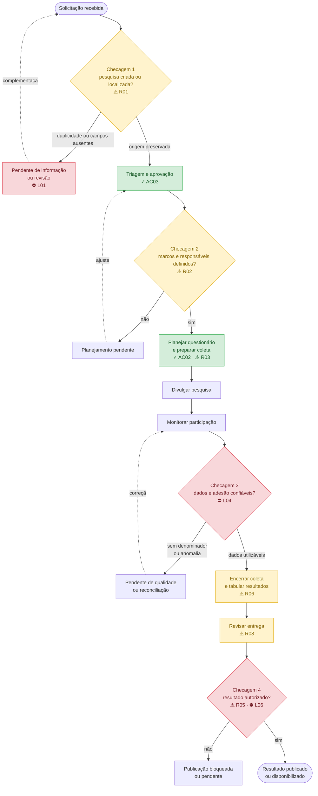

<div align="center">
<sub>Figura 6.7.4 - Fluxo de interação anotado do perfil operacional principal (equipe da Central de Pesquisas)</sub><br>

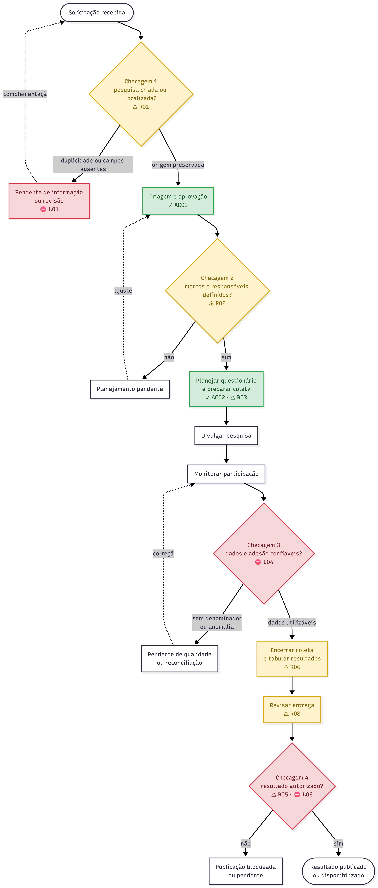

<sup>Material produzido pelos autores (2026)</sup>

</div><br>

**Fluxo secundário — área técnica**

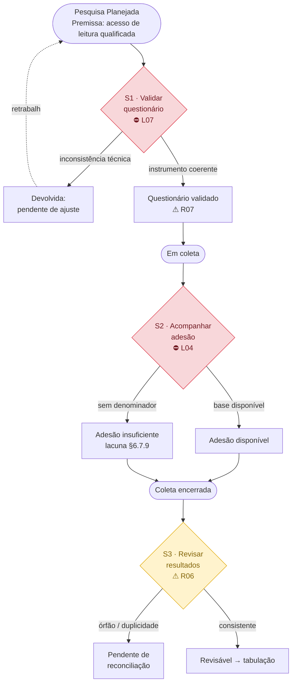

<div align="center">
<sub>Figura 6.7.5 - Fluxo de interação anotado do perfil secundário (área técnica), restrito ao trecho de divergência</sub><br>

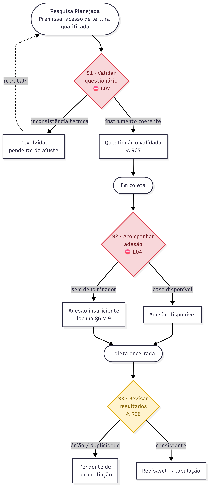

<sup>Material produzido pelos autores (2026)</sup>

</div><br>

Leitura obrigatória para os dois diagramas: cor e sigla juntas indicam a
classificação (§6.7.21); a ausência de marcação em um nó (ex.: `E`, `F`,
`COL`, `AD`) significa que o passo não concentra divergência relevante — ele
segue o fluxo sem atrito registrado nas §6.7.4, §6.7.11 ou §6.7.12.

### 6.7.23 Checklist de entrega do Fluxo de Interação Anotado

Verificação final (tarefa de teste) dos itens de entrega esperados, aplicada
ao conteúdo produzido nas §6.7.1-§6.7.23.

<div align="center">
<sub>Tabela 6.7.26 - Checklist de entrega do Fluxo de Interação Anotado</sub><br>

| Item da checklist | Onde está atendido | Situação |
| :--- | :--- | :--- |
| Os dois fluxos previstos no escopo foram entregues (principal ponta a ponta; secundário no trecho de divergência). | §6.7.3 e §6.7.6 (tabelas e diagramas-base); §6.7.22 (diagramas anotados). | Atendido. |
| O arquivo abre e é legível sem ferramenta proprietária específica. | Diagramas em Mermaid dentro de Markdown e exportados em PNG/PDF na §6.7.22 (`docs/assets/diagramas/fluxo-principal.*` e `fluxo-secundario.*`), abríveis em qualquer visualizador de PDF ou navegador. | Atendido. |
| As premissas assumidas estão marcadas como tais no documento. | §6.7.5 (perfil principal), §6.7.16 (perfil secundário) e convenção "Premissa:" registrada na §6.7.21. | Atendido. |
| Há legenda ou chave de leitura da notação adotada. | §6.7.21. | Atendido. |
| Cada divergência recebeu decisão de acomodação, ruptura deliberada ou lacuna. | §6.7.18 (acomodação e ruptura) e §6.7.20 (lacuna). | Atendido. |
| Ao menos uma divergência envolve perfis distintos com expectativas incompatíveis sobre o mesmo objeto. | §6.7.4 (equipe interna × solicitante) e R01-R05 (§6.7.18), que retomam essas mesmas linhas. | Atendido. |
| Passos sem correspondência no modelo e estados sem passo correspondente estão sinalizados, não silenciados. | §6.7.9 e §6.7.10, consolidados como lacunas nomeadas na §6.7.20. | Atendido. |

<sup>Material produzido pelos autores (2026)</sup>

</div><br>

Todos os itens do checklist estão atendidos. Os diagramas anotados da §6.7.22
foram exportados em PNG e PDF (`docs/assets/diagramas/fluxo-principal.*` e
`fluxo-secundario.*`), incorporados à documentação com legenda e fonte, e são
legíveis em visualizador de PDF e em navegador padrão sem depender de ferramenta
proprietária.


# 7. Referências

<a id="ref-1"></a>[1] INTELI; SINDUSFARMA. **Termo de Abertura de Projeto Inteli (TAPI) — ESMD11: arquitetura e governança de dados alinhada à estratégia corporativa**. São Paulo, 2026. Documento externo `Tapi-sinduspharma.txt`, conferido em 13 ago. 2026; SHA-256 `16ec3cb7efefa8a371aa4ad03ff47a0388b24c24f1e22545994d38ffaed0ba3c`.

<a id="ref-2"></a>[2] INTELI; SINDUSFARMA. [**Arquitetura de Negócio: Central de Pesquisas do Sindusfarma**](arquitetura-de-negocio.md). São Paulo, 2026. Cópia local incorporada à pasta `docs/` para manter a documentação autocontida.

<a id="ref-3"></a>[3] INTELI; SINDUSFARMA. [**Data Model Canvas: Data Warehouse — Sindusfarma**](dmc.json). São Paulo, 2026. Exportação JSON mantida em `docs/dmc.json`.

<a id="ref-4"></a>[4] BRASIL. [**Lei nº 13.709, de 14 de agosto de 2018 (Lei Geral de Proteção de Dados Pessoais)**](https://www.planalto.gov.br/ccivil_03/_ato2015-2018/2018/lei/l13709compilado.htm). Brasília, 2018. Acesso em: 12 ago. 2026.

<a id="ref-5"></a>[5] AUTORIDADE NACIONAL DE PROTEÇÃO DE DADOS (ANPD). [**Guia orientativo para definições dos agentes de tratamento de dados pessoais e do encarregado**](https://www.gov.br/anpd/pt-br/centrais-de-conteudo/materiais-educativos-e-publicacoes/2021.05.27GuiaAgentesdeTratamento_Final.pdf). Versão 2.0. Brasília, 2022. Acesso em: 12 ago. 2026.

<a id="ref-6"></a>[6] AUTORIDADE NACIONAL DE PROTEÇÃO DE DADOS (ANPD). [**Comunicação de Incidente de Segurança**](https://www.gov.br/anpd/pt-br/canais_atendimento/agente-de-tratamento/comunicado-de-incidente-de-seguranca-cis). Orientações com base na Resolução CD/ANPD nº 15, de 24 de abril de 2024. Brasília, 2024. Acesso em: 12 ago. 2026.

<a id="ref-7"></a>[7] AUTORIDADE NACIONAL DE PROTEÇÃO DE DADOS (ANPD). [**Relatório de Impacto à Proteção de Dados Pessoais (RIPD)**](https://www.gov.br/anpd/pt-br/canais_atendimento/agente-de-tratamento/relatorio-de-impacto-a-protecao-de-dados-pessoais-ripd). Brasília, 2023. Acesso em: 12 ago. 2026.

<a id="ref-8"></a>[8] AUTORIDADE NACIONAL DE PROTEÇÃO DE DADOS (ANPD). [**Resolução CD/ANPD nº 19, de 23 de agosto de 2024: Regulamento de Transferência Internacional de Dados e cláusulas-padrão contratuais**](https://www.gov.br/anpd/pt-br/acesso-a-informacao/institucional/atos-normativos/regulamentacoes_anpd/resolucao-cd-anpd-no-19-de-23-de-agosto-de-2024). Brasília, 2024. Acesso em: 12 ago. 2026.

<a id="ref-9"></a>[9] AUTORIDADE NACIONAL DE PROTEÇÃO DE DADOS (ANPD). [**Direito dos Titulares**](https://www.gov.br/anpd/pt-br/assuntos/titular-de-dados-1/direito-dos-titulares). Brasília, 2024. Acesso em: 12 ago. 2026.

<a id="ref-10"></a>[10] CONSELHO NACIONAL DE SAÚDE (CNS). [**Resolução nº 510, de 7 de abril de 2016: normas aplicáveis a pesquisas em Ciências Humanas e Sociais**](https://www.gov.br/conselho-nacional-de-saude/pt-br/atos-normativos/resolucoes/2016/resolucao-no-510.pdf/view). Brasília, 2016. Acesso em: 12 ago. 2026.

<a id="ref-11"></a>[11] CONSELHO NACIONAL DE SAÚDE (CNS). [**Resolução nº 466, de 12 de dezembro de 2012: diretrizes e normas regulamentadoras de pesquisas envolvendo seres humanos**](https://www.gov.br/conselho-nacional-de-saude/pt-br/atos-normativos/resolucoes/2012/resolucao-no-466.pdf/view). Brasília, 2012. Acesso em: 12 ago. 2026.

<a id="ref-12"></a>[12] GRUPO G05. **Dicionário de Variáveis — Respostas**. São Paulo, 2026. Arquivo local `Dicionario_Variaveis_Respostas_Grupo6.xlsx - Dicionário.csv`, disponibilizado junto às bases do parceiro.

<a id="ref-13"></a>[13] GRUPO 5. **JTBD a partir do Data Model Canvas — Central de Pesquisas do Sindusfarma**. São Paulo, 2026. Artefato local de levantamento usado como referência complementar; não substitui TAPI, Arquitetura de Negócio nem evidência observada nos dados.

<a id="ref-14"></a>[14] GRUPO 5. **Problem Canvas — Gestão integrada de pesquisas setoriais**. São Paulo, 2026. Artefato local de levantamento usado como referência complementar; não substitui TAPI, Arquitetura de Negócio nem evidência observada nos dados.

<a id="ref-15"></a>[15] GRUPO 5. [**Relatório de modelagem quantitativa de dados do parceiro e análise reproduzível**](modelagem_quantitativa_de_dados_do_parceiro.md). São Paulo, 2026. Relatório, script e log locais (`docs/modelagem_quantitativa_de_dados_do_parceiro.md`, `scripts/analysis/analise_quantitativa.py`, `docs/resultados_analise.txt`).

# 8. Avaliação dos Resultados

Esta avaliação separa resultados executados nesta Sprint de efeitos esperados
para uma solução futura. As medições abaixo vêm dos scripts e testes
versionados aplicados ao snapshot externo identificado pelos hashes da §5.3.6;
o checkout isolado não contém os CSVs. Benefícios operacionais, metas de serviço
e ganhos de negócio não foram medidos e permanecem condicionados à implantação
e a uma linha de base aprovada.

## 8.1 Resultados Quantitativos

Os resultados medidos demonstram consistência dos artefatos e características
do snapshot analisado. Eles não demonstram redução de prazo, aumento de adesão
ou funcionamento de uma plataforma produtiva.

### 8.1.1 Resultado medido nesta sprint

| Indicador | Resultado medido | Como foi medido |
| :--- | :--- | :--- |
| Volume do snapshot analisado | 46.148 registros em seis CSVs | soma das contagens reproduzidas pelo perfilador da §5.3 |
| Duplicidade de linha e das chaves declaradas | 0 ocorrência nas seis bases | `scripts/data_quality/profile_csv.py` e manifesto versionado |
| Relações pesquisa ausentes | 55 participações, 43 questões e 3.592 elementos de resposta órfãos | relatório `relacionamentos.csv` descrito na §5.3 |
| Modelo dimensional exportado | 4 cubos com Modelo Dimensional, Dados e Governança preenchidos | `scripts/dmc/validate_dmc.py docs/dmc.json` |
| Testes estruturais do DMC | 17 testes aprovados | `python3 -m unittest discover -s scripts/dmc -p 'test_*.py'` |
| Testes do perfilamento | 5 testes aprovados | `python3 -m unittest discover -s scripts/data_quality -p 'test_*.py'` |
| Testes de rastreabilidade | 13 testes aprovados, incluindo 2 fontes primárias e 12 afirmações conferidas | `SINDUSFARMA_SOURCE_DIR=/caminho/seguro/das/fontes python3 -m unittest discover -s scripts/traceability -p 'test_*.py'` |
| Reabertura na ferramenta oficial | 4 cards renderizados, sem erro de aplicação ou resposta HTTP falha | importação e reexportação em sessão nova, com comparação semântica do JSON |

### 8.1.2 Meta / projetado para sprints futuras

| Indicador (projetado) | Meta | Por que não foi medido nesta sprint |
| :--- | :--- | :--- |
| Redução do tempo de ciclo | A definir após baseline operacional aprovado | a Sprint mediu datas do snapshot, não esforço nem processo antes/depois |
| Aumento de adesão | A definir após receber o universo elegível por pesquisa | o denominador de convidados não está nas fontes |
| Frescor e disponibilidade | A definir junto da arquitetura produtiva | não há carga automática, timestamp de extração ou SLA aprovado |
| Cobertura de publicação autorizada | A definir após política e integração com o acervo | decisão, versão e data de publicação não existem no snapshot |
| Conformidade de acesso | A definir após aprovação de perfis e instrumentação | política final e logs de autorização ainda não estão integrados |

## 8.2 Diagnóstico Qualitativo

O trabalho torna reproduzíveis o diagnóstico de qualidade, a validação
estrutural do canvas e a distinção entre métrica disponível e dependência
futura. O modelo cobre portfólio e ciclo, participação, pipeline mensal e
resultados/questionários, com Dados e Governança preenchidos como proposta
técnica sujeita a homologação.

As principais lacunas analíticas passam a ser a ausência de metadados de versão,
validação e publicação, além da falta de ponte observada entre participação e
resposta individual. O C04 cobre o instrumento de pesquisa por questões, mas
não afirma uma `FATO_RESPOSTA` conciliada nem substitui regras futuras de
autorização, catálogo, frescor e acesso. O TAPI [<sup>[1]</sup>](#ref-1) e a Arquitetura [<sup>[2]</sup>](#ref-2) foram
conferidos pelos hashes registrados no mapa de fontes; conteúdos derivados de
DMC, dicionário, JTBD e Problem Canvas são tratados como referência documental
ou proposta, não como confirmação primária isolada. Esses pontos são fronteiras
de evidência, não resultados omitidos nem capacidade presumida.

<!-- QUANTI:UT-04:START -->
### 8.2.1 Cuidados matemáticos antes de automatizar os indicadores

0. **Declarar granularidade e denominador.** A adesão medida por pesquisa sobre associados resulta em 8,8%; medida como alcance acumulado do cadastro resulta em 53,8%. São leituras diferentes dos mesmos dados e não devem ser apresentadas como o mesmo indicador.

0. **Nunca contar linhas como entidades.** `respostas.csv` tem 20.607 linhas e 542 respondentes distintos, ou 38,0 linhas por respondente. O erro é proporcional à quantidade de perguntas de matriz: pesquisas com instrumentos mais complexos podem parecer ter mais respondentes quando se contam elementos de resposta.

0. **Aplicar completude por tipo de informação.** `linha_matriz` vazio em pergunta aberta pode ser correto, enquanto `prorrogada_ate` vazio significa “não prorrogada”. Uma regra uniforme de preenchimento confundiria ausência esperada com falha de qualidade.

0. **Excluir períodos incompletos e registros futuros.** Há 12 pesquisas com divulgação posterior a 14/08/2026 e `data_limite` chegando a 18/09/2027. Séries de desempenho devem aplicar uma data de referência antes de comparar períodos.

0. **Reportar dispersão junto com posição.** O coeficiente de variação é 58% no ciclo de entrega e 190% em `dias úteis aberta`; médias isoladas escondem a heterogeneidade do processo.

0. **Preferir mediana em distribuições concentradas.** Participações por empresa têm mediana 6, terceiro quartil 58, máximo 266 e média 44,7. A média não descreve uma empresa típica nesse recorte.

0. **Não tratar identificadores como números.** `respondent_id` tem 12 dígitos e é um identificador externo; o código de dia da semana é ordinal e cíclico. Operações aritméticas sobre esses campos não representam medidas de negócio.

0. **Usar redundâncias internas como testes automatizados.** `participantes` coincide com a contagem observada em 290 de 326 pesquisas (89,0%); o dia da semana coincide em 100% dos registros datados; e `dias_uteis_para_entrega` correlaciona 0,996 com o cálculo derivado das datas.

0. **Não substituir uma variável por outra parecida.** `tempo_preenchimento` é um valor declarado, enquanto a duração derivada de `hora_inicio` e `hora_termino` mede intervalo entre acessos. As duas variáveis não devem ser comparadas como se tivessem a mesma definição.

As regras devem permanecer alinhadas ao grão de `respostas` e às distinções entre linha, respondente e entidade descritas nas §§5.2 e 5.3.
<!-- QUANTI:UT-04:END -->

## 8.3 Tabela de Fontes e Auditabilidade

O mapa completo de origem e dependências está em
[`docs/fontes-e-dependencias.md`](fontes-e-dependencias.md). A tabela abaixo
mantém no documento canônico a distinção necessária entre fonte primária,
evidência observada e decisão proposta.

| Bloco | Origem auditável | Classificação e estado |
| :--- | :--- | :--- |
| Contexto, escopo, processo e papéis | TAPI [<sup>[1]</sup>](#ref-1) e Arquitetura de Negócio [<sup>[2]</sup>](#ref-2), identificados por SHA-256 em `docs/fontes-e-dependencias.md`; referências complementares [<sup>[13]</sup>](#ref-13) e [<sup>[14]</sup>](#ref-14) | TAPI e Arquitetura conferidos diretamente; referências complementares não substituem fonte primária |
| Estrutura, grão e qualidade das bases | seis CSVs externos identificados pelos hashes da §5.3.6; manifesto, perfilador e testes em `scripts/data_quality/` | Evidência observada no snapshot local; o método é reproduzível quando as fontes e o dicionário estão disponíveis, mas os dados brutos não fazem parte do checkout |
| Perguntas, requisitos, indicadores e dashboards | PB01–PB13, RF01–RF13 e I01–I25 deste documento; matrizes e validadores versionados em `scripts/` | Síntese derivada; as limitações constam nas §§5.6 e 6.4 |
| Cadeia analítica executável | `scripts/traceability/manifest.json`, validador e testes; IDs e nomes conferidos contra `docs/dmc.json` | 13 perguntas, 13 requisitos, 25 indicadores e 4 dashboards cobertos; I12, I13 e I15 mantidos como extensões futuras de resposta conciliada e metadados |
| Negócio, Consumo Analítico e Governança Corporativa do canvas | Data Model Canvas [<sup>[3]</sup>](#ref-3) e exportação `docs/dmc.json` | Baseline documental derivado; papéis e políticas continuam sujeitos a validação |
| Cubos C01–C04 | contratos da §5.2, derivados das perguntas, indicadores e dados observados | Proposta de modelagem; não prova implantação de data warehouse |
| Distribuição temporal, linha de base dos indicadores e cuidados matemáticos | `scripts/analysis/analise_quantitativa.py` aplicado aos seis CSVs externos; hashes registrados em `docs/resultados_analise.txt` | Evidência observada no snapshot local, reproduzível quando as fontes externas estão disponíveis; dados brutos não fazem parte do checkout |

A auditoria transversal aplicou o teste “qual é a fonte?” aos grupos de
afirmações exigidos nesta Sprint:

| Afirmação auditada | Origem seguida até a fonte | Tipo | Resultado |
| :--- | :--- | :--- | :--- |
| Identidade do parceiro e propósito do projeto | TAPI [<sup>[1]</sup>](#ref-1) e Arquitetura [<sup>[2]</sup>](#ref-2), com Arquitetura preservada em cópia local | fonte primária | **OK:** parceiro, propósito, escopo macro, MVP e públicos confirmados documentalmente |
| Fragmentação, cruzamentos manuais e processo AS-IS | TAPI [<sup>[1]</sup>](#ref-1) e Arquitetura [<sup>[2]</sup>](#ref-2) | fonte primária | **OK:** ausência de integração, dashboard manual, silo e cruzamentos em planilhas confirmados; magnitude de esforço continua sem medição |
| Seis fontes, estrutura, contagens, chaves, nulos e relações órfãs | CSVs externos identificados pelos hashes da §5.3.6 e `scripts/data_quality/` | observado nos dados e no código | **OK:** reproduzível sem publicar os registros |
| Natureza real ou sintética dos CSVs | nenhuma declaração primária disponível | pendente | **Correção aplicada:** removida a afirmação de que as linhas são fictícias; o uso continua restrito a agregados |
| Data Owner, Data Steward e Data Custodian | Arquitetura [<sup>[2]</sup>](#ref-2), baseline do DMC [<sup>[3]</sup>](#ref-3) e `docs/dmc.json` | referência documental | **OK com limitação:** nomes e responsabilidades constam na Arquitetura; designações jurídicas e política final não são inferidas |
| Riscos de qualidade, exposição e reidentificação | campos, chaves, e-mail e texto livre observados; §6.6 | observado + avaliação de risco | **OK:** nenhuma autorização de publicação é inferida |
| RF01–RF13 e PB01–PB13 | TAPI [<sup>[1]</sup>](#ref-1), Arquitetura [<sup>[2]</sup>](#ref-2), estrutura observada e síntese do grupo | contrato proposto sustentado por fonte | **OK com limitação:** contratos são da equipe; campos e dependências observáveis são citados diretamente |
| I01–I25 | CSVs, perfilamento e dependências declaradas nas §§5.6 e 6.4 | observado, mapeamento ou integração futura | **OK:** cada indicador explicita disponibilidade e denominador; indisponível nunca vira zero |
| Atualização automática, acesso e publicação | ausência de timestamp, política, logs e decisão no snapshot | proposta futura | **Correção aplicada:** removidas afirmações de capacidade atual ou tempo real |
| Quatro cards dimensionais do DMC | §5.2 e `docs/dmc.json` | observado no artefato | **OK:** Modelo Dimensional, Dados e Governança preenchidos; C03 é Pipeline Mensal e C04 é Resultados e Questionários |

Nenhuma referência complementar deve ser usada, isoladamente, para classificar
uma afirmação como confirmada pelo parceiro. TAPI e Arquitetura só sustentam os
trechos que afirmam explicitamente; conteúdo exclusivo do DMC, dicionário, JTBD
ou Problem Canvas permanece tratado como referência documental, evidência
observada nos dados ou proposta, conforme indicado nas tabelas.
