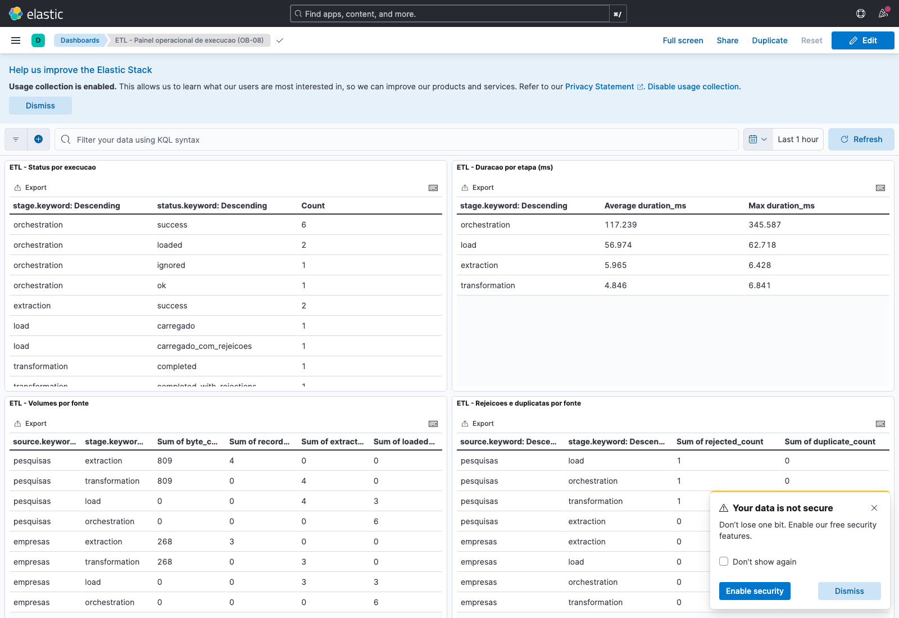
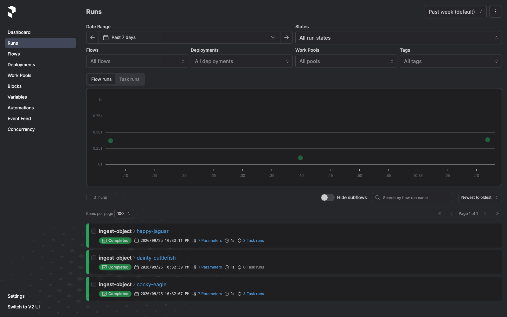
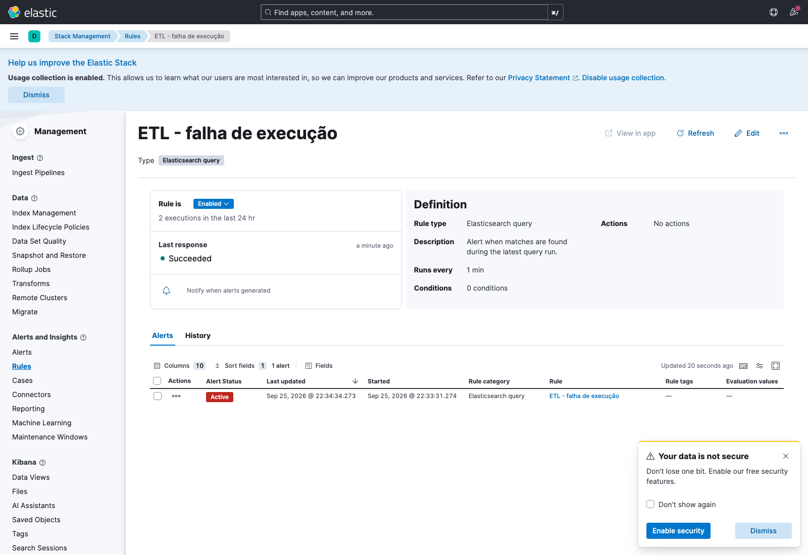

# Smoke de observabilidade — Sprint 4 (OB-11)

Execução real do roteiro [`smoke_observabilidade.sh`](../scripts/orchestration/smoke_observabilidade.sh)
em 25/09/2026, sobre a stack completa do `docker-compose.yml` (MinIO, Prefect
server e scheduler, runner, Elasticsearch, Logstash e Kibana 8.15.0), subida
do zero com `docker compose up -d --build`. O procedimento está no
[runbook](runbook-execucao.md#smoke-de-observabilidade-ob-11).

## Preparação

| Passo | Resultado |
| :--- | :--- |
| Saúde dos serviços | `minio`, `prefect-server`, `elasticsearch` e `kibana` saudáveis; `_cluster/health` = `yellow` (nó único) |
| Importação do painel (`observability/kibana/painel-operacional.ndjson`) | `success: true`, 7 objetos salvos |
| Regras de alerta (especificação do runbook) | "ETL - falha de execução" e "ETL - fila parada" criadas como Elasticsearch query sobre `etl-logs-*` |

## Cenário A — execução concluída

| Verificação | Resultado observado |
| :--- | :--- |
| `health_check.py` | `status geral: ok` · `prefect_api: http://prefect-server:4200/api/health respondeu HTTP 200` · `duckdb: DuckDB v1.5.5 em /data/warehouse.duckdb` |
| `run_ingest.py --source empresas` | `status: loaded`; lote `empresas-000001` com extraído 3, carregado 3, rejeitado 0, duplicado 0, `balanced: True` |
| `run_ingest.py --source pesquisas` | `status: loaded`; lote `pesquisas-000001` com extraído 4, carregado 3, rejeitado 1, duplicado 0, `balanced: True` |
| Reenvio de `empresas` | `status: ignored` (idempotência por SHA-256) |
| Eventos no Elasticsearch | `extraction.batch.emitted`, `transformation.batch.emitted`, `load.batch.emitted`, `orchestration.extract/transform/load/ingest_object.emitted` e `orchestration.health_check.emitted`, todos com `run_id`, `task_id` (UUID do `task_run` do Prefect) e `batch_id` |
| JSON inválido no índice | 0 documentos com `_jsonparsefailure` |
| Histórico no Prefect | flow runs `COMPLETED` para `empresas` e `pesquisas`; deployment `agendado` com cron `0 3 * * *` |

Exemplo de evento de carga indexado:

```text
{'source': 'empresas', 'status': 'carregado', 'run_id': 'e601a8842f8ddc75',
 'task_id': '01a0db57-501b-787a-a1c4-a3097430f0fb', 'batch_id': 'empresas-000001',
 'duration_ms': 51.23, 'loaded_count': 3, 'rejected_count': 0, 'duplicate_count': 0}
```



O painel mostra status por etapa, duração média e máxima por etapa (extração
≈ 6 ms, transformação ≈ 5 ms, carga ≈ 57 ms por lote), volumes por fonte
(bytes, registros extraídos e carregados) e rejeições por fonte e etapa.



## Cenário B — falha controlada e alerta

| Verificação | Resultado observado |
| :--- | :--- |
| `docker compose stop minio` + `run_ingest.py --source pesquisas` | Falha com `MaxRetryError`/`NameResolutionError` para `minio:9000`; processo termina com código 1 |
| Coleta da falha | 12 documentos com `tags: etl_error` em `etl-logs-*` |
| Alerta "ETL - falha de execução" | Estado **Active**, iniciado 25/09/2026 22:33:31 (BRT) |
| Alerta "ETL - fila parada" | `ok` (há eventos de orquestração nas últimas 26 h) |
| Recuperação | `docker compose start minio` e reexecução: `status: loaded`, reconciliação balanceada |



## Limites desta evidência

- A falha controlada ocorre no cálculo do checksum, antes da task de extração;
  por isso não gera `extraction.retry.emitted`. A repetição com limite é
  provada pelos testes automatizados (`tests/extraction/test_resilience.py`,
  `tests/orchestration/test_retry_reexecucao.py`).
- Ambiente local sem autenticação na Elastic Stack e sem canal de notificação:
  o alerta é visível em **Kibana → Alerts**, sem envio externo.
