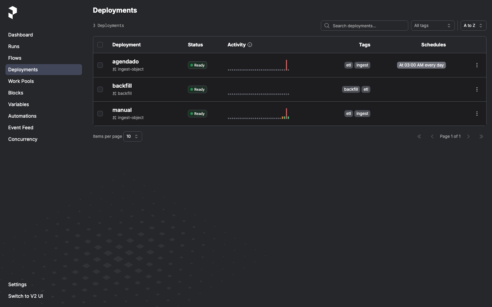
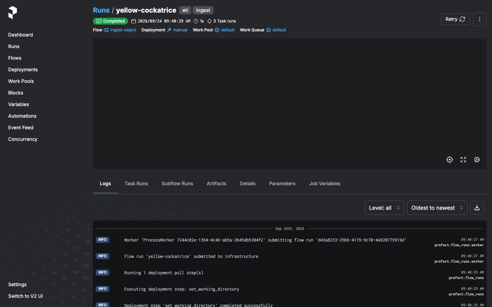
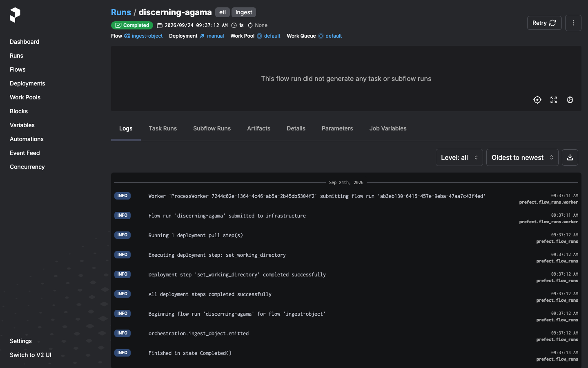
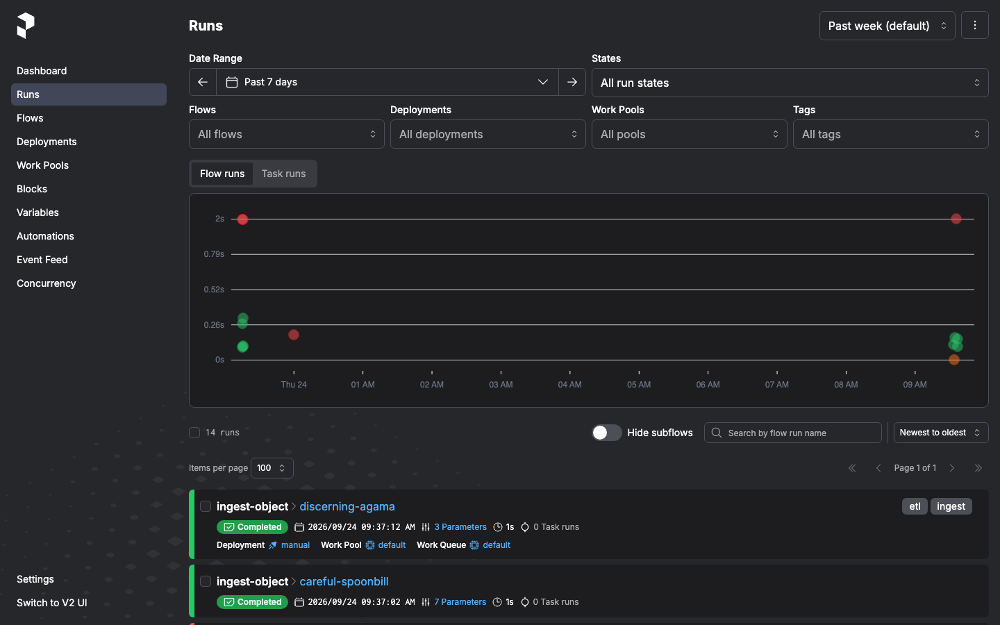

# Smoke da orquestração servida — execução, falha e reinício pela interface

Registro da execução de fluxos pela interface do Prefect Server local, com
falha controlada e reinício bem-sucedido. Requer os MRs de orquestração
integrados (servidor, deployments publicados e `scheduler` no ar); a ordem
de merge está descrita em cada MR. Comandos executados contra o ambiente
declarado em `docker-compose.yml`. Capturas da UI em
`docs/assets/smoke-sprint4/`.

## 1. Servidor, UI e deployments publicados

```bash
docker compose up -d --build
curl http://localhost:4200/api/health
# true
export PREFECT_API_URL=http://localhost:4200/api
prefect work-pool create default --type process   # idempotente
prefect deploy --all
prefect deployment ls
# ingest-object/agendado   (cron `0 3 * * *`, servido pelo `scheduler`)
# ingest-object/manual     (work pool `default`, `prefect.yaml`)
# backfill/backfill        (work pool `default`, `prefect.yaml`)
```



A UI lista os flows, os deployments `Ready` com schedule ("At 03:00 AM
every day" no `agendado`) e conserva o histórico após o término. ID
estável entre restarts (`prefect deployment inspect <nome> | grep id`; os
publicados via CLI mudam a cada `deploy --all`):

- `ingest-object/agendado`: `9d842229-404b-4f78-86f9-b8896034e7ab`

## 2. Execução pela interface (sucesso)

Com um worker servindo o pool (`docker compose exec -d runner prefect
worker start --pool default`), um run disparado pelo deployment executa de
verdade no contêiner. Objeto novo publicado sem ingestão prévia:

```bash
docker compose exec runner python -c "
import os
from urllib.parse import urlsplit
from minio import Minio
p = urlsplit(os.environ['ETL_MINIO_ENDPOINT'])
c = Minio(p.netloc or p.path, access_key=os.environ['ETL_MINIO_ACCESS_KEY'],
          secret_key=os.environ['ETL_MINIO_SECRET_KEY'], secure=False)
c.fput_object(os.environ['ETL_MINIO_BUCKET'], 'landing/ui-novo.csv', '/tmp/ui4.csv')
"
prefect deployment run 'ingest-object/manual' -p key=landing/ui-novo.csv
# URL: http://localhost:4200/runs/flow-run/d43a8233-25b6-4179-9c70-4a920779919d
# yellow-cockatrice | Completed
```

As tasks aparecem separadas no run (`extract`, `transform`, `load`,
todas `Completed`):



Reenvio do mesmo objeto: `status: ignored` (mesmo checksum SHA-256), sem
nova carga e sem duplicar.

## 3. Falha controlada

Run pelo deployment com objeto inexistente — falha permanente, sem retry
(`NoSuchKey` falha rápido por regra em `_should_retry`):

```bash
prefect deployment run 'ingest-object/manual' -p key=landing/inexistente.csv
# fast-bird | Failed (S3Error: NoSuchKey ... landing/inexistente.csv)
```

## 4. Reinício bem-sucedido (reexecução parametrizada)

Reexecução pelo deployment de um objeto já carregado — conclui sem
duplicar nenhuma linha confirmada:

```bash
prefect deployment run 'ingest-object/manual' -p key=landing/ui-recuperado.csv
# discerning-agama | Completed, status ignored (mesmo checksum, zero carga nova)
```

A prova de carga nova pelo mesmo caminho está no `yellow-cockatrice`
(§2): lote `c0187b25` com 1 registro extraído, 1 aceito, 0 rejeitados e 0
duplicados (`_batch_metadata`); o lote `97d9d693` mostra o outro lado da
moeda — 4 extraídos, 1 aceito e 3 duplicados contidos, sem duplicar o já
confirmado.



O detalhe do run mostra logs, parâmetros e o botão `Retry` para reiniciar
pela interface.

## 5. Histórico na interface



| Run | State | Deployment | Parâmetros |
| :--- | :--- | :--- | :--- |
| `yellow-cockatrice` | Completed | `manual` | `key=landing/ui-novo.csv`, 3 task runs, lote 1/1/0/0 |
| `discerning-agama` | Completed | `manual` | `key=landing/ui-recuperado.csv`, `ignored`, zero duplicação |
| `ordinary-dragon` | Completed | `manual` | `key=landing/ui-manual.csv` |
| `fast-bird` | Failed | `manual` | `key=landing/inexistente.csv` (NoSuchKey) |
| `zealous-marten`, … | Scheduled | `agendado` | `key=landing/empresas.csv` |

## 6. Agendamento sobrevive ao reinício

```bash
docker compose restart scheduler
docker compose exec runner prefect deployment ls
# ingest-object/agendado   (id 9d842229-404b-4f78-86f9-b8896034e7ab, inalterado)
# runs Scheduled preservados, com os parâmetros de cada execução
```

Agendamentos e histórico vivem no `prefect-server` (volume
`prefect-data`), não no processo que serve o deployment — derrubar e subir
o ambiente preserva ambos.
