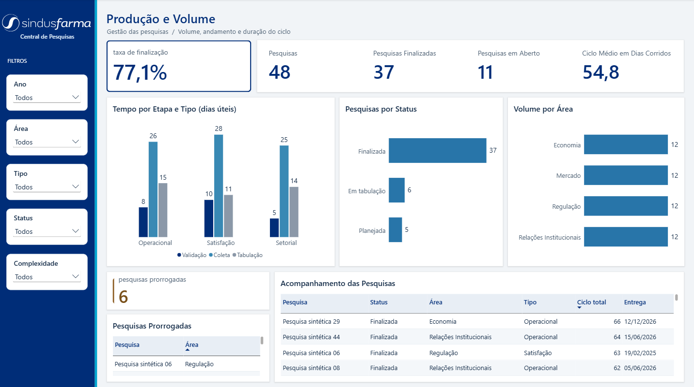
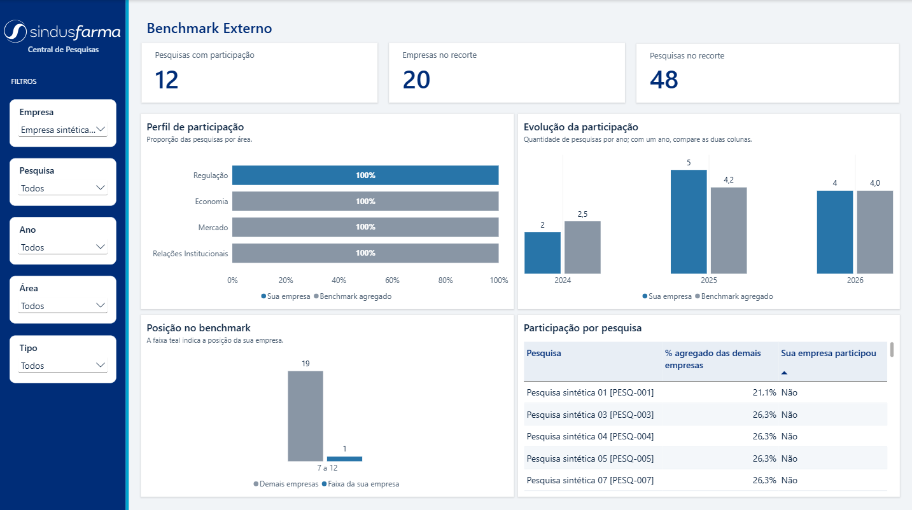

# Dashboard da Central de Pesquisas

## Visão geral

O dashboard organiza a leitura da operação da Central de Pesquisas em duas
perspectivas complementares:

- acompanhamento do volume e do ciclo das pesquisas;
- comparação da participação observada de uma empresa com o benchmark do
  recorte;

A estrutura das telas foi definida a partir dos relatórios e rascunhos
fornecidos pelo parceiro, preservando a finalidade de cada painel e adaptando
os visuais aos indicadores e dimensões disponíveis no modelo analítico.

## Produção e Volume

### Objetivo

Apresentar uma visão operacional do portfólio de pesquisas, permitindo
acompanhar volume, situação do ciclo, duração das etapas e prorrogações.

### Filtros

| Filtro | Uso |
| :--- | :--- |
| Ano | Define o período analisado. |
| Área | Restringe o portfólio à área selecionada. |
| Tipo | Restringe o portfólio ao tipo de pesquisa selecionado. |
| Status | Permite analisar as pesquisas por situação no ciclo. |
| Complexidade | Permite comparar o portfólio por nível de complexidade. |

### Indicadores e visuais

| Visual | Informação apresentada |
| :--- | :--- |
| Taxa de finalização | Percentual de pesquisas finalizadas no recorte. |
| Pesquisas | Quantidade total de pesquisas. |
| Pesquisas finalizadas | Quantidade de pesquisas finalizadas. |
| Pesquisas em aberto | Quantidade de pesquisas ainda abertas. |
| Ciclo médio em dias corridos | Duração média do ciclo completo. |
| Tempo por etapa e tipo | Duração das etapas de validação, coleta e tabulação por tipo, apresentada em dias úteis. |
| Pesquisas por status | Distribuição do portfólio por situação. |
| Volume por área | Distribuição das pesquisas por área. |
| Pesquisas prorrogadas | Quantidade e relação das pesquisas com prorrogação. |
| Acompanhamento das pesquisas | Pesquisa, status, área, tipo, ciclo total e entrega. |

### Base analítica

A tela utiliza principalmente o cubo C01 — Portfólio e Ciclo. Os principais
recortes são status, área, tipo, complexidade e tempo, com `data_solicitacao`
como marco temporal padrão quando aplicável.

## Benchmark Externo

### Objetivo

Permitir que uma empresa compare sua participação observada com as demais
empresas do recorte selecionado.

O termo **participação observada** é utilizado porque o painel não representa
adesão, desempenho ou participação de mercado homologada.

### Filtros

| Filtro | Uso |
| :--- | :--- |
| Empresa | Seleciona a empresa analisada. |
| Pesquisa | Restringe o conjunto de pesquisas. |
| Ano | Define o período da comparação. |
| Área | Restringe a comparação à área selecionada. |
| Tipo | Restringe a comparação ao tipo de pesquisa selecionado. |

### Indicadores e visuais

| Visual | Informação apresentada |
| :--- | :--- |
| Pesquisas com participação | Quantidade de pesquisas com participação observada. |
| Empresas no recorte | Quantidade de empresas observadas. |
| Pesquisas no recorte | Quantidade de pesquisas consideradas na comparação. |
| Perfil de participação | Participação da empresa em comparação com o benchmark por área. |
| Evolução da participação | Comparação anual entre a empresa selecionada e o benchmark. |
| Posição no benchmark | Distribuição das empresas por faixa de participação. |
| Participação por pesquisa | Pesquisas, percentual agregado das demais empresas e participação da empresa selecionada. |

### Base analítica

A tela utiliza principalmente o cubo C02 — Participação e Representatividade,
com apoio das dimensões de pesquisa e tempo. O campo de participação de
mercado permanece sujeito à homologação da fonte oficial e não é tratado como
medida definitiva enquanto essa validação não existir.
