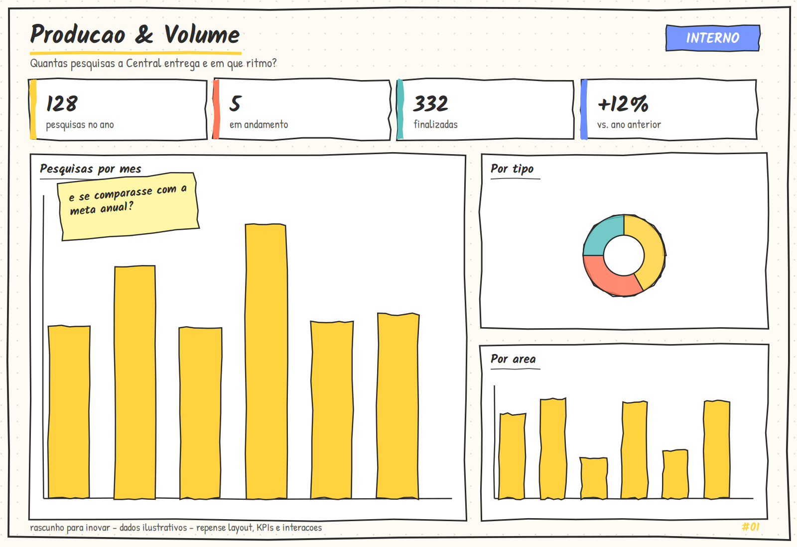
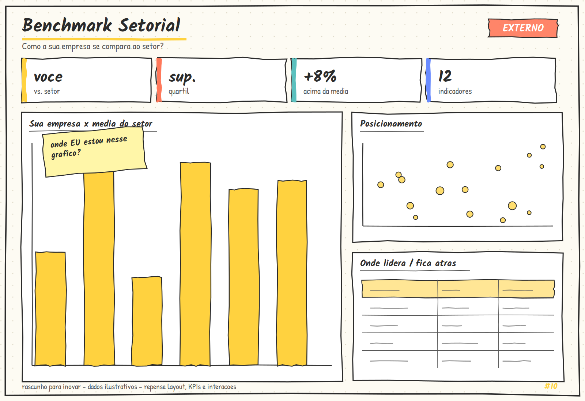

# Levantamento inicial dos dashboards

Este documento registra a proposta de estruturação dos dashboards antes da
etapa de construção dos reports.

Os rascunhos fornecidos pelo parceiro foram utilizados como ponto de partida
para compreender a finalidade, a narrativa e os principais elementos de cada
tela. A estrutura abaixo foi então organizada com base nas informações
disponíveis no projeto e no que fazia sentido para responder às perguntas de
negócio de cada painel. Assim, o resultado não pretende reproduzir o rascunho
literalmente: ele preserva sua intenção e adapta a composição dos visuais,
indicadores e filtros ao contexto analítico disponível.

O levantamento e o mapa se limitam à definição das telas, dos visuais, das
medidas de negócio que cada visual deverá consumir, das dimensões, dos filtros
e dos cubos de origem. As fórmulas detalhadas das medidas, as regras físicas
do modelo e as validações serão registradas em documentos próprios.

## 1. Relatório 01 — Produção & Volume

**Objetivo:** oferecer uma visão operacional do volume de pesquisas, da situação
do portfólio, do tempo de ciclo e das pesquisas prorrogadas.

### 1.1 Filtros da tela

| Filtro | Finalidade |
| :--- | :--- |
| Ano | Definir o período de análise das pesquisas. |
| Área | Restringir o portfólio à área selecionada. |
| Tipo | Restringir o portfólio ao tipo de pesquisa selecionado. |
| Status | Analisar pesquisas em diferentes situações do ciclo. |
| Complexidade | Comparar o portfólio por nível de complexidade. |

Os filtros deverão atuar sobre os visuais da tela, preservando o mesmo recorte
de análise. O período deverá ser identificado de acordo com o marco temporal
utilizado, sem misturar datas de solicitação, divulgação ou entrega.

### 1.2 Visuais e indicadores previstos

| Visual | Tipo | Indicador ou informação apresentada |
| :--- | :--- | :--- |
| Taxa de finalização | Cartão | Percentual de pesquisas finalizadas no recorte. |
| Pesquisas | Cartão | Quantidade de pesquisas no recorte selecionado. |
| Pesquisas finalizadas | Cartão | Quantidade de pesquisas com status finalizado. |
| Pesquisas em aberto | Cartão | Quantidade de pesquisas ainda abertas. |
| Ciclo médio em dias corridos | Cartão | Média do tempo total do ciclo, identificada em dias corridos. |
| Tempo por etapa e tipo | Colunas agrupadas | Duração das etapas de validação, coleta e tabulação, distribuída por tipo de pesquisa. |
| Pesquisas por status | Barras horizontais | Quantidade de pesquisas em cada status. |
| Volume por área | Barras horizontais | Quantidade de pesquisas por área. |
| Pesquisas prorrogadas | Cartão | Quantidade de pesquisas que possuem prorrogação. |
| Pesquisas prorrogadas | Tabela | Relação das pesquisas prorrogadas, com pesquisa e área. |
| Acompanhamento das pesquisas | Tabela | Pesquisa, status, área, tipo, ciclo total, entrega e indicação de prorrogação. |

O rascunho sugeria uma leitura de volume por mês e uma distribuição por tipo.
Na proposta estruturada, a leitura operacional será organizada principalmente
por status, etapa/tipo e área, pois esses recortes respondem de forma mais
direta ao acompanhamento do portfólio disponível. A comparação com meta anual
ou com o ano anterior não será tratada como medida adicional sem regra e fonte
definidas.

## 2. Relatório 10 — Benchmark Externo

**Objetivo:** permitir a comparação da participação observada de uma empresa
com o benchmark formado pelas demais empresas do recorte.

O termo “participação observada” será utilizado para evitar que o painel seja
interpretado como medida de adesão, desempenho ou participação de mercado
homologada.

### 2.1 Filtros da tela

| Filtro | Finalidade |
| :--- | :--- |
| Empresa | Selecionar a empresa analisada. |
| Pesquisa | Restringir o conjunto de pesquisas do benchmark. |
| Ano | Definir o período da comparação. |
| Área | Analisar a participação dentro de uma área. |
| Tipo | Restringir a comparação ao tipo de pesquisa selecionado. |

### 2.2 Visuais e indicadores previstos

| Visual | Tipo | Indicador ou informação apresentada |
| :--- | :--- | :--- |
| Pesquisas com participação | Cartão | Quantidade de pesquisas nas quais houve participação observada. |
| Empresas no recorte | Cartão | Quantidade de empresas observadas no recorte. |
| Pesquisas no recorte | Cartão | Quantidade de pesquisas consideradas no benchmark. |
| Perfil de participação | Barras horizontais | Proporção de participação da empresa selecionada em comparação com o benchmark agregado, por área. |
| Evolução da participação | Colunas agrupadas | Quantidade de pesquisas por ano, comparando a empresa selecionada com o benchmark agregado. |
| Posição no benchmark | Distribuição por faixas | Distribuição das empresas por faixa de participação, destacando a faixa da empresa selecionada. |
| Participação por pesquisa | Tabela | Pesquisa, percentual agregado das demais empresas e indicação se a empresa selecionada participou. |

O rascunho sugeria cartões de quartil, diferença para a média, quantidade de
indicadores e uma tabela de liderança. Esses elementos orientam a intenção de
comparação, mas a estrutura proposta prioriza os indicadores e recortes que
podem ser explicados diretamente pela participação observada disponível. Não
serão criadas métricas de quartil, média ou liderança sem regra estatística,
denominador e fonte definidos.

## 3. Escopo do levantamento

O levantamento contempla somente:

- as duas telas apresentadas nos rascunhos do parceiro;
- os visuais necessários para responder aos objetivos de cada painel;
- os indicadores que deverão ser acompanhados em cada visual;
- os filtros de recorte de cada tela;
- a adaptação do rascunho às informações disponíveis no projeto.

Ficam para etapas posteriores a implementação dos reports, a configuração do
modelo semântico, a validação dos valores, os testes de navegação e a avaliação
de usabilidade.

## 4. Mapa de visualizações, medidas, dimensões e cubos

Esta seção detalha como os visuais levantados serão organizados no modelo
analítico. As medidas são referenciadas pelo significado de negócio e pelos
indicadores do DMC. A definição de numerador, denominador, grão, nulos e
duplicatas não é repetida aqui.

### 4.1 Filtros compartilhados do Relatório 01

| Filtro | Dimensão | Efeito esperado |
| :--- | :--- | :--- |
| Ano | DIM_TEMPO | Filtra o período do portfólio; o papel temporal deverá ser rotulado. |
| Área | DIM_AREA | Restringe as pesquisas à área selecionada. |
| Tipo | DIM_TIPO_PESQUISA | Restringe as pesquisas ao tipo selecionado. |
| Status | DIM_STATUS_PESQUISA | Restringe ou segmenta as pesquisas pela situação do ciclo. |
| Complexidade | DIM_PERFIL_PESQUISA | Restringe as pesquisas pelo nível de complexidade. |

O papel temporal padrão deverá ser `data_solicitacao`. Caso outro marco seja
utilizado, o campo deverá ser identificado no próprio visual.

### 4.2 Filtros compartilhados do Relatório 10

| Filtro | Dimensão | Efeito esperado |
| :--- | :--- | :--- |
| Empresa | DIM_EMPRESA | Define a empresa selecionada para comparação. |
| Pesquisa | DIM_PESQUISA | Restringe o conjunto de pesquisas do benchmark. |
| Ano | DIM_TEMPO | Restringe o período da participação observada. |
| Área | DIM_AREA, por DIM_PESQUISA | Recalcula os agrupamentos para a área selecionada. |
| Tipo | DIM_TIPO_PESQUISA, por DIM_PESQUISA | Recalcula os agrupamentos para o tipo selecionado. |

O benchmark deverá ser rotulado como participação observada. O filtro não
deverá transformar esse indicador em adesão, desempenho ou participação de
mercado homologada.

### 4.3 Mapa do Relatório 01 — Produção & Volume

**Cubo de origem predominante:** C01 — Portfólio e Ciclo.

| Visual | Medida do modelo | Dimensões de corte | Filtros do visual | Cubo |
| :--- | :--- | :--- | :--- | :--- |
| Taxa de finalização | Taxa baseada em pesquisas finalizadas e pesquisas do recorte (I02) | Status | Filtros compartilhados; status finalizada no numerador | C01 |
| Pesquisas | Quantidade de pesquisas no portfólio (I01) | Pesquisa, tempo, área, tipo, status, complexidade | Filtros compartilhados | C01 |
| Pesquisas finalizadas | Quantidade de pesquisas com status finalizado (I01) | Status | Filtros compartilhados; status finalizada | C01 |
| Pesquisas em aberto | Quantidade de pesquisas em status aberto (I01) | Status | Filtros compartilhados; estados abertos | C01 |
| Ciclo médio em dias corridos | Média do tempo total do ciclo (I04) | Papéis de DIM_TEMPO; pesquisa | Filtros compartilhados; pares de datas válidos | C01 |
| Tempo por etapa e tipo | Médias de validação, coleta e tabulação em dias corridos (I04) | Tipo; etapa do ciclo | Filtros compartilhados | C01 |
| Pesquisas por status | Quantidade de pesquisas no portfólio (I01) | Status | Filtros compartilhados; eixo por status | C01 |
| Volume por área | Quantidade de pesquisas no portfólio (I01) | Área | Filtros compartilhados; eixo por área | C01 |
| Pesquisas prorrogadas — cartão | Quantidade de pesquisas prorrogadas (I05) | Pesquisa; `flag_prorrogada` | Filtros compartilhados; `flag_prorrogada = verdadeiro` | C01 |
| Pesquisas prorrogadas — tabela | Quantidade e atributos das pesquisas prorrogadas | Pesquisa, área, status | Filtros compartilhados; `flag_prorrogada = verdadeiro` | C01 |
| Acompanhamento das pesquisas — tabela | Quantidade e atributos do ciclo; duração, entrega e prorrogação (I01, I04, I05) | Pesquisa, status, área, tipo | Filtros compartilhados; ordenação por ciclo total quando necessário | C01 |

As durações deverão ser exibidas como **dias corridos** enquanto não houver
calendário útil homologado. Pares de datas incompletos não deverão aparecer
como zero.

### 4.4 Mapa do Relatório 10 — Benchmark Externo

**Cubo de origem predominante:** C02 — Participação e Representatividade.
**Dimensões conformadas de apoio:** DIM_PESQUISA e DIM_TEMPO.

| Visual | Medida do modelo | Dimensões de corte | Filtros do visual | Cubo |
| :--- | :--- | :--- | :--- | :--- |
| Pesquisas com participação | Quantidade de pesquisas distintas com participação observada | Pesquisa, tempo | Empresa, pesquisa, ano, área e tipo | C02 |
| Empresas no recorte | Quantidade de empresas observadas no recorte (I07) | Empresa, pesquisa | Empresa, pesquisa, ano, área e tipo | C02 |
| Pesquisas no recorte | Quantidade de pesquisas distintas no recorte | Pesquisa, tempo | Empresa, pesquisa, ano, área e tipo | C01/C02 |
| Perfil de participação | Participações observadas da empresa e do benchmark agregado | Área, empresa | Empresa, pesquisa, ano, área e tipo | C02 |
| Evolução da participação | Quantidade de pesquisas/participações por ano para empresa e benchmark | Ano, empresa | Empresa, pesquisa, ano, área e tipo | C02 |
| Posição no benchmark | Distribuição de empresas por faixa de participações observadas | Empresa, faixa de participação | Empresa, pesquisa, ano, área e tipo | C02 |
| Participação por pesquisa | Participações por pesquisa e percentual agregado das demais empresas, quando disponível | Pesquisa, empresa | Empresa, pesquisa, ano, área e tipo | C02 |

O campo `pct_mercado_na_participacao` não deverá ser usado como medida oficial
de representatividade enquanto a fonte autoritativa não estiver homologada.

## 5. Observações de escopo

As medidas apresentadas neste mapa são referências de negócio para orientar a
construção dos visuais. Este documento não fecha fórmulas DAX nem substitui a
especificação detalhada de numerador, denominador, grão, nulos e duplicatas.

Também ficam fora deste documento a configuração física dos relacionamentos,
as hierarquias do modelo, a implementação das medidas, a construção das
interações, a conferência dos valores e os testes de usabilidade.

Não há relacionamento direto presumido entre participação e resposta. A ponte
entre pessoa, participação e resposta não deve ser criada sem reconciliação e
contrato específico.

## 6. Referências

- Rascunho do parceiro: `rascunho-relatorio-01.png`.
- Rascunho do parceiro: `rascunho-relatorio-10.png`.
- [Implementação dos relatórios da Sprint 4](implementacao-reports.md).
- [Data Model Canvas](../dmc.md), utilizado como referência conceitual para os
  temas e indicadores já existentes no projeto.

