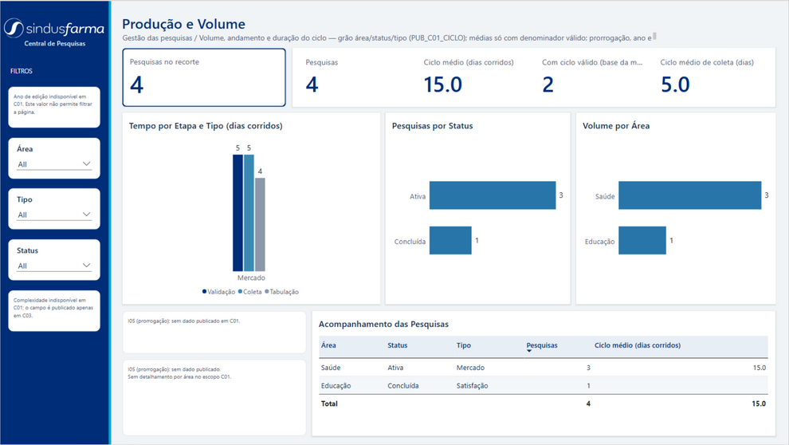
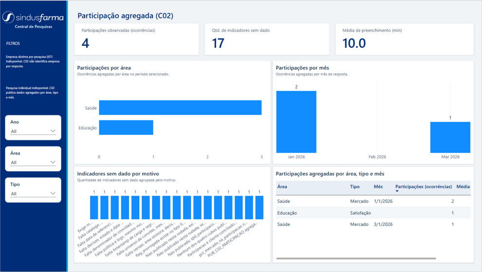
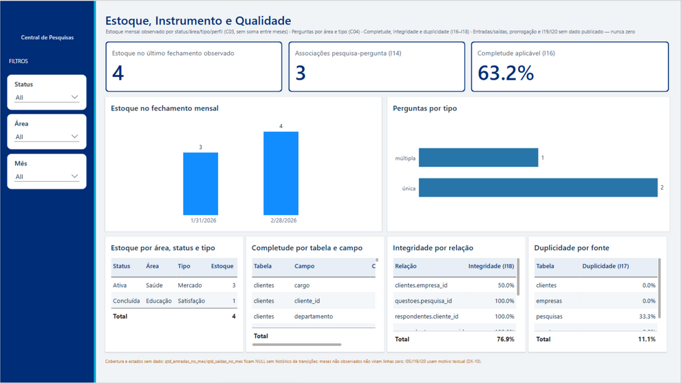
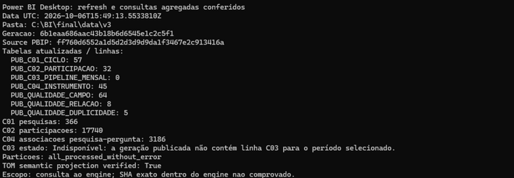

# Validação de conexão e atualização no Power BI

Este registro atende BI-02, BI-05 e BI-06 e mantém o procedimento de DX-04.
O projeto consumidor é `powerbi/CentralPesquisasBI.pbip`, com sete partições
Parquet e dimensões calculadas. O consumidor recebe somente a geração
publicada; o DuckDB de ingestão permanece na máquina autorizada de carga.

## Procedimento reproduzível

1. Na máquina de carga, publique somente depois da
   [reconciliação analítica](reconciliacao-analitica.md). Registre o `load_id`
   em `--load-reference`, conforme [publicação e acesso](acesso-cubos-bi.md).
   Guarde a conferência de BI-05 contra o banco dessa mesma carga.
2. Copie a subpasta imutável indicada por `current.json` para uma pasta
   restrita no Windows. Ela contém `manifest.json` e sete Parquet.
   Confira hashes e contagens antes da conexão. Mantenha o pacote fora do Git.
3. Abra `powerbi/CentralPesquisasBI.pbip`. Em **Transformar dados > Gerenciar
   parâmetros**, configure `PastaPublicacaoBI` para a subpasta copiada, sem
   barra final. Use **Fechar e aplicar** e **Atualizar**. Preserve o parâmetro
   de exemplo no arquivo versionado; o caminho da máquina fica na cópia local.
4. Registre versão do Desktop, Windows, data com fuso, ID da geração,
   `load_reference`, caminho sanitizado e os erros de cada consulta.
   Execute `COUNTROWS` para as sete tabelas no modo de consulta DAX e um
   agregado por cubo, conforme [BI-05](refresh-final-bi05.md).
5. Compare cada número com o manifesto, os Parquet e consultas ao DuckDB da
   mesma carga. Teste médias ponderadas e estados indisponíveis conforme
   [especificação de medidas](especificacao-medidas-bi.md). Os vínculos dos visuais
   e sua aceitação são rastreados em RP-13/RP-14 e na auditoria do pacote
   integrado; eles não substituem as consultas às partições carregadas.
6. Para trocar a geração, copie o pacote novo inteiro para outra subpasta,
   altere `PastaPublicacaoBI` e repita aplicar, atualizar e as conferências.
   Alterar `current.json` no publicador não atualiza o parâmetro do relatório.
   Registre os IDs antigo/novo e confirme que os resultados mudaram conforme
   os respectivos manifestos. Uma cópia parcial deve falhar; não aceitar um
   refresh que mantenha silenciosamente o cache anterior.

## Evidência necessária para o aceite

As evidências, reunindo capturas e recibos, registram projeto/versão, parâmetro
com caminho sanitizado, conclusão ou erro do refresh e resultados DAX das sete
tabelas. A captura do resumo v3 mostra pasta, geração, data, sete contagens e
agregados; o recibo medido fornece versão, projeção TOM e proveniência.
Registre também a troca entre duas gerações. Evite nomes de usuário, registros individuais,
IDs de pessoa/empresa, e-mails ou credenciais. Uma captura do dashboard com
dados sintéticos demonstra o visual; não prova qual geração foi importada.

| Etapa | Geração e execução | Resultado |
| :--- | :--- | :--- |
| BI-01 | Migração de duas páginas e 48 visuais | Estrutura migrada; o pacote integrado inclui as entregas posteriores RP-13/RP-14/RP-17 |
| BI-02 | Fixture corrigido `2c699f0b...` | Sete tabelas consultadas no Desktop real, partições processadas sem erro |
| BI-03/BI-04 | Pacote integrado `ff760d6` | Projeção TOM com 128 itens/zero diferenças; médias e estoque do fixture consultados |
| BI-05 | Geração CB-16 `6b1eaa686aac43b18b6d6545e1c2c5f1` | Publicação, origem e refresh do pacote corrigido conferidos |
| BI-06 | Refresh e troca de geração | Fixture corrigido e v3 consultados; troca final registrada; falha de arquivo e recuperação histórica documentadas |

Os recibos finais abaixo sustentam a conferência de conexão e atualização. Card fechado, branch criada, pipeline ou recibo preenchido não
comprovam execução no Power BI Desktop.

## Tabelas e agregados a registrar

| Tabela | Linhas do manifesto | Linhas no Desktop | Agregado ou estado |
| :--- | :--- | :--- | :--- |
| `PUB_C01_CICLO` | 57 | 57 | 366 pesquisas, conforme o recibo v3 |
| `PUB_C02_PARTICIPACAO` | 32 | 32 | 17740 participações, conforme o recibo v3 |
| `PUB_C03_PIPELINE_MENSAL` | 0 | 0 | Sem fechamento observado; estoque indisponível |
| `PUB_C04_INSTRUMENTO` | 45 | 45 | 3186 associações pesquisa-pergunta |
| `PUB_QUALIDADE_CAMPO` | 64 | 64 | Apuração por campo conferida; KPI global 1844495/2584786 |
| `PUB_QUALIDADE_RELACAO` | 8 | 8 | Apuração por relação conferida; KPI global 833146/833146 |
| `PUB_QUALIDADE_DUPLICIDADE` | 5 | 5 | Apuração por tabela conferida; KPI global (275840-275840)/275840 |

## Limites do contrato publicado

- C01 publica durações em dias corridos e a base válida de cada fase. Falta
  `flag_prorrogada`; taxa de prorrogação permanece indisponível.
- C02 conta ocorrências de participação, não empresas ou pessoas distintas.
  Não há chave pública para benchmark individual ou participação de mercado.
- C03 publica estoque observado por mês. Entradas e saídas são medidas
  operacionais fora do catálogo I01–I25, com motivo de indisponibilidade
  quando falta histórico de transições. Não recebem o identificador I05,
  que pertence à taxa de prorrogação.
- A correção CF-04 distingue fechamento observado vazio por marcador
  agregado global com estoque zero e recortes nulos. Ausência de fechamento
  continua sem linha. Ver [contrato do marcador](publicacao-c03-fechamentos.md).
  Os recibos Desktop abaixo conferiram o pacote anterior `ff760d6`.
- C04 conta associações pesquisa-pergunta, não respostas ou respondentes.
- Parseabilidade e divergência de título não têm consulta publicada nesta
  geração histórica. Após CF-05, `DIM_INDICADORES_BLOQUEADOS` contém 19 entradas: 18 com status
  "Sem dado" e uma "Parcial". O catálogo registra os motivos; não implementa
  uma medida numérica vazia para cada entrada. As duas medidas individuais
  `Taxa de Prorrogacao` e `Representatividade` retornam texto com o motivo,
  conforme [sinalização](sinalizacao-indicadores-bloqueados.md).

## Correções posteriores à conferência Desktop

CF-04 alterou a publicação de C03 observado vazio e CF-05 passou a apresentar
a taxa física como "Completude de preenchimento". I16, completude aplicável,
permanece indisponível sem regras homologadas de obrigatoriedade.
As capturas e os recibos de `ff760d6` permanecem evidência histórica; não
comprovam abertura, refresh nem renderização dessas alterações no Desktop.
A VM ficou desligada nesta rodada. Os testes de código verificam os novos
contratos; o aceite visual das alterações exige uma nova rodada Desktop.

## Tratamento de erro

Registre a mensagem, a tabela, a geração e a ação corretiva. Arquivo ausente,
hash divergente, tipo incompatível, expressão DAX inválida ou caminho ambíguo
interrompem o aceite. Corrija a origem ou o modelo, repita o refresh e as
consultas e preserve a evidência do erro e da correção.

## Ensaios executados e diagnóstico

O ensaio do pacote integrado `f068a01` executou em VM Windows com Power BI
Desktop `2.158.1177.0` em 06/10/2026 às 14:08:45 UTC, com relógio
sincronizado. As sete contagens do fixture foram 2/3/4/2/64/8/5 na ordem
C01, C02, C03, C04 e três tabelas de qualidade. As 13 partições do projeto
e duas automáticas de data estavam processadas sem erro. A comparação TOM
teve 128 itens e zero diferenças, dentro do escopo de projeção registrado.

Os recibos sintéticos de [BI-02](https://git.inteli.edu.br/graduacao/2026-2a/t13/g05/-/merge_requests/276),
[BI-03](https://git.inteli.edu.br/graduacao/2026-2a/t13/g05/-/merge_requests/278) e
[BI-04](https://git.inteli.edu.br/graduacao/2026-2a/t13/g05/-/merge_requests/290)
registram fonte do pacote, hashes, contagens, versão e consultas. A execução
foi automatizada no Desktop real; não há declaração de operação humana.
A igualdade semântica não identifica o commit exato dentro do engine.

As capturas históricas de diagnóstico mostram falhas anteriores de
[coluna no relacionamento](evidencias/bi-desktop/erro-coluna-calculada.png) e
[valor de direção de filtro](evidencias/bi-desktop/erro-direcao-filtro.png).
São recortes sem dados de origem ou credenciais; não identificam a revisão
exata do projeto e não são capturas do ensaio integrado aprovado. O recibo
posterior registra o modelo corrigido processado e consultado.

A publicação v3 está conferida em CB-16. O refresh e a troca de geração
têm os recibos adicionais abaixo. A falha de arquivo e sua recuperação histórica estão registradas; o pacote
corrigido tem o ensaio final separado abaixo.

## Troca do fixture para a geração v3

O [recibo de troca](evidencias/bi06/troca-fixture-v3.json) liga as execuções
das 14:08:45 e 14:15:30 UTC de 06/10/2026. O parâmetro da cópia privada
do PBIP mudou de `C:\BI\<pacote>\data\g1` para
`C:\BI\<pacote>\data\v3`; o projeto foi reaberto e atualizado. Os
caminhos desta página estão sanitizados. Em ambos os estados, o arquivo
local do parâmetro e sua expressão no modelo ativo foram conferidos.

O [recibo v3](evidencias/bi06/desktop-v3-antes-ajustes-relatorio.json) registra
57/32/0/45/64/8/5 linhas nas sete publicações e totais C01/C02/C04 de
366/17740/3186. São diferentes de 2/3/4/2/64/8/5 e 4/4/3 do fixture,
conforme seus manifestos. A geração v3 é
`6b1eaa686aac43b18b6d6545e1c2c5f1`, carga
`afcde424-45e8-457b-8793-bf0866d142b2`. C03 ficou sem fechamento observado,
com estoque e fluxos indisponíveis.

Esta rodada usou o pacote `f068a01` e antecede os ajustes de títulos do
relatório. Confirma conexão, troca e atualização do modelo daquela revisão.
A falha de arquivo ausente está registrada abaixo. A recuperação da mesma revisão aparece no recibo específico; o ensaio do
pacote corrigido está registrado separadamente.

## Falha de arquivo ausente observada

Ao remover `PUB_C01_CICLO.parquet` somente da cópia privada Windows da geração
v3 e clicar Atualizar, o Desktop exibiu sete consultas bloqueadas e o erro
"File or Folder: Could not find file" para C01. O
[recibo do diagnóstico](evidencias/bi06/arquivo-ausente-v3.json) registra a
observação em 06/10/2026 às 14:19:20 UTC; a
[captura do diálogo](evidencias/bi06/arquivo-ausente-v3.png) mostra a falha
sem dados de origem ou credenciais. O pacote imutável da publicação ficou
preservado.

Essa falha não foi aceita como refresh bem-sucedido. O arquivo foi restaurado, o projeto reaberto e atualizado, com nova consulta
às 14:36:59 UTC. O [recibo de recuperação](evidencias/bi06/desktop-recuperacao-v3-historica.json)
registra as sete contagens e a projeção TOM da revisão histórica `f068a01`. Uma consulta ao cache anterior, sozinha, não
comprova que a atualização com o arquivo ausente funcionou.

## Fixture antigo e qualidade

A troca registrada acima partiu da geração `665cb490...`, cujo conteúdo
de qualidade antecede a correção da chave composta de respostas/questões.
Os recibos provam aquela execução e as contagens, mas o total de
correspondências do fixture publicado foi 11/13 em vez de 10/13 da consulta
composta independente. O novo fixture `2c699f0b...` tem execução Desktop corrigida na seção final. As tabelas de qualidade v3 foram conferidas contra a ingestão
sem divergências; os números do fixture antigo não aceitam I18.

## Execução final do pacote integrado

A revisão executada foi `ff760d6552a1d5d2d3d9d9da1f3467e2c913416a`, pacote SHA256
`a9b087e5a9e4e0d56af8d7b36fe0a687857b205e7c59b6dbd44c9dd7c2358cea`, inventário SHA256
`1624eef9ad87a61af4146cc0c67e469014cb830829bc9562a04ba70eaeca8ac6`, com 98 arquivos conferidos no Windows.
O fixture corrigido foi consultado em `2026-10-06T15:44:25.2528117Z` e a v3 em
`2026-10-06T15:49:13.5533810Z`, no Desktop real `2.158.1177.0`, Windows
`10.0.26200.0`, por automação em VM. O parâmetro local foi conferido
por arquivo e pela expressão no modelo ativo. As 13 partições do projeto
e duas automáticas de data estavam processadas sem erro. A comparação TOM
teve 128 itens e zero diferenças. Ela compara a projeção semântica
declarada; não fornece um marcador do commit exato dentro do engine.
O SHA do pacote executado permanece distinto dos commits documentais
posteriores anexados às MRs.

### Reproduzir a fonte do PBIP

A revisão executada está [no GitLab](https://git.inteli.edu.br/graduacao/2026-2a/t13/g05/-/tree/ff760d6552a1d5d2d3d9d9da1f3467e2c913416a).
Busque a branch de validação e abra essa revisão em uma pasta ainda
inexistente, preservando o checkout de trabalho:

```bash
git fetch origin test/bi-desktop-integrated
git worktree add --detach ../bi-pacote-conferido ff760d6552a1d5d2d3d9d9da1f3467e2c913416a
```

O inventário compara os arquivos versionados de `powerbi/`, exceto
`powerbi/CentralPesquisasBI.SemanticModel/definition/expressions.tmdl`,
cujo parâmetro foi adaptado somente na cópia privada Windows. O parâmetro
tem conferência própria por arquivo e expressão no modelo ativo.
Esse checkout reproduz a fonte PBIP e seu inventário; a geração Parquet
autorizada e o ZIP conferido permanecem privados.

A geração corrigida `2c699f0b066847ee8559f1e31d88f49d`, referência
`synthetic-bi02-fixture`, retornou 2/3/4/2/64/8/5 linhas na ordem C01,
C02, C03, C04, qualidade por campo, relação e duplicidade. Seus totais
C01/C02/C04 foram 4/4/3. A integridade retornou 10/13, igual à consulta
independente de chave composta; o resultado antigo de 11/13 fica histórico.
As médias de validação, coleta, tabulação e ciclo total foram 5/5/4/15 dias,
com base 2 em cada fase; preenchimento teve média 10 minutos com base 2.

As somas C02 por Ano, Trimestre e Mês retornaram o total 4 incluindo
o membro em branco virtual. Uma participação tem mês nulo; as três com
data e a parcela em branco reconciliam o total. C03 teve estoque 3 em
31/01/2026 e 4 em 28/02/2026. Os totais por Área, Área/Tipo e
Área/Tipo/Perfil coincidiram com 3 e 4 em cada fechamento. O último estoque
foi 4, sem somar os dois fechamentos em 7. Março de 2026 existe no
calendário por C02 e não tem fechamento C03; estoque retornou `BLANK()`.
Na v3, todas as 17740 participações têm mês nulo. Os totais por níveis do
calendário incluem esse membro em branco; a parcela com data é zero.
A v3 não oferece fechamento C03 para demonstrar navegação temporal observada.
Essas consultas exercitam as definições carregadas e a reconciliação por
nível; não declaram operação humana de drill na interface.

As consultas DAX de diagnóstico com `DATATABLE` e `DIVIDE` retornaram
média ponderada 8,2 contra média simples 5, zero numérico para numerador
zero/base positiva, e `BLANK()` para base zero. São probes de aritmética
no engine; não são medidas publicadas do modelo.

| Fase C01 v3 | Soma em dias | Base válida | Média ponderada |
| --- | ---: | ---: | ---: |
| Validação | 171 | 20 | 8,55 |
| Coleta | 4960 | 358 | 13,854748603351956 |
| Tabulação | 3020 | 330 | 9,151515151515152 |
| Ciclo total | 9468 | 331 | 28,604229607250755 |

C02 v3 retornou soma nula, base 0 e média nula. A completude física de preenchimento foi
1844495/2584786 (0,7135967929259908), a integridade 833146/833146 (1),
e a duplicidade (275840-275840)/275840 (0). Os numeradores e denominadores
conferem com a apuração independente da ingestão. O catálogo manteve
18 entradas/17 estados "Sem dado" e duas medidas textuais individuais.
A taxa diagnóstica de finalização não é medida DAX publicada e não integra
os recibos públicos. C03 v3 retornou data e estoque nulos com motivo
textual de indisponibilidade. O pacote Desktop `ff760d6` não representava fechamento global
observado sem grupo. Esse resultado é histórico; não prova a correção
posterior descrita abaixo.

A [troca final](evidencias/bi06/troca-fixture-corrigido-v3-final.json)
liga as gerações e os recibos de consulta. Os caminhos locais ficam
sanitizados; nenhuma geração, DuckDB ou dado de origem é versionado.

Os resultados detalhados ficam nos recibos sanitizados do
[fixture corrigido](evidencias/bi02/desktop-fixture-corrigido-final.json) e da
[v3 final](evidencias/bi05/desktop-v3-final.json). Eles incluem contagens,
agregados, qualidade, fechamentos C03 do fixture e indisponibilidade C03 v3.

## Capturas finais e seus limites

O [índice de capturas](evidencias/bi06/capturas-finais.json) registra o pacote
executado, geração, hash de cada PNG e leituras do relógio UTC imediatamente
antes/depois da captura. A resolução dessas leituras é de um segundo; horários
iguais indicam o mesmo segundo UTC, sem precisão de subsegundo. Os caminhos
de artefatos do ambiente foram removidos do índice público.

As três imagens de [C01](evidencias/bi06/final-fixture-c01.png),
[C02](evidencias/bi06/final-fixture-c02.png) e
[C03/C04/qualidade](evidencias/bi06/final-fixture-c03-c04.png) mostram o
fixture sintético. C02 tem eixo de contagem 0–3 compatível com as barras;
C03 mostra fechamentos mensais categóricos. Elas demonstram os visuais
sintéticos, sem serem capturas dos registros da fonte v3.

A [captura de resumo v3](evidencias/bi06/final-v3-summary.png) é uma tela
nativa de console que apresenta o resumo dos recibos de consultas reais ao
engine do Desktop. Mostra caminho da geração copiada, data UTC da consulta,
ID da geração, fonte PBIP, sete contagens, totais C01/C02/C04 e motivo de
indisponibilidade C03, sem categorias privadas ou registros individuais.
A data da consulta e o intervalo da captura são campos distintos. Essa imagem
não é uma captura da página do relatório nem fornece um marcador Git dentro
do engine. A [conferência final BI-05](evidencias/bi05/conferencia-desktop-v3-final.json)
compara os recibos com a origem e a publicação da mesma carga.

### C01: produção e volume



Captura final do relatório no Power BI Desktop com origem no fixture sintético,
geração `2c699f0b066847ee8559f1e31d88f49d`, pacote `ff760d6`.
Capturada entre 15:45:00 e 15:45:01 UTC de 06/10/2026.

### C02: participação agregada



Captura final do relatório no Power BI Desktop com origem no fixture sintético,
geração `2c699f0b066847ee8559f1e31d88f49d`, pacote `ff760d6`.
As duas leituras do relógio registraram 15:44:23 UTC de 06/10/2026.

### C03/C04: estoque, instrumento e qualidade



Captura final do relatório no Power BI Desktop com origem no fixture sintético,
geração `2c699f0b066847ee8559f1e31d88f49d`, pacote `ff760d6`.
Capturada entre 15:45:13 e 15:45:14 UTC de 06/10/2026.

### V3: resumo dos recibos de consulta ao motor



Captura final de console nativa com origem nos recibos reais de consulta ao motor
do Power BI Desktop, geração v3 `6b1eaa686aac43b18b6d6545e1c2c5f1`,
pacote `ff760d6`. Capturada entre 15:50:41 e 15:50:42 UTC de 06/10/2026.
Esta imagem mostra o resumo agregado dos recibos; não mostra uma página do
relatório v3 nem o diálogo de atualização.
