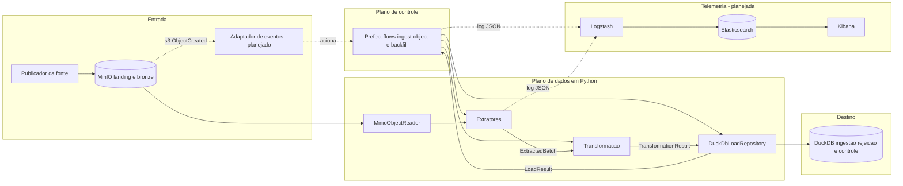

# Visão Computacional do ETL (ISO/IEC 10746) — AN-06

Decomposição do pipeline em componentes, com a interface que cada um expõe, a
responsabilidade que assume e a que explicitamente recusa. As assinaturas foram
lidas do código em [`src/etl/`](../src/etl/); quando um componente existe apenas
como contrato, a linha diz **planejado** e nomeia onde o contrato está escrito.

O diagrama de componentes correspondente está em
[`assets/uml/componentes-etl.plantuml`](assets/uml/componentes-etl.plantuml) e é
espelhado ao fim deste documento.

## Princípio de separação

O código de domínio não depende de Prefect, MinIO ou DuckDB. Essas tecnologias
são alcançadas por adaptadores que implementam protocolos declarados em
[`contracts.py`](../src/etl/extraction/contracts.py). Na prática:

- `etl.extraction.contracts` importa apenas a biblioteca padrão;
- `etl.transformation` conhece o contrato de lote, não o armazenamento;
- `etl.load` conhece o contrato de lote e o DuckDB, não o orquestrador;
- `etl.orchestration` conhece os três, e nenhuma regra de negócio vive nele.

É essa separação que permite testar extração, transformação e carga sem serviço
externo, com as 19 suítes de `tests/`.

## Componentes

| Componente | Módulo ou serviço | Interface exposta | Responsabilidade | Não é responsabilidade | Estado |
| :--- | :--- | :--- | :--- | :--- | :--- |
| Publicador da fonte | Externo | Upload no MinIO | Depositar o objeto na área de entrada | Transformar o conteúdo ou confirmar processamento | Manual |
| Armazenamento de objetos | MinIO | S3 API | Preservar o objeto imutável e servir sua leitura | Decidir se o objeto deve ser processado | Implementado |
| Adaptador de eventos | — | Webhook HTTP | Validar a notificação `s3:ObjectCreated` e acionar o deployment | Ler ou transformar o conteúdo | **Planejado** (ADR 0001) |
| Leitor de objetos | [`object_storage.py`](../src/etl/extraction/object_storage.py) | `ObjectReader.open(reference) -> ContextManager[BinaryIO]` | Abrir o objeto como fluxo de bytes | Interpretar o conteúdo | Implementado |
| Extratores | [`csv_extractors.py`](../src/etl/extraction/csv_extractors.py), [`questionnaire_extractors.py`](../src/etl/extraction/questionnaire_extractors.py) | `Extractor.read(*, run_id, checkpoint=None) -> Iterator[ExtractedBatch]` | Ler a fonte em lotes e emitir o contrato comum | Aplicar regra de negócio ou gravar no banco | Implementado |
| Configuração | [`config.py`](../src/etl/extraction/config.py) | `load_extraction_settings(parameters=None, environ=None) -> ExtractionSettings` | Resolver endpoint, bucket, credenciais e limites | Expor segredo em log ou repr | Implementado |
| Resiliência | [`resilience.py`](../src/etl/extraction/resilience.py), [`failures.py`](../src/etl/extraction/failures.py) | `RetryExecutor.execute(...)`, `classify_source_failure(exception) -> FailureClassification` | Distinguir falha transitória de permanente e repetir com limite | Decidir a política de agendamento | Implementado |
| Transformação | [`pipeline.py`](../src/etl/transformation/pipeline.py) | `transform_batch(batch, *, references, previous, source_offset, ingested_at, source_timezone=None) -> TransformationResult` | Tipar, validar, deduplicar e separar rejeições | Escrever dados ou confirmar checkpoint | Implementado |
| Referências | [`consistency.py`](../src/etl/transformation/consistency.py) | `ReferenceData.require(source)`, `.get(source, key)` | Fornecer as chaves dos pais para integridade referencial | Buscar os pais no banco | Implementado |
| Repositório de carga | [`duckdb_repository.py`](../src/etl/load/duckdb_repository.py) | `load_batch(result, metadata) -> LoadResult`, `object_already_loaded(checksum)`, `loaded_identities(source)`, `load(source)`, `commit(checkpoint)` | Gravar aceitos e rejeitados em transação e reconciliar contagens | Decidir quando o pipeline executa | Implementado |
| Contrato físico | [`ddl.py`](../src/etl/load/ddl.py) | `statements()`, `render_ddl()`, `table_name(source)` | Declarar tabelas, constraints e views | Executar carga | Implementado |
| Ambiente do banco | [`environment.py`](../src/etl/load/environment.py) | `prepare_database(settings) -> bool`, `run_health_check(settings) -> HealthCheckReport` | Criar o arquivo do banco e verificar escrita e persistência | Monitorar a execução do pipeline | Implementado |
| Orquestração | [`flow.py`](../src/etl/orchestration/flow.py) | Flows `ingest_object` e `backfill`; tasks `extract`, `transform`, `load` | Coordenar etapas, parâmetros, retries, timeout e estados | Conter regra de transformação | Implementado e exercitado em `tests/orchestration/` |
| Banco de ingestão | DuckDB | SQL | Persistir dados conformes, rejeições e controles | Substituir a cópia imutável da origem | Implementado |
| Log estruturado | [`log_events.py`](../src/etl/extraction/log_events.py) | `ExtractionLogSink.emit(event)`, `StandardLoggingSink` | Emitir o evento JSON do lote extraído | Transportar telemetria a um coletor | Implementado parcialmente |
| Telemetria | — | Logstash, Elasticsearch, Kibana | Centralizar logs, métricas e painéis | Controlar o estado do pipeline | **Planejado** (ADR 0001) |

### Componentes acrescentados ao fluxo servido

| Componente | Entrada | Saída | Responsabilidade verificável | Estado em `develop` |
| :--- | :--- | :--- | :--- | :--- |
| Servidor de deployment | Parâmetros do deployment `ingest-object/agendado` | Flow run do Prefect | Manter o deployment disponível para agenda e disparo manual | Implementado em `scripts/orchestration/deployment.py`; inicialização manual |
| Emissor de eventos da carga | `LoadResult` e `BatchMetadata` | `LoadBatchLogEvent` | Publicar status, duração e contagens sem conteúdo de negócio | Implementado em `src/etl/load/log_events.py` |
| Sink de logging padrão | Evento técnico | Registro JSON no logger Python | Serializar o evento sem acoplar o repositório ao transporte | Implementado para extração e carga |
| Coletor de telemetria | Log JSON | Índice/painel central | Transportar e reter sinais operacionais | Ausente no Compose da base auditada |
| Camada analítica | Views tratadas e controles | Dimensões, fatos e cubos | Materializar o contrato dimensional | Dependência CB-02 a CB-06; não integrada |

O servidor Prefect e o coletor são componentes distintos: servir um deployment
não instala nem configura observabilidade centralizada. Da mesma forma, emitir
JSON estruturado não comprova que o evento chegou a Elasticsearch ou a um
painel.

## Contratos de dados entre componentes

Três estruturas imutáveis atravessam as fronteiras, todas declaradas em
[`contracts.py`](../src/etl/extraction/contracts.py) com `CONTRACT_VERSION =
"1.0"`:

| Estrutura | Campos | Quem produz | Quem consome |
| :--- | :--- | :--- | :--- |
| `ExtractionCheckpoint` | `source`, `position`, `sequence`, `source_version` | Extrator | `CheckpointStore` e o próprio extrator na retomada |
| `BatchMetadata` | `source`, `run_id`, `task_id`, `batch_id`, `started_at`, `finished_at`, `record_count`, `byte_count`, `schema_version`, `source_checksum`, `contract_version` | Extrator | Transformação, carga e log |
| `ExtractedBatch` | `records`, `checkpoint`, `metadata` | Extrator | Transformação |

O checkpoint é **opaco** para quem o persiste: hoje os extratores CSV usam o
formato `row:N`, mas o repositório apenas o guarda e devolve. Trocar o formato
não obriga a alterar a carga.

`ExtractedBatch` valida a si mesmo na construção: metadados e checkpoint precisam
pertencer à mesma fonte, e `record_count` precisa bater com a quantidade de
registros. Um lote inconsistente não chega à transformação.

## Protocolos e implementações

| Protocolo | Declarado em | Implementação concreta |
| :--- | :--- | :--- |
| `Extractor` | `contracts.py` | `PesquisasExtractor`, `EmpresasExtractor`, `ClientesExtractor`, `RespondentesExtractor`, `QuestoesExtractor`, `RespostasExtractor` |
| `ObjectReader` | `object_storage.py` | `MinioObjectReader` |
| `CheckpointStore` | `contracts.py` | `DuckDbLoadRepository` |
| `MetadataSink` | `contracts.py` | **Nenhuma** |
| `FailureRecorder` | `failures.py` | Fornecido pelo chamador |
| `ExtractionLogSink` | `log_events.py` | `StandardLoggingSink` |

### Interfaces do caminho servido e da telemetria

O ponto de entrada servido é o próprio flow `ingest_object`. O script de
deployment fornece nome, cron e parâmetros padrão; execuções pela agenda, UI ou
CLI chegam à mesma assinatura e produzem o mesmo histórico de estados.

| Fronteira | Contrato | Falha observável |
| :--- | :--- | :--- |
| Operador/Prefect → flow | `source`, `bucket`, `key`, `version_id`, `event_id`, `reprocess`, `db_path` | Parâmetro inválido encerra a execução antes da leitura. |
| Flow → MinIO | `ObjectReference` e `ObjectReader.open()` | Falha transitória pode repetir; falha permanente termina a task. |
| Flow → repositório | `load_batch()` seguido de `commit(checkpoint)` | A confirmação não ocorre se carga ou reconciliação falhar. |
| Repositório → logging | `LoadLogSink.emit(LoadBatchLogEvent)` | Falha do sink não reverte uma carga já confirmada. |
| Logging → coletor | Linha JSON em stdout/stderr | Transporte externo não está configurado na base auditada. |

A responsabilidade pela decisão de confirmar é da orquestração; o repositório
apenas oferece a operação persistente `commit`. Essa separação impede que uma
carga parcial avance o checkpoint por efeito colateral interno.

## Fluxo de controle da ingestão

`ingest_object(source, bucket, key, *, version_id=None, event_id=None,
reprocess=False, db_path=None)` executa nesta ordem:

1. valida a fonte contra o dicionário `EXTRACTORS` e resolve o caminho do banco;
2. carrega as configurações, constrói o cliente MinIO e o `MinioObjectReader`;
3. calcula o SHA-256 do objeto lendo-o em blocos de 64 KiB;
4. consulta `_control_object`: hash já concluído retorna `{"status":
   "ignored"}` sem nova carga, a menos que `reprocess=True`;
5. monta as referências dos pais, lê as identidades já carregadas e recupera o
   checkpoint — descartando-o se pertencer a outra versão do objeto;
6. executa as tasks `extract`, `transform` e `load` em sequência;
7. marca o objeto como concluído e confirma o checkpoint do último lote.

O checkpoint só é confirmado **depois** da carga. Uma falha entre a extração e a
gravação deixa a posição anterior intacta, e a execução seguinte relê o trecho
em vez de saltá-lo.

`backfill(sources, bucket, *, prefix="landing", reprocess=False, db_path=None)`
chama `ingest_object` por fonte, com fontes, prefixo e modo registrados como
parâmetros do run.

## Política de falha no nível do flow

A task `extract` declara `retries=2`, `retry_delay_seconds=1` e
`timeout_seconds=120`; `transform` e `load` declaram apenas o timeout. A função
`_should_retry` só autoriza nova tentativa para exceção inesperada:
`ExtractionError`, `ValueError` e `KeyError` falham de imediato, porque a falha
transitória já foi reexecutada dentro da extração pelo `RetryExecutor` e porque
credencial, schema e objeto ausente não melhoram com repetição.

A carga usa `_connect_with_retry`, que espera o escritor anterior liberar o
arquivo do DuckDB e, esgotado o prazo, levanta `WriteLockTimeoutError`. Um erro
que não seja de lock propaga na primeira tentativa.

## Divergências entre contrato e implementação

Registradas aqui porque o critério de avaliação exige que a visão corresponda ao
código, e não ao contrato idealizado.

| Divergência | Onde | Efeito |
| :--- | :--- | :--- |
| `MetadataSink` não tem implementação | `contracts.py` declara o protocolo; nenhum módulo o implementa | Os metadados de lote são gravados diretamente em `_batch_metadata` pela carga, sem passar por um sink; o protocolo permanece como ponto de extensão não exercitado |
| `QuarantineStore` fora do caminho produtivo | `quarantine.py`; usado apenas em `tests/transformation/test_transformation.py` | As rejeições reais vão para as tabelas `rejected` e `rejected_reason` do DuckDB; só o dataclass `RejectedRecord` é compartilhado |
| Acesso a atributo privado | `_build_references` em `flow.py` executa SQL por `repo._conn` | A orquestração contorna a interface pública do repositório; qualquer mudança interna na conexão quebra o flow |
| Disparo por evento ausente | Contrato no ADR 0001 | A ingestão é iniciada manualmente ou por cron, não pela criação do objeto |

## Diagrama de componentes

Os elementos tracejados não existem no `develop`. A fonte PlantUML com portas e
interfaces está em
[`assets/uml/componentes-etl.plantuml`](assets/uml/componentes-etl.plantuml).
