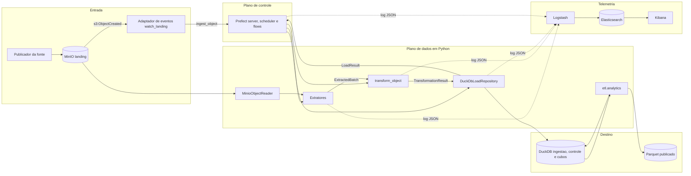

# Visão Computacional do ETL (ISO/IEC 10746) — AN-06

Decomposição do pipeline em componentes, com a interface que cada um expõe, a
responsabilidade que assume e a que explicitamente recusa. As assinaturas foram
lidas do código em [`src/etl/`](../src/etl/); quando um componente existe apenas
como contrato, a linha diz **planejado** e nomeia onde o contrato está escrito.
Base registrada em 25/09/2026; revisão de contratos em 06/10/2026 com o
flow completo DW e o monitor periódico. Descreve código e configuração
versionados, sem afirmar execução desses deployments no ambiente do parceiro.

Esta revisão descreve o conjunto integrado dos suplementos PL (MR !289),
OBS (MR !295) e reports (MR !294). O código novo de DW e monitor periódico
é entregue pelas branches PL e OBS; conferir esses contratos após integrar
as três entregas.

O diagrama de componentes correspondente está em
[`assets/uml/componentes-etl.plantuml`](assets/uml/componentes-etl.plantuml) e é
espelhado ao fim deste documento.

## Princípio de separação

O código de domínio não depende de Prefect, MinIO ou DuckDB. Essas tecnologias
são alcançadas por adaptadores que implementam protocolos declarados em
[`contracts.py`](../src/etl/extraction/contracts.py). Na prática:

- `etl.extraction.contracts` importa apenas a biblioteca padrão;
- `etl.transformation` conhece o contrato de lote, não o armazenamento;
- `etl.load` conhece o contrato de lote e o DuckDB, não o orquestrador;
- `etl.orchestration` conhece os três, e nenhuma regra de negócio vive nele.

É essa separação que permite testar extração, transformação e carga sem serviço
externo. A quantidade de testes é obtida pela coleta do runner, e não mantida
como número fixo neste documento.

## Componentes

| Componente | Módulo ou serviço | Interface exposta | Responsabilidade | Não é responsabilidade | Estado |
| :--- | :--- | :--- | :--- | :--- | :--- |
| Publicador da fonte | Externo | Upload no MinIO | Depositar o objeto na área de entrada | Transformar o conteúdo ou confirmar processamento | Manual |
| Armazenamento de objetos | MinIO | S3 API | Preservar o objeto imutável e servir sua leitura | Decidir se o objeto deve ser processado | Implementado |
| Adaptador de eventos | [`watch_landing.py`](../scripts/orchestration/watch_landing.py) | Webhook HTTP `s3:ObjectCreated` ou polling do prefixo | Inferir a fonte pela chave e acionar `ingest_object` uma vez por objeto novo | Ler ou transformar o conteúdo | Implementado (ambiente local) |
| Leitor de objetos | [`object_storage.py`](../src/etl/extraction/object_storage.py) | `ObjectReader.open(reference) -> ContextManager[BinaryIO]` | Abrir o objeto como fluxo de bytes | Interpretar o conteúdo | Implementado |
| Extratores | [`csv_extractors.py`](../src/etl/extraction/csv_extractors.py), [`questionnaire_extractors.py`](../src/etl/extraction/questionnaire_extractors.py) | `Extractor.read(*, run_id, task_id, checkpoint=None) -> Iterator[ExtractedBatch]` | Ler a fonte em lotes, informar a posição absoluta (`source_offset`) de cada lote e emitir o contrato comum | Aplicar regra de negócio ou gravar no banco | Implementado |
| Configuração | [`config.py`](../src/etl/extraction/config.py) | `load_extraction_settings(parameters=None, environ=None) -> ExtractionSettings` | Resolver endpoint, bucket, credenciais e limites | Expor segredo em log ou repr | Implementado |
| Resiliência | [`resilience.py`](../src/etl/extraction/resilience.py), [`failures.py`](../src/etl/extraction/failures.py) | `RetryExecutor.execute(...)`, `classify_source_failure(exception) -> FailureClassification` | Distinguir falha transitória de permanente e repetir com limite | Decidir a política de agendamento | Implementado |
| Transformação | [`pipeline.py`](../src/etl/transformation/pipeline.py) | `transform_object(batches, *, references, previous, ingested_at) -> list[TransformationResult]`; `transform_batch(...)` para um lote isolado | Tipar, validar, decidir a identidade uma vez sobre todos os lotes do objeto e separar rejeições | Escrever dados ou confirmar checkpoint | Implementado |
| Referências | [`consistency.py`](../src/etl/transformation/consistency.py) | `ReferenceData.require(source)`, `.get(source, key)` | Fornecer as chaves dos pais para integridade referencial | Buscar os pais no banco | Implementado |
| Repositório de carga | [`duckdb_repository.py`](../src/etl/load/duckdb_repository.py) | `load_batch(result, metadata) -> LoadResult`, `object_already_loaded(checksum)`, `loaded_identities(source)`, `fetch_compatibility_records(source)`, `load(source)`, `commit(checkpoint)`, `mark_object_loaded(...)` | Conferir identidades contra o estado persistido, gravar aceitos e rejeitados em transação e recusar o `COMMIT` se a reconciliação não fechar (`UnbalancedLoadError`) | Decidir quando o pipeline executa | Implementado |
| Contrato físico | [`ddl.py`](../src/etl/load/ddl.py) | `statements()`, `render_ddl()`, `table_name(source)` | Declarar tabelas, constraints e views | Executar carga | Implementado |
| Ambiente do banco | [`environment.py`](../src/etl/load/environment.py) | `prepare_database(settings) -> bool`, `run_health_check(settings) -> HealthCheckReport` | Criar o arquivo do banco e verificar escrita e persistência | Monitorar a execução do pipeline | Implementado |
| Orquestração | [`flow.py`](../src/etl/orchestration/flow.py) | Flows `ingest_object` e `backfill`; tasks `extract`, `transform`, `load` | Coordenar etapas, parâmetros, retries, timeout e estados | Conter regra de transformação | Implementado e exercitado em `tests/orchestration/` |
| Banco de ingestão | DuckDB | SQL | Persistir dados conformes, rejeições e controles | Substituir a cópia imutável da origem | Implementado |
| Log estruturado | [`extraction/log_events.py`](../src/etl/extraction/log_events.py), [`transformation/log_events.py`](../src/etl/transformation/log_events.py), [`load/log_events.py`](../src/etl/load/log_events.py), [`logging_config.py`](../src/etl/orchestration/logging_config.py) | `*LogSink.emit(event)`, `configure_json_logging()` | Emitir um evento JSON por lote nas quatro etapas, com `run_id`, `task_id`, `batch_id`, duração, bytes, contagens e tentativas | Transportar telemetria a um coletor | Implementado |
| Telemetria | Serviços `logstash`, `elasticsearch`, `kibana` do [`docker-compose.yml`](../docker-compose.yml); [`observability/`](../observability/) | GELF UDP 12201 → índice `etl-logs-*` → painel Kibana | Centralizar logs, métricas, painel e alertas | Controlar o estado do pipeline | Implementado (ambiente local; ADR 0006/0008) |

### Componentes acrescentados ao fluxo servido

| Componente | Entrada | Saída | Responsabilidade verificável | Estado no código versionado |
| :--- | :--- | :--- | :--- | :--- |
| Servidor de deployment | Parâmetros do deployment `pipeline-completo/agendado-dw` | Flow run do Prefect | Manter o deployment disponível para agenda e disparo manual | Implementado em `scripts/orchestration/deployment.py`, servido pelo serviço `scheduler` do Compose contra o `prefect-server` |
| Emissor de eventos da carga | `LoadResult` e `BatchMetadata` | `LoadBatchLogEvent` | Publicar status, duração e contagens sem conteúdo de negócio | Implementado em `src/etl/load/log_events.py` |
| Sink de logging padrão | Evento técnico | Registro JSON no logger Python | Serializar o evento sem acoplar o repositório ao transporte | Implementado para extração, transformação, carga e orquestração |
| Pipeline completo DW | `run_pipeline(sources=None, *, publish_dir, reprocess=False, db_path=None, observed_at=None)` | Backfill confirmado, load_id, reconciliação e geração publicada | Confirmar seis fontes antes de `load_warehouse` → `reconcile_warehouse` → `publish_warehouse`; compartilhar lock com writers de ingestão e propagar falhas | Implementado em `src/etl/orchestration/pipeline.py` e `src/etl/orchestration/analytics.py` (PL, MR !289) |
| Monitor periódico | Configuração Prefect/DuckDB e intervalo de 60s | Um relatório por ciclo, com limite de 30s | Consultar saúde mesmo sem execução de flows; distinguir lock busy de indisponibilidade | Serviço `health-monitor` em [`docker-compose.yml`](../docker-compose.yml), usando `scripts/orchestration/health_monitor.py` (OBS, MR !295) |
| Health check da orquestração | `PREFECT_API_URL` e configuração do DuckDB | Evento `orchestration.health_check.emitted` e código de saída | Verificar disponibilidade do Prefect e do banco | Implementado em [`health.py`](../src/etl/orchestration/health.py) e `scripts/orchestration/health_check.py` |
| Coletor de telemetria | Log JSON no stdout | Índice `etl-logs-*` e painel Kibana | Transportar e reter sinais operacionais | Implementado: driver GELF → Logstash → Elasticsearch |
| Camada analítica | Views tratadas e controles | Dimensões, fatos C01–C04 e 7 Parquet publicados | Materializar e publicar o contrato dimensional | Implementado em [`src/etl/analytics/`](../src/etl/analytics/) |

O servidor Prefect e o coletor são componentes distintos: o Prefect guarda o
estado e o histórico das execuções; a Elastic Stack recebe os eventos técnicos
para consulta, painel e alerta. O transporte é best-effort: uma falha do
coletor não interrompe nem confirma uma carga (ADR 0006), o que é coberto por
`tests/e2e/test_telemetria_e_coletor_indisponivel.py`.

## Contratos de dados entre componentes

Três estruturas imutáveis atravessam as fronteiras, todas declaradas em
[`contracts.py`](../src/etl/extraction/contracts.py) com `CONTRACT_VERSION =
"1.0"`:

| Estrutura | Campos | Quem produz | Quem consome |
| :--- | :--- | :--- | :--- |
| `ExtractionCheckpoint` | `source`, `position`, `sequence`, `source_version` | Extrator | `CheckpointStore` e o próprio extrator na retomada |
| `BatchMetadata` | `source`, `run_id`, `task_id`, `batch_id`, `started_at`, `finished_at`, `record_count`, `byte_count`, `schema_version`, `source_checksum`, `contract_version`, `source_offset` | Extrator | Transformação, carga e log |
| `ExtractedBatch` | `records`, `checkpoint`, `metadata` | Extrator | Transformação |

O checkpoint é **opaco** para quem o persiste: hoje os extratores CSV usam o
formato `row:N`, mas o repositório apenas o guarda e devolve. Trocar o formato
não obriga a alterar a carga.

`ExtractedBatch` valida a si mesmo na construção: metadados e checkpoint precisam
pertencer à mesma fonte, e `record_count` precisa bater com a quantidade de
registros. Um lote inconsistente não chega à transformação.

## Protocolos e implementações

| Protocolo | Declarado em | Implementação concreta |
| :--- | :--- | :--- |
| `Extractor` | `contracts.py` | `PesquisasExtractor`, `EmpresasExtractor`, `ClientesExtractor`, `RespondentesExtractor`, `QuestoesExtractor`, `RespostasExtractor` |
| `ObjectReader` | `object_storage.py` | `MinioObjectReader` |
| `CheckpointStore` | `contracts.py` | `DuckDbLoadRepository` |
| `MetadataSink` | `contracts.py` | **Nenhuma** |
| `FailureRecorder` | `failures.py` | Fornecido pelo chamador |
| `ExtractionLogSink`, `TransformationLogSink`, `LoadLogSink` | `log_events.py` de cada etapa | `StandardLoggingSink` |

### Interfaces do caminho servido e da telemetria

O ponto de entrada da agenda DW é `run_pipeline`, flow `pipeline-completo`.
O script de deployment fornece cron, seis fontes e `publish_dir`. O manual DW
usa a mesma assinatura; `ingest_object` e `backfill` isolados continuam
limitados à ingestão tratada. Sem observação real de fechamento, C03 permanece
`not_observed`; a agenda não cria evidência mensal.

| Fronteira | Contrato | Falha observável |
| :--- | :--- | :--- |
| Operador/Prefect → flow | `source`, `bucket`, `key`, `version_id`, `event_id`, `reprocess`, `db_path` | Parâmetro inválido encerra a execução antes da leitura. |
| Flow → MinIO | `ObjectReference` e `ObjectReader.open()` | Falha transitória pode repetir; falha permanente termina a task. |
| Flow → repositório | `load_batch()` seguido de `commit(checkpoint)`; `mark_object_loaded()` só com todas as reconciliações balanceadas | `UnbalancedLoadError` ou erro de escrita desfaz a transação e não avança checkpoint nem objeto. |
| Repositório → logging | `LoadLogSink.emit(LoadBatchLogEvent)` | Falha do sink não reverte uma carga já confirmada. |
| Logging → coletor | Linha JSON em stdout/stderr, enviada pelo driver GELF | Coletor fora do ar descarta o evento sem bloquear a carga. |

A responsabilidade pela decisão de confirmar é da orquestração; o repositório
apenas oferece a operação persistente `commit`. Essa separação impede que uma
carga parcial avance o checkpoint por efeito colateral interno.

## Fluxo de controle da ingestão

`ingest_object(source, bucket, key, *, version_id=None, event_id=None,
reprocess=False, db_path=None)` executa nesta ordem:

1. valida a fonte contra o dicionário `EXTRACTORS` e resolve o caminho do banco;
2. carrega as configurações, constrói o cliente MinIO e o `MinioObjectReader`;
3. calcula o SHA-256 do objeto lendo-o em blocos de 64 KiB;
4. consulta `_control_object`: hash já concluído retorna `{"status":
   "ignored"}` sem nova carga, a menos que `reprocess=True`;
5. monta as referências dos pais pela interface pública do repositório
   (`fetch_compatibility_records`), lê as identidades já carregadas e recupera o
   checkpoint — descartando-o se pertencer a outra versão do objeto;
6. executa `extract` (lotes com `source_offset` absoluto, inclusive na
   retomada), `transform` (`transform_object`: decisão de identidade única
   sobre todos os lotes do objeto) e `load` (por lote: conferência contra o
   estado persistido, transação, reconciliação e só então `commit` do
   checkpoint do lote);
7. confere que todas as reconciliações fecharam e só então marca o objeto como
   concluído; caso contrário levanta `UnbalancedLoadError`.

O checkpoint só é confirmado **depois** do `COMMIT` e da reconciliação do lote.
Uma falha entre a extração e a gravação deixa a posição anterior intacta, e a
execução seguinte relê o trecho em vez de saltá-lo, preservando a posição
absoluta de cada ocorrência.

`backfill(sources, bucket, *, prefix="landing", reprocess=False, db_path=None)`
chama `ingest_object` por fonte, com fontes, prefixo e modo registrados como
parâmetros do run.

## Política de falha no nível do flow

As tasks `extract`, `transform` e `load` declaram `retries=2`,
`retry_delay_seconds=1` e timeout (120 s para extração e transformação, 3600 s
para a carga do objeto inteiro). A função `_should_retry` só autoriza nova
tentativa para exceção transitória ou inesperada: `ExtractionError`,
`ValueError`, `KeyError` e `UnbalancedLoadError` falham de imediato, porque a
falha transitória já foi reexecutada dentro da extração pelo `RetryExecutor`
(configurado por `ETL_EXTRACTION_*`), porque credencial, schema e objeto
ausente não melhoram com repetição e porque uma reconciliação desbalanceada é
determinística para os mesmos lotes.

A carga usa `_connect_with_retry`, que espera o escritor anterior liberar o
arquivo do DuckDB e, esgotado o prazo, levanta `WriteLockTimeoutError`. Um erro
que não seja de lock propaga na primeira tentativa.

## Divergências entre contrato e implementação

O estado abaixo é deliberadamente explícito para não confundir contrato com
componente integrado:

| Capacidade | Implementação verificável | Situação |
| :--- | :--- | :--- |
| Execução manual parametrizada | `ingest_object(...)` e scripts `run_ingest.py`/`run_backfill.py` | Disponível |
| Deployment servido e agendado | `deployment.py` chama `ingest_object.serve()`; serviço `scheduler` do Compose | Disponível |
| Disparo por evento | `watch_landing.py` (webhook `s3:ObjectCreated` ou polling) | Disponível no ambiente local; a notificação do MinIO é configurada pelo operador |
| Logs estruturados das quatro etapas | Sinks de extração, transformação, carga e orquestração | Disponível |
| Coletor, índice, painel e alerta | Logstash, Elasticsearch e Kibana no Compose; painel `observability/kibana/painel-operacional.ndjson`; duas regras de alerta documentadas no runbook | Disponível no ambiente local; regras criadas manualmente |
| Health check | `scripts/orchestration/health_check.py` (Prefect + DuckDB) | Disponível |
| Publicação dos cubos para BI | `etl.analytics.publish` gera 7 Parquet; modelo TMDL em `powerbi/` | Disponível |

Registradas aqui porque o critério de avaliação exige que a visão corresponda ao
código, e não ao contrato idealizado.

| Divergência | Onde | Efeito |
| :--- | :--- | :--- |
| `MetadataSink` não tem implementação | `contracts.py` declara o protocolo; nenhum módulo o implementa | Os metadados de lote são gravados diretamente em `_batch_metadata` pela carga, sem passar por um sink; o protocolo permanece como ponto de extensão não exercitado |
| `QuarantineStore` fora do caminho produtivo | `quarantine.py`; usado apenas em `tests/transformation/test_transformation.py` | As rejeições reais vão para as tabelas `rejected` e `rejected_reason` do DuckDB; só o dataclass `RejectedRecord` é compartilhado |
| Área `bronze` do MinIO | Contrato do ADR 0001 | Não implementada: a extração lê `landing/` e grava direto na ingestão tratada; a imutabilidade da origem é garantida pelo objeto em `landing/` e pelo SHA-256 |

## Diagrama de componentes

As setas tracejadas indicam transporte best-effort de telemetria (GELF/UDP), que
não bloqueia a carga. A fonte PlantUML com portas e interfaces está em
[`assets/uml/componentes-etl.plantuml`](assets/uml/componentes-etl.plantuml).
