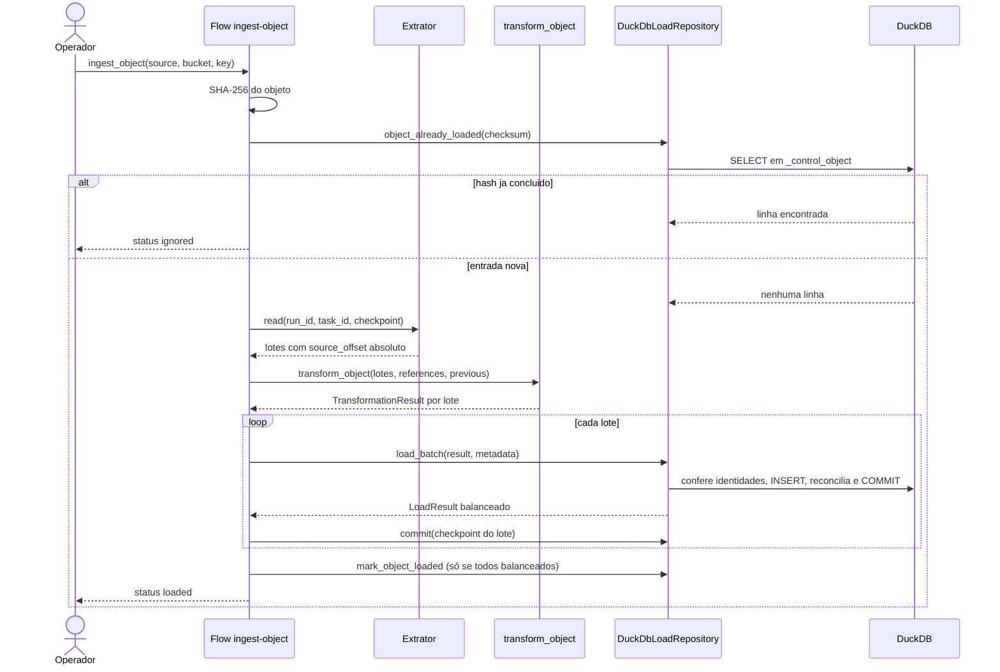

# Visão de Engenharia do ETL (ISO/IEC 10746) — AN-07

Como o pipeline é executado: onde os processos rodam, como se comunicam, onde os
dados ficam, como a execução é coordenada, o que é medido e como o sistema se
recupera de uma falha. A visão descreve o ambiente **declarado no repositório**
(base de 25/09/2026, revisão de contratos em 06/10/2026); capacidade que
existe apenas como decisão está marcada
como planejada.

O ambiente e o pipeline de verificação estão registrados no
[ADR 0004](adrs/0004-execucao-local-e-integracao-continua.md).

## Execução

### Topologia servida da Sprint 4

Todos os serviços abaixo estão declarados em `docker-compose.yml`, na raiz do
repositório, e sobem com `docker compose up -d`. A revisão descreve a
configuração versionada; execução e capturas têm registros próprios.

| Serviço | Imagem | Papel | Portas/volumes | Saúde |
| :--- | :--- | :--- | :--- | :--- |
| `minio` | `minio/minio:latest` | Armazenamento de objetos e console | 9000 (API), 9001 (console), `minio-data` | `mc ready local` |
| `createbucket` | `minio/mc:latest` | Cria o bucket `sindusfarma` e encerra | — | — |
| `prefect-server` | Construída pelo `Dockerfile` | API, UI e histórico do Prefect | 4200, `prefect-data` | `GET /api/health` |
| `scheduler` | Construída pelo `Dockerfile` | Serve o deployment `pipeline-completo/agendado-dw` (cron `0 3 * * *`) | `duck-data`; `restart: unless-stopped` | depende de `prefect-server` saudável |
| `health-monitor` | Construída pelo `Dockerfile` | Checa Prefect/DuckDB a cada 60s, subprocesso limitado a 30s; emite relatório mesmo sem flows | `duck-data`; `restart: unless-stopped` | diferencia `ok`, `busy` e `degraded`; não reinicia API/banco |
| `runner` | Construída pelo `Dockerfile` | Executa flows, scripts, health check e testes | `duck-data`, `src`, `scripts`, `observability` | — |
| `elasticsearch` | `elasticsearch:8.15.0` | Índice da telemetria `etl-logs-*` | 9200, `es-data` | `_cluster/health` green/yellow |
| `logstash` | `logstash:8.15.0` | Coletor GELF → Elasticsearch | 12201/udp | — |
| `kibana` | `kibana:8.15.0` | Painel operacional e regras de alerta | 5601 | `/api/status` available |

A persistência local fica nos volumes nomeados do Compose; credenciais e
segurança desligada da Elastic Stack destinam-se somente ao ambiente de
desenvolvimento. Não há Deploy Contínuo: implantação fora do ambiente local
exige autenticação, retenção e aprovação próprias (ADR 0004 e 0006).

O `runner` parte de `python:3.12-slim`, instala `requirements.txt`, define
`PYTHONPATH=/app/src` e `PREFECT_LOGGING_LEVEL=INFO`, e permanece vivo com
`sleep infinity` para receber comandos. O código de `src/` e `scripts/` é
montado em volume, de modo que uma alteração local vale na próxima execução sem
reconstruir a imagem.

O banco de ingestão é um arquivo local do DuckDB, preparado por
`prepare_database(settings)` em
[`environment.py`](../src/etl/load/environment.py) e verificado por
`run_health_check(settings)`, que confere três pontos: existência do arquivo,
resposta a uma consulta simples e persistência de uma escrita entre conexões. O
procedimento está documentado em [`ambiente-duckdb.md`](ambiente-duckdb.md).

Comandos de execução:

```bash
docker compose up -d
docker compose run --rm --no-deps runner python scripts/orchestration/run_ingest.py --source empresas
docker compose run --rm --no-deps runner python scripts/orchestration/run_backfill.py --sources empresas
# Pipeline completo: as seis fontes antes da carga DW e da publicação
docker compose run --rm --no-deps runner python scripts/orchestration/run_pipeline.py
docker compose run --rm --no-deps runner python scripts/orchestration/health_check.py
```

Os comandos de objeto e backfill isolado terminam na ingestão tratada.
`run_pipeline` usa o mesmo DuckDB nas tasks analíticas, reconcilia a carga
efetiva e publica em `ETL_PUBLISH_DIR` (padrão `/data/publicacao`).

O deployment agendado não precisa de comando manual: o serviço `scheduler`
executa `scripts/orchestration/deployment.py` e reinicia sozinho.

## Rede e comunicação

| Origem | Destino | Protocolo | Conteúdo |
| :--- | :--- | :--- | :--- |
| `health-monitor` | Construída pelo `Dockerfile` | Checa Prefect/DuckDB a cada 60s, subprocesso limitado a 30s; emite relatório mesmo sem flows | `duck-data`; `restart: unless-stopped` | diferencia `ok`, `busy` e `degraded`; não reinicia API/banco |
| `runner` | `minio:9000` | HTTP, API S3 | Leitura do objeto e upload de fixtures |
| Operador | `localhost:9001` | HTTP | Console do MinIO |
| `health-monitor` | Construída pelo `Dockerfile` | Checa Prefect/DuckDB a cada 60s, subprocesso limitado a 30s; emite relatório mesmo sem flows | `duck-data`; `restart: unless-stopped` | diferencia `ok`, `busy` e `degraded`; não reinicia API/banco |
| `runner` | Arquivo local | Chamada de sistema | Escrita no DuckDB |
| MinIO | Adaptador de eventos (`watch_landing.py`) | HTTP, webhook | `s3:ObjectCreated` (ou polling do prefixo `landing/`) |
| `runner`, `scheduler` | `prefect-server:4200` | HTTP | Estados, logs e histórico dos flow runs |
| Daemon Docker (driver GELF do `runner`/`scheduler`) | Logstash `127.0.0.1:12201` | UDP, GELF | Log JSON estruturado, best-effort |
| Logstash | `elasticsearch:9200` | HTTP | Indexação em `etl-logs-YYYY.MM.dd` |
| Operador | `localhost:5601` / `localhost:4200` | HTTP | Kibana (painel, alertas) e UI do Prefect |

O TLS é derivado do esquema do endpoint: `_minio_client` em
[`flow.py`](../src/etl/orchestration/flow.py) usa `secure=True` apenas quando o
endpoint começa com `https`. No ambiente local, o tráfego é HTTP dentro da rede
do Compose.

Credenciais chegam por variável de ambiente e são encapsuladas em `SecretValue`,
cuja representação textual é mascarada. `ExtractionSettings.safe_summary()`
existe para registrar a configuração sem revelar segredo.

## Armazenamento

| Área | Onde | Conteúdo | Mutabilidade |
| :--- | :--- | :--- | :--- |
| Entrada | MinIO, bucket `sindusfarma`, prefixo `landing` | Objeto recebido | Imutável |
| Intermediária | MinIO, área `bronze` | Representação por lote — **planejada, não implementada**; a extração lê `landing/` direto | — |
| Ingestão tratada | DuckDB, `ingestao_<fonte>` | Linhas conformes com proveniência | Acrescida por versão |
| Rejeição | DuckDB, `rejected` e `rejected_reason` | Ocorrência recusada e motivos | Acrescida |
| Controle | DuckDB, `_control_object`, `_loaded_identity`, `_checkpoint`, `_batch_metadata` | Estado técnico da execução | Convergente por chave |
| Analítica | DuckDB, `DIM_*` e `FATO_*` (C01–C04) | Cubos materializados por `etl.analytics` | Recriada por carga analítica conciliada |
| Publicação | Diretório de geração com 7 Parquet + `manifest.json` | Recortes agregados para o Power BI | Imutável por geração |
| Telemetria | Elasticsearch, `es-data` | Eventos técnicos sem payload de negócio | Acrescida; retenção não definida |
| Volumes | `minio-data`, `duck-data`, `prefect-data`, `es-data` | Persistência entre reinícios dos contêineres | Persistente |

Não há política de retenção definida para as versões acumuladas na tabela de
ingestão nem para os objetos da área de entrada. É pendência registrada no ADR
0002.

## Configuração

| Variável | Lida por | Padrão |
| :--- | :--- | :--- |
| `ETL_MINIO_ENDPOINT` | `load_extraction_settings` | — |
| `ETL_MINIO_BUCKET` | `load_extraction_settings` | — |
| `ETL_MINIO_INPUT_PREFIX` | `load_extraction_settings` | `landing` |
| `ETL_MINIO_ACCESS_KEY`, `ETL_MINIO_SECRET_KEY` | `load_extraction_settings` | — |
| `ETL_REQUEST_TIMEOUT_SECONDS` | `load_extraction_settings` | 30 |
| `ETL_EXTRACTION_BATCH_SIZE` | `load_extraction_settings` | 1000 |
| `ETL_EXTRACTION_MAX_ATTEMPTS` | `load_extraction_settings`, consumida por `RetryExecutor.from_settings` | 3 |
| `ETL_EXTRACTION_RETRY_INITIAL_DELAY_SECONDS` | `load_extraction_settings`, consumida por `RetryExecutor.from_settings` | 0,5 |
| `ETL_EXTRACTION_RETRY_MAX_DELAY_SECONDS` | `load_extraction_settings`, consumida por `RetryExecutor.from_settings` | 5 |
| `ETL_DUCKDB_PATH` | `load_duckdb_settings` | `data/duckdb/ingestao.duckdb` |
| `ETL_DUCKDB_THREADS` | `load_duckdb_settings` | Padrão do DuckDB |
| `ETL_DUCKDB_MEMORY_LIMIT` | `load_duckdb_settings` | Padrão do DuckDB |
| `ETL_DUCKDB_WRITE_LOCK_TIMEOUT_SECONDS` | `load_duckdb_settings` | 300 |
O flow e o repositório leem o mesmo `ETL_DUCKDB_PATH`; no Compose ele aponta para `/data/warehouse.duckdb`. O TLS do MinIO é derivado do esquema do endpoint.

## Orquestração

### Agendamento e parâmetros efetivos

`scripts/orchestration/deployment.py` serve o deployment `agendado` do flow
`ingest-object` com cron `0 3 * * *`. Na configuração versionada, a execução é
diária às 03:00 no fuso do servidor Prefect; não há `timezone` explícito no
script. Os parâmetros padrão são `source=empresas`, bucket vindo de
`ETL_MINIO_BUCKET` (ou `sindusfarma`) e chave `landing/empresas.csv`.

| Controle | Valor/fonte | Efeito operacional |
| :--- | :--- | :--- |
| Agenda | `0 3 * * *` | Uma execução diária enquanto o processo servido estiver ativo. |
| Reprocessamento | `reprocess=false` por padrão | Checksum já concluído é ignorado. |
| Timeout de acesso | `ETL_REQUEST_TIMEOUT_SECONDS` | Limita operações com a fonte. |
| Tamanho do lote | `ETL_EXTRACTION_BATCH_SIZE` | Registros por lote e por checkpoint. |
| Tentativas | `ETL_EXTRACTION_MAX_ATTEMPTS` | Restringe retry de falha transitória. |
| Espera | `ETL_EXTRACTION_RETRY_INITIAL_DELAY_SECONDS` e `ETL_EXTRACTION_RETRY_MAX_DELAY_SECONDS` | Controla backoff limitado. |
| Banco | argumento `db_path` ou `ETL_DUCKDB_PATH` | Mantém o mesmo destino entre agenda, UI e CLI. |

Execução manual e backfill devem informar seus parâmetros no histórico do
Prefect; alterar o script não é necessário para uma reexecução pontual.

O plano de controle é o Prefect. O `prefect-server` do Compose persiste
agendamentos e histórico; o `scheduler` serve o deployment por `flow.serve()`.
Os deployments `ingest-object/manual` e `backfill` de `prefect.yaml` são
publicados pela CLI para execução parametrizada pela UI. A disponibilidade do
orquestrador é verificada pelo health check (OB-09) e pela regra de alerta
"fila parada".

| Mecanismo | Implementação | Parâmetros |
| :--- | :--- | :--- |
| Agendamento | `ingest_object.serve(name="agendado", cron="0 3 * * *")` em `scripts/orchestration/deployment.py` | `source`, `bucket`, `key` |
| Execução sob demanda | `scripts/orchestration/run_ingest.py` | `--source`, `--key`, `--fixture` |
| Backfill | `scripts/orchestration/run_backfill.py` e o flow `backfill` | `sources`, `bucket`, `prefix`, `reprocess` |
| Disparo por evento | `scripts/orchestration/watch_landing.py` (webhook `s3:ObjectCreated` ou polling) | `bucket`, `key`, `version_id`, `event_id` |

As dependências entre etapas são declaradas pela ordem das tasks dentro do flow:
`extract`, `transform` e `load` se encadeiam pelo valor retornado, de modo que a
falha de uma impede a execução das seguintes. O histórico de cada run, com
parâmetros e estado por task, fica no Prefect.

O agendamento é servido pelo contêiner `scheduler` com `restart: unless-stopped`;
agendamentos e histórico vivem no volume `prefect-data` do `prefect-server` e
sobrevivem a `docker compose down/up`. Uma task falha pode ser reexecutada pela
UI do Prefect ou pelo mesmo comando; a retomada parte do último checkpoint
confirmado.

## Recuperação

| Situação | Tratamento | Onde |
| :--- | :--- | :--- |
| Falha transitória na leitura do objeto | `RetryExecutor` repete com espera progressiva, até `max_attempts` | `resilience.py` |
| Classificação da falha | `classify_source_failure` decide por status HTTP, código do MinIO, nome da exceção e `errno` | `failures.py` |
| Falha permanente | `PermanentSourceError`; `_should_retry` recusa nova tentativa no nível do Prefect | `failures.py`, `flow.py` |
| Limite de tentativas esgotado | `RetryLimitExceededError` | `resilience.py` |
| Etapa travada | `timeout_seconds=120` em `extract`/`transform` e `3600` em `load` | `flow.py` |
| Banco ocupado por outro escritor | `_connect_with_retry` espera até `write_lock_timeout_seconds` e então levanta `WriteLockTimeoutError` | `duckdb_repository.py` |
| Falha durante a gravação do lote | `ROLLBACK` e registro do lote com status `falha` fora da transação | `duckdb_repository.py` |
| Identidade já persistida por outro lote | Reclassificada dentro da transação: mesmo conteúdo = duplicata; conteúdo divergente = `IDENTITY_CONFLICT` | `duckdb_repository.py` (`_reconcile_with_persisted`) |
| Reconciliação que não fecha | `UnbalancedLoadError` antes do `COMMIT`: rollback, lote falho, checkpoint e objeto não confirmados, sem retry | `duckdb_repository.py`, `flow.py` |
| Reexecução do mesmo objeto | `_control_object` responde `ignored` sem nova carga | `flow.py` |
| Retomada após interrupção | Checkpoint confirmado lote a lote depois do `COMMIT` e da reconciliação; `source_offset` absoluto preservado na retomada; checkpoint de outra versão do objeto é descartado | `flow.py`, `csv_extractors.py` |

A ordem de confirmação é a garantia central: **carga, reconciliação e só então
checkpoint e hash**. Uma falha em qualquer ponto anterior deixa o estado
confirmado intacto, e a execução seguinte refaz o trecho em vez de saltá-lo.

A sequência completa, com os cenários de falha e de reenvio, está em
[`assets/uml/sequencia-ingestao-etl.plantuml`](assets/uml/sequencia-ingestao-etl.plantuml).
O resumo da execução normal e do reenvio:



## Métricas e telemetria

### Sinais, coleta e alertas

| Sinal | Produção | Coleta/retenção | Painel/alerta |
| :--- | :--- | :--- | :--- |
| Estado do flow/task, tentativas | Prefect | `prefect-server` (volume `prefect-data`) | UI do Prefect (4200) |
| Marcos de orquestração | `orchestration.*.emitted` (`flow.py`) | Logstash → `etl-logs-*` | Painel Kibana: status e duração por etapa |
| Lote extraído | `ExtractionBatchLogEvent` (`extraction.batch.emitted`) | Logstash → `etl-logs-*` | Painel: volumes (`byte_count`, `record_count`) |
| Lote transformado | `TransformationBatchLogEvent` (`transformation.batch.emitted`) | Logstash → `etl-logs-*` | Painel: aceitos, rejeitados, duplicados |
| Lote carregado/falho | `LoadBatchLogEvent` (`load.batch.emitted`) | Logstash → `etl-logs-*` | Painel: `loaded_count`, rejeições; alerta de falha |
| Retry e latência | `extraction.retry.emitted`, `load.connect_retry.emitted` | Logstash → `etl-logs-*` | Painel: tentativas de repetição |
| Disponibilidade | `orchestration.health_check.emitted` (Prefect + DuckDB) | Logstash → `etl-logs-*` | Alerta "ETL - falha de execução" (status `degraded`) |
| Fila parada | Ausência de evento `stage: orchestration` | Elasticsearch | Alerta "ETL - fila parada" (26 h) |
| Contagens conciliadas | DuckDB, `reconciliacao_execucao` | Volume `duck-data` | Consulta SQL |

Todos os eventos carregam correlação por `run_id`, `task_id` (o `task_run.id`
do Prefect, ADR 0008) e `batch_id`, sem payload de negócio. O painel está
versionado em `observability/kibana/painel-operacional.ndjson`; as duas regras
de alerta estão especificadas no runbook e são criadas pela UI ou pela API de
Alerting do Kibana, porque o formato de regra muda entre versões e não é
importável por NDJSON.
O roteiro OB-11 (`scripts/orchestration/smoke_observabilidade.sh`) prova uma
execução concluída e uma falha controlada com o alerta correspondente.

O transporte é best-effort (UDP/GELF): coletor indisponível não bloqueia nem
confirma uma carga, garantia coberta por
`tests/e2e/test_telemetria_e_coletor_indisponivel.py`. Não há fila durável de
telemetria; eventos emitidos com o coletor fora do ar são perdidos, e o estado
autoritativo continua no DuckDB e no Prefect (ADR 0006).

Na recuperação, o último checkpoint confirmado define a retomada. O lote atual
só avança depois de persistência e reconciliação; retry esgotado mantém o
checkpoint anterior e deixa a falha visível no histórico e no evento técnico.

## Verificação automatizada

| Camada | Testes locais | Coberta pelo CI |
| :--- | :--- | :--- |
| Extração | Módulos em `tests/extraction/` | Sim |
| Transformação | Módulos em `tests/transformation/` | Sim |
| Carga | Módulos em `tests/load/` | Sim |
| Orquestração | Módulos em `tests/orchestration/` e `tests/e2e/` | Sim |

```bash
PYTHONPATH=src python -m unittest discover -s tests
```

## Limitações desta visão

- A área intermediária `bronze` é contrato, não implementação.
- A notificação `s3:ObjectCreated` do MinIO ao `watch_landing.py` é configurada
  manualmente pelo operador (`mc event add`); o modo polling dispensa essa
  configuração.
- As regras de alerta do Kibana não fazem parte do NDJSON do painel e são
  criadas pela API (comandos no runbook); não há canal de
  notificação (e-mail, chat) nem política de retenção do índice.
- Os testes automatizados substituem apenas o armazenamento de objetos por
  leitor em memória; a integração real com MinIO, Prefect e Elastic Stack é
  exercitada pelo smoke operacional OB-11.
- Elastic Stack e MinIO rodam sem autenticação forte, adequados apenas ao
  ambiente local.
