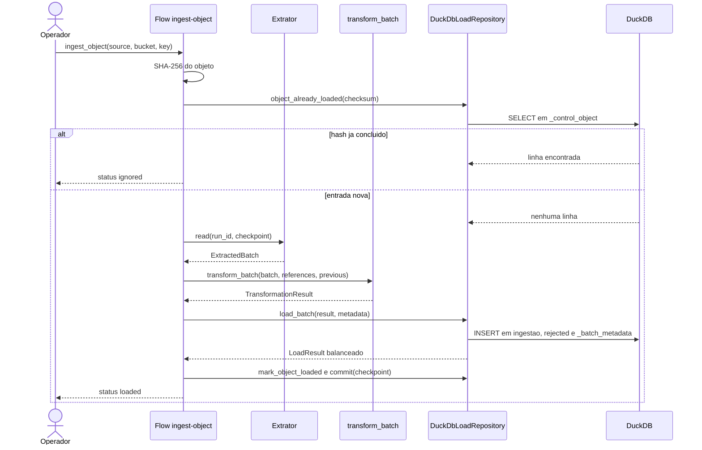

# Visão de Engenharia do ETL (ISO/IEC 10746) — AN-07

Como o pipeline é executado: onde os processos rodam, como se comunicam, onde os
dados ficam, como a execução é coordenada, o que é medido e como o sistema se
recupera de uma falha. A visão descreve o ambiente **declarado no repositório**;
capacidade que existe apenas como decisão está marcada como planejada.

O ambiente e o pipeline de verificação estão registrados no
[ADR 0004](adrs/0004-execucao-local-e-integracao-continua.md).

## Execução

O ambiente local é declarado em `docker-compose.yml`, na raiz do repositório.

| Serviço | Imagem | Papel | Portas |
| :--- | :--- | :--- | :--- |
| `minio` | `minio/minio:latest` | Armazenamento de objetos e console | 9000 (API), 9001 (console) |
| `createbucket` | `minio/mc:latest` | Cria o bucket `sindusfarma` e encerra | — |
| `runner` | Construída pelo `Dockerfile` | Executa flows, scripts e testes | — |

O `runner` parte de `python:3.12-slim`, instala `requirements.txt`, define
`PYTHONPATH=/app/src` e `PREFECT_LOGGING_LEVEL=INFO`, e permanece vivo com
`sleep infinity` para receber comandos. O código de `src/` e `scripts/` é
montado em volume, de modo que uma alteração local vale na próxima execução sem
reconstruir a imagem.

O banco de ingestão é um arquivo local do DuckDB, preparado por
`prepare_database(settings)` em
[`environment.py`](../src/etl/load/environment.py) e verificado por
`run_health_check(settings)`, que confere três pontos: existência do arquivo,
resposta a uma consulta simples e persistência de uma escrita entre conexões. O
procedimento está documentado em [`ambiente-duckdb.md`](ambiente-duckdb.md).

Comandos de execução:

```bash
docker compose up -d
docker compose exec runner python scripts/orchestration/run_ingest.py --source empresas
docker compose exec runner python scripts/orchestration/run_backfill.py --sources empresas
docker compose exec runner python scripts/orchestration/deployment.py
```

## Rede e comunicação

| Origem | Destino | Protocolo | Conteúdo |
| :--- | :--- | :--- | :--- |
| `runner` | `minio:9000` | HTTP, API S3 | Leitura do objeto e upload de fixtures |
| Operador | `localhost:9001` | HTTP | Console do MinIO |
| `runner` | Arquivo local | Chamada de sistema | Escrita no DuckDB |
| MinIO | Adaptador de eventos | HTTP, webhook | `s3:ObjectCreated` — **planejado** |
| Componentes | Logstash | TCP | Log estruturado — **planejado** |

O TLS é derivado do esquema do endpoint: `_minio_client` em
[`flow.py`](../src/etl/orchestration/flow.py) usa `secure=True` apenas quando o
endpoint começa com `https`. No ambiente local, o tráfego é HTTP dentro da rede
do Compose.

Credenciais chegam por variável de ambiente e são encapsuladas em `SecretValue`,
cuja representação textual é mascarada. `ExtractionSettings.safe_summary()`
existe para registrar a configuração sem revelar segredo.

## Armazenamento

| Área | Onde | Conteúdo | Mutabilidade |
| :--- | :--- | :--- | :--- |
| Entrada | MinIO, bucket `sindusfarma`, prefixo `landing` | Objeto recebido | Imutável |
| Intermediária | MinIO, área `bronze` | Representação por lote — **planejada** | Imutável |
| Ingestão tratada | DuckDB, `ingestao_<fonte>` | Linhas conformes com proveniência | Acrescida por versão |
| Rejeição | DuckDB, `rejected` e `rejected_reason` | Ocorrência recusada e motivos | Acrescida |
| Controle | DuckDB, `_control_object`, `_loaded_identity`, `_checkpoint`, `_batch_metadata` | Estado técnico da execução | Convergente por chave |
| Volumes | `minio-data`, `duck-data` | Persistência entre reinícios dos contêineres | Persistente |

Não há política de retenção definida para as versões acumuladas na tabela de
ingestão nem para os objetos da área de entrada. É pendência registrada no ADR
0002.

## Configuração

| Variável | Lida por | Padrão |
| :--- | :--- | :--- |
| `ETL_MINIO_ENDPOINT` | `load_extraction_settings` | — |
| `ETL_MINIO_BUCKET` | `load_extraction_settings` | — |
| `ETL_MINIO_INPUT_PREFIX` | `load_extraction_settings` | `landing` |
| `ETL_MINIO_ACCESS_KEY`, `ETL_MINIO_SECRET_KEY` | `load_extraction_settings` | — |
| `ETL_REQUEST_TIMEOUT_SECONDS` | `load_extraction_settings` | 30 |
| `ETL_EXTRACTION_BATCH_SIZE` | `load_extraction_settings` | 1000 |
| `ETL_EXTRACTION_MAX_ATTEMPTS` | `load_extraction_settings`, consumida por `RetryExecutor.from_settings` | 3 |
| `ETL_EXTRACTION_RETRY_INITIAL_DELAY_SECONDS` | `load_extraction_settings`, consumida por `RetryExecutor.from_settings` | 0,5 |
| `ETL_EXTRACTION_RETRY_MAX_DELAY_SECONDS` | `load_extraction_settings`, consumida por `RetryExecutor.from_settings` | 5 |
| `ETL_DUCKDB_PATH` | `load_duckdb_settings` | `data/duckdb/ingestao.duckdb` |
| `ETL_DUCKDB_THREADS` | `load_duckdb_settings` | Padrão do DuckDB |
| `ETL_DUCKDB_MEMORY_LIMIT` | `load_duckdb_settings` | Padrão do DuckDB |
| `ETL_DUCKDB_WRITE_LOCK_TIMEOUT_SECONDS` | `load_duckdb_settings` | 300 |
O flow e o repositório leem o mesmo `ETL_DUCKDB_PATH`; no Compose ele aponta para `/data/warehouse.duckdb`. O TLS do MinIO é derivado do esquema do endpoint.

## Orquestração

O plano de controle é o Prefect, executado em processo. Não há servidor,
agente nem worker remoto no ambiente declarado.

| Mecanismo | Implementação | Parâmetros |
| :--- | :--- | :--- |
| Agendamento | `ingest_object.serve(name="agendado", cron="0 3 * * *")` em `scripts/orchestration/deployment.py` | `source`, `bucket`, `key` |
| Execução sob demanda | `scripts/orchestration/run_ingest.py` | `--source`, `--key`, `--fixture` |
| Backfill | `scripts/orchestration/run_backfill.py` e o flow `backfill` | `sources`, `bucket`, `prefix`, `reprocess` |
| Disparo por evento | **Planejado** (ADR 0001) | `bucket`, `key`, `version_id`, `event_id` |

As dependências entre etapas são declaradas pela ordem das tasks dentro do flow:
`extract`, `transform` e `load` se encadeiam pelo valor retornado, de modo que a
falha de uma impede a execução das seguintes. O histórico de cada run, com
parâmetros e estado por task, fica no Prefect.

Como o agendamento é servido em processo, ele existe apenas enquanto o comando
`deployment.py` estiver rodando. Uma parada do contêiner interrompe o cron sem
recuperação automática.

## Recuperação

| Situação | Tratamento | Onde |
| :--- | :--- | :--- |
| Falha transitória na leitura do objeto | `RetryExecutor` repete com espera progressiva, até `max_attempts` | `resilience.py` |
| Classificação da falha | `classify_source_failure` decide por status HTTP, código do MinIO, nome da exceção e `errno` | `failures.py` |
| Falha permanente | `PermanentSourceError`; `_should_retry` recusa nova tentativa no nível do Prefect | `failures.py`, `flow.py` |
| Limite de tentativas esgotado | `RetryLimitExceededError` | `resilience.py` |
| Etapa travada | `timeout_seconds=120` em cada task | `flow.py` |
| Banco ocupado por outro escritor | `_connect_with_retry` espera até `write_lock_timeout_seconds` e então levanta `WriteLockTimeoutError` | `duckdb_repository.py` |
| Falha durante a gravação do lote | `ROLLBACK` e registro do lote com status `falha` fora da transação | `duckdb_repository.py` |
| Reexecução do mesmo objeto | `_control_object` responde `ignored` sem nova carga | `flow.py` |
| Retomada após interrupção | Checkpoint confirmado apenas depois da carga; checkpoint de outra versão do objeto é descartado | `flow.py` |

A ordem de confirmação é a garantia central: **carga, reconciliação e só então
checkpoint e hash**. Uma falha em qualquer ponto anterior deixa o estado
confirmado intacto, e a execução seguinte refaz o trecho em vez de saltá-lo.

A sequência completa, com os cenários de falha e de reenvio, está em
[`assets/uml/sequencia-ingestao-etl.plantuml`](assets/uml/sequencia-ingestao-etl.plantuml).
O resumo da execução normal e do reenvio:



## Métricas e telemetria

O que existe hoje:

- `transform_batch` devolve, em `TransformationResult.metrics`, os campos
  `source`, `run_id`, `task_id`, `batch_id`, `stage`, `status`,
  `extracted_count`, `accepted_count`, `rejected_count`, `duplicate_count`,
  `input_bytes` e `duration_seconds`;
- `LoadResult.as_dict()` devolve `extracted`, `loaded`, `rejected`,
  `duplicates` e `balanced`, registrados em log pela task `load`;
- `_batch_metadata` persiste status e contagens por lote, e as views `execucao`
  e `reconciliacao_execucao` os consolidam por execução;
- `ExtractionBatchLogEvent` emite um evento JSON por lote extraído, por
  `StandardLoggingSink`, para o `logging` da biblioteca padrão;
- o Prefect registra estado, duração e parâmetros de cada run.

**Atualização (Sprint 4, OB-07/OB-08/OB-09):** o envio de métricas e traces ao
coletor (Logstash → Elasticsearch), o painel operacional no Kibana, o health
check exposto da orquestração e as regras mínimas de alerta foram
implementados — ver `docs/runbook-execucao.md` e `observability/`. A nota
anterior descrevia isso como ausente do `develop` e apontava para as branches
`task-196-ov-05` a `task-199-ov-08` da Sprint 3, que de fato não chegaram a
ser integradas; o trabalho foi refeito do zero na Sprint 4. Nesta data as
branches correspondentes ainda não foram mergeadas — confirmar o estado do
merge antes de tratar esta seção como refletindo o `develop`. Até lá, a
verificação operacional disponível continua sendo as views de reconciliação
no DuckDB e o histórico de runs do Prefect.

## Verificação automatizada

| Camada | Testes locais | Coberta pelo CI |
| :--- | :--- | :--- |
| Extração | Módulos em `tests/extraction/` | Sim |
| Transformação | Módulos em `tests/transformation/` | Sim |
| Carga | Módulos em `tests/load/` | Sim |
| Orquestração | Módulos em `tests/orchestration/` e `tests/e2e/` | Sim |

```bash
PYTHONPATH=src python -m unittest discover -s tests
```

## Limitações desta visão

- O disparo por evento e a área intermediária `bronze` são contrato, não
  implementação.
- A observabilidade prevista no ADR 0001 não pode ser exercitada no ambiente
  declarado, que não inclui a Elastic Stack.
- Os testes do flow substituem apenas o armazenamento de objetos por leitor em
  memória; a integração real com MinIO requer Docker e permanece como smoke
  operacional documentado.
- O agendamento não sobrevive à parada do processo que o serve.
