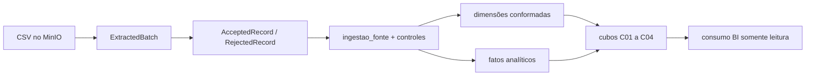

# Visão de Informação do ETL (ISO/IEC 10746) — AN-05

Visão de informação do pipeline da Sprint 3: que dados entram, como eles são
representados em cada etapa, que metadados os acompanham, o que acontece com o
que é recusado e como o resultado é persistido no DuckDB. A visão descreve o
comportamento **implementado** em [`src/etl/`](../src/etl/); onde algo é apenas
contrato, isso está dito na própria linha.

O destino é o DuckDB, conforme o
[ADR 0001](adrs/0001-arquitetura-etl-python-prefect-minio-duckdb.md). O grão e a
identidade de cada linha da tabela de ingestão seguem o
[ADR 0002](adrs/0002-identidade-e-versoes-na-tabela-de-ingestao.md).

## Cadeia de representação

O mesmo dado muda de forma quatro vezes entre a origem e a consulta:

| Etapa | Representação | Onde vive |
| :--- | :--- | :--- |
| Origem | Objeto imutável, byte a byte como recebido | MinIO, área de entrada (`landing`) |
| Extração | `ExtractedBatch`: registros como texto, mais checkpoint e metadados | Memória, no contrato de [`contracts.py`](../src/etl/extraction/contracts.py) |
| Transformação | `AcceptedRecord` e `RejectedRecord`: valores tipados e violações | Memória, em [`pipeline.py`](../src/etl/transformation/pipeline.py) |
| Carga | Linhas tipadas com proveniência, e rejeições com motivo | DuckDB, tabelas `ingestao_<fonte>`, `rejected` e `rejected_reason` |

Nenhuma etapa altera a anterior. A representação da origem permanece disponível
para reprocessamento, o que torna toda transformação refazível a partir do
objeto original.

## Fontes

As seis fontes são snapshots CSV separados por `;` e codificados em UTF-8 com
BOM, detalhados em [`inventario-fontes-etl.md`](inventario-fontes-etl.md).

| Fonte | Grão | Chave declarada em `schema.py` | Volume observado (v3) |
| :--- | :--- | :--- | ---: |
| `pesquisas.csv` | Uma linha por pesquisa | `pesquisa_id` | 366 |
| `empresas.csv` | Uma linha por empresa | `empresa_id` | 779 |
| `clientes.csv` | Uma linha por pessoa cadastrada | `cliente_id` | 5.430 |
| `respondentes.csv` | Uma linha por participação | Sem chave de negócio declarada | 18.735 |
| `questoes.csv` | Uma linha por pergunta em pesquisa | `pesquisa_id` e `pergunta_id` | 3.297 |
| `respostas.csv` | Uma linha por elemento de resposta | `pesquisa_id` e `resposta_id` | 281.835 |

`respondentes` é a única fonte sem chave de negócio: sua identidade é a
ocorrência física, formada por `source_checksum` e `source_offset`
(`POSITIONAL_KEY` em [`ddl.py`](../src/etl/load/ddl.py)). A consequência está
registrada no ADR 0002: a fonte é reingerida por inteiro a cada reexportação.

Frequência de atualização, fuso horário, tipo de carga e forma de acesso
permanecem **pendentes de confirmação com o parceiro**. Enquanto isso, cada
arquivo é tratado como snapshot estático, não como fonte contínua.

## Schema canônico

O contrato de destino é declarado em
[`schema.py`](../src/etl/transformation/schema.py), com `SCHEMA_VERSION = "1.0"`.
Cada campo declara nome de origem, nome canônico, tipo, obrigatoriedade e
sentinelas — valores que a fonte usa para representar ausência e que não podem
ser confundidos com dado válido.

| Tipo canônico | Conversão aplicada | Tipo no DuckDB |
| :--- | :--- | :--- |
| `text`, `id` | Texto normalizado | `VARCHAR` |
| `integer` | Inteiro | `BIGINT` |
| `decimal`, `percent` | Decimal com 6 casas; percentual normalizado | `DECIMAL(18, 6)` |
| `date` | Data civil | `DATE` |
| `datetime` | Instante com fuso | `TIMESTAMP` |
| `boolean` | Booleano | `BOOLEAN` |
| `list` | Lista de textos, separada na origem por barra vertical entre espaços | `VARCHAR` com JSON |

Sentinelas observadas e tratadas como ausência: `s/i` em `clientes.id_cliente` e
`respondentes.id_cliente`, `-` em `empresas.Associado`, `na` e `n/a` em
`respondentes.market_share` e `respostas.valor`.

O contrato canônico declara diretamente os tipos DuckDB
(`Field.duckdb_type`), validado por `duckdb_type()` em
[`ddl.py`](../src/etl/load/ddl.py). O destino efetivo é o DuckDB; o nome
remanescente é a pendência registrada na
[matriz de rastreabilidade](matriz-rastreabilidade-sprint3.md).

## Metadados técnicos

Nenhuma linha entra na ingestão sem proveniência. Os metadados vêm de duas
fontes complementares.

**Do lote**, em `BatchMetadata`
([`contracts.py`](../src/etl/extraction/contracts.py)): `source`, `run_id`,
`task_id`, `batch_id`, `started_at`, `finished_at`, `record_count`,
`byte_count`, `schema_version`, `source_checksum` e `contract_version`.

**Da linha**, acrescentados pela transformação (`TECHNICAL_COLUMNS` em
`schema.py`):

| Coluna | O que registra |
| :--- | :--- |
| `source` | Fonte de origem do registro |
| `run_id`, `task_id`, `batch_id` | Execução, tarefa e lote que produziram a linha |
| `source_checksum` | SHA-256 do objeto de origem |
| `source_offset` | Posição absoluta da linha dentro da fonte |
| `content_checksum` | Digest do conteúdo canônico da linha |
| `record_identity` | Identidade do registro: chave de negócio ou ocorrência física |
| `idempotency_key` | Identidade combinada com o conteúdo; chave primária da tabela |
| `ingested_at` | Instante da ingestão, em UTC |
| `schema_version` | Versão do contrato canônico aplicado |

Esses campos permitem responder, para qualquer linha, de qual arquivo e de qual
posição ela veio, em que execução foi gravada e sob qual versão de contrato.

## Rejeições

A validação é fail-closed: um registro que não satisfaz o contrato não entra na
tabela de ingestão e também não é descartado. Ele é gravado com o motivo.

- `normalize_record` aplica conversão e nulabilidade; `validate_consistency`
  aplica integridade referencial contra os pais já carregados.
- Cada violação é um par `(code, field)` (`Violation` em
  [`validation.py`](../src/etl/transformation/validation.py)).
- A ocorrência rejeitada vira `RejectedRecord`, com `rejection_id` derivado da
  ocorrência e do conjunto de motivos.
- A carga grava a ocorrência em `rejected` e cada motivo em `rejected_reason`.

Nenhuma tabela de ingestão carrega motivo de rejeição, e nenhuma tabela de
rejeição carrega o conteúdo do registro: a rejeição referencia a origem por
`source_checksum` e `source_offset`, o que permite recuperar o valor exato no
objeto imutável sem replicar dado pessoal na camada de erro.

O módulo [`quarantine.py`](../src/etl/transformation/quarantine.py) também
oferece um `QuarantineStore` em SQLite, com permissões restritas. **Ele não é
usado no caminho produtivo**: apenas o dataclass `RejectedRecord` é compartilhado
com a carga. As rejeições reais vivem no DuckDB.

## Duplicidade e versões

`classify_duplicates` ([`identity.py`](../src/etl/transformation/identity.py))
compara cada candidato com as identidades já carregadas, obtidas da tabela de
controle `_loaded_identity`, e classifica em três resultados:

| Resultado | Condição | Destino |
| :--- | :--- | :--- |
| `accepted` | Identidade nova | Tabela de ingestão |
| `duplicate` | Mesma identidade e mesmo conteúdo | Contabilizado, não gravado |
| Conflito | Mesma identidade e conteúdo diferente | Rejeitado com `IDENTITY_CONFLICT` |

O ADR 0002 decidiu que o destino aceita versões do mesmo registro, mas a
classificação **ainda recusa** a correção do parceiro como conflito. Essa
divergência é conhecida, está registrada no próprio ADR e é vigiada pelos testes
de `tests/load/test_identity_coupling.py`.

## Persistência no DuckDB

O contrato físico está em [`ddl.py`](../src/etl/load/ddl.py) e sua forma
revisável em `sql/duckdb/001_ingestao_tratada.sql`, mantidos em sincronia por
`scripts/load/render_ddl.py --check`.

| Estrutura | Nome | Conteúdo |
| :--- | :--- | :--- |
| Tabela de ingestão | `ingestao_<fonte>` | Linhas tipadas e conformes, com proveniência; chave primária `idempotency_key` |
| View de estado atual | `ingestao_<fonte>_atual` | Linha mais recente por chave de negócio; não existe para `respondentes` |
| View de compatibilidade | `<fonte>` | Nome sem prefixo, transitório, para leitores anteriores ao ADR 0002 |
| Rejeição | `rejected` | Uma linha por ocorrência recusada |
| Motivo da rejeição | `rejected_reason` | Uma linha por violação da ocorrência |
| Metadados de lote | `_batch_metadata` | Status e contagens por lote: `carregado`, `carregado_com_rejeicoes` ou `falha` |
| Idempotência por objeto | `_control_object` | SHA-256 de objetos já concluídos |
| Identidades carregadas | `_loaded_identity` | Identidade e conteúdo já gravados, por fonte |
| Retomada | `_checkpoint` | Última posição confirmada por fonte |
| Agregado de execução | `execucao` | View com o consolidado de cada execução |
| Reconciliação | `reconciliacao_execucao` | View que prova extraído = carregado + rejeitado + duplicado |

Os agregados são views, não tabelas: não existe um segundo escritor capaz de
divergir do que a carga gravou lote a lote.

## Reconciliação

Ao fim de cada lote, `load_batch` conta no próprio banco, por `run_id` e
`batch_id`, quantas linhas foram gravadas e quantas foram rejeitadas, e compara
com o que o lote extraído declarava. O resultado é um `LoadResult`, cujo método
`is_balanced()` verifica a equação `extraído = carregado + rejeitado +
duplicado`. A contagem vem do banco, e não das listas em memória, para que a
conta não feche apenas porque as duas pontas nasceram do mesmo objeto.

Um lote revertido é registrado em `_batch_metadata` com status `falha` e
contagens zeradas, já fora da transação desfeita. Sem esse registro, a perda
desapareceria do histórico e a reconciliação fecharia a conta sem notá-la.

## Dado pessoal na cadeia

`clientes.csv` contém `e-mail`, cargo e departamento, e `respondentes.csv`
vincula pessoa, empresa e pesquisa. As regras que se aplicam à informação nesta
cadeia:

- o conteúdo do registro não é escrito em log, métrica ou artefato de CI;
- a rejeição referencia a posição na origem, não o valor recusado;
- `ExtractedBatch.as_attributes()` expõe apenas metadados técnicos, nunca
  registros;
- o objeto bruto permanece restrito ao armazenamento de objetos, e os CSVs reais
  não são versionados.

A política completa está em
[`Governança-de-Dados-do-Projeto.md`](Governança-de-Dados-do-Projeto.md) e em
[`dev-rules.md`](dev-rules.md).

## Camada analítica derivada

A Sprint 4 prolonga a cadeia informacional sem alterar a fonte de verdade da
ingestão. As tabelas analíticas devem ser derivadas exclusivamente das views
`ingestao_<fonte>_atual` e dos controles de execução; nunca dos CSVs brutos nem
de uma segunda transformação mantida pela ferramenta de BI.

| Saída analítica | Fontes tratadas necessárias | Grão esperado |
| :--- | :--- | :--- |
| C01 — Portfólio e ciclo | `pesquisas` e datas conformadas | Uma pesquisa por versão válida |
| C02 — Participação e representatividade | `respondentes`, `empresas`, `clientes`, `pesquisas` | Uma participação em uma pesquisa |
| C03 — Pipeline mensal | Marcos de `pesquisas` e dimensão calendário | Uma pesquisa em um período de referência |
| C04 — Resultados e questionários | `questoes`, `respostas`, `pesquisas` | Uma resposta a uma questão versionada |

O contrato lógico dos quatro cubos permanece em [`dmc.json`](dmc.json). A DDL e
a rotina de carga da camada analítica são dependências dos cards CB-02 a CB-06;
até sua integração, o diagrama acima descreve a cadeia-alvo, não tabelas já
presentes na base `develop`.

### Linhagem entre ingestão e cubos

Cada fato analítico deve preservar uma referência verificável à execução que o
originou. A linhagem mínima é composta por `run_id`, `source_checksum`,
`schema_version` e o instante de atualização; para fatos formados por mais de
uma fonte, a carga deve registrar o conjunto de checksums participantes.

| Pergunta de auditoria | Metadado que responde | Origem canônica |
| :--- | :--- | :--- |
| Qual execução produziu o valor? | `run_id` | `_batch_metadata` e linhas de ingestão |
| Qual snapshot foi usado? | `source_checksum` | `_control_object` e linhas de ingestão |
| Qual contrato tipou o dado? | `schema_version` | `BatchMetadata` e destino tratado |
| O lote fechou as contagens? | extraído, aceito, rejeitado e duplicado | `reconciliacao_execucao` |
| Quando o cubo foi atualizado? | instante e identificador da carga analítica | controle da camada analítica, dependência CB-06 |

O BI consome somente tabelas ou views publicadas. Campos técnicos podem ser
ocultados da camada semântica, mas não removidos do caminho auditável que liga
uma medida ao snapshot tratado.

## Limites desta visão

A implementação integrada na base auditada termina na ingestão tratada. Cubos,
dimensões e fatos do [`dmc.json`](dmc.json) funcionam como contrato de destino
enquanto as dependências CB-02 a CB-06 não forem incorporadas. Esta distinção
evita apresentar desenho lógico como dado já consultável.

| Informação desejada | Estado | Motivo verificável |
| :--- | :--- | :--- |
| Volume e estado das pesquisas | Disponível na ingestão tratada | `pesquisas` possui identidade e datas tipadas. |
| Participação por empresa | Parcial | Existe participação, mas a qualidade do vínculo pessoa–empresa precisa ser preservada. |
| Taxa de resposta | Indisponível | Não há denominador confirmado para população convidada. |
| Representatividade por segmento | Indisponível | Não existe regra aprovada de população-base e ponderação. |
| Resultado agregado por questão | Parcial | Questões e respostas existem; publicação depende das regras de agregação e privacidade. |
| Série histórica anterior aos snapshots | Indisponível | A origem entregue não contém histórico retroativo completo. |

Não há política de retenção definida para as versões acumuladas na tabela de
ingestão, e a ponte entre `respostas.respondent_id` e a base de participação
permanece sem regra confirmada — nenhuma das duas pode ser suposta por
semelhança de valores.
