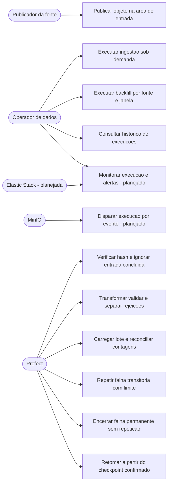

# Visão de Negócio do ETL (ISO/IEC 10746) — AN-04

Visão de negócio do pipeline entregue na Sprint 3: por que ele existe, quem
depende do resultado, o que está dentro e fora do escopo, sob que restrições ele
opera e onde exatamente a entrega termina. É a visão que justifica as demais;
decisões técnicas ficam registradas em [`adrs/index.md`](adrs/index.md).

O contexto de negócio vem de
[`arquitetura-de-negocio.md`](arquitetura-de-negocio.md) e do
[`dmc.json`](dmc.json); o escopo formal da sprint vem de
[`checklist-entregaveis-sprint3.md`](checklist-entregaveis-sprint3.md).

## Objetivo

Na Sprint 4, o objetivo deixa de terminar na disponibilidade técnica da
ingestão: a cadeia deve permitir consumo analítico controlado dos cubos por uma
ferramenta de BI, mantendo rastreabilidade até o snapshot tratado. O valor de
negócio é reduzir a montagem manual de relatórios sem publicar indicadores cujo
dado ou regra ainda não existe.

O sucesso é observado quando:

- o operador identifica execução, atualização e qualidade antes de liberar o
  consumo;
- o analista consulta medidas aprovadas sem acesso de escrita ao warehouse;
- cada indicador publicado possui numerador, denominador, grão e origem;
- uma indisponibilidade é mostrada como tal, não substituída por zero ou proxy.

A Central de Pesquisas do Sindusfarma conduz pesquisas setoriais cujos dados
hoje vivem dispersos em planilhas, sistemas distintos e arquivos reexportados
manualmente. Cruzar informações exige trabalho manual repetido, a origem de cada
dado nem sempre é recuperável e não há um ponto único onde o estado de uma
pesquisa possa ser consultado com confiança.

O objetivo deste pipeline é **transformar os arquivos recebidos do parceiro em
uma base de ingestão tratada, rastreável e reprodutível**, de modo que:

- cada linha carregada possa ser ligada ao arquivo e à posição de onde veio;
- dados que não satisfazem o contrato sejam registrados com o motivo, em vez de
  serem corrigidos ou descartados em silêncio;
- reprocessar a mesma entrada produza o mesmo resultado, sem duplicar dado;
- o trabalho manual de padronização deixe de ser refeito a cada nova exportação.

Este é o insumo para os cubos e painéis descritos no Data Model Canvas, que
**não** fazem parte desta entrega.

## Partes interessadas

| Parte interessada | Decisão apoiada | Forma de consumo | Limite |
| :--- | :--- | :--- | :--- |
| Central de Pesquisas | priorizar operação, prazos e qualidade | dashboards e detalhe agregado | não expor resposta individual |
| Liderança do Sindusfarma | acompanhar portfólio e representatividade | indicadores executivos | somente métricas com regra aprovada |
| Analista de dados | validar cubos e investigar variações | acesso BI somente leitura | sem alterar dado tratado |
| Operador do ETL | executar, retomar e reconciliar cargas | Prefect, logs e controles DuckDB | não redefine regra de negócio |
| Governança/privacidade | autorizar publicação e retenção | evidências de linhagem e catálogo | bloqueia indicador sem base adequada |

| Parte interessada | Relação com o pipeline | O que espera |
| :--- | :--- | :--- |
| Central de Pesquisas | Consumidora principal | Base confiável sobre portfólio, ciclo e participação das pesquisas |
| Áreas técnicas do Sindusfarma | Consumidoras setoriais | Dados das pesquisas sob sua atuação, em forma agregada |
| Gestores | Consumidores executivos | Consolidação de portfólio, adesão e qualidade |
| Empresas participantes e respondentes | Titulares dos dados | Confidencialidade e uso restrito à finalidade da pesquisa |
| Equipe de dados do projeto | Construtora e operadora | Contratos versionados, execução rastreável e ambiente reproduzível |
| Professores avaliadores | Avaliadores da entrega | Evidência verificável de cada requisito do enunciado |

Os papéis de governança — Data Owner, Data Steward, Data Custodian e
responsáveis técnicos — estão registrados no [`dmc.json`](dmc.json) e em
[`Governança-de-Dados-do-Projeto.md`](Governança-de-Dados-do-Projeto.md) como
**baseline documental sujeito a homologação**, não como atribuição formalizada.

## Escopo de negócio

### Consumo analítico controlado

O caminho aprovado é: ingestão tratada reconciliada → carga dos cubos →
publicação somente leitura → modelo semântico do BI. A ferramenta de BI não
transforma a origem, não corrige rejeições e não escreve no DuckDB. A liberação
de uma atualização exige conciliação da execução e identificação do snapshot.

| Etapa | Responsável | Evidência para avançar |
| :--- | :--- | :--- |
| Ingestão | Operador do ETL | execução concluída e `reconciliacao_execucao` balanceada |
| Camada analítica | Rotina de carga dos cubos | contagens de origem e destino reconciliadas |
| Publicação | Responsável por dados | snapshot, data de atualização e conjunto de medidas aprovados |
| Consumo | Analista/gestor | filtro, unidade e período visíveis no relatório |

Não há entrega automatizada em produção nesta arquitetura. Credenciais,
gateway, atualização agendada da ferramenta de BI e permissões corporativas
dependem do ambiente do parceiro.

O pipeline entrega, nesta sprint:

- leitura das seis fontes fornecidas pelo parceiro, preservando o arquivo
  recebido como cópia imutável;
- padronização de nomes, tipos, datas, decimais e valores de ausência;
- separação explícita entre o que é dado válido e o que é dado recusado, com o
  motivo da recusa;
- persistência em uma base consultável por SQL, com proveniência por linha;
- coordenação da execução, com repetição controlada de falhas e retomada segura;
- reconciliação que prova, a cada lote, que nada foi perdido pelo caminho.

Não entrega, por decisão do enunciado: enriquecimento analítico, consolidação de
negócio, cruzamento avançado entre fontes, indicador, agregação, estrutura de
consumo final e implantação automática.

## Restrições

| Restrição | Origem | Consequência para a entrega |
| :--- | :--- | :--- |
| Dados pessoais nas fontes | `clientes.csv` traz e-mail, cargo e departamento; `respondentes.csv` liga pessoa, empresa e pesquisa | Conteúdo de registro não aparece em log, métrica ou artefato de CI; os CSVs reais não são versionados |
| LGPD e finalidade documentada | [`Governança-de-Dados-do-Projeto.md`](Governança-de-Dados-do-Projeto.md) | Tratamento limitado ao mínimo necessário; identidade separada da camada analítica |
| Arquivos como snapshot | [`inventario-fontes-etl.md`](inventario-fontes-etl.md) | Sem frequência de atualização, fuso horário, data de referência ou tipo de carga confirmados |
| Ambiente acadêmico | [ADR 0004](adrs/0004-execucao-local-e-integracao-continua.md) | Execução local em contêineres, com fixtures sintéticas; sem ambiente produtivo |
| Identidades não conciliadas | Inventário de fontes e `dmc.json` | A ponte entre `respostas.respondent_id` e a participação não pode ser criada por semelhança de valores |
| Ausência de universo de convites | `dmc.json`, decisões DR01 e DR02 | Denominadores de adesão e de participação de mercado permanecem indisponíveis |
| Registros órfãos conhecidos | Quatro `pesquisa_id` sem correspondência e 55 participações com `id_pesq` 304 | Permanecem classificados e rastreáveis, nunca corrigidos em silêncio |

## Limite da ingestão

**A entrega termina na tabela de ingestão tratada do DuckDB.** Nenhum cubo,
dimensão, fato, indicador, agregação ou painel é construído nesta sprint.

O limite tem dois lados. De um lado, a ingestão **não é uma cópia bruta das
fontes**: os dados chegam tipados, validados, deduplicados, com proveniência por
linha e com as recusas registradas à parte. De outro, ela **não antecipa a
camada analítica**: as estruturas do [`dmc.json`](dmc.json) funcionam apenas como
contrato de destino que restringe nomes e tipos, conforme
[`inventario-contratos-dimensionais.md`](inventario-contratos-dimensionais.md).

Uma pergunta de negócio como "qual foi a taxa de adesão desta pesquisa" não é
respondida por esta entrega. O que ela garante é que, quando essa pergunta for
respondida, o dado que a sustenta terá origem conhecida e conferível.

## Capacidades de negócio apoiadas

As capacidades abaixo vêm de
[`arquitetura-de-negocio.md`](arquitetura-de-negocio.md); a coluna da direita
registra o que o pipeline efetivamente apoia hoje.

| Capacidade | Apoio desta entrega |
| :--- | :--- |
| Gerir o portfólio de pesquisas | Base de `pesquisas` tratada, com marcos do ciclo tipados |
| Acompanhar participação e engajamento | Base de `respondentes`, `clientes` e `empresas` tratada, com limitações de chave registradas |
| Estruturar questionários e respostas | Bases de `questoes` e `respostas` tratadas |
| Garantir qualidade e rastreabilidade | Rejeição com motivo, reconciliação por lote e proveniência por linha |
| Sustentar decisões estratégicas | Indireto: a entrega prepara o insumo, não o painel |
| Assegurar conformidade com a LGPD | Parcial: minimização em logs e não versionamento das bases reais; controle de acesso permanece proposta |

## Casos de uso

Atores e casos de uso do pipeline, detalhados em
[`assets/uml/casos-de-uso-etl.plantuml`](assets/uml/casos-de-uso-etl.plantuml).

Os casos marcados como planejados não têm implementação no `develop` e estão
registrados como pendência na
[matriz de rastreabilidade](matriz-rastreabilidade-sprint3.md).

## Riscos de negócio reconhecidos

### Indicadores publicáveis e indisponíveis

| Indicador | Situação | Regra/limite |
| :--- | :--- | :--- |
| Quantidade de pesquisas por status e período | Publicável após carga do C01 | Contagem distinta de pesquisa no grão documentado. |
| Duração entre marcos disponíveis | Publicável com ressalva | Somente pares de datas presentes; valores ausentes não viram zero. |
| Participações por pesquisa/empresa | Publicável agregado | Sujeito a limiar de privacidade e qualidade do vínculo. |
| Taxa de resposta | Indisponível | Falta denominador confirmado de convidados elegíveis. |
| Representatividade do setor | Indisponível | Falta população-base e regra de ponderação aprovadas. |
| Atraso contratual | Indisponível | Não existe regra única de prazo e prorrogação aprovada. |
| Série histórica completa | Indisponível | Os snapshots entregues não cobrem retrospectivamente todos os marcos. |

Indicador indisponível deve aparecer no catálogo como bloqueado, com motivo e
dependência, e não em um dashboard com valor estimado. Essa regra preserva o
limite entre análise sustentada pelos dados e hipótese de negócio.

- **Dependência de confirmação do parceiro.** Frequência, fuso horário, tipo de
  carga e forma de acesso continuam pendentes; até lá, a automação opera sobre
  snapshots recebidos manualmente.
- **Reidentificação.** Combinações de cargo, departamento e empresa com baixa
  frequência podem identificar pessoas mesmo sem e-mail; publicar qualquer
  recorte exige limiar de agregação homologado.
- **Falsa sensação de completude.** Consultas fora da cobertura das fontes devem
  retornar indisponível, nunca zero.
- **Observabilidade ausente.** Sem telemetria integrada, uma falha silenciosa só
  é percebida na consulta seguinte ao banco.
