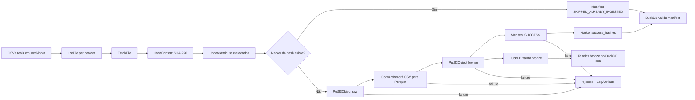

# Arquitetura da ingestão raw/bronze

## Fluxo real

## Process Group

O fluxo exportado `01_SINDUSFARMA_RAW_BRONZE` possui 94 processors, 148
conexões e 0 processors inválidos na validação da API do NiFi.

Cada dataset segue o mesmo padrão:

1. `ListFile` descobre exatamente um CSV esperado.
2. `FetchFile` carrega o conteúdo sem apagar a origem.
3. `HashContent` calcula SHA-256 do arquivo completo.
4. `FetchS3Object` tenta buscar o marker de sucesso.
5. Marker encontrado gera manifest `SKIPPED_ALREADY_INGESTED`.
6. Marker ausente segue para `raw/`, conversão Parquet e `bronze/`.
7. Após sucesso, o fluxo grava evento `SUCCESS` e marker por hash.

O gatilho local é o agendamento padrão dos processors `ListFile`. Para rodadas
controladas da entrega, o bootstrap inicia o Process Group, aguarda a fila
zerar e para o grupo ao final.

## Decisões de modelagem

Bronze usa tipos `string` para preservar fidelidade da origem. Conversões para
tipos analíticos ficam para uma camada posterior, porque esta entrega avalia
ingestão, rastreabilidade, idempotência e qualidade.

No DuckDB, as tabelas estruturadas da entrega ficam materializadas como:
`bronze.clientes`, `bronze.empresas`, `bronze.pesquisas`, `bronze.questoes`,
`bronze.respondentes` e `bronze.respostas`. Elas são criadas a partir dos
Parquets no MinIO e mantêm o NiFi como responsável pela ingestão.

Não foi usado particionamento por data: os CSVs somam 46.148 registros e não
existe coluna temporal comum a todos os datasets que justifique criar muitas
partições pequenas. Se o volume crescer, a estratégia recomendada é particionar
por `dataset` e por data de ingestão ou data de negócio quando houver uma coluna
estável.
